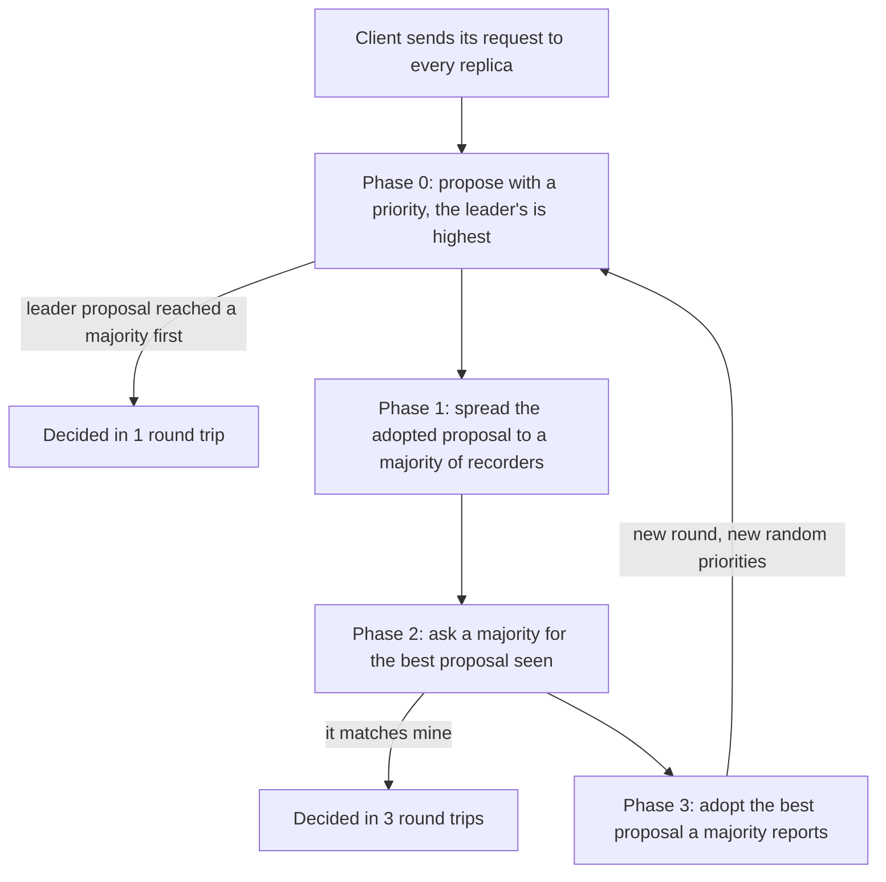

---
# Skeleton from Lead 5yr6p7kc (Cloudflare blog), picked 2026-11-15.
# Drafted per docs/editorial/concept-writing-guide.md. published and
# reviewed are the pick time, provisional: set them when you publish.
# verified: is the Author's alone (ADR-0007).
title: "QuePaxa: consensus where the leader is only a fast path"
description: "QuePaxa is a consensus protocol where the leader is only a fast path: proposers adopt each other's values, so no election timeout can stall writes."
kind: concept
vertical: distributed-systems
tags: ["consensus", "quepaxa", "raft", "paxos", "fault-detection"]
published: "2026-11-13T07:09:16Z"
verified: 2026-11-15
reviewed: "2026-11-15T07:51:47Z"
author: mira-vance
# Optional: an image HastCode may use, beside this file, replaces the
# generated title card. Never a Source's image.
# hero: concept-name.png
# hero_alt: "What the image shows"
# Optional: related Explainer slugs and extra sources (title + url).
related: [metastable-failures, etcd]
---

At 14:43 UTC on 2 November 2020, a core network switch at Cloudflare [went into a partially operating state](https://blog.cloudflare.com/a-byzantine-failure-in-the-real-world/): some protocols kept working, some packets were not forwarded, and six minutes later it recovered on its own. For those minutes an etcd cluster behind it could not accept a write. One node kept starting elections and voting for itself; another kept voting for the existing leader. The votes tied, and the cluster stayed read-only until the switch recovered, because Raft elections end up [blocking all writes until they're resolved](https://blog.cloudflare.com/a-byzantine-failure-in-the-real-world/). The knock-on effects through Cloudflare's databases hit API and dashboard availability for six hours and 33 minutes, and the dashboard ran [as much as 80 times slower than normal](https://blog.cloudflare.com/a-byzantine-failure-in-the-real-world/). In November 2026, when Cloudflare explained the consensus protocol behind Meerkat, its new control-plane store, it [cited that incident](https://blog.cloudflare.com/choosing-quepaxa/). The protocol it chose has no elections to stall.

> Drafted with AI assistance, researched, verified and edited by the HastCode editorial team. We publish only as many pieces as the Author can verify this way.

## TL;DR

- **QuePaxa** is a [crash fault tolerant and asynchronous consensus algorithm](https://github.com/dedis/quepaxa) from EPFL's DEDIS lab and colleagues, published at [SOSP 2023](https://bford.info/pub/os/quepaxa/), in which a leader speeds things up but nothing waits for one: in Cloudflare's words, ["The leader is completely optional."](https://blog.cloudflare.com/choosing-quepaxa/)
- Each round has [four phases](https://blog.cloudflare.com/choosing-quepaxa/). Proposers pick random priorities and adopt the highest-priority proposal a majority of **recorders** report, so competing proposers converge instead of blocking each other, and no replica has to decide that another has failed.
- In Cloudflare's Meerkat, [upwards of 95% of decisions](https://blog.cloudflare.com/choosing-quepaxa/) are made by the leader in the first phase, one round trip. When the leader failed, the decision rate fell to [around 65%](https://blog.cloudflare.com/choosing-quepaxa/) and the system never halted.
- The price: extra proposals while hedging, three round trips instead of one when the leader is out, and a protocol that has [not been battle-tested as extensively](https://blog.cloudflare.com/choosing-quepaxa/) as Raft or Paxos; Cloudflare is formally verifying its implementation.

## A consensus protocol that never waits for a leader

**Consensus** here means replicas agreeing on one [ordered log of events](https://blog.cloudflare.com/choosing-quepaxa/); a key-value store is built on top, each log entry a `get` or a `put`. Most production systems do this with Raft or Multi-Paxos, which route every proposal through one **leader** and replace it, after a timeout, when it seems to have failed.

The QuePaxa paper, by Pasindu Tennage, Cristina Basescu, Bryan Ford and colleagues, is titled ["Escaping the Tyranny of Timeouts in Consensus"](https://bford.info/pub/os/quepaxa/). It keeps the leader's one-round-trip fast path but takes the timeout out of liveness, the guarantee that the system keeps deciding. It does this with a randomized asynchronous core, plus ["short hedging delays instead of conservative timeouts to limit redundant effort"](https://bford.info/pub/os/quepaxa/). A **hedging delay** is how long a replica waits before helping out: a guess about performance, not a verdict that the leader is dead.

Two roles do the work. **Proposers** submit proposals. **Recorders** are, in Cloudflare's description, [intermediaries that record every proposal they see](https://blog.cloudflare.com/choosing-quepaxa/). Any two majorities of recorders [share at least one recorder](https://blog.cloudflare.com/choosing-quepaxa/), which is what keeps a decision safe.

What does not count: QuePaxa is [crash fault tolerant](https://github.com/dedis/quepaxa); it does not claim to tolerate Byzantine faults such as a replica that lies. And "the leader is optional" does not mean there is no leader; Meerkat runs with one almost all the time.

## One round, four phases, two exits

Walk it from the top, using the phases as Cloudflare [describes them](https://blog.cloudflare.com/choosing-quepaxa/). In **phase 0**, each proposer picks a priority and sends its proposal to the recorders. Non-leaders pick theirs at random; the leader's is not random, it is the highest possible. Each proposer adopts the highest-priority proposal it hears back from a majority. If the leader's proposal reached a majority first, it is decided right there: one round trip.

If not, **phase 1** spreads each proposer's adopted proposal to a majority of recorders, which track the best they have seen. In **phase 2**, a proposer asks a majority for that best proposal; if it matches its own, it decides. Otherwise **phase 3** carries the best proposal it sees into a new round.

Cloudflare's measurements put numbers on the two exits. In Meerkat, [upwards of 95%](https://blog.cloudflare.com/choosing-quepaxa/) of decisions leave at phase 0. In a test where the leader failed, decisions fell back to phase 2, which takes [three round trips](https://blog.cloudflare.com/choosing-quepaxa/), and the decision rate dropped to around 65% of normal. It returned to 100% when the faulty leader was replaced, [a minute after failing](https://blog.cloudflare.com/choosing-quepaxa/). In between: ["At no point did the system halt."](https://blog.cloudflare.com/choosing-quepaxa/)

## Why random priorities converge instead of duelling

Basic Paxos has the problem the random priorities solve. Its proposers ask a majority of **acceptors** to agree on one value, and two proposers can [repeatedly block each other](https://blog.cloudflare.com/choosing-quepaxa/), each one's attempt invalidating the other's. Paxos guarantees progress only under **partial synchrony**, the assumption that messages eventually arrive within a bounded time.

QuePaxa replaces competition with adoption. When a recorder returns a proposal with a higher priority than a proposer's own, the proposer [adopts it as its own](https://blog.cloudflare.com/choosing-quepaxa/). Several proposers active at once therefore push the same value rather than rival ones, which is how EPFL can say a second leader can help in the same round [without interfering with the first one](https://actu.epfl.ch/news/a-game-changer-for-building-robust-distributed-sys).

The randomness is not decoration. Cloudflare says random priorities are something QuePaxa [must do to circumvent the FLP impossibility theorem](https://blog.cloudflare.com/choosing-quepaxa/), the [result](https://hdl.handle.net/1721.1/149560) by Fischer, Lynch and Paterson that, in an asynchronous system, every consensus protocol has the possibility of nontermination, even with only one faulty process. The trade is a probabilistic finish: citing the paper, Cloudflare says each round has [a 50% chance of deciding](https://blog.cloudflare.com/choosing-quepaxa/), much higher in practice thanks to convergence, and that given enough rounds, proposers are guaranteed to agree.

## Where it runs: Meerkat and the DEDIS prototype

**Meerkat** is Cloudflare's [experimental distributed consensus service](https://blog.cloudflare.com/choosing-quepaxa/) for its internal global control plane. A cluster may span continents over links with [high and variable latency](https://blog.cloudflare.com/choosing-quepaxa/), and Cloudflare's own evaluations of Meerkat used servers spanning nearly all continents. Meerkat can [switch which replica acts as leader](https://blog.cloudflare.com/choosing-quepaxa/) while the cluster is running, and Cloudflare's implementation is in Rust.

**The DEDIS prototype** is the authors' own, [open source in Go](https://github.com/dedis/quepaxa) under the BSD-3-Clause licence, formerly called Raxos and QSCOD. Its `experiments/` folder carries builds of EPaxos, Multi-Paxos, Raft and Rabia for comparison. The paper reports [250k commands per second](https://bford.info/pub/os/quepaxa/) of normal-case WAN throughput, comparable to Multi-Paxos, and a median latency under 380ms in WAN experiments under adverse conditions, which the authors' project page lists as [DoS attacks, misconfigurations and slow leaders](https://sec.cs.ucl.ac.uk/projects/PJ-QUEPAXA). The prototype also went through SOSP's [artifact evaluation](https://actu.epfl.ch/news/a-game-changer-for-building-robust-distributed-sys).

**etcd**, the Raft store from the opening, is the contrast. Its leader election depends on an [election timeout](https://etcd.io/docs/v3.4/tuning/#time-parameters), and our [etcd profile](/distributed-systems/etcd/) covers the rest of its design.

## Why leader-based consensus stalls over the Internet

Leaders are an optimisation that won. A leader is the only replica that proposes, so it can decide [in a single network round-trip, instead of two](https://blog.cloudflare.com/choosing-quepaxa/), and proposers stop duelling. On a normal day this is pure gain.

The cost appears when the leader goes. Raft [elects a new leader using a majority vote](https://blog.cloudflare.com/choosing-quepaxa/), and candidates can compete so that two replicas mutually prevent each other from reaching a majority. Cloudflare's example is that a [two-second network outage](https://blog.cloudflare.com/choosing-quepaxa/) can set off elections that keep going: a metastable failure, which outlives its trigger. Our explainer on [metastable failures](/distributed-systems/metastable-failures/) covers the loop.

Elections also need someone to start them, and that is a fault detector: a timeout that decides the leader is gone. Over the Internet, a process [cannot directly observe that a remote process has failed](https://blog.cloudflare.com/choosing-quepaxa/), and there is no guaranteed upper bound on message delay. Cloudflare calls fault detection fundamentally error-prone in asynchronous networks. A timeout that fires too early starts needless elections, and the 2020 switch showed what partial failure does to the votes.

## Why safe timeouts are slow timeouts

The other way out is to make the timeout long, and the numbers get large fast. etcd's tuning guide is plain: ["Election timeouts must be at least 10 times the round-trip time so it can account for variance in the network."](https://etcd.io/docs/v3.4/tuning/#time-parameters) Its default is [1000ms](https://etcd.io/docs/v3.4/tuning/#time-parameters).

The same guide puts a round trip across the continental United States at [about 130ms](https://etcd.io/docs/v3.4/tuning/#time-parameters) and between the US and Japan at around 350 to 400ms, and allows an election timeout up to 50 seconds, a value it reserves for globally distributed clusters. Cloudflare's figure for Raft deployments is an election timeout of [five to ten times the round-trip time](https://blog.cloudflare.com/choosing-quepaxa/); with round trips halfway across the world in the hundreds of milliseconds, detecting a failed leader can take around a second.

That second is a second without writes. Because elections stop the system, timeouts are [usually set conservatively high](https://blog.cloudflare.com/choosing-quepaxa/), so a cluster trades slow recovery from real failures for fewer false alarms. EPFL's announcement states the dilemma: with a timeout that is too long, a failed leader leaves you [waiting a long time](https://actu.epfl.ch/news/a-game-changer-for-building-robust-distributed-sys), and one that is too short is, in its words, ["where the real disaster can happen."](https://actu.epfl.ch/news/a-game-changer-for-building-robust-distributed-sys) We infer that this is why global deployment is where the trade bites hardest: the round trip, and its variance, set the floor.

## Practice one: hedge instead of detecting faults

QuePaxa's answer is to stop asking whether the leader is alive. Clients [send their requests for proposals to every replica](https://blog.cloudflare.com/choosing-quepaxa/). Non-leader replicas wait a small hedge timeout, giving the leader a chance to decide alone, then propose too. In Cloudflare's implementation, clients do the waiting instead of replicas, which cuts messages.

A wrong guess is cheap. Cloudflare's comparison: in Raft, a five-millisecond timeout on a network with 100-millisecond latency [would completely freeze the system](https://blog.cloudflare.com/choosing-quepaxa/), while in QuePaxa ["a five-millisecond hedge timeout only increases the number of active proposers."](https://blog.cloudflare.com/choosing-quepaxa/) Those proposers adopt the leader's higher-priority value, so a hedge that fires early adds traffic, not a fight. The hedge timeout is [locally determined by replicas](https://blog.cloudflare.com/choosing-quepaxa/) and can be as small as they want.

The paper goes further and tunes it automatically, ["treating leader choice and hedging delay as a multi-armed-bandit optimization"](https://bford.info/pub/os/quepaxa/), a learner that keeps trying options and favours what performs best.

The cost is redundant work. Every early hedge means more proposals and more messages to recorders, which is why the paper frames the delay as limiting [redundant effort](https://bford.info/pub/os/quepaxa/). You trade bandwidth during trouble for never stopping.

## Practice two: keep a leader, and keep it replaceable

Hedging does not mean giving up the leader. Meerkat runs with one because the leader's top priority makes [phase 0 decisions](https://blog.cloudflare.com/choosing-quepaxa/) the normal case: over 95% of them, at one round trip each. EPFL's Bryan Ford claims QuePaxa is ["just as fast, efficient, low latency and low cost in terms of network bandwidth, under normal conditions"](https://actu.epfl.ch/news/a-game-changer-for-building-robust-distributed-sys) as leader-based protocols.

What changes is what a bad leader costs. In Raft a slow leader is either tolerated or voted out through the election path above. In QuePaxa, a slow or partitioned leader simply loses phase 0 more often, and the other proposers finish the round. Meerkat can also [swap the leader while the cluster runs](https://blog.cloudflare.com/choosing-quepaxa/); the paper's bandit can [switch leaders even when the current one has not failed](https://sec.cs.ucl.ac.uk/projects/PJ-QUEPAXA).

The cost is the fallback's latency. A phase 2 decision takes [three round trips instead of one](https://blog.cloudflare.com/choosing-quepaxa/), so a long leader outage runs at reduced throughput, 65% of the normal decision rate in Cloudflare's test, until the leader is replaced. Degraded is better than read-only, but it is still degraded, and you should alert on it.

## Practice three: verify what the field has not yet tested

Raft and Paxos have years of production behind them; QuePaxa has fewer. Cloudflare says so directly: it [has not been battle-tested as extensively](https://blog.cloudflare.com/choosing-quepaxa/) as Raft or Paxos.

Its response is to verify rather than wait for experience. Cloudflare is [formally verifying its QuePaxa implementation and Meerkat as a whole](https://blog.cloudflare.com/choosing-quepaxa/), alongside extensive simulation and fault-injection testing, and plans posts on verifying the Rust implementation and testing hard-to-reproduce failures.

There is also a model gap to close. The original design is **crash-stop**: a replica that fails never comes back. Real servers reboot with their disks, so Cloudflare is [extending the design to support crash recovery](https://blog.cloudflare.com/choosing-quepaxa/). We infer that this is the riskiest part of the adoption: a recovering replica must not forget what it told the recorders, and that is new protocol work, not just engineering.

The cost is time and expertise: formal methods, a simulator and a fault-injection harness are a project of their own. For a team without them, our view is that a well-understood Raft, and the timeouts that come with it, is still the safer choice.

## What QuePaxa is not

It is not Raft with better timeouts. Raft still needs a timeout to [start an election](https://etcd.io/docs/v3.4/tuning/#time-parameters), and the election blocks writes. QuePaxa's hedge delay decides only how soon others help, never who may write.

It is not Byzantine fault tolerant. The 2020 postmortem's title calls the switch failure Byzantine, but its own postscript notes the community's view that it was [an omission fault](https://blog.cloudflare.com/a-byzantine-failure-in-the-real-world/), tolerable without BFT protocols. QuePaxa tolerates [crashes](https://github.com/dedis/quepaxa). We infer that a partially working switch is closer to QuePaxa's world, slow or missing messages, than to lying replicas.

It is not guaranteed to finish in a bounded number of rounds. Agreement comes [given enough rounds](https://blog.cloudflare.com/choosing-quepaxa/); we infer that FLP is why no fixed bound is promised.

And it is not a general cure for metastability. It removes one sustaining loop, competing elections, but retries and overload elsewhere in a control plane can still hold a system down; those defences are in our [metastable failures](/distributed-systems/metastable-failures/) explainer.

## What a leader-optional protocol makes possible

Once the leader is a fast path, you can measure it as one. The useful number is the share of decisions made in phase 0, Cloudflare's [over 95%](https://blog.cloudflare.com/choosing-quepaxa/), and its fall during an incident tells you how much of the fast path you lost, rather than whether writes have stopped.

It also changes how you tune. A timeout that freezes Raft when set too low becomes, in QuePaxa, a dial that trades [extra bandwidth](https://blog.cloudflare.com/choosing-quepaxa/) for how soon other proposers help. You no longer have to choose between etcd's [50-second global ceiling](https://etcd.io/docs/v3.4/tuning/#time-parameters) and a cluster that elects too eagerly.

You can try it now: the [DEDIS repository](https://github.com/dedis/quepaxa) ships the replica, the client and comparison builds of Raft and Multi-Paxos, enough to run a slow-leader experiment of your own. Cloudflare has promised [benchmarks and lessons](https://blog.cloudflare.com/choosing-quepaxa/) from production next.

The optimistic part: a global control plane where losing the leader costs about a third of its decisions for a minute, rather than every write until an election resolves. Ford thinks QuePaxa ["should be the new standard consensus protocol"](https://actu.epfl.ch/news/a-game-changer-for-building-robust-distributed-sys). Cloudflare's verification work will show how far that holds.

## Sources

- James Larisch, ["Choosing QuePaxa, an unusual consensus algorithm"](https://blog.cloudflare.com/choosing-quepaxa/), Cloudflare blog, 11 November 2026.
- Pasindu Tennage, Cristina Basescu, Eleftherios Kokoris-Kogias, Ewa Syta, Philipp Jovanovic, Vero Estrada-Galiñanes, Bryan Ford, ["QuePaxa: Escaping the Tyranny of Timeouts in Consensus"](https://bford.info/pub/os/quepaxa/), SOSP 2023 ([PDF](https://bford.info/pub/os/quepaxa/quepaxa.pdf), [ACM](https://dl.acm.org/doi/10.1145/3600006.3613150)).
- UCL Information Security, ["QuePaxa: Escaping the Tyranny of Timeouts in Consensus"](https://sec.cs.ucl.ac.uk/projects/PJ-QUEPAXA), project page.
- DEDIS, [dedis/quepaxa](https://github.com/dedis/quepaxa), GitHub repository, BSD-3-Clause.
- Tanya Petersen, ["A game changer for building robust distributed systems"](https://actu.epfl.ch/news/a-game-changer-for-building-robust-distributed-sys), EPFL News, 23 October 2023.
- Tom Lianza, ["A Byzantine failure in the real world"](https://blog.cloudflare.com/a-byzantine-failure-in-the-real-world/), Cloudflare blog, 27 November 2020.
- etcd, ["Tuning: Time parameters"](https://etcd.io/docs/v3.4/tuning/#time-parameters), etcd v3.4 documentation.
- Michael J. Fischer, Nancy A. Lynch, Michael S. Paterson, ["Impossibility of Distributed Consensus with One Faulty Process"](https://hdl.handle.net/1721.1/149560), MIT LCS technical report MIT-LCS-TR-282, September 1982 (later in the Journal of the ACM).
