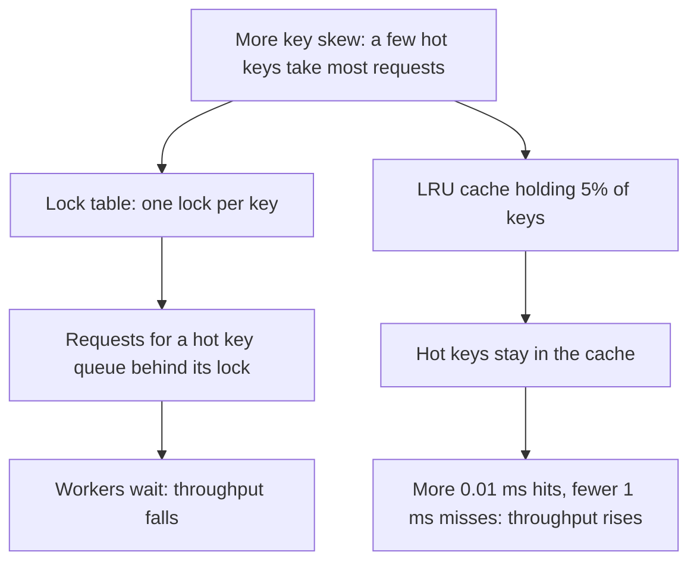

---
# Skeleton from Lead kmex2pgr (Marc Brooker), picked 2026-11-26.
# Written to docs/editorial/concept-writing-guide.md. published and
# reviewed are the pick time (make daily may move them to a Gap Day);
# make release keeps it (ADR-0012). verified: is the Author's alone (ADR-0007).
title: "Traffic mix: why key skew slows a lock table and speeds a cache"
description: "Traffic mix is which requests a system receives, not how many; a load test with the wrong key skew can misread throughput in either direction."
kind: concept
vertical: distributed-systems
tags: ["load-testing", "benchmarks", "zipf", "lock-contention", "caching"]
published: "2026-11-26T07:37:22Z"
reviewed: "2026-11-26T07:37:22Z"
author: mira-vance
# Optional: an image HastCode may use, beside this file, replaces the
# generated title card. Never a Source's image.
# hero: concept-name.png
# hero_alt: "What the image shows"
# Optional: related Explainer slugs and extra sources (title + url).
related: [metastable-failures, hdr-histograms-tail-latency]
draft: true
---

On 12 November 2026, at [4:20 PM UTC](https://www.365fanatic.com/wp-content/uploads/2026/11/postincidentreport-mo1550821.pdf#page=5), [most Exchange Online users lost access to their mailboxes](https://www.365fanatic.com/wp-content/uploads/2026/11/postincidentreport-mo1550821.pdf#page=2). Microsoft's post-incident report traces the outage to a latent defect in the gateway servers in front of Exchange Online: [lock contention inside an internal Windows process](https://www.365fanatic.com/wp-content/uploads/2026/11/postincidentreport-mo1550821.pdf#page=6). The change that introduced it had run worldwide for [more than three months without impact](https://www.365fanatic.com/wp-content/uploads/2026/11/postincidentreport-mo1550821.pdf#page=6), and load testing had not caught it. The report says why: ["the traffic conditions were different from what was observed during the incident"](https://www.365fanatic.com/wp-content/uploads/2026/11/postincidentreport-mo1550821.pdf#page=6), and the lab used older hardware with fewer cores. At the lowest point, [more than 80% of North America's gateway servers](https://www.365fanatic.com/wp-content/uploads/2026/11/postincidentreport-mo1550821.pdf#page=8) were unresponsive. Customers felt the impact until [4:10 PM UTC the next day](https://www.365fanatic.com/wp-content/uploads/2026/11/postincidentreport-mo1550821.pdf#page=5). The lab had applied load, but not production's load. This is how the make-up of traffic changes what a system can do, in which direction, and three practices that bring a load test closer to production.

## TL;DR

- **Traffic mix** (Marc Brooker also says workload mix) is the make-up of the requests a system receives: which keys and which operations, in what proportions. His claim: ["The performance of computer systems is extremely sensitive to workload mix."](http://brooker.co.za/blog/2026/11/18/workload-mix.html)
- The mechanism is key skew meeting a shared resource. In his two simulators, more skew [lowers the throughput of a lock table and raises the throughput of a cache](http://brooker.co.za/blog/2026/11/18/workload-mix.html).
- The effect is large: throughput, he writes, ["can vary by multiple orders of magnitude, in both directions"](http://brooker.co.za/blog/2026/11/18/workload-mix.html). On his parameters we work out about 16 times for the lock table and 100 times for the cache.
- What to do: draw test keys from a measured distribution, sweep the skew, and prefer designs with one cost mode. The costs are trace capture, more test runs and, with optimistic concurrency control, [retries on conflict](https://docs.aws.amazon.com/aurora-dsql/latest/userguide/working-with-concurrency-control.html#dsql-transaction-conflicts).

## Traffic mix is which requests arrive, not how many

Microsoft's report uses the term in its findings: ["Our testing did not adequately represent the combination of hardware and traffic mix encountered during this incident."](https://www.365fanatic.com/wp-content/uploads/2026/11/postincidentreport-mo1550821.pdf#page=15) Brooker read the preliminary version and built his post, ["Traffic mix matters"](http://brooker.co.za/blog/2026/11/18/workload-mix.html), around one sentence of it. Traffic mix, he writes, is ["the one thing that makes the difference between a great load test and a complete waste of time"](http://brooker.co.za/blog/2026/11/18/workload-mix.html).

In our words: hold the request rate fixed, and the mix is everything else about the requests. It covers the split between reads and writes, and how requests spread across keys. The YCSB benchmark sets both as properties: [`readproportion`, `updateproportion` and `requestdistribution`](https://github.com/brianfrankcooper/YCSB/wiki/Core-Properties#core-workload-package-properties). Its workload A is ["a mix of 50/50 reads and writes"](https://github.com/brianfrankcooper/YCSB/wiki/Core-Workloads), and workload B is 95/5.

**Key skew** is how unevenly requests spread across keys. Brooker's simulators draw keys from a **Zipf distribution**, in which [key number k is drawn with probability proportional to 1/k^s](https://brooker.co.za/blog/2023/02/07/hot-keys.html). The exponent s (the simulators call it the coefficient) sets the skew. In the simulators ["a coefficient of 0 is uniform"](http://brooker.co.za/blog/2026/11/18/workload-mix.html): every key is equally likely.

Two things do not count as mix: the request rate and the hardware. Microsoft's finding names hardware as a separate gap in its tests.

## One skew, two shared resources, opposite results

Walk it from the top. Brooker's post runs each branch as [an interactive simulator](http://brooker.co.za/blog/2026/11/18/workload-mix.html). Both models use [16 worker threads and draw keys from a Zipf distribution over N keys](http://brooker.co.za/blog/2026/11/18/workload-mix.html). Only the shared resource differs.

Take the left branch first. The **lock table** holds one lock per key. A request takes a worker and [waits in a FIFO (first in, first out) queue for its key's lock](http://brooker.co.za/blog/2026/11/18/workload-mix.html). It holds the lock for an exponentially distributed time with a mean of 1 ms, then releases it. Brooker says it is not ["an unreasonable mental model of a relational database"](http://brooker.co.za/blog/2026/11/18/workload-mix.html), where each transaction takes a lock while it runs.

The post prints no throughput figures, so the numbers here are our arithmetic on its parameters. With many keys and no skew, two workers rarely want the same lock. Each worker finishes about 1,000 requests a second, so 16 workers finish about 16,000. At the other extreme, every request wants the same key. One lock, held for 1 ms at a time, passes about 1,000 requests a second while 15 workers wait. We infer a 16-fold range, set by the worker count.

Brooker's result sits between those ends: ["the more skewed the distribution, the less throughput you get out of the system"](http://brooker.co.za/blog/2026/11/18/workload-mix.html). ["A small number of keys are highly contended"](http://brooker.co.za/blog/2026/11/18/workload-mix.html), he explains, and the rest of the machine sits underused.

## The same skew makes a cache faster

Now the right branch. Brooker's second model also stands for a relational database, a single-system one such as Postgres. It is [a fast in-memory LRU cache in front of slower storage](http://brooker.co.za/blog/2026/11/18/workload-mix.html). An LRU (least recently used) cache evicts the key that has gone longest without a read. This one holds 5% of the keys. A hit costs a mean of 0.01 ms. A miss reads storage at a mean of 1 ms, and the key then enters the cache.

Our arithmetic again. With uniform keys, a read finds its key in a 5% cache about 5% of the time. The mean read costs 0.05 × 0.01 ms + 0.95 × 1 ms, about 0.95 ms, so 16 workers finish about 16,800 reads a second. If skew put every read on a cached key, each would cost 0.01 ms: 1.6 million reads a second. That is a range of about 100 times, or two orders of magnitude.

Brooker's curve climbs between those ends: ["The more skewed the distribution, the better the performance, over something of a broad range."](http://brooker.co.za/blog/2026/11/18/workload-mix.html) He plots throughput on [a log scale](http://brooker.co.za/blog/2026/11/18/workload-mix.html). We infer the reason: a hot key is read again before the cache evicts it, so it stays cached.

We infer what this does to a load test. A test with uniform keys errs twice: it overstates the lock table and understates the cache. A test more skewed than production errs the other way on both.

## Skew shows up in gateways, benchmarks and caches

**Microsoft 365's gateway.** The defect [hit newer servers but not older ones](https://www.365fanatic.com/wp-content/uploads/2026/11/postincidentreport-mo1550821.pdf#page=6). The newer servers have more cores, which, the report says, ["allows for more concurrent requests which led to higher contention"](https://www.365fanatic.com/wp-content/uploads/2026/11/postincidentreport-mo1550821.pdf#page=6). The trigger included a shift in traffic. An automatic failover moved [Teams traffic onto the gateway that also serves Exchange Online](https://www.365fanatic.com/wp-content/uploads/2026/11/postincidentreport-mo1550821.pdf#page=6), and all services stayed healthy for about 16 hours, until the daily peak.

**pgbench.** PostgreSQL's benchmark tool warns of the lock-table effect in its own default test. Every transaction [updates one row of a small branches table](https://www.postgresql.org/docs/current/pgbench.html). The table has one row per unit of the scale factor, the setting that sizes the test database. Run more clients than rows, the documentation says, and ["you'll mostly be measuring update contention"](https://www.postgresql.org/docs/current/pgbench.html).

**Twitter's caches.** A study of [153 in-memory cache clusters at Twitter](https://www.usenix.org/conference/osdi20/presentation/yang) found many workloads ["far more write-heavy or more skewed than previously shown"](https://www.usenix.org/conference/osdi20/presentation/yang). So even published workload studies can lag the mix in production.

**Sharded stores.** Skew also caps scale-out in a store that splits its keys across nodes. In Brooker's 2023 simulation with Zipf keys (s = 0.7, N = 1,000), errors climbed [once the system had scaled to about 10 nodes](https://brooker.co.za/blog/2023/02/07/hot-keys.html). A hot key's shard, he writes, ["will become a bottleneck for the whole system"](https://brooker.co.za/blog/2023/02/07/hot-keys.html). Our [sharding comparison](/distributed-systems/hash-vs-range-vs-directory-sharding/) shows why a hash moves a hot key and never splits it.

## Why load tests end up with the wrong mix

Tool defaults are often uniform. The built-in pgbench script picks each account with [`random`, which draws every value in the range with equal probability](https://www.postgresql.org/docs/current/pgbench.html). YCSB's `requestdistribution` property [defaults to `uniform`](https://github.com/brianfrankcooper/YCSB/wiki/Core-Properties#core-workload-package-properties), though its packaged [workload A sets it to `zipfian`](https://github.com/brianfrankcooper/YCSB/blob/master/workloads/workloada).

Tests aim at volume. Brooker wrote in 2021 that ["load tests typically test lots of load, instead of testing the bad pattern for caches"](https://brooker.co.za/blog/2021/08/27/caches.html). The bad pattern, he says, is a key frequency distribution with a heavier tail than the typical one.

Standard benchmarks carry their own mix. Brooker says they ["don't reflect the coordination and contention patterns present in real-world workloads"](https://brooker.co.za/blog/2025/05/20/icpe.html). TPC-C, his example, can be [partitioned by warehouse to avoid cross-partition write conflicts](https://brooker.co.za/blog/2025/05/20/icpe.html).

A skew parameter is still a guess. ["Parametric approaches like Zipf do have their place"](https://brooker.co.za/blog/2023/02/07/hot-keys.html), Brooker writes, but people use them outside that place too often.

Production also moves. Microsoft's lab ran [older hardware than its newest servers](https://www.365fanatic.com/wp-content/uploads/2026/11/postincidentreport-mo1550821.pdf#page=6), and one failover changed the gateway's traffic.

## Practice one: draw test keys from production's distribution

Measure how often each key is requested in production, then make the test match. Brooker's advice to the field: ["we need to get better at benchmarking with real distributions reflective of real workloads"](https://brooker.co.za/blog/2023/02/07/hot-keys.html). Microsoft's repair item says the same of its own labs. It is [expanding load tests to its newest, highest-core hardware](https://www.365fanatic.com/wp-content/uploads/2026/11/postincidentreport-mo1550821.pdf#page=15), with traffic that represents production, by the first quarter of 2027.

You can replay a trace. Twitter published [one-week request traces from 54 cache clusters](https://github.com/twitter/cache-trace), collected in March 2020, with keys anonymised.

Or you can fit a distribution. In pgbench, [`random_zipfian(lb, ub, parameter)`](https://www.postgresql.org/docs/current/pgbench.html#PGBENCH-BUILTIN-FUNCTIONS) does it. With a parameter of 2.5, it draws the value 1 about 5.66 times more often than 2. YCSB accepts [`zipfian` as a `requestdistribution`](https://github.com/brianfrankcooper/YCSB/wiki/Core-Properties#core-workload-package-properties).

The costs: a trace means capturing, storing and anonymising production keys. A fitted Zipf can still miss, as Brooker warns. The pgbench function also accepts only [a parameter from 1.001 to 1000](https://www.postgresql.org/docs/current/pgbench.html#PGBENCH-BUILTIN-FUNCTIONS). It cannot express a milder skew such as Brooker's s = 0.7. We infer one more cost: the mix drifts, so a captured trace ages.

## Practice two: sweep the skew and report a curve

A single run gives one point. Brooker's simulators give [a curve](http://brooker.co.za/blog/2026/11/18/workload-mix.html): throughput against skew. No Source prescribes this as a practice. We infer it from how he presents his results.

Run the test at several skews on both sides of your best estimate. Then report the slope beside the number.

The slope tells you what your estimate is worth. A flat curve means an error in the measured mix costs little. A steep one, like the cache's on a log axis, means the reported number holds only at the mix you tested.

Sweep the hardware as well. Microsoft's defect appeared only on its newer, higher-core servers, and [its load tests ran on older ones](https://www.365fanatic.com/wp-content/uploads/2026/11/postincidentreport-mo1550821.pdf#page=6).

The cost is test time. The pgbench documentation advises runs of [at least a few minutes](https://www.postgresql.org/docs/current/pgbench.html), to average out noise. Every skew and every server type multiplies the runs.

## Practice three: prefer designs with one cost mode

A design choice can shrink the sensitivity itself. Brooker: ["This is also a reason I like optimistic concurrency control, and architectures with a single cost/latency mode."](http://brooker.co.za/blog/2026/11/18/workload-mix.html) A **mode** is one of the distinct costs a request can have, such as the cache's 0.01 ms hit and its 1 ms miss.

Under **optimistic concurrency control** (OCC), transactions take no locks. [Aurora DSQL](https://aws.amazon.com/rds/aurora/dsql/), the AWS database Brooker points to, ["evaluates conflicts at commit time"](https://docs.aws.amazon.com/aurora-dsql/latest/userguide/working-with-concurrency-control.html#dsql-transaction-conflicts). In his words, ["all reads go to a single fast storage layer, and nobody is holding resources waiting on locks"](http://brooker.co.za/blog/2026/11/18/workload-mix.html). Its design [removed the need for a large local cache](https://brooker.co.za/blog/2024/12/04/inside-dsql.html). We infer the benefit: one read path means one read cost, whatever the skew.

A two-mode cache carries a second risk: the system can settle in the slow mode. Brooker's 2021 post describes [two stable loops](https://brooker.co.za/blog/2021/08/27/caches.html), and our [metastable failures Explainer](/distributed-systems/metastable-failures/) walks through the cache example.

The cost: OCC is less sensitive to skew, not immune. A conflicting transaction [fails with SQLSTATE 40001](https://docs.aws.amazon.com/aurora-dsql/latest/userguide/working-with-concurrency-control.html#dsql-transaction-conflicts), and the application must retry it. AWS tells users to [minimize high contention on single keys](https://docs.aws.amazon.com/aurora-dsql/latest/userguide/working-with-concurrency-control.html#dsql-perf-guidelines). Brooker's rule: ["you want the heat on your hottest write key to remain constant as the overall load on your database rises"](https://brooker.co.za/blog/2024/12/05/inside-dsql-writes.html). OCC coordinates less than locking when conflicts are rare, ["and more than pessimistic systems when the optimistic assumption is wrong"](https://brooker.co.za/blog/2023/10/18/optimism.html).

## Traffic mix is not load level, and not loop type

The nearest confusion is load level. Doubling the request rate with the wrong keys tests the wrong system twice as hard. In [Brooker's models](http://brooker.co.za/blog/2026/11/18/workload-mix.html) the worker count never changes. Only the keys do.

Mix is also not the open-or-closed question. A closed-loop load generator waits for each response before it sends the next request, so it slows down when the server does. Brooker notes that [most benchmarks are closed while most cloud systems are open](https://brooker.co.za/blog/2025/05/20/icpe.html). That is an error in when requests are sent. Mix is an error in which requests are sent. Our [HDR histograms Explainer](/distributed-systems/hdr-histograms-tail-latency/) covers the first.

Nor is mix only key skew. Microsoft's report does not say which properties of its lab traffic differed. Brooker moves from its sentence to key skew, and we follow him. We infer, and the report does not state, that the gateway's lock contention behaved like his lock table: more workers queued behind one lock.

## What knowing the mix makes possible

Every throughput number gains a condition: at which mix? You can now ask that of any benchmark result. Record the answer beside your own results: the key distribution and its parameter, the read/write split, the hardware.

You can also predict the direction of the error before you run anything. If the bottleneck is a lock, a uniform test is optimistic. If it is a cache, a uniform test is pessimistic, and you may be paying for capacity you do not need.

Try it. Brooker's post embeds [both simulators](http://brooker.co.za/blog/2026/11/18/workload-mix.html), with controls for the number of keys, the cache size and the cache's speed-up. On your own database, run pgbench twice, once with `random` and once with `random_zipfian`, and compare. The optimistic part: mix sensitivity is measurable. A team that knows its curve can run closer to the limit with fewer surprises.

## Sources

- [Traffic mix matters](http://brooker.co.za/blog/2026/11/18/workload-mix.html), Marc Brooker, 18 November 2026.
- Microsoft, ["Post Incident Report for Microsoft 365"](https://www.365fanatic.com/wp-content/uploads/2026/11/postincidentreport-mo1550821.pdf), incidents EX1550543 and MO1550821, report dated 20 November 2026.
- Marc Brooker, ["Hot Keys, Scalability, and the Zipf Distribution"](https://brooker.co.za/blog/2023/02/07/hot-keys.html), 7 February 2023.
- Marc Brooker, ["Caches, Modes, and Unstable Systems"](https://brooker.co.za/blog/2021/08/27/caches.html), 27 August 2021.
- Marc Brooker, ["Good Performance for Bad Days"](https://brooker.co.za/blog/2025/05/20/icpe.html), 20 May 2025.
- Marc Brooker, ["Optimism vs Pessimism in Distributed Systems"](https://brooker.co.za/blog/2023/10/18/optimism.html), 18 October 2023.
- Marc Brooker, ["DSQL Vignette: Reads and Compute"](https://brooker.co.za/blog/2024/12/04/inside-dsql.html), 4 December 2024.
- Marc Brooker, ["DSQL Vignette: Transactions and Durability"](https://brooker.co.za/blog/2024/12/05/inside-dsql-writes.html), 5 December 2024.
- Amazon Web Services, ["Concurrency control in Aurora DSQL"](https://docs.aws.amazon.com/aurora-dsql/latest/userguide/working-with-concurrency-control.html), Aurora DSQL User Guide, and the [Aurora DSQL product page](https://aws.amazon.com/rds/aurora/dsql/).
- PostgreSQL, ["pgbench"](https://www.postgresql.org/docs/current/pgbench.html), documentation.
- YCSB, ["Core Properties"](https://github.com/brianfrankcooper/YCSB/wiki/Core-Properties) and ["Core Workloads"](https://github.com/brianfrankcooper/YCSB/wiki/Core-Workloads), project wiki, and the [`workloada`](https://github.com/brianfrankcooper/YCSB/blob/master/workloads/workloada) file.
- Juncheng Yang, Yao Yue, K. V. Rashmi, ["A large scale analysis of hundreds of in-memory cache clusters at Twitter"](https://www.usenix.org/conference/osdi20/presentation/yang), OSDI 2020.
- Twitter, [cache-trace](https://github.com/twitter/cache-trace), anonymised production cache traces.
