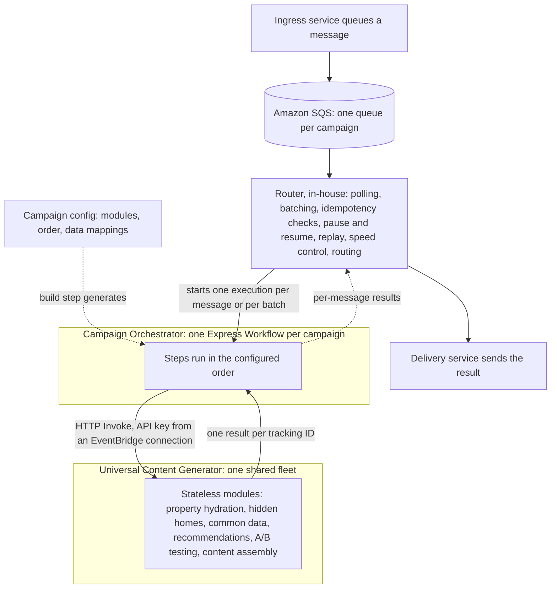

---
# Skeleton from Lead gfaluotq (AWS Architecture Blog), picked 2026-11-18,
# drafted per docs/editorial/case-study-writing-guide.md; the Author's check
# list is in the review queue. published and reviewed are the pick time (make
# daily may move them to a Gap Day); make release keeps it (ADR-0012).
# verified: is the Author's alone (ADR-0007).
title: "Campaign Orchestrator: how Zillow sends 100M notifications a day"
description: "Zillow runs each notification campaign as a Step Functions Express Workflow behind its own router, trading exactly-once execution for volume."
kind: case-study
vertical: distributed-systems
tags: ["workflows", "aws-step-functions", "idempotency", "batching", "zillow"]
published: "2026-11-17T06:32:28Z"
reviewed: "2026-11-17T06:32:28Z"
author: mira-vance
# Optional: an image HastCode may use, beside this file, replaces the
# generated title card. Never a Source's image.
# hero: system-name.png
# hero_alt: "What the image shows"
# Optional: related Explainer slugs and extra sources (title + url).
related: [durable-execution]
draft: true
---

Every day, Zillow sends home shoppers [more than 100 million personalised email and push notifications](https://aws.amazon.com/blogs/architecture/how-zillow-runs-100-million-daily-notifications-on-aws-step-functions/), and it runs them as short-lived executions on AWS Step Functions Express Workflows. The workflow engine does not decide when a campaign sends, how fast, or whether it pauses: [an in-house router in front of it does](https://aws.amazon.com/blogs/architecture/how-zillow-runs-100-million-daily-notifications-on-aws-step-functions/). This is how Zillow split the work between a router, generated workflows and a shared content service, which engines it turned down, and what the design costs.

> Drafted with AI assistance, researched, verified and edited by the HastCode editorial team. We publish only as many pieces as the Author can verify this way.

## TL;DR

- Campaign Orchestrator is Zillow's [configuration-driven layer](https://aws.amazon.com/blogs/architecture/how-zillow-runs-100-million-daily-notifications-on-aws-step-functions/) that runs notification campaigns as Step Functions Express Workflows. Its steps call the Universal Content Generator (UCG), a shared library of content modules.
- Zillow built it because [more than 10 microservices generated more than 20 campaigns](https://aws.amazon.com/blogs/architecture/how-zillow-runs-100-million-daily-notifications-on-aws-step-functions/), each with its own workflow, data models and rules, so every new feature was rebuilt per service.
- An in-house router reads Amazon SQS and applies batching, idempotency checks, pause, replay and speed control. It starts one workflow per campaign, generated from config, whose steps call UCG through HTTP Invoke.
- The price: Express is [at-least-once with a five-minute limit](https://docs.aws.amazon.com/step-functions/latest/dg/choosing-workflow-type.html), so every module must be idempotent (safe to repeat), and quotas need planning. The surprise: a batch of 10 messages in one execution is ["about 90 percent cheaper"](https://aws.amazon.com/blogs/architecture/how-zillow-runs-100-million-daily-notifications-on-aws-step-functions/) than 10 runs.

## One queue, one router and one workflow per campaign

The diagram is ours, redrawn from the text of the post; the original figures are in [the AWS Architecture Blog post](https://aws.amazon.com/blogs/architecture/how-zillow-runs-100-million-daily-notifications-on-aws-step-functions/) of 11 November 2026. Its authors are Yuzhong Li, tech lead of Zillow Group's Product Comms System, and Nishita Kheur of AWS.

A message moves top to bottom. [An ingress service puts it on the queue; the router applies the campaign's controls and starts the workflow](https://aws.amazon.com/blogs/architecture/how-zillow-runs-100-million-daily-notifications-on-aws-step-functions/). Campaign Orchestrator runs the steps, each calling a UCG module, and the delivery service sends the result.

The post's batching section says the router uses per-message results to deliver, retry or drop each message. So we infer two edges: results returning to the router (dotted) and the router handing off to delivery. The post states neither path. Steps 1 to 4 below walk the diagram: the router, the generated workflows, the UCG call, and batching.

## Why one service per campaign stopped working

Zillow's Comms Experience [ran more than 20 email and push campaigns across more than 10 microservices](https://aws.amazon.com/blogs/architecture/how-zillow-runs-100-million-daily-notifications-on-aws-step-functions/). Each service owned its own workflow, data models, business rules and assembly logic. That was a deliberate early choice: each campaign was its own service [because scale was the main challenge](https://aws.amazon.com/blogs/architecture/how-zillow-runs-100-million-daily-notifications-on-aws-step-functions/) when the systems were first built.

Most campaigns followed the same pattern anyway: [receive a trigger, hydrate data, apply rules, assemble content, send](https://aws.amazon.com/blogs/architecture/how-zillow-runs-100-million-daily-notifications-on-aws-step-functions/). To hydrate is to load the details a message needs, such as a home's price and photos. As Zillow added products, similar features ended up implemented differently across campaigns. Each new capability had to be rebuilt and retested in every service, and every service carried its own releases, monitoring, dashboards and on-call support.

Idle capacity was a second cost. Some daily campaigns [ran for about four hours and left their generator idle for the other 20](https://aws.amazon.com/blogs/architecture/how-zillow-runs-100-million-daily-notifications-on-aws-step-functions/).

Note the order of the fix. [Before evaluating workflow engines](https://aws.amazon.com/blogs/architecture/how-zillow-runs-100-million-daily-notifications-on-aws-step-functions/), the team extracted shared logic into reusable modules and moved campaign decisions into configuration. We infer that this kept the engine's job narrow: by then it only had to sequence calls, not hold business logic.

The post gives no count of incidents caused by the old design.

## Why Step Functions beat Temporal, Flowable and an in-house engine

Zillow [evaluated Temporal, Flowable, an in-house engine, and Step Functions Standard and Express Workflows](https://aws.amazon.com/blogs/architecture/how-zillow-runs-100-million-daily-notifications-on-aws-step-functions/). It used four criteria: reliability, total cost of ownership, development speed and cross-team scalability. The engine also had to be managed, configuration-driven, and able to orchestrate both newer and older services.

- **Temporal and Flowable.** Each ["would have added another infrastructure component to operate"](https://aws.amazon.com/blogs/architecture/how-zillow-runs-100-million-daily-notifications-on-aws-step-functions/). Neither is available as a managed AWS service, the post says, so Zillow would have run and scaled it.
- **An in-house engine.** It offered control, but ["required custom lifecycle management, worker pools, queue integration, and monitoring"](https://aws.amazon.com/blogs/architecture/how-zillow-runs-100-million-daily-notifications-on-aws-step-functions/).
- **Step Functions.** It is serverless, so Zillow had [no servers or worker fleets to run](https://aws.amazon.com/blogs/architecture/how-zillow-runs-100-million-daily-notifications-on-aws-step-functions/).

The deciding argument was effort. Step Functions met the core orchestration needs ["at roughly a quarter of the estimated build effort"](https://aws.amazon.com/blogs/architecture/how-zillow-runs-100-million-daily-notifications-on-aws-step-functions/) and a quarter of the ongoing maintenance. That made it the choice for the minimum viable product (MVP).

Read that with its framing in mind. The post is co-written with AWS, the comparison rests on estimates, and the post judges the losing options mainly on who operates them. Temporal is a durable execution runtime, built so a workflow can [wait for days and survive a crash](/distributed-systems/durable-execution/). Our reading is that Zillow needed none of that: each workflow [runs for only a few seconds](https://aws.amazon.com/blogs/architecture/how-zillow-runs-100-million-daily-notifications-on-aws-step-functions/).

## Express over Standard: at-least-once is enough for idempotent steps

Step Functions calls a workflow definition a state machine and one run of it an execution. It has two workflow types, and [the type cannot be changed after a state machine is created](https://docs.aws.amazon.com/step-functions/latest/dg/choosing-workflow-type.html). Volume drove the choice. The MVP plan [ramped from 14 million workflows a day to more than 100 million](https://aws.amazon.com/blogs/architecture/how-zillow-runs-100-million-daily-notifications-on-aws-step-functions/), which Zillow puts at several thousand executions per second at peak.

| | Standard | Express |
|---|---|---|
| Maximum duration ([AWS](https://docs.aws.amazon.com/step-functions/latest/dg/choosing-workflow-type.html)) | One year | Five minutes |
| Execution guarantee ([AWS](https://docs.aws.amazon.com/step-functions/latest/dg/choosing-workflow-type.html#express-at-least-once-execution)) | Exactly-once | At-least-once (asynchronous), at-most-once (synchronous) |
| Billed by ([AWS](https://docs.aws.amazon.com/step-functions/latest/dg/choosing-workflow-type.html)) | State transitions | Executions, duration and memory |
| Zillow's verdict ([post](https://aws.amazon.com/blogs/architecture/how-zillow-runs-100-million-daily-notifications-on-aws-step-functions/)) | "Exactly once, which is stronger than needed." | "At least once, sufficient with idempotent modules." |

At-least-once means an execution ["could potentially run more than once"](https://docs.aws.amazon.com/step-functions/latest/dg/choosing-workflow-type.html), in AWS's words. An idempotent call is one that is safe to repeat: the second run gives the same result as the first. Zillow's workflows are [built around idempotent module calls and finish well within the five-minute Express limit](https://aws.amazon.com/blogs/architecture/how-zillow-runs-100-million-daily-notifications-on-aws-step-functions/). Our durable execution Explainer covers [why at-least-once needs idempotency](/distributed-systems/durable-execution/).

What Express is not: a durable, auditable record. Step Functions [does not capture Express execution history](https://docs.aws.amazon.com/step-functions/latest/dg/choosing-workflow-type.html#express-at-least-once-execution); logging must go through Amazon CloudWatch Logs. We infer that is why CloudWatch logging throughput is among the quotas Zillow reviewed.

## Step 1: the router decides when a workflow starts

Zillow's campaigns need [a set of controls applied before a workflow starts](https://aws.amazon.com/blogs/architecture/how-zillow-runs-100-million-daily-notifications-on-aws-step-functions/): queue polling, batching, idempotency checks, pause and resume, replay coordination, speed control and campaign routing. An in-house router service does all of it. It reads from Amazon Simple Queue Service (Amazon SQS) and starts the right Step Functions workflow.

Zillow keeps these controls out of the workflow on purpose: ["Some of these controls are specific to how we order and throttle campaign sends, so they live outside Step Functions."](https://aws.amazon.com/blogs/architecture/how-zillow-runs-100-million-daily-notifications-on-aws-step-functions/) The router gives it one place to pause a campaign, replay a batch or adjust send speed, with no change to a workflow definition.

The router also isolates campaigns. Each campaign has [its own state machine and its own SQS queue](https://aws.amazon.com/blogs/architecture/how-zillow-runs-100-million-daily-notifications-on-aws-step-functions/), and the router gives each queue its own polling threads, worker pool and circuit breakers. A circuit breaker stops calls to a failing dependency until it recovers. When one campaign fails or backs up, only its breaker trips, and Zillow can pause that queue without touching the others.

The post does not say how the idempotency check works: what key it uses, where it stores keys it has seen, or for how long. We infer it guards against the same message reaching the router twice, before any execution is paid for.

## Step 2: config becomes one Express Workflow per campaign

Each message is [input data combined with persisted campaign configuration](https://aws.amazon.com/blogs/architecture/how-zillow-runs-100-million-daily-notifications-on-aws-step-functions/). The post's sample input carries a payload keyed by tracking ID (a recipient and their home IDs), platform and campaign metadata, and a config naming the modules to run.

Campaign owners do not write Step Functions definitions. They write [a config that says which modules run, in what order, and how data moves between them](https://aws.amazon.com/blogs/architecture/how-zillow-runs-100-million-daily-notifications-on-aws-step-functions/), and a build step generates the workflow definition and its deployment template. In the post's A/B test example, a config adds an `experiment` module before `assemble_email` and maps its result into the email's variant input. That is a config change, with no Step Functions definition edited directly.

The design choice to notice: ["Campaigns don't share one generic workflow that picks modules at runtime."](https://aws.amazon.com/blogs/architecture/how-zillow-runs-100-million-daily-notifications-on-aws-step-functions/) Each campaign gets its own generated workflow. We infer the benefit: a campaign's steps are fixed at build time, and a bad config breaks one campaign. The cost is one state machine per campaign to generate and deploy. Zillow is [considering a generic workflow](https://aws.amazon.com/blogs/architecture/how-zillow-runs-100-million-daily-notifications-on-aws-step-functions/) next, still with one copy per campaign.

Much of the behaviour lives in JSONata, the expression language that reshapes data between steps. Shared expressions must have unit tests. The tests run in continuous integration through the [TestState API](https://docs.aws.amazon.com/step-functions/latest/apireference/API_TestState.html), [against the same runtime Step Functions uses](https://aws.amazon.com/blogs/architecture/how-zillow-runs-100-million-daily-notifications-on-aws-step-functions/), and a failing case blocks the deploy. Configs drafted by Zillow's internal AI assistants must pass the same checks.

## Step 3: each step calls a UCG module over HTTP Invoke

The Universal Content Generator holds what the old generators duplicated. Its modules cover [property hydration (price, photos and address for each home), hidden homes, common data, recommendations, A/B testing and content assembly](https://aws.amazon.com/blogs/architecture/how-zillow-runs-100-million-daily-notifications-on-aws-step-functions/). Zillow describes them as ["stateless and schema-driven"](https://aws.amazon.com/blogs/architecture/how-zillow-runs-100-million-daily-notifications-on-aws-step-functions/). All campaigns now share one fleet, so the load spreads across the day.

Workflow steps call UCG directly with HTTP Invoke, which AWS's docs call an [HTTP Task](https://docs.aws.amazon.com/step-functions/latest/dg/call-https-apis.html): a Task state that calls an HTTPS API. Zillow gives two reasons. The content logic [already ran as long-lived containerised services](https://aws.amazon.com/blogs/architecture/how-zillow-runs-100-million-daily-notifications-on-aws-step-functions/) in its private service environment, with network access, service discovery and authentication in place. And routing steps straight to UCG added no new compute cost.

Authentication runs through an Amazon EventBridge connection. The connection [holds an API key that UCG checks on every request](https://aws.amazon.com/blogs/architecture/how-zillow-runs-100-million-daily-notifications-on-aws-step-functions/). EventBridge [stores it in AWS Secrets Manager](https://docs.aws.amazon.com/step-functions/latest/dg/call-https-apis.html#http-task-authentication) and adds it at call time, so neither the workflow definition nor application code contains it. Rotating the key is one change to the connection.

To avoid repeating those settings, a base component, `content_module_call`, [defines the resource, method, headers and connection](https://aws.amazon.com/blogs/architecture/how-zillow-runs-100-million-daily-notifications-on-aws-step-functions/). A business module extends it and supplies only its endpoint. A build script merges the two into a standard Task state.

One documented limit applies to every call, batched or not: an HTTP Invoke request [times out after 60 seconds](https://docs.aws.amazon.com/step-functions/latest/dg/service-quotas.html#service-limits-http-task).

## Step 4: batching turns 100 executions into one

Batching changes the numbers most. Processing 100 messages one by one [could produce 100 workflow executions and 400 HTTP requests](https://aws.amazon.com/blogs/architecture/how-zillow-runs-100-million-daily-notifications-on-aws-step-functions/) to UCG. With batching, the router groups them and starts one workflow that makes four HTTP requests, if every step supports bulk input and output.

The saving follows from how Express is billed: [by the number of requests and by duration](https://aws.amazon.com/step-functions/pricing/), with memory in 64-MB chunks. Zillow's rule of thumb: a batch of 10 is cheaper than 10 separate runs [unless it runs more than 10 times as long as a single one](https://aws.amazon.com/blogs/architecture/how-zillow-runs-100-million-daily-notifications-on-aws-step-functions/). In its four-step example one message takes about 1.2 seconds, so the break-even is 12 seconds. In practice a batch of 10 takes about 1.4 seconds.

The arithmetic supports the claim (this check is ours). Requests fall from 10 to 1, a 90% cut. Billed time falls from 12 seconds to 1.4, an 88% cut. Whatever the split between the two charges, the saving is between 88% and 90%. The batched payload [stays under the 256 KiB limit](https://aws.amazon.com/blogs/architecture/how-zillow-runs-100-million-daily-notifications-on-aws-step-functions/), the [maximum input or output for a state](https://docs.aws.amazon.com/step-functions/latest/dg/service-quotas.html#service-limits-task-executions), so memory is still billed at the 64 MB minimum.

Batching is a requirement on every module, not a setting. The module API accepts batches [keyed by tracking ID](https://aws.amazon.com/blogs/architecture/how-zillow-runs-100-million-daily-notifications-on-aws-step-functions/), and a module that does not follow it will not build. UCG returns a result per tracking ID, so the router can ["deliver, retry, or drop each message individually"](https://aws.amazon.com/blogs/architecture/how-zillow-runs-100-million-daily-notifications-on-aws-step-functions/). One failed message does not fail the batch.

## What it costs: idempotency everywhere, quotas and a router to run

**Every step must be safe to repeat.** Express gives [at-least-once execution](https://docs.aws.amazon.com/step-functions/latest/dg/choosing-workflow-type.html#express-at-least-once-execution), so a workflow can run twice. Idempotent modules make the content generation safe. The post does not say what stops a second run from sending a second email. We infer that job falls to the router's idempotency check or to the delivery service.

**Quotas become design inputs.** Zillow's words: ["At our target throughput, service quotas are part of the architecture."](https://aws.amazon.com/blogs/architecture/how-zillow-runs-100-million-daily-notifications-on-aws-step-functions/) HTTP Invoke needed attention first, because its default quota is lower than the rate at which Express Workflows can start. AWS's quota page shows the gap. It throttles HTTP Tasks with [a token bucket of 300, refilled at 300 a second](https://docs.aws.amazon.com/step-functions/latest/dg/service-quotas.html#service-limits-http-task), against [6,000 and 6,000 for Express `StartExecution`](https://docs.aws.amazon.com/step-functions/latest/dg/service-quotas.html#service-limits-api-action-throttling-general). For scale (our arithmetic): 100 million a day averages about 1,160 executions a second. At four HTTP calls each, as in Zillow's four-step example, that is about 4,600 calls a second unbatched. Zillow sized the need from a capacity model and [worked with AWS to raise the quota before each rollout phase](https://aws.amazon.com/blogs/architecture/how-zillow-runs-100-million-daily-notifications-on-aws-step-functions/).

**The router is still a service to run.** It is an in-house service with polling threads, worker pools and circuit breakers per campaign. Zillow avoided running workflow workers. It did not avoid running software.

**Batching couples every module.** It [works only if every step in the workflow can handle a batch](https://aws.amazon.com/blogs/architecture/how-zillow-runs-100-million-daily-notifications-on-aws-step-functions/).

## The evidence: effort estimates and a phased ramp, with gaps

The numbers Zillow publishes are about effort. Its internal engineering estimates [put the build at 9 development weeks, down from 32 for a comparable in-house engine](https://aws.amazon.com/blogs/architecture/how-zillow-runs-100-million-daily-notifications-on-aws-step-functions/). Ongoing maintenance ["fell along the same lines, from roughly 8 hours per week to 2"](https://aws.amazon.com/blogs/architecture/how-zillow-runs-100-million-daily-notifications-on-aws-step-functions/). Both are close to the quarter the evaluation predicted: 9 of 32 weeks is 28%, and 2 of 8 hours is 25% (our arithmetic).

On scale, the post says the rollout was planned [in phases, from early traffic to more than 100 million daily executions](https://aws.amazon.com/blogs/architecture/how-zillow-runs-100-million-daily-notifications-on-aws-step-functions/). That let Zillow validate cost, quotas, latency and operations before full scale. It names product velocity as the largest impact: a team now edits a config and validates the workflow, where it used to change several generator services.

The gaps matter:

- The post publishes no delivery latency, no error or duplicate rates, and no cost in dollars.
- It gives no production batch size: 10 and 100 appear only in examples. It does not say which campaigns run batched.
- It does not say whether the router starts executions asynchronously or synchronously. AWS documents [at-least-once for the first and at-most-once for the second](https://docs.aws.amazon.com/step-functions/latest/dg/choosing-workflow-type.html#express-at-least-once-execution).
- The build comparison is against an estimated in-house engine, not Temporal or Flowable. The post does not say what the 8 hours a week measured.

## What a thin workflow behind a strong router makes possible

Campaign Orchestrator and UCG now serve every campaign. Product teams [own their modules, steps, configuration and the Step Functions cost tied to their traffic](https://aws.amazon.com/blogs/architecture/how-zillow-runs-100-million-daily-notifications-on-aws-step-functions/), so they can launch and change campaigns without waiting on the central team. Central teams own the router and the deployment tooling.

If you run high-volume, short-lived workflows, the post's practices transfer. [Treat each message as data plus config, keep modules stateless and tested, make every step batch-capable, and plan quotas before the ramp](https://aws.amazon.com/blogs/architecture/how-zillow-runs-100-million-daily-notifications-on-aws-step-functions/).

Our reading adds a test for your own design. List the controls your business cares about: pacing, pause, replay, deduplication. If the engine's guarantees do not cover them, put them in one component in front of it and let the engine only sequence steps. Then pick the cheapest execution mode whose guarantees your idempotent steps can tolerate. Measure it the way Zillow did: seconds per execution, requests per message, and quota headroom before each ramp.

## Sources

- [How Zillow runs 100 million daily notifications on AWS Step Functions](https://aws.amazon.com/blogs/architecture/how-zillow-runs-100-million-daily-notifications-on-aws-step-functions/), Nishita Kheur (AWS) and Yuzhong Li (Zillow Group), AWS Architecture Blog, 11 November 2026
- [Choosing workflow type in Step Functions](https://docs.aws.amazon.com/step-functions/latest/dg/choosing-workflow-type.html), AWS Step Functions Developer Guide
- [Call HTTPS APIs in Step Functions workflows](https://docs.aws.amazon.com/step-functions/latest/dg/call-https-apis.html), AWS Step Functions Developer Guide
- [Step Functions service quotas](https://docs.aws.amazon.com/step-functions/latest/dg/service-quotas.html), AWS Step Functions Developer Guide
- [TestState](https://docs.aws.amazon.com/step-functions/latest/apireference/API_TestState.html), AWS Step Functions API Reference
- [AWS Step Functions pricing](https://aws.amazon.com/step-functions/pricing/)
