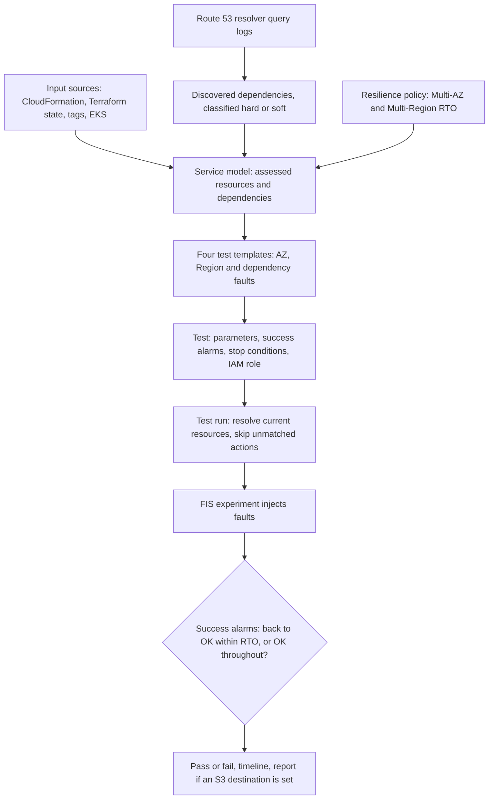

---
# Skeleton from Lead pz7aqhml (AWS Architecture Blog), picked 2026-10-29.
# Drafted per docs/editorial/case-study-writing-guide.md; no author notes
# are left. published and reviewed are the pick time, provisional: set them
# when you publish. verified: is the Author's alone (ADR-0007).
title: "Resilience Hub tests: how AWS turns a service model into FIS faults"
description: "How AWS Resilience Hub turns a service's resources, DNS-found dependencies and RTO into FIS fault tests, and why alarms you pick decide the verdict."
kind: case-study
vertical: infrastructure-cloud
tags: ["chaos-engineering", "fault-injection", "resilience", "aws", "dependencies"]
published: "2026-10-29T19:09:35Z"
reviewed: "2026-10-29T19:09:35Z"
author: mira-vance
# Optional: an image HastCode may use, beside this file, replaces the
# generated title card. Never a Source's image.
# hero: system-name.png
# hero_alt: "What the image shows"
related: [metastable-failures]
draft: true
---

AWS's own documentation for the next generation of Resilience Hub warns that its AI failure-mode assessment is [directional guidance, not proof](https://docs.aws.amazon.com/resilience-hub/latest/userguide/next-gen-how-assessments-work.html): "Do not use it as a guarantee or as evidence. If you need evidence, run a resilience test." In October 2026 AWS shipped those tests: [four pre-configured fault experiments](https://aws.amazon.com/blogs/architecture/recommended-resilience-testing-in-the-next-generation-of-aws-resilience-hub/) built from what Resilience Hub already knows about your service, and graded pass or fail.

> Drafted with AI assistance, researched, verified and edited by the HastCode editorial team. We publish only as many pieces as the Author can verify this way.

## TL;DR

- Recommended resilience testing is a Resilience Hub feature that [creates AWS Fault Injection Service (FIS) experiments from your service's resources, dependencies and resilience policy](https://aws.amazon.com/blogs/architecture/recommended-resilience-testing-in-the-next-generation-of-aws-resilience-hub/), injects the faults, and judges the result against your success criteria and recovery time objective (RTO).
- AWS built it because hand-designed fault experiments [need deep expertise and drift out of date as architectures evolve](https://aws.amazon.com/blogs/architecture/recommended-resilience-testing-in-the-next-generation-of-aws-resilience-hub/), and its own assessment is not evidence.
- It works in layers: a service model and DNS-based dependency discovery say what exists; four [test templates](https://docs.aws.amazon.com/resilience-hub/latest/userguide/next-gen-resilience-testing-concepts.html) say what to break; each run resolves targets at run time, skips actions with nothing to hit, and lets your CloudWatch alarms decide the verdict.
- The price: real faults on real resources, billed [per FIS action-minute](https://docs.aws.amazon.com/resilience-hub/latest/userguide/next-gen-pricing.html), and a verdict only as good as the alarms you choose. The surprise: a failing test can be the right answer.

## From service model to pass or fail

The diagram is ours, redrawn from the text of AWS's post and user guide; AWS's own figures (two test-run timelines) are in [the original post](https://aws.amazon.com/blogs/architecture/recommended-resilience-testing-in-the-next-generation-of-aws-resilience-hub/). It reads top to bottom; Steps 1 to 5 below walk it in order.

## Why hand-built chaos experiments go stale

An FIS [experiment template is the blueprint](https://docs.aws.amazon.com/fis/latest/userguide/what-is.html#concepts) of an experiment: the actions to run, the targets to run them on, and the stop conditions that end it early. What it does not give you is the judgement. AWS's post names the gap plainly: you [need to know which faults to inject, which resources to target, and how to judge whether the outcome counts as success](https://aws.amazon.com/blogs/architecture/recommended-resilience-testing-in-the-next-generation-of-aws-resilience-hub/), and "Many teams do not know where to start."

The second problem is time. A template written by hand names targets as they were on the day it was written. As the architecture changes, experiments [built by hand can drift out of date](https://aws.amazon.com/blogs/architecture/recommended-resilience-testing-in-the-next-generation-of-aws-resilience-hub/). We infer the failure this invites: a test that still passes, because the resource it was meant to break has moved or been renamed and nothing is being hit.

Recommended testing answers both problems at once: it chooses the faults, and it re-derives the targets every time it runs.

## Why not hand-built experiments, or an assessment alone

The Sources weigh the feature against two things AWS already offered.

The first is the hand-built FIS experiment, which, we infer, stays the tool for a fault no template covers. The new feature replaces only its hardest parts: [what used to be manual experiment design becomes an out-of-the-box test](https://aws.amazon.com/blogs/architecture/recommended-resilience-testing-in-the-next-generation-of-aws-resilience-hub/) with success evaluation built in from your policy.

The second is analysis without faults. Resilience Hub v1 ran [static rule-based checks](https://docs.aws.amazon.com/resilience-hub/latest/userguide/next-gen-what-changes.html); the next generation replaces them with a [multi-agent AI system](https://docs.aws.amazon.com/resilience-hub/latest/userguide/next-gen-how-assessments-work.html) that reads your topology and reports failure modes against the AWS Well-Architected reliability practices. AWS does not let the assessment stand as proof. The assessment tells you whether a policy looks achievable; [a resilience test is the evidence](https://docs.aws.amazon.com/resilience-hub/latest/userguide/next-gen-how-assessments-work.html).

The argument that decides it is the one in that warning. Reading a design can tell you a second Availability Zone exists. Only cutting the first one off tells you traffic actually moves there inside your RTO. Recommended testing keeps the assessment's knowledge of the service and adds the fault.

## Step 1: the service model says what exists

Everything starts from how Resilience Hub models an application. You [define a resilience policy, then a system, its user journeys, and its services](https://docs.aws.amazon.com/resilience-hub/latest/userguide/next-gen-modeling-how-it-works.html). A system is the top-level business application and user journeys are its critical business paths. The service is the working unit: what v1 called an application [maps to a service, the primary unit of assessment](https://docs.aws.amazon.com/resilience-hub/latest/userguide/next-gen-what-changes.html), and resilience tests [run at the service level](https://docs.aws.amazon.com/resilience-hub/latest/userguide/next-gen-resilience-testing.html).

A service learns its resources from input sources: [CloudFormation stacks, a Terraform state file in S3, resource tags, or an EKS cluster's namespaces](https://docs.aws.amazon.com/resilience-hub/latest/userguide/next-gen-add-input-source.html), optionally narrowed by a label selector. Not everything found counts. The assessment works on [assessed resources](https://docs.aws.amazon.com/resilience-hub/latest/userguide/next-gen-how-assessments-work.html): top-level components whose configuration meaningfully affects availability, recoverability or fault tolerance.

The policy supplies the numbers a test is graded against: AZ recovery is judged against [your Multi-AZ RTO](https://docs.aws.amazon.com/resilience-hub/latest/userguide/next-gen-resilience-testing-configuring.html), and Multi-Region recovery against a Multi-Region RTO the policy [must define](https://docs.aws.amazon.com/resilience-hub/latest/userguide/next-gen-resilience-testing-multi-region-recovery.html).

## Step 2: dependency discovery reads DNS

Dependency discovery says what a service calls. It [analyses Route 53 DNS resolver query logs](https://docs.aws.amazon.com/resilience-hub/latest/userguide/next-gen-how-discovery-works.html) to find every domain name the service's compute resolves, with no agents or code changes: 35 days of history first, then continuous discovery summarised by hour, each dependency attributed to the compute that called it. It finds AWS services, internal endpoints and third-party endpoints, including, per the post, [unexpected cross-Region calls](https://aws.amazon.com/blogs/architecture/recommended-resilience-testing-in-the-next-generation-of-aws-resilience-hub/).

You then [classify each dependency](https://docs.aws.amazon.com/resilience-hub/latest/userguide/next-gen-classifying-dependencies.html) as hard (the service fails without it) or soft (it degrades but keeps running). That label is the hinge of the whole feature: the dependency validation test pre-selects [the discovered soft dependency with the highest query volume](https://docs.aws.amazon.com/resilience-hub/latest/userguide/next-gen-resilience-testing-dependency-validation.html), and Multi-Region recovery pre-selects [the busiest hard one](https://docs.aws.amazon.com/resilience-hub/latest/userguide/next-gen-resilience-testing-multi-region-recovery.html). If nothing is classified, nothing is pre-selected.

DNS also sets the blind spots. AWS lists them: Lambda functions outside a VPC are not covered, [connections made by IP address are not discovered](https://docs.aws.amazon.com/resilience-hub/latest/userguide/next-gen-discovery-limitations.html), dependencies called less than once an hour may be missed at first, and a shared EKS cluster can attribute a call to the wrong service. A dependency the model never saw is one no test pre-selects, though you can [add one by DNS name](https://docs.aws.amazon.com/resilience-hub/latest/userguide/next-gen-resilience-testing-dependency-validation.html).

## Step 3: four templates, one per fault boundary

Open a service's Testing tab and you see [recommended tests based on its architecture and resilience policy](https://docs.aws.amazon.com/resilience-hub/latest/userguide/next-gen-tutorial-run-test.html). There are four templates. Three [align to AWS fault isolation boundaries, Availability Zones and Regions](https://docs.aws.amazon.com/resilience-hub/latest/userguide/next-gen-resilience-testing.html); the fourth targets dependencies.

A template is data. Each [declares its actions](https://docs.aws.amazon.com/resilience-hub/latest/userguide/next-gen-resilience-testing-available-tests.html), each with an ID and the resource type it targets, and its parameters, each with a type, whether it is required, a default and a maximum number of values. You can list and read them with `list-test-templates` and `get-test-template`.

The actions show how much one template bundles. Availability Zone: recovery simulates [a power interruption in one AZ](https://docs.aws.amazon.com/resilience-hub/latest/userguide/next-gen-resilience-testing-az-recovery.html): it stops EC2 instances there, blocks new launches and Auto Scaling capacity, cuts the subnet's traffic, fails over an RDS cluster whose writer is there, terminates ElastiCache nodes, pauses I/O on half the EBS volumes, and starts ARC zonal autoshift if you have it enabled.

Multi-Region: isolation [cuts Transit Gateway, route-table and VPC-endpoint paths](https://docs.aws.amazon.com/resilience-hub/latest/userguide/next-gen-resilience-testing-multi-region-isolation.html) to another Region and pauses S3, DynamoDB and MemoryDB replication. Multi-Region: recovery impairs dependencies in one Region and watches the other; [you perform the failover yourself](https://docs.aws.amazon.com/resilience-hub/latest/userguide/next-gen-resilience-testing-multi-region-recovery.html).

## Step 4: a test fixes the settings, a run fixes the targets

The three levels are what keep the experiment current. A [test template is the recommendation](https://docs.aws.amazon.com/resilience-hub/latest/userguide/next-gen-resilience-testing-concepts.html); a test is your configured copy of it, one per template per service; a test run is one execution that scopes to the service's current resources. Your settings persist, but the targets are looked up fresh each time.

Defaults are opinionated. Recovery tests default to [your RTO plus 30 minutes](https://docs.aws.amazon.com/resilience-hub/latest/userguide/next-gen-resilience-testing-configuring.html), so the service must recover and then stay recovered; dependency validation defaults to 30 minutes and Multi-Region isolation to 3 hours. Dependency validation blocks [up to 10 dependencies](https://aws.amazon.com/blogs/architecture/recommended-resilience-testing-in-the-next-generation-of-aws-resilience-hub/) for between 1 minute and 12 hours.

At run time, Resilience Hub [includes every discovered resource the test applies to](https://docs.aws.amazon.com/resilience-hub/latest/userguide/next-gen-resilience-testing-concepts.html), then runs the FIS experiment. An action whose target type the service does not have is [skipped](https://docs.aws.amazon.com/resilience-hub/latest/userguide/next-gen-resilience-testing-configuring.html). That is how one dependency template serves EC2, ECS and EKS: it carries a packet-loss action for each, [100 percent loss at the compute layer](https://aws.amazon.com/blogs/architecture/recommended-resilience-testing-in-the-next-generation-of-aws-resilience-hub/), and only the matching ones fire.

Late binding shows up in permissions too. The execution role cannot be scoped to resource IDs, because [targets are resolved at run time](https://docs.aws.amazon.com/resilience-hub/latest/userguide/next-gen-resilience-testing-iam.html); it is scoped to resource types instead.

## Step 5: your alarms decide pass or fail

Resilience Hub does not judge health itself. You give it [at least one CloudWatch success alarm, and all must pass](https://docs.aws.amazon.com/resilience-hub/latest/userguide/next-gen-resilience-testing-configuring.html). The rule depends on the kind of test:

- **Recovery tests** (AZ recovery, Multi-Region recovery) pass when every success alarm [returns to OK within the RTO in your policy and holds until the test ends](https://aws.amazon.com/blogs/architecture/recommended-resilience-testing-in-the-next-generation-of-aws-resilience-hub/). The RTO clock [starts when the test actions begin](https://docs.aws.amazon.com/resilience-hub/latest/userguide/next-gen-resilience-testing-az-recovery.html).
- **Sustained tests** (dependency validation, Multi-Region isolation) pass when every success alarm [stays OK from fault injection to the end](https://aws.amazon.com/blogs/architecture/recommended-resilience-testing-in-the-next-generation-of-aws-resilience-hub/).

So the choice of alarm is the real test design. AWS asks for customer-level signals, such as order success rate or end-to-end availability, [rather than the state of individual resources](https://aws.amazon.com/blogs/architecture/recommended-resilience-testing-in-the-next-generation-of-aws-resilience-hub/): "The impaired resources are expected to be unhealthy." For the AZ test it says to [avoid per-AZ alarms](https://docs.aws.amazon.com/resilience-hub/latest/userguide/next-gen-resilience-testing-az-recovery.html) for the same reason.

Two other alarm roles sit beside these. Additional alarms are [observability only](https://docs.aws.amazon.com/resilience-hub/latest/userguide/next-gen-resilience-testing-configuring.html) and never change the verdict. Stop conditions, up to five, [end the test automatically](https://aws.amazon.com/blogs/architecture/recommended-resilience-testing-in-the-next-generation-of-aws-resilience-hub/) if breached, and an FIS experiment stopped this way [cannot be resumed](https://docs.aws.amazon.com/fis/latest/userguide/stop-conditions.html).

## Reading a verdict: when failing is the right answer

AWS's post walks two runs of dependency validation on [the same service, with the same two success alarms](https://aws.amazon.com/blogs/architecture/recommended-resilience-testing-in-the-next-generation-of-aws-resilience-hub/): a heartbeat canary and an end-to-end order-flow canary.

Blocking Payment Gateway and Notification Service, both classified soft, passed: both alarms stayed OK throughout and orders kept flowing. Blocking Amazon Cognito and AWS STS, both hard, failed: the order-flow canary went into alarm as soon as faults were injected, while the heartbeat stayed green. AWS reads that as the right result: the failure was contained to the flow that needed authentication.

That is why the post adds a [decision framework](https://aws.amazon.com/blogs/architecture/recommended-resilience-testing-in-the-next-generation-of-aws-resilience-hub/): read every verdict against the classification. A soft dependency that fails may be misclassified, or the degradation path has a gap. A hard one that passes may be misclassified, or the dependency was never exercised. A hard one that fails is expected, but check it failed gracefully, with "no cascading failures, no data corruption, no hung connections."

If you add retries or a fallback to soften a hard dependency, as the framework suggests, mind the loop in our explainer on [metastable failures](/distributed-systems/metastable-failures/): retries can keep a system down after the trigger is gone.

## The first cost: real faults on real resources

FIS [carries out real actions on real AWS resources](https://docs.aws.amazon.com/fis/latest/userguide/what-is.html), and AWS recommends planning first and starting in pre-production. An AZ recovery run really stops instances and fails over databases; the guardrail is the stop conditions you remember to set.

Setup is not free either. The dependency-blocking actions need [the SSM Agent on EC2 instances, an SSM Agent container in your ECS task definition, or a Kubernetes service account for EKS pods](https://docs.aws.amazon.com/resilience-hub/latest/userguide/next-gen-resilience-testing-dependency-validation.html).

Then the bill: tests cost [$0.10 per FIS action-minute, plus $0.10 per action-minute for each additional target account](https://docs.aws.amazon.com/resilience-hub/latest/userguide/next-gen-pricing.html); reports cost nothing extra. One action running for the default 30 minutes is 30 action-minutes, or $3 (our arithmetic, not AWS's). A recovery test that bundles many actions and runs for your RTO plus 30 minutes costs proportionally more, and we have not found whether a skipped action is billed.

## The second cost: a verdict only as good as its inputs

Three gaps follow from inputs that are yours or the model's.

**A block has to land.** AWS's own pages tell you to make sure traffic is [actually flowing to a dependency during the test](https://docs.aws.amazon.com/resilience-hub/latest/userguide/next-gen-resilience-testing-dependency-validation.html), and suggest alarms on its request count or connection errors to prove it. A dependency must resolve in DNS, or the action fails.

**Replacements escape.** If blocking a dependency fails health checks and ECS replaces the task, [the packet-loss action does not re-apply to the replacement](https://docs.aws.amazon.com/resilience-hub/latest/userguide/next-gen-resilience-testing-dependency-validation.html) and may report as failed. We infer the risk: the fleet partly heals itself out of the experiment, and a pass partly measures the replacements.

**The failover is yours.** Multi-Region recovery measures your recovery; it does not perform it. You [trigger the failover or run an ARC Region switch plan](https://docs.aws.amazon.com/resilience-hub/latest/userguide/next-gen-resilience-testing-multi-region-recovery.html); attaching the plan adds its timeline to the report.

## The evidence, and what the post leaves out

What AWS publishes is a mechanism and a worked example on one service, not results. There are no figures on how many customers have run tests, how often tests fail, or what they found.

The recommendation step is the least explained. The post says the four tests are [selected based on your service's architecture and resilience policy](https://aws.amazon.com/blogs/architecture/recommended-resilience-testing-in-the-next-generation-of-aws-resilience-hub/), but neither it nor the guide says how. We infer that "selected" mostly means pre-filling parameters (the busiest soft or hard dependency, the RTO-based duration) and applying the policy's thresholds, because those are the only selection rules the documentation states.

The Sources also disagree in places. The post's worked example treats Payment Gateway as soft, while the guide's classification page lists [a payment gateway as a typical hard dependency](https://docs.aws.amazon.com/resilience-hub/latest/userguide/next-gen-classifying-dependencies.html). We read that as the framework's point: classification belongs to your service, not to a category. And the post opens by saying each run auto-generates a report, while the guide says [no report is generated without an S3 destination](https://docs.aws.amazon.com/resilience-hub/latest/userguide/next-gen-resilience-testing-runs-and-report.html), as the post's own configuration walkthrough later does.

## What it makes possible

The feature is [available in all AWS commercial Regions](https://aws.amazon.com/blogs/architecture/recommended-resilience-testing-in-the-next-generation-of-aws-resilience-hub/) where the next generation of Resilience Hub runs. AWS suggests starting with dependency validation, one soft dependency at a time, then AZ and Multi-Region tests. Runs can repeat [quarterly, monthly or on demand](https://aws.amazon.com/blogs/architecture/recommended-resilience-testing-in-the-next-generation-of-aws-resilience-hub/).

The idea under it works off AWS too. Keep the fault as a template, not a script. Bind the targets at run time from a live model of the service, so the experiment cannot drift away from the system. Judge the result by what customers feel, and read every verdict against what you expected. A test that fails where you predicted it would is not a bad day; it is a classification you can now trust.

## Sources

- [Recommended resilience testing in the next generation of AWS Resilience Hub](https://aws.amazon.com/blogs/architecture/recommended-resilience-testing-in-the-next-generation-of-aws-resilience-hub/), Jennifer Moran and Imran Sadiq, AWS Architecture Blog, 26 October 2026
- [AWS Resilience Hub User Guide: Resilience testing](https://docs.aws.amazon.com/resilience-hub/latest/userguide/next-gen-resilience-testing.html)
- [AWS Resilience Hub User Guide: How resilience testing works](https://docs.aws.amazon.com/resilience-hub/latest/userguide/next-gen-resilience-testing-concepts.html)
- [AWS Resilience Hub User Guide: Configuring a test](https://docs.aws.amazon.com/resilience-hub/latest/userguide/next-gen-resilience-testing-configuring.html)
- [AWS Resilience Hub User Guide: Available tests](https://docs.aws.amazon.com/resilience-hub/latest/userguide/next-gen-resilience-testing-available-tests.html)
- [AWS Resilience Hub User Guide: Availability Zone: recovery](https://docs.aws.amazon.com/resilience-hub/latest/userguide/next-gen-resilience-testing-az-recovery.html)
- [AWS Resilience Hub User Guide: Dependency validation](https://docs.aws.amazon.com/resilience-hub/latest/userguide/next-gen-resilience-testing-dependency-validation.html)
- [AWS Resilience Hub User Guide: Multi-Region: isolation](https://docs.aws.amazon.com/resilience-hub/latest/userguide/next-gen-resilience-testing-multi-region-isolation.html)
- [AWS Resilience Hub User Guide: Multi-Region: recovery](https://docs.aws.amazon.com/resilience-hub/latest/userguide/next-gen-resilience-testing-multi-region-recovery.html)
- [AWS Resilience Hub User Guide: Test runs and report](https://docs.aws.amazon.com/resilience-hub/latest/userguide/next-gen-resilience-testing-runs-and-report.html)
- [AWS Resilience Hub User Guide: IAM execution roles for resilience testing](https://docs.aws.amazon.com/resilience-hub/latest/userguide/next-gen-resilience-testing-iam.html)
- [AWS Resilience Hub User Guide: Step 6, run your first resilience test](https://docs.aws.amazon.com/resilience-hub/latest/userguide/next-gen-tutorial-run-test.html)
- [AWS Resilience Hub User Guide: How application modeling works](https://docs.aws.amazon.com/resilience-hub/latest/userguide/next-gen-modeling-how-it-works.html)
- [AWS Resilience Hub User Guide: Add input sources to a service](https://docs.aws.amazon.com/resilience-hub/latest/userguide/next-gen-add-input-source.html)
- [AWS Resilience Hub User Guide: How dependency discovery works](https://docs.aws.amazon.com/resilience-hub/latest/userguide/next-gen-how-discovery-works.html)
- [AWS Resilience Hub User Guide: Classifying dependencies as hard or soft](https://docs.aws.amazon.com/resilience-hub/latest/userguide/next-gen-classifying-dependencies.html)
- [AWS Resilience Hub User Guide: Coverage and known limitations](https://docs.aws.amazon.com/resilience-hub/latest/userguide/next-gen-discovery-limitations.html)
- [AWS Resilience Hub User Guide: How failure mode assessments work](https://docs.aws.amazon.com/resilience-hub/latest/userguide/next-gen-how-assessments-work.html)
- [AWS Resilience Hub User Guide: What changes with Next generation Resilience Hub](https://docs.aws.amazon.com/resilience-hub/latest/userguide/next-gen-what-changes.html)
- [AWS Resilience Hub User Guide: Pricing overview](https://docs.aws.amazon.com/resilience-hub/latest/userguide/next-gen-pricing.html)
- [AWS FIS User Guide: What is AWS Fault Injection Service?](https://docs.aws.amazon.com/fis/latest/userguide/what-is.html)
- [AWS FIS User Guide: Stop conditions](https://docs.aws.amazon.com/fis/latest/userguide/stop-conditions.html)
