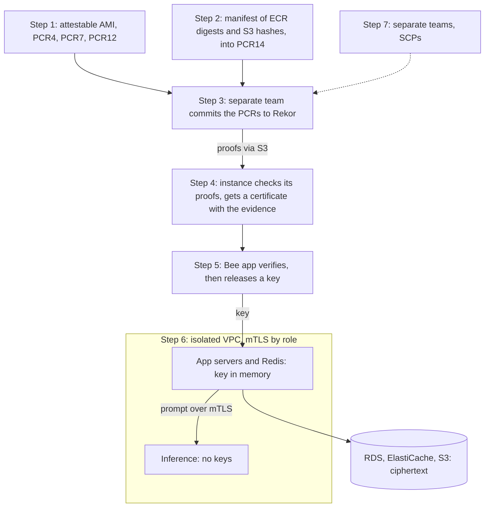

---
# Skeleton from Lead 5uifdlyr (AWS Architecture Blog), picked 2026-11-23.
# Follow docs/editorial/case-study-writing-guide.md; the Author's check list
# is in the review queue. published and reviewed are the pick time (make daily may move them to a Gap Day);
# make release keeps it (ADR-0012). verified: is the Author's alone (ADR-0007).
title: "Zero Operator Access: how Bee keeps operators out of user data"
description: "Bee's app releases a 7-day key only to EC2 instances whose measured software is in a public log, at the cost of no shell and replace-only deploys."
kind: case-study
vertical: infrastructure-cloud
tags: ["confidential-computing", "attestation", "encryption", "privacy", "bee"]
published: "2026-11-23T09:31:05Z"
reviewed: "2026-11-23T09:31:05Z"
author: mira-vance
# Optional: an image HastCode may use, beside this file, replaces the
# generated title card. Never a Source's image.
# hero: system-name.png
# hero_alt: "What the image shows"
# Optional: related Explainer slugs and extra sources (title + url).
# related: [metastable-failures]
draft: true
---

Bee's wearable listens through the user's day, and the conversations it captures [can be about health, finances and family](https://aws.amazon.com/blogs/architecture/how-bee-implemented-zero-operator-access-for-personal-ai-on-aws/). The servers that read them run [without SSH, SSM (AWS Systems Manager) or shell access](https://cdn.amazon.science/28/51/3233e0da45d6bf68c85b9eb04f0d/beeprivatecompute-whitepaper-09-23-26.pdf#page=2). A user's phone hands them a decryption key only after checking their software against [a public log that Amazon does not operate](https://cdn.amazon.science/28/51/3233e0da45d6bf68c85b9eb04f0d/beeprivatecompute-whitepaper-09-23-26.pdf#page=11). This is how Bee built Zero Operator Access on AWS, the simpler designs it could not use, and what the guarantee costs.

## TL;DR

- Zero Operator Access (ZOA) is Bee's name for an architecture with [no mechanism for operators to access customer data](https://aws.amazon.com/blogs/architecture/how-bee-implemented-zero-operator-access-for-personal-ai-on-aws/): not Bee's engineers, not other Amazon staff, not AWS's operators. The user's device enforces it, [not policy](https://cdn.amazon.science/28/51/3233e0da45d6bf68c85b9eb04f0d/beeprivatecompute-whitepaper-09-23-26.pdf#page=1).
- Bee needed it because a personal AI must [process plaintext](https://cdn.amazon.science/28/51/3233e0da45d6bf68c85b9eb04f0d/beeprivatecompute-whitepaper-09-23-26.pdf#page=4) on servers, even in the background. Frontier models need [more compute than a personal device can provide](https://cdn.amazon.science/28/51/3233e0da45d6bf68c85b9eb04f0d/beeprivatecompute-whitepaper-09-23-26.pdf#page=1).
- Each server records hashes of its boot image in the NitroTPM registers PCR4, PCR7 and PCR12, and one hash over [every container image and model file in PCR14](https://aws.amazon.com/blogs/architecture/how-bee-implemented-zero-operator-access-for-personal-ai-on-aws/). A separate team logs the approved values in Sigstore Rekor, a public log, and the app releases a key only to a server whose certificate carries matching evidence.
- The price is a fleet changed only by replacement, with no shell and no reboot, and a key that lives [up to 7 days after the user's last request](https://cdn.amazon.science/28/51/3233e0da45d6bf68c85b9eb04f0d/beeprivatecompute-whitepaper-09-23-26.pdf#page=17). The surprise: Bee's own whitepaper says its strongest privacy claim is [not that servers never see plaintext](https://cdn.amazon.science/28/51/3233e0da45d6bf68c85b9eb04f0d/beeprivatecompute-whitepaper-09-23-26.pdf#page=4).

## From a measured image to a released key

The diagram is ours, redrawn from the text of the AWS post and Bee's whitepaper; AWS's own figure is in [the original](https://aws.amazon.com/blogs/architecture/how-bee-implemented-zero-operator-access-for-personal-ai-on-aws/). Our seven steps are not the post's lettered build steps or numbered runtime steps. Steps 1 to 3 happen before launch, Step 4 at boot and Step 5 in the app. Steps 6 and 7 fence what measurement cannot see.

## Why a background agent needs servers no operator can open

On-device computation is [the simplest privacy model](https://cdn.amazon.science/28/51/3233e0da45d6bf68c85b9eb04f0d/beeprivatecompute-whitepaper-09-23-26.pdf#page=1), Bee's whitepaper says, but frontier-model quality needs far more compute than a personal device can provide. So plaintext has to reach a server. Bee is also not a chatbot that answers and forgets. It is meant to [run in the background, maintain memory and notice patterns](https://cdn.amazon.science/28/51/3233e0da45d6bf68c85b9eb04f0d/beeprivatecompute-whitepaper-09-23-26.pdf#page=5) while the user has no session open. A server therefore needs a usable key between conversations.

The whitepaper names who must be kept out. "Amazon operators" means [Bee engineers, other Amazon employees and AWS infrastructure operators](https://cdn.amazon.science/28/51/3233e0da45d6bf68c85b9eb04f0d/beeprivatecompute-whitepaper-09-23-26.pdf#page=3). Bee's own controls cover the first two. Protection from the third is [inherited from the AWS Nitro System](https://aws.amazon.com/blogs/architecture/how-bee-implemented-zero-operator-access-for-personal-ai-on-aws/), whose operator access controls are designed so that AWS personnel have no technical path to customer data.

## Why not on-device, stateless sessions or a key in KMS

Bee's sources name two designs it could not use; a third goes unmentioned.

- **On-device only.** Ruled out by compute, as above.
- **Stateless private processing.** Some designs [discard session state once a request completes](https://cdn.amazon.science/28/51/3233e0da45d6bf68c85b9eb04f0d/beeprivatecompute-whitepaper-09-23-26.pdf#page=5). Bee's agent cannot be fully stateless: it links new events to old context and works while the user is away. So Bee chose bounded state, with keys kept for at most 7 days of inactivity.
- **A server-side key in AWS KMS (Key Management Service).** AWS documents a KMS key policy that releases a key [only if the attestation measurements match](https://docs.aws.amazon.com/AWSEC2/latest/UserGuide/nitrotpm-attestation.html#attestation-kms). Neither Bee source discusses it. Both stress that [AWS never holds the key](https://aws.amazon.com/blogs/architecture/how-bee-implemented-zero-operator-access-for-personal-ai-on-aws/) and that there is [no service-wide master key](https://cdn.amazon.science/28/51/3233e0da45d6bf68c85b9eb04f0d/beeprivatecompute-whitepaper-09-23-26.pdf#page=2).

Because AWS never holds the user's key, the post says, ["no storage layer, backup, IAM policy, or KMS grant can provide access to it."](https://aws.amazon.com/blogs/architecture/how-bee-implemented-zero-operator-access-for-personal-ai-on-aws/) We infer the deciding argument from that. A key policy governs every KMS key, and an administrator can edit a policy. A key derived from a secret on the user's phone has no policy to edit.

## Step 1: the image's boot measurements are known before launch

An attestable AMI (Amazon Machine Image, the disk image an instance boots from) carries [a cryptographic hash that represents all of its contents](https://docs.aws.amazon.com/AWSEC2/latest/UserGuide/attestable-ami.html). Bee builds them in [an internal, hardened pipeline](https://aws.amazon.com/blogs/architecture/how-bee-implemented-zero-operator-access-for-personal-ai-on-aws/) that computes the expected register values [offline, by hashing the kernel, initramfs and bootloader](https://cdn.amazon.science/28/51/3233e0da45d6bf68c85b9eb04f0d/beeprivatecompute-whitepaper-09-23-26.pdf#page=10).

The registers are PCRs (Platform Configuration Registers) in NitroTPM, which [adds measured boot and remote attestation to EC2](https://cdn.amazon.science/28/51/3233e0da45d6bf68c85b9eb04f0d/beeprivatecompute-whitepaper-09-23-26.pdf#page=2). Per AWS, [PCR4 holds hashes of the binaries the UEFI environment runs, PCR7 a hash of the Secure Boot policy, and PCR12 a hash of the boot command line](https://docs.aws.amazon.com/AWSEC2/latest/UserGuide/nitrotpm-attestation-document-content.html). At boot, the boot chain [extends the same measurements into NitroTPM](https://cdn.amazon.science/28/51/3233e0da45d6bf68c85b9eb04f0d/beeprivatecompute-whitepaper-09-23-26.pdf#page=10), and the live values must match the precomputed ones.

Following AWS's guidance on [isolating data from your own operators](https://docs.aws.amazon.com/AWSEC2/latest/UserGuide/isolate-data-operators.html), it has [no SSH, SSM or shell](https://aws.amazon.com/blogs/architecture/how-bee-implemented-zero-operator-access-for-personal-ai-on-aws/). Per [the whitepaper](https://cdn.amazon.science/28/51/3233e0da45d6bf68c85b9eb04f0d/beeprivatecompute-whitepaper-09-23-26.pdf#page=8), the root filesystem is read-only with a RAM-backed overlay, and local disks use an ephemeral LUKS (Linux disk encryption) mapping with an in-memory passphrase. An instance cannot be rebooted, only terminated, and its disk data goes with it.

## Step 2: PCR14 measures every container and model file

A trusted operating system is not enough. Containers and model weights [can change independently of the AMI](https://aws.amazon.com/blogs/architecture/how-bee-implemented-zero-operator-access-for-personal-ai-on-aws/), and an altered workload would still show clean boot values.

So a custom measured boot tool runs before any application container starts. Per [the AWS post](https://aws.amazon.com/blogs/architecture/how-bee-implemented-zero-operator-access-for-personal-ai-on-aws/), it:

1. resolves each Docker image in the manifest to its immutable Amazon ECR (Elastic Container Registry) digest, a hash of the image's content;
2. retrieves each S3 artifact's SHA-256 checksum;
3. computes one deterministic hash over the manifest, the digests and the checksums;
4. extends PCR14 with that hash.

In AWS's words, ["Any change to any container image, model weight, or the manifest itself produces a different PCR14"](https://aws.amazon.com/blogs/architecture/how-bee-implemented-zero-operator-access-for-personal-ai-on-aws/). The tool [extends PCR14 before the instance obtains its attestation document](https://aws.amazon.com/blogs/architecture/how-bee-implemented-zero-operator-access-for-personal-ai-on-aws/), so one signed document covers both the operating system and the workload.

Bee also replaces EC2's built-in user data loading, which can run a script at launch. Its manifest loader [rejects legacy bash userdata](https://cdn.amazon.science/28/51/3233e0da45d6bf68c85b9eb04f0d/beeprivatecompute-whitepaper-09-23-26.pdf#page=7) instead of running it. We infer why: a launch script would be an unmeasured way to change what runs.

## Step 3: a team Bee does not control logs the approved values

Before a deployment, the manifest goes to a transparency service run by [a separate Amazon team that Bee does not control](https://aws.amazon.com/blogs/architecture/how-bee-implemented-zero-operator-access-for-personal-ai-on-aws/). Per [the whitepaper](https://cdn.amazon.science/28/51/3233e0da45d6bf68c85b9eb04f0d/beeprivatecompute-whitepaper-09-23-26.pdf#page=10), that service keeps replicas of ECR and S3, checks that the base AMI is in cold storage, and recomputes the expected PCRs itself. It then publishes PCR4, PCR7, PCR12 and PCR14.

They go to Sigstore Rekor, a public transparency log: an append-only record that outsiders can watch. [Auditors can monitor the log for consistency](https://docs.sigstore.dev/logging/overview/#auditing-the-public-instance), so an entry cannot be quietly changed or removed. The public Rekor log Bee uses is [operated as part of Sigstore/OpenSSF rather than by Amazon](https://cdn.amazon.science/28/51/3233e0da45d6bf68c85b9eb04f0d/beeprivatecompute-whitepaper-09-23-26.pdf#page=11).

Each entry's payload is canonical JSON holding the PCR map. It is [signed with ECDSA P-256 and countersigned by an RFC 3161 timestamp authority](https://cdn.amazon.science/28/51/3233e0da45d6bf68c85b9eb04f0d/beeprivatecompute-whitepaper-09-23-26.pdf#page=11), a service that signs proof of when data existed. The proofs then sit in [an S3 bucket replicated to each region](https://cdn.amazon.science/28/51/3233e0da45d6bf68c85b9eb04f0d/beeprivatecompute-whitepaper-09-23-26.pdf#page=11). Instances with no internet egress read them there, and [never contact external Sigstore infrastructure](https://cdn.amazon.science/28/51/3233e0da45d6bf68c85b9eb04f0d/beeprivatecompute-whitepaper-09-23-26.pdf#page=8).

We infer what a public log adds over a private list of approved builds. Whoever runs a private list can edit it. An append-only log keeps every accepted build visible to anyone who checks later.

## Step 4: the instance earns a certificate that carries its evidence

At boot, the instance obtains its attestation document: [a signed object (COSE_Sign1) holding PCR values, optional user data and an AWS Nitro Attestation PKI certificate chain](https://cdn.amazon.science/28/51/3233e0da45d6bf68c85b9eb04f0d/beeprivatecompute-whitepaper-09-23-26.pdf#page=8). AWS says the [Nitro Hypervisor signs it](https://docs.aws.amazon.com/AWSEC2/latest/UserGuide/nitrotpm-attestation-document-content.html). The instance compares its PCRs with its Rekor proofs and, on a mismatch, [stops](https://aws.amazon.com/blogs/architecture/how-bee-implemented-zero-operator-access-for-personal-ai-on-aws/). Clients would reject it anyway; the whitepaper calls the check [fail-fast](https://cdn.amazon.science/28/51/3233e0da45d6bf68c85b9eb04f0d/beeprivatecompute-whitepaper-09-23-26.pdf#page=11).

On a match, the instance asks AWS Private CA, a managed private certificate authority, for a TLS certificate. Its attestation request [carries the SHA-256 hash of the certificate's public key as user data](https://cdn.amazon.science/28/51/3233e0da45d6bf68c85b9eb04f0d/beeprivatecompute-whitepaper-09-23-26.pdf#page=13). The certificate holds a custom X.509 extension with [that hash, the PCR list (4, 7, 12, 14), the attestation document and the Sigstore bundle](https://cdn.amazon.science/28/51/3233e0da45d6bf68c85b9eb04f0d/beeprivatecompute-whitepaper-09-23-26.pdf#page=12). The bundle is gzip-compressed JSON, to stay within certificate size limits.

The binding is the point. In AWS's words, ["The attestation is tied to that certificate's key, so it can't be reused by another instance."](https://aws.amazon.com/blogs/architecture/how-bee-implemented-zero-operator-access-for-personal-ai-on-aws/) We infer the effect: a copied certificate proves nothing without the matching private key.

## Step 5: the app checks the evidence, then releases a key

The Bee app decides offline, [against roots built into the app](https://aws.amazon.com/blogs/architecture/how-bee-implemented-zero-operator-access-for-personal-ai-on-aws/). After validating the TLS chain against a pinned Private CA root, [it checks](https://cdn.amazon.science/28/51/3233e0da45d6bf68c85b9eb04f0d/beeprivatecompute-whitepaper-09-23-26.pdf#page=13):

- the public-key hash, in the extension and in the attestation's user data;
- all four PCRs against the Rekor payload, which must match exactly;
- the Rekor inclusion proof, a Merkle-tree path of hashes from the entry to a checkpoint signed with Rekor's embedded key;
- the timestamp, and the attestation's chain to [the pinned AWS Nitro root](https://cdn.amazon.science/28/51/3233e0da45d6bf68c85b9eb04f0d/beeprivatecompute-whitepaper-09-23-26.pdf#page=14).

If any check fails, the app [shares no keys](https://aws.amazon.com/blogs/architecture/how-bee-implemented-zero-operator-access-for-personal-ai-on-aws/). If all pass, it releases a scoped server-processing key, derived from a secret that [only the user's devices hold](https://cdn.amazon.science/28/51/3233e0da45d6bf68c85b9eb04f0d/beeprivatecompute-whitepaper-09-23-26.pdf#page=2). App servers keep it [only in memory and in Redis key stores inside attested instances](https://aws.amazon.com/blogs/architecture/how-bee-implemented-zero-operator-access-for-personal-ai-on-aws/), with persistence disabled. A background job that finds no key [aborts](https://cdn.amazon.science/28/51/3233e0da45d6bf68c85b9eb04f0d/beeprivatecompute-whitepaper-09-23-26.pdf#page=17).

Each client request [resets an absolute expiry timestamp](https://cdn.amazon.science/28/51/3233e0da45d6bf68c85b9eb04f0d/beeprivatecompute-whitepaper-09-23-26.pdf#page=17), at most 7 days ahead. Say you last open the app at 18:00 on a Friday (our example). With no further request, the key leaves every cache around 18:00 the next Friday. A summary queued for that Saturday fails, and your data stays encrypted until your phone shares the key again.

## Step 6: the network and mTLS roles fence what runs

Attestation, in AWS's words, ["proves what runs inside an instance, but it can't measure what surrounds it"](https://aws.amazon.com/blogs/architecture/how-bee-implemented-zero-operator-access-for-personal-ai-on-aws/).
Attested instances run in [isolated VPC subnets with no internet egress](https://aws.amazon.com/blogs/architecture/how-bee-implemented-zero-operator-access-for-personal-ai-on-aws/). Egress is [allowed only to RDS, authenticated ElastiCache endpoints and tightly scoped Lambda functions](https://cdn.amazon.science/28/51/3233e0da45d6bf68c85b9eb04f0d/beeprivatecompute-whitepaper-09-23-26.pdf#page=8), and security groups add [DNS, S3 artifact access and selected peered VPC traffic](https://cdn.amazon.science/28/51/3233e0da45d6bf68c85b9eb04f0d/beeprivatecompute-whitepaper-09-23-26.pdf#page=9). The instance [encrypts sensitive data before it reaches RDS, ElastiCache or S3](https://aws.amazon.com/blogs/architecture/how-bee-implemented-zero-operator-access-for-personal-ai-on-aws/).

The same certificates run mTLS (mutual TLS, where both sides present certificates) between instances. Only roles that must start connections, such as app servers, [get client certificates](https://aws.amazon.com/blogs/architecture/how-bee-implemented-zero-operator-access-for-personal-ai-on-aws/). Inference instances get none, so they cannot reach key stores or other services. They receive [only the plaintext inputs one inference request needs](https://cdn.amazon.science/28/51/3233e0da45d6bf68c85b9eb04f0d/beeprivatecompute-whitepaper-09-23-26.pdf#page=12), and Bee says the split reduces blast radius.

## Step 7: separate teams and SCPs cover the accounts

The last gap is people. The Bee team runs the Private CA and the deployment pipeline but [not the transparency service](https://cdn.amazon.science/28/51/3233e0da45d6bf68c85b9eb04f0d/beeprivatecompute-whitepaper-09-23-26.pdf#page=22). The transparency team can commit entries but has no access to Bee's accounts, nor to the Private CA, which sits in a tightly controlled account. Shipping unlogged code would take [coordination across independent teams](https://aws.amazon.com/blogs/architecture/how-bee-implemented-zero-operator-access-for-personal-ai-on-aws/).

AWS Service Control Policies (SCPs) [set the maximum permissions available](https://docs.aws.amazon.com/organizations/latest/userguide/orgs_manage_policies_scps.html) to users and roles in an organization; they grant nothing themselves. Bee applies them [across all Bee accounts](https://aws.amazon.com/blogs/architecture/how-bee-implemented-zero-operator-access-for-personal-ai-on-aws/), and changing them [requires multiple levels of approvals](https://cdn.amazon.science/28/51/3233e0da45d6bf68c85b9eb04f0d/beeprivatecompute-whitepaper-09-23-26.pdf#page=22).

Neither source treats these rules as the main defence: ["The primary safeguard is still attestation"](https://aws.amazon.com/blogs/architecture/how-bee-implemented-zero-operator-access-for-personal-ai-on-aws/). We infer the reason. Someone with enough approvals can change a policy, but a changed deployment changes its PCRs, and the app refuses it.

## The first cost: no shell, no reboot, every change a new identity

Operators lose the usual tools. Diagnostics must run [through measured software paths, logs, metrics, health checks and replacement deployments](https://cdn.amazon.science/28/51/3233e0da45d6bf68c85b9eb04f0d/beeprivatecompute-whitepaper-09-23-26.pdf#page=23). Incident response means stopping traffic, replacing instances or rotating keys, never editing a live host.

Every change is a new identity. Changing a container image, adding a model file or modifying the security agent [changes the measured configuration](https://cdn.amazon.science/28/51/3233e0da45d6bf68c85b9eb04f0d/beeprivatecompute-whitepaper-09-23-26.pdf#page=23), so it needs a new Rekor entry and new instances. Rollback [replaces instances with a previously measured configuration](https://cdn.amazon.science/28/51/3233e0da45d6bf68c85b9eb04f0d/beeprivatecompute-whitepaper-09-23-26.pdf#page=24). Logging becomes a rule people must follow: approved code sees plaintext, so it [must keep it out of logs, metric labels, traces and crash reports](https://cdn.amazon.science/28/51/3233e0da45d6bf68c85b9eb04f0d/beeprivatecompute-whitepaper-09-23-26.pdf#page=23). Review and deployment discipline enforce that, not encryption alone.

We infer one more cost. The Private CA root and the Rekor key are [hardcoded in the client](https://cdn.amazon.science/28/51/3233e0da45d6bf68c85b9eb04f0d/beeprivatecompute-whitepaper-09-23-26.pdf#page=13), so replacing one means shipping an app update first. Our [trust-store comparison](/languages-runtimes/bundled-vs-platform-trust-stores/) covers that trade.

## The second cost: approved code still sees plaintext

Zero Operator Access is not end-to-end encryption, and that is the confusion to correct. Bee's whitepaper says its strongest privacy claim is ["not that the system never processes plaintext."](https://cdn.amazon.science/28/51/3233e0da45d6bf68c85b9eb04f0d/beeprivatecompute-whitepaper-09-23-26.pdf#page=4) A personal AI must read conversations to summarise them. The claim is narrower: only measured software that the user's device approved processes plaintext.

So residual risks remain: bugs in approved code, compromised client devices, [unauthorized approval of malicious code, and data kept by external services](https://cdn.amazon.science/28/51/3233e0da45d6bf68c85b9eb04f0d/beeprivatecompute-whitepaper-09-23-26.pdf#page=3). A transparency report is ["a verifiability artifact, not an execution transcript"](https://cdn.amazon.science/28/51/3233e0da45d6bf68c85b9eb04f0d/beeprivatecompute-whitepaper-09-23-26.pdf#page=15). It proves which software received a key, not that the software behaved.

The key window has a cost too. A released key [can remain in memory and Redis until expiration](https://cdn.amazon.science/28/51/3233e0da45d6bf68c85b9eb04f0d/beeprivatecompute-whitepaper-09-23-26.pdf#page=20), and revocation stops future work, not past work. Bee also [cannot recover the Client Secret](https://cdn.amazon.science/28/51/3233e0da45d6bf68c85b9eb04f0d/beeprivatecompute-whitepaper-09-23-26.pdf#page=17), the secret held on the user's device, if the user loses it.

Inference pays a compute cost as well. Shared model servers run [without shared prefix caches where cross-user reuse would raise a privacy concern](https://cdn.amazon.science/28/51/3233e0da45d6bf68c85b9eb04f0d/beeprivatecompute-whitepaper-09-23-26.pdf#page=10), favouring recomputation. Our [Workers AI KV cache case study](/ai-ml-systems/workers-ai-kv-cache-exposure/) shows how a shared cache can expose data.

## The evidence: an outside review, two open gaps, no numbers

The strongest evidence is external. Bee Private Compute was [independently assessed by Trail of Bits in 2026](https://cdn.amazon.science/28/51/3233e0da45d6bf68c85b9eb04f0d/beeprivatecompute-whitepaper-09-23-26.pdf#page=24), and the whitepaper says the report, with each finding's fix status, is published alongside it.

Bee names two gaps itself. An operator who can influence load-balancer routing [may be able to send a particular user to a particular approved VM instance](https://cdn.amazon.science/28/51/3233e0da45d6bf68c85b9eb04f0d/beeprivatecompute-whitepaper-09-23-26.pdf#page=9). Clients check software, not routing, so this alone exposes no plaintext to unattested systems. Bee still lists stronger non-targetability, and [binding attestation to a specific instance](https://cdn.amazon.science/28/51/3233e0da45d6bf68c85b9eb04f0d/beeprivatecompute-whitepaper-09-23-26.pdf#page=24), as open work.

Neither source publishes operational numbers: no verification latency, fleet size, deployment rate or cost.

Two details need care. The AWS post says Lambda functions ["never see plaintext"](https://aws.amazon.com/blogs/architecture/how-bee-implemented-zero-operator-access-for-personal-ai-on-aws/), yet its runtime steps allow plaintext with the user's consent. The whitepaper is precise: plaintext leaves [only when an active cryptographic consent record authorizes it](https://cdn.amazon.science/28/51/3233e0da45d6bf68c85b9eb04f0d/beeprivatecompute-whitepaper-09-23-26.pdf#page=8), which has a [maximum TTL of 7 days](https://cdn.amazon.science/28/51/3233e0da45d6bf68c85b9eb04f0d/beeprivatecompute-whitepaper-09-23-26.pdf#page=22). And SCPs [do not restrict the management account](https://docs.aws.amazon.com/organizations/latest/userguide/orgs_manage_policies_scps.html#not-restricted-by-scp); neither source says how Bee governs that account.

## What attestation-gated keys make possible

Bee is [moving inference to Amazon Bedrock Mantle](https://aws.amazon.com/blogs/architecture/how-bee-implemented-zero-operator-access-for-personal-ai-on-aws/), which the post says provides zero operator access as a managed capability. User-held keys and attested application servers stay.

The pattern works beyond Bee. Measure everything that can change what runs, containers and model weights included. Have a team that cannot deploy log the approved values where outsiders can watch. Bind the evidence to the TLS key, and let the client release the secret. Then fence what measurement cannot see with the network, roles and account rules.

Test your own system with one question: if an engineer swapped a container image tonight, would any client notice before sending data? In Bee's design, the answer is a refused connection. The cost is a fleet you debug without a shell and change only by replacement. What could go right is a privacy promise users can check, where disputes rest on ["concrete cryptographic evidence rather than internal assertions."](https://cdn.amazon.science/28/51/3233e0da45d6bf68c85b9eb04f0d/beeprivatecompute-whitepaper-09-23-26.pdf#page=15)

## Sources

- [How Bee implemented Zero Operator Access for personal AI on AWS](https://aws.amazon.com/blogs/architecture/how-bee-implemented-zero-operator-access-for-personal-ai-on-aws/), Gopinath Jagadesan, Steve Korshakov, Ethan Sutin and Arvind Raghu, AWS Architecture Blog, 20 November 2026
- [Bee Private Compute](https://cdn.amazon.science/28/51/3233e0da45d6bf68c85b9eb04f0d/beeprivatecompute-whitepaper-09-23-26.pdf), Steve Korshakov, Karan Lyons, Ethan Sutin and others, Amazon, 2026 ([publication page](https://www.amazon.science/publications/bee-private-compute-privacy-preserving-intelligence-for-bee))
- [Attestable AMIs](https://docs.aws.amazon.com/AWSEC2/latest/UserGuide/attestable-ami.html), Amazon EC2 User Guide
- [Amazon EC2 instance attestation](https://docs.aws.amazon.com/AWSEC2/latest/UserGuide/nitrotpm-attestation.html), Amazon EC2 User Guide
- [NitroTPM Attestation Document contents](https://docs.aws.amazon.com/AWSEC2/latest/UserGuide/nitrotpm-attestation-document-content.html), Amazon EC2 User Guide
- [Isolate data from your own operators](https://docs.aws.amazon.com/AWSEC2/latest/UserGuide/isolate-data-operators.html), Amazon EC2 User Guide
- [Rekor](https://docs.sigstore.dev/logging/overview/), Sigstore documentation
- [Service control policies (SCPs)](https://docs.aws.amazon.com/organizations/latest/userguide/orgs_manage_policies_scps.html), AWS Organizations User Guide
