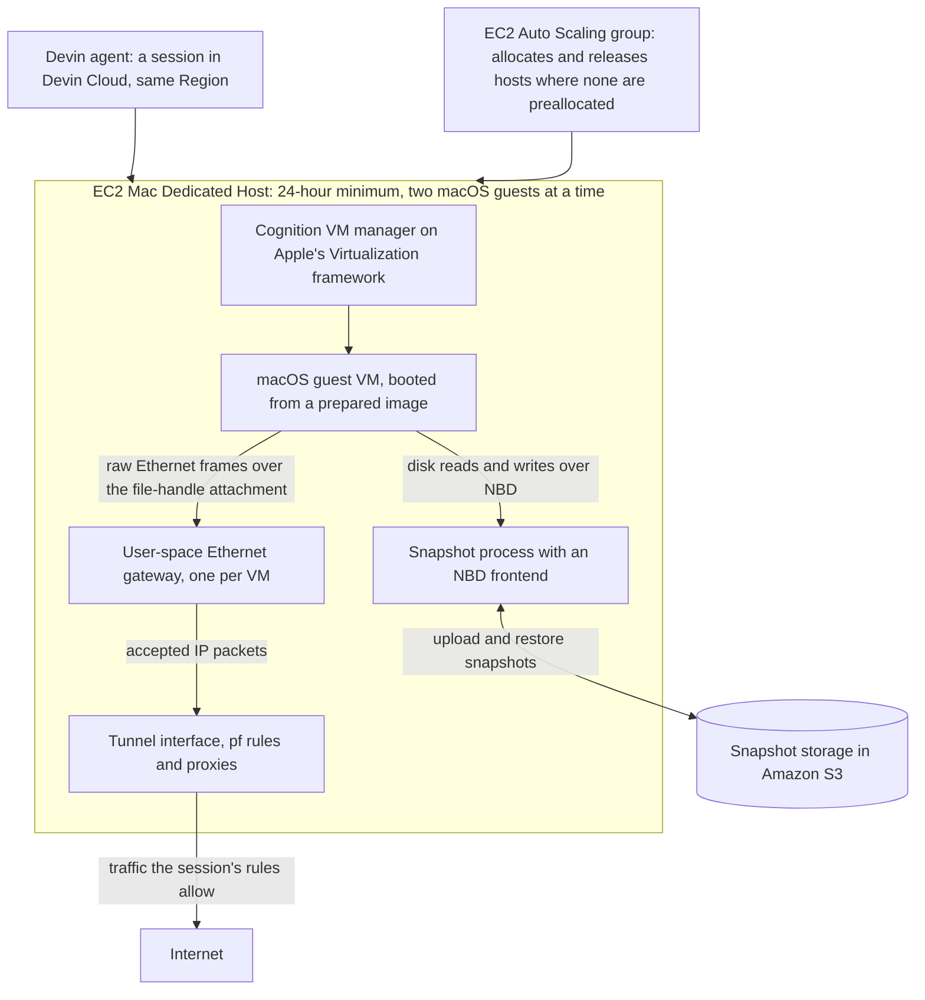

---
# Skeleton from Lead hsuxxcfl (AWS Architecture Blog), picked 2026-11-23.
# Follows docs/editorial/case-study-writing-guide.md; the Author's check list
# is in the review queue. published and reviewed are the pick time (make daily may move them to a Gap Day);
# make release keeps it (ADR-0012). verified: is the Author's alone (ADR-0007).
title: "Devin on macOS: how Cognition runs agent VMs on EC2 Mac"
description: "EC2 Mac hosts rent for 24 hours at least, so Cognition snapshots each Devin VM's disk to S3 and frees the VM whenever a session goes idle."
kind: case-study
vertical: infrastructure-cloud
tags: ["virtualization", "macos", "ai-agents", "snapshots", "cognition"]
published: "2026-11-23T09:31:06Z"
verified: 2026-11-23
reviewed: "2026-11-23T10:10:31Z"
author: mira-vance
# Optional: an image HastCode may use, beside this file, replaces the
# generated title card. Never a Source's image.
# hero: system-name.png
# hero_alt: "What the image shows"
# Optional: related Explainer slugs and extra sources (title + url).
related: [fly-io-sbd]
---

Cognition [launched macOS support for Devin](https://aws.amazon.com/blogs/architecture/ai-coding-agents-on-amazon-ec2-mac-how-cognition-scales-devin-for-macos/#results), its AI software engineer, on 15 September 2026. Within six weeks, [nearly 1,000 organisations were running it](https://aws.amazon.com/blogs/architecture/ai-coding-agents-on-amazon-ec2-mac-how-cognition-scales-devin-for-macos/), by Cognition's count. Each session gets [a fresh macOS virtual machine (VM) in under a minute](https://aws.amazon.com/blogs/architecture/ai-coding-agents-on-amazon-ec2-mac-how-cognition-scales-devin-for-macos/), yet the Mac underneath [cannot be released for 24 hours](https://aws.amazon.com/blogs/architecture/ai-coding-agents-on-amazon-ec2-mac-how-cognition-scales-devin-for-macos/#solution-overview). This is how Cognition splits a session's life from its host's, the four parts that make it work, and what each one costs.

## TL;DR

- Cognition runs each Devin macOS session in its own guest VM, [two at a time on each EC2 Mac Dedicated Host](https://aws.amazon.com/blogs/architecture/ai-coding-agents-on-amazon-ec2-mac-how-cognition-scales-devin-for-macos/#solution-overview). A VM manager it built on [Apple's Virtualization framework](https://developer.apple.com/documentation/virtualization) runs them.
- It needed them because Devin [could write Swift but could not run or test the app](https://aws.amazon.com/blogs/architecture/ai-coding-agents-on-amazon-ec2-mac-how-cognition-scales-devin-for-macos/#why-an-ai-coding-agent-needs-its-own-mac) without macOS and Xcode. A passing build does not show that an app behaves.
- Four parts do the work. An Auto Scaling group supplies hosts where none are preallocated, and a prepared image boots ready to build. A snapshot process, reached over NBD (Network Block Device), [saves the disk to Amazon S3](https://aws.amazon.com/blogs/architecture/ai-coding-agents-on-amazon-ec2-mac-how-cognition-scales-devin-for-macos/#keep-session-state-with-disk-snapshots), and a [user-space gateway](https://aws.amazon.com/blogs/architecture/ai-coding-agents-on-amazon-ec2-mac-how-cognition-scales-devin-for-macos/#apply-network-access-rules-with-a-user-space-ethernet-gateway) applies each session's network rules.
- The price: hosts held for 24 hours at least, a licence cap of two VMs per Mac, and [link-layer code Cognition now owns](https://devin.ai/blog/devin-gets-a-mac#enter-ethernet). The surprise: [about 90% of sessions give up their VM when idle](https://aws.amazon.com/blogs/architecture/ai-coding-agents-on-amazon-ec2-mac-how-cognition-scales-devin-for-macos/#keep-session-state-with-disk-snapshots) and resume in seconds.

## A Devin session's path through one EC2 Mac host

The diagram is ours, redrawn from the text of the AWS post and Cognition's own; AWS's architecture figure is Figure 1 in [the original](https://aws.amazon.com/blogs/architecture/ai-coding-agents-on-amazon-ec2-mac-how-cognition-scales-devin-for-macos/#solution-overview). A session starts at the top, with the Devin agent, which [runs as a Devin Cloud service in the same AWS Region](https://aws.amazon.com/blogs/architecture/ai-coding-agents-on-amazon-ec2-mac-how-cognition-scales-devin-for-macos/#solution-overview) as the hosts.

The session lands on [a physical Mac mini or Mac Studio](https://aws.amazon.com/blogs/architecture/ai-coding-agents-on-amazon-ec2-mac-how-cognition-scales-devin-for-macos/#why-cognition-chose-aws). Cognition rents it as an [EC2 Dedicated Host](https://aws.amazon.com/ec2/dedicated-hosts/), a physical server dedicated to one customer's use. Cognition's VM manager boots a macOS guest on it, and two paths leave the guest. Disk reads and writes go over NBD to a snapshot process that saves to Amazon S3. Network traffic leaves as raw Ethernet frames for a gateway that hands it to pf, the macOS packet filter. Step 1 covers the host, Step 2 the VM manager and its image, Step 3 the disk and Step 4 the network.

## Devin could write Swift but could not run it

Before this launch, Devin Cloud [ran sessions only on Linux and Windows VMs](https://aws.amazon.com/blogs/architecture/ai-coding-agents-on-amazon-ec2-mac-how-cognition-scales-devin-for-macos/#why-an-ai-coding-agent-needs-its-own-mac). Devin could write Swift, but without macOS and Xcode it could not run or test the app. To build and test, it depended on the customer's own CI system or Mac fleet. Building, testing and signing apps for iPhone, iPad and Mac [needs Apple hardware and macOS](https://aws.amazon.com/blogs/architecture/ai-coding-agents-on-amazon-ec2-mac-how-cognition-scales-devin-for-macos/).

A passing build was not enough either. Cognition's example is an iPhone game that should [resume where it was paused](https://devin.ai/blog/devin-gets-a-mac#why-devin-needs-a-mac). To check that, the agent has to play, pause, quit, relaunch and confirm the saved state. Compiling proves none of it.

So Cognition needed more than macOS in a VM. It set [four requirements](https://aws.amazon.com/blogs/architecture/ai-coding-agents-on-amazon-ec2-mac-how-cognition-scales-devin-for-macos/#why-an-ai-coding-agent-needs-its-own-mac) for each workspace:

- a disk that keeps the session's work, so an idle session does not hold a running VM;
- network access that follows the session's access rules;
- a development environment that is ready before Devin starts;
- a way for the user and Devin to see and operate the running app.

The first three are this piece's subject. The fourth, a live view and control through the macOS accessibility tree, is a second idea, and [the AWS post covers it](https://aws.amazon.com/blogs/architecture/ai-coding-agents-on-amazon-ec2-mac-how-cognition-scales-devin-for-macos/#let-devin-operate-native-apps-through-the-accessibility-tree) in depth.

## Each choice kept Cognition's existing machinery in charge

The two posts give a reason for turning down four alternatives.

- **Racks of Macs.** Cognition wanted to avoid [buying, racking and maintaining physical Macs](https://aws.amazon.com/blogs/architecture/ai-coding-agents-on-amazon-ec2-mac-how-cognition-scales-devin-for-macos/#why-cognition-chose-aws). EC2 Mac instances come through the EC2 API, run in an Amazon VPC and boot from Amazon EBS volumes, so Cognition manages them like other EC2 instances.
- **vhost-user for the disk.** Cognition's Linux VMs reach their snapshot process over vhost-user, a protocol for [sharing a VM's virtqueues with a user-space process on the same host](https://qemu-project.gitlab.io/qemu/interop/vhost-user.html#introduction). Apple's framework [does not support it](https://aws.amazon.com/blogs/architecture/ai-coding-agents-on-amazon-ec2-mac-how-cognition-scales-devin-for-macos/#keep-session-state-with-disk-snapshots).
- **Apple's NAT for the network.** Network address translation needs the least setup, but Apple's version [also manages rules in pf](https://aws.amazon.com/blogs/architecture/ai-coding-agents-on-amazon-ec2-mac-how-cognition-scales-devin-for-macos/#apply-network-access-rules-with-a-user-space-ethernet-gateway), which Cognition's controls use too. As AWS's post puts it, "the two systems raced to configure the same filter."
- **UI automation for setup.** Clicking through account creation and permission prompts was possible, but Cognition [judged that coordinating it](https://devin.ai/blog/devin-gets-a-mac#bootable-is-not-ready) "can be unreliable and expensive."

We infer the deciding argument from what replaced each one. Cognition [kept the snapshot system it runs for Linux](https://aws.amazon.com/blogs/architecture/ai-coding-agents-on-amazon-ec2-mac-how-cognition-scales-devin-for-macos/#keep-session-state-with-disk-snapshots) and the pf-based controls it already used. It changed only the adapter where macOS meets them: NBD in place of vhost-user, a raw socket in place of NAT. Reuse won, and the price was owning those adapters.

## Step 1: hosts are held for a day, VMs only while sessions work

An EC2 Mac instance is a whole machine. AWS offers Mac instances [only as bare metal on Dedicated Hosts](https://docs.aws.amazon.com/AWSEC2/latest/UserGuide/ec2-mac-instances.html#mac-instance-considerations), one per host, with a minimum allocation of 24 hours before the host can be released. [The unit of billing is the host](https://docs.aws.amazon.com/AWSEC2/latest/UserGuide/ec2-mac-instances.html).

Devin sessions do not fit that shape, so Cognition [separates the life of a Devin session from the life of a host](https://aws.amazon.com/blogs/architecture/ai-coding-agents-on-amazon-ec2-mac-how-cognition-scales-devin-for-macos/#solution-overview). In Regions where it has no preallocated capacity, [an EC2 Auto Scaling group allocates and releases Dedicated Hosts](https://aws.amazon.com/blogs/architecture/ai-coding-agents-on-amazon-ec2-mac-how-cognition-scales-devin-for-macos/#solution-overview).

Each host then runs [two isolated Devin workspaces at a time](https://aws.amazon.com/blogs/architecture/ai-coding-agents-on-amazon-ec2-mac-how-cognition-scales-devin-for-macos/#solution-overview). The ceiling is a licence term. The macOS Software License Agreement [allows up to two additional copies of macOS in virtual environments on each Mac](https://aws.amazon.com/blogs/architecture/ai-coding-agents-on-amazon-ec2-mac-how-cognition-scales-devin-for-macos/#solution-overview), which AWS's post calls "a limit macOS enforces." Because idle sessions release their VMs, [one host serves multiple sessions a day](https://aws.amazon.com/blogs/architecture/ai-coding-agents-on-amazon-ec2-mac-how-cognition-scales-devin-for-macos/#solution-overview).

A worked example shows why the release matters (our numbers, not Cognition's). One host held for its 24-hour minimum offers 48 VM-hours: two slots for a day. Picture a session that works in three 20-minute bursts across eight hours. Kept running, it pins one slot for all eight hours. Released when idle, it holds the slot for one hour, plus a few seconds per resume. The other seven hours go to other sessions.

## Step 2: the guest boots from an image already set up

Cognition's VM manager runs macOS guests from [images Cognition prepares and manages](https://aws.amazon.com/blogs/architecture/ai-coding-agents-on-amazon-ec2-mac-how-cognition-scales-devin-for-macos/#solution-overview). A bootable image is not yet a workspace. Devin needs [a user account, a usable desktop, Xcode tools, and permissions to observe and control apps](https://aws.amazon.com/blogs/architecture/ai-coding-agents-on-amazon-ec2-mac-how-cognition-scales-devin-for-macos/#prepare-guest-images-before-the-first-boot).

The permissions are the hard part. A fresh install asks for each one, such as accessibility and screen recording, in a dialog. In [AWS's words](https://aws.amazon.com/blogs/architecture/ai-coding-agents-on-amazon-ec2-mac-how-cognition-scales-devin-for-macos/#prepare-guest-images-before-the-first-boot), "each dialog would block Devin until a person approved it."

So Cognition prepares the image in two passes. First, with the guest off, it [mounts the guest image disk on the host](https://aws.amazon.com/blogs/architecture/ai-coding-agents-on-amazon-ec2-mac-how-cognition-scales-devin-for-macos/#prepare-guest-images-before-the-first-boot). It creates the user and updates the macOS internal configuration databases, so the permissions are in place before the first boot. Neither post names the databases or the edits.

Second, it boots the prepared image once, so Devin [does not compete with system initialization for resources](https://devin.ai/blog/devin-gets-a-mac#bootable-is-not-ready). It installs the remaining developer tools, verifies Xcode, warms the Simulator, and lets Spotlight indexing finish. It also turns off background daemons the sessions do not need.

The payoff: a new session [can start building and testing as soon as its VM starts](https://aws.amazon.com/blogs/architecture/ai-coding-agents-on-amazon-ec2-mac-how-cognition-scales-devin-for-macos/#prepare-guest-images-before-the-first-boot). We infer this is what keeps the start under a minute. The slow work happens once per image, not once per session.

## Step 3: the disk lives in a snapshot process, reached over NBD

Much of the work in Devin Cloud is [asynchronous](https://aws.amazon.com/blogs/architecture/ai-coding-agents-on-amazon-ec2-mac-how-cognition-scales-devin-for-macos/#keep-session-state-with-disk-snapshots), and an idle session does not need a running VM. So Cognition gave macOS the snapshot system its Linux VMs already use. It runs as a separate process on the host and handles the VM's disk reads and writes. The guest sees an ordinary virtual disk.

NBD connects the two. Apple's framework offers a storage attachment [backed by a Network Block Device client](https://developer.apple.com/documentation/virtualization/vznetworkblockdevicestoragedeviceattachment), available since macOS 14. It forwards the guest's I/O to a server the framework does not control. Cognition [added an NBD frontend](https://devin.ai/blog/devin-gets-a-mac#disk-snapshots) to its snapshot process and kept the design behind it. Our [Sprites Block Device explainer](/infrastructure-cloud/fly-io-sbd/) walks another disk served over NBD, at Fly.io.

Shutdown is where order matters. When a guest stops, the snapshot process [keeps running to persist pending writes and upload the updated snapshot](https://aws.amazon.com/blogs/architecture/ai-coding-agents-on-amazon-ec2-mac-how-cognition-scales-devin-for-macos/#keep-session-state-with-disk-snapshots). The VM manager waits for that upload before it cleans up. Cognition [gives the reason](https://devin.ai/blog/devin-gets-a-mac#disk-snapshots): "Stopping both processes together could interrupt the very work needed to preserve the session."

The result is the AWS post's most striking number. Cognition reports that about [90% of sessions give up their Mac VM when idle](https://aws.amazon.com/blogs/architecture/ai-coding-agents-on-amazon-ec2-mac-how-cognition-scales-devin-for-macos/#keep-session-state-with-disk-snapshots) and resume from a snapshot in seconds. On average, a session frees and reclaims its VM multiple times.

## Step 4: a gateway in user space applies each session's rules

Devin Cloud [applies each session's access rules to outbound traffic and blocks access to protected host infrastructure](https://aws.amazon.com/blogs/architecture/ai-coding-agents-on-amazon-ec2-mac-how-cognition-scales-devin-for-macos/#apply-network-access-rules-with-a-user-space-ethernet-gateway). The Mac guests had to keep those controls.

Apple's framework offers [three network attachments](https://devin.ai/blog/devin-gets-a-mac#enter-ethernet): bridged, NAT and file handle. Cognition took the file handle, which [transmits raw network packets and frames over a datagram socket](https://developer.apple.com/documentation/virtualization/vzfilehandlenetworkdeviceattachment). "Each datagram carries one frame," [Cognition writes](https://devin.ai/blog/devin-gets-a-mac#enter-ethernet), so its own code receives the guest's Ethernet traffic. Neither post says why bridged networking lost.

Each Mac VM gets [its own gateway, in user space on the host](https://aws.amazon.com/blogs/architecture/ai-coding-agents-on-amazon-ec2-mac-how-cognition-scales-devin-for-macos/#apply-network-access-rules-with-a-user-space-ethernet-gateway). The gateway does three jobs:

- It answers ARP, the protocol that [maps an IP address to an Ethernet address](https://www.rfc-editor.org/rfc/rfc826).
- It validates Ethernet addressing.
- It [checks that each packet's source IP address matches the address assigned to the guest](https://aws.amazon.com/blogs/architecture/ai-coding-agents-on-amazon-ec2-mac-how-cognition-scales-devin-for-macos/#apply-network-access-rules-with-a-user-space-ethernet-gateway).

Accepted IP packets go into [a tunnel interface on the host](https://devin.ai/blog/devin-gets-a-mac#enter-ethernet). There, pf rules and proxies route the traffic and apply the session's access policy. Return traffic [takes the reverse path](https://devin.ai/blog/devin-gets-a-mac#enter-ethernet), wrapped back into Ethernet frames for the guest.

We infer the source-IP check is what keeps sessions apart. pf and the proxies see only IP packets. Without the check, a guest could claim another guest's address, and with it that session's rules.

## What it costs: day-long hosts, two VMs per Mac, code to own

Hosts come by the day. AWS [lets a host go only after its 24-hour minimum](https://aws.amazon.com/blogs/architecture/ai-coding-agents-on-amazon-ec2-mac-how-cognition-scales-devin-for-macos/#plan-your-own-macos-fleet-on-ec2-mac) and [bills by the host](https://docs.aws.amazon.com/AWSEC2/latest/UserGuide/ec2-mac-instances.html). We infer that a host allocated for a short burst of demand costs a full day. Mac instances run [only as On-Demand Instances](https://docs.aws.amazon.com/AWSEC2/latest/UserGuide/ec2-mac-instances.html), and a Savings Plan [can lower the cost](https://aws.amazon.com/blogs/architecture/ai-coding-agents-on-amazon-ec2-mac-how-cognition-scales-devin-for-macos/#plan-your-own-macos-fleet-on-ec2-mac). Neither post gives a price.

Density stops at two. The licence fixes [two guest VMs per Mac](https://aws.amazon.com/blogs/architecture/ai-coding-agents-on-amazon-ec2-mac-how-cognition-scales-devin-for-macos/#solution-overview) whatever the machine's size, so a bigger host does not mean more sessions at once. We infer that is why releasing idle VMs carries so much weight: it is the one lever left.

Idle is not free either. Every shutdown waits for a snapshot upload, and every resume takes [seconds](https://aws.amazon.com/blogs/architecture/ai-coding-agents-on-amazon-ec2-mac-how-cognition-scales-devin-for-macos/#keep-session-state-with-disk-snapshots), not zero.

The network now has an owner. Cognition [says so plainly](https://devin.ai/blog/devin-gets-a-mac#enter-ethernet): "The trade-off is that we now own the link-layer handling and validation that managed networking would otherwise provide."

The images need upkeep. Cognition [edits macOS internal configuration databases directly](https://aws.amazon.com/blogs/architecture/ai-coding-agents-on-amazon-ec2-mac-how-cognition-scales-devin-for-macos/#prepare-guest-images-before-the-first-boot). We infer it must recheck those edits whenever macOS or Xcode changes.

Capacity is regional. Mac instance types are [available only in specific Regions](https://aws.amazon.com/blogs/architecture/ai-coding-agents-on-amazon-ec2-mac-how-cognition-scales-devin-for-macos/#plan-your-own-macos-fleet-on-ec2-mac), so AWS's list bounds where a fleet can run.

## The evidence: fast starts and wide adoption, few fleet numbers

The published numbers are about adoption and speed. Cognition [launched on 15 September 2026](https://aws.amazon.com/blogs/architecture/ai-coding-agents-on-amazon-ec2-mac-how-cognition-scales-devin-for-macos/#results), and nearly 1,000 organisations were running Devin on macOS within six weeks. Evan Almloff, a Member of Technical Staff at Cognition, [says](https://aws.amazon.com/blogs/architecture/ai-coding-agents-on-amazon-ec2-mac-how-cognition-scales-devin-for-macos/#results) its "mac-m4pro.metal and mac-m4.metal fleet spans six regions". He adds that it can mint fresh macOS VMs "in under a minute". By [Cognition's estimate](https://aws.amazon.com/blogs/architecture/ai-coding-agents-on-amazon-ec2-mac-how-cognition-scales-devin-for-macos/), that gets customers to a working macOS environment 15–20 times faster than setting up a Mac host themselves. The post does not show how it measured that.

One customer reports results. Wispr [uses Devin for macOS to test its iOS app end to end](https://aws.amazon.com/blogs/architecture/ai-coding-agents-on-amazon-ec2-mac-how-cognition-scales-devin-for-macos/#results). Its Lead iOS Engineer, Sumit Oberoi, is quoted on two results: "cut down code review time by 70%" and "improved our velocity by nearly 2x". That is one team's measure, with no baseline or method given.

The fleet itself goes unmeasured in public. The post gives no host count, utilisation, cost per session or snapshot size. It gives no upload time, no resume time beyond "seconds", no gateway throughput and no failure figures. The 90% figure carries no time window. It is also a joint post: [three of its seven authors work at Cognition and four at AWS](https://aws.amazon.com/blogs/architecture/ai-coding-agents-on-amazon-ec2-mac-how-cognition-scales-devin-for-macos/), among them EC2 Mac's worldwide go-to-market lead. Read it as the builders' account, not an audit.

## Split the session from the host when the host outlives the work

Devin now [builds, runs and verifies iPhone, iPad and Mac apps in its own cloud workspace](https://aws.amazon.com/blogs/architecture/ai-coding-agents-on-amazon-ec2-mac-how-cognition-scales-devin-for-macos/#results), and uploads builds to TestFlight from there. It no longer needs a customer's CI system or Macs to build and test Apple apps.

The lesson reaches beyond Macs. When the unit you rent outlives the unit of work, move the work's state out of the machine. Cognition's disk lives in a snapshot process and in S3, so a VM is disposable and a day-long host serves many short sessions.

The second lesson is where to hook in. Cognition took the lowest-level attachments Apple offers, a block device and a raw socket, so the snapshot system and pf rules it already trusted kept working. The price is owning that layer's code.

AWS's post lists four points for planning a macOS fleet: [one Mac instance per host and the 24-hour minimum, cross-account host sharing, Savings Plans, and Region limits](https://aws.amazon.com/blogs/architecture/ai-coding-agents-on-amazon-ec2-mac-how-cognition-scales-devin-for-macos/#plan-your-own-macos-fleet-on-ec2-mac). Before you size one, measure the share of each session's life its machine sits idle (our suggestion, not the post's). That share is the capacity that releasing idle VMs would give back.

## Sources

- [AI coding agents on Amazon EC2 Mac: How Cognition scales Devin for macOS](https://aws.amazon.com/blogs/architecture/ai-coding-agents-on-amazon-ec2-mac-how-cognition-scales-devin-for-macos/), Adam Hesch and six co-authors from Cognition and AWS, AWS Architecture Blog, 20 November 2026
- [Bringing macOS to Devin](https://devin.ai/blog/devin-gets-a-mac), Cognition, 15 September 2026
- [Amazon EC2 Mac instances](https://docs.aws.amazon.com/AWSEC2/latest/UserGuide/ec2-mac-instances.html), Amazon EC2 User Guide
- [Amazon EC2 Dedicated Hosts](https://aws.amazon.com/ec2/dedicated-hosts/), AWS
- [Virtualization framework](https://developer.apple.com/documentation/virtualization), Apple Developer Documentation
- [VZNetworkBlockDeviceStorageDeviceAttachment](https://developer.apple.com/documentation/virtualization/vznetworkblockdevicestoragedeviceattachment), Apple Developer Documentation
- [VZFileHandleNetworkDeviceAttachment](https://developer.apple.com/documentation/virtualization/vzfilehandlenetworkdeviceattachment), Apple Developer Documentation
- [Vhost-user Protocol](https://qemu-project.gitlab.io/qemu/interop/vhost-user.html), QEMU documentation
- [RFC 826: An Ethernet Address Resolution Protocol](https://www.rfc-editor.org/rfc/rfc826), David C. Plummer, November 1982
