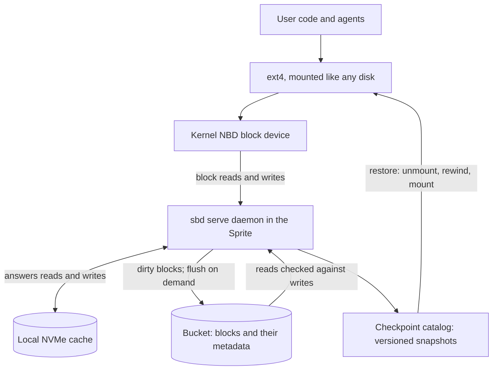
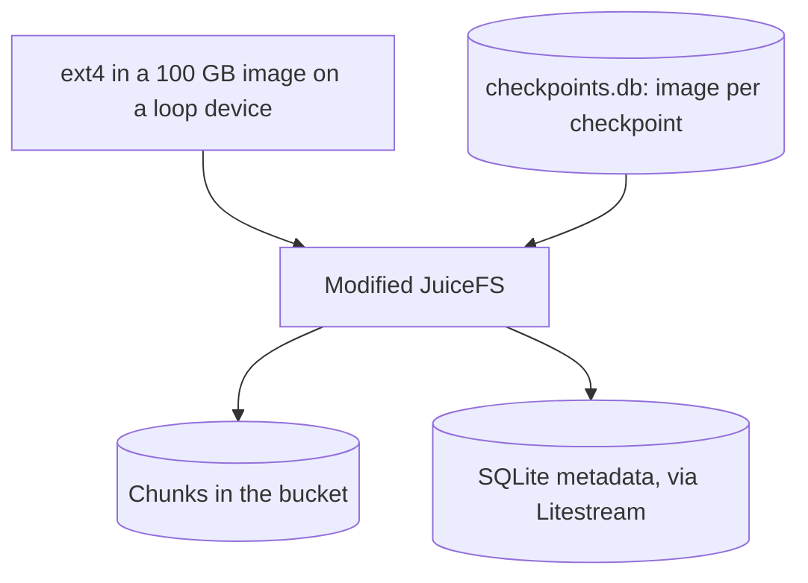

---
# Skeleton from Lead 6pj2k5cj (Fly.io blog), picked 2026-10-27.
# Follow docs/editorial/case-study-writing-guide.md; no author notes are
# left. published and reviewed are the pick time, provisional: set them
# when you publish. verified: is the Author's alone (ADR-0007).
title: "Sprites Block Device: how Fly.io runs ext4 on a bucket"
description: "How Fly.io's Sprites Block Device turns a bucket into a Linux disk over NBD, trading a JuiceFS stack for one source of truth and fail-stop restarts."
kind: case-study
vertical: infrastructure-cloud
tags: ["storage", "object-storage", "block-devices", "filesystems", "fly-io"]
published: "2026-10-28T12:54:21Z"
verified: 2026-10-28
reviewed: "2026-10-28T12:54:21Z"
author: mira-vance
# Optional: an image HastCode may use, beside this file, replaces the
# generated title card. Never a Source's image.
# hero: system-name.png
# hero_alt: "What the image shows"
# Optional: related Explainer slugs and extra sources (title + url).
# related: [metastable-failures]
---

Fly.io built a test harness that drove [400 of its Sprites through about 5,000 cycles of write, checkpoint, sleep, wake and restore](https://fly.io/blog/sprites-block-device/#my-agent-ate-my-dogfood), checking every byte that came back, and a nonzero number of them permanently lost the ability to checkpoint. Its fix was to throw out its clever custom filesystem and give each Sprite something deliberately plain: a disk.

> Drafted with AI assistance, researched, verified and edited by the HastCode editorial team. We publish only as many pieces as the Author can verify this way.

## TL;DR

- The Sprites Block Device (SBD) is Fly.io's new storage layer for Sprites, its Linux VMs: it [presents an object storage bucket to the Linux kernel as a block device, over NBD](https://fly.io/blog/sprites-block-device/#just-a-disk), and the Sprite runs ordinary ext4 on top.
- Fly.io built it because the old stack, a heavily modified JuiceFS, kept a Sprite's disk in [three separately durable records that could disagree](https://fly.io/blog/sprites-block-device/#manifests-that-lie), and one crash window left gaps that no checkpoint could repair.
- [A daemon, `sbd serve`](https://fly.io/blog/sprites-block-device/#just-a-disk), answers the kernel's reads and writes from a local cache, uploads dirty blocks in the background and flushes on demand; the metadata lives in the bucket beside the blocks, and a checkpoint is a [versioned block snapshot of the whole volume](https://fly.io/blog/sprites-block-device/#dumber-checkpoints-are-better-checkpoints).
- The price is [a fail-stop design](https://fly.io/blog/sprites-block-device/#dumber-checkpoints-are-better-checkpoints), where a Sprite restarts rather than run on a disk SBD cannot vouch for, plus [a migration each owner of an older Sprite starts by hand](https://docs.fly.io/sprites/sprite-maintenance#storage-upgrades). The surprise is how little is new: the only thing tracking files is [the filesystem code every Linux box already runs](https://fly.io/blog/sprites-block-device/#moms-spaghetti).

## SBD at a glance: ext4, a block device, a daemon and a bucket

The diagram is ours, redrawn from the text of Fly.io's post, which has no architecture figure; [the original is here](https://fly.io/blog/sprites-block-device/).

Top to bottom, Step 1 is the block device the kernel sees, Step 2 is the daemon and its cache, Step 3 is the bucket that holds both data and map, and Step 4 is the checkpoint catalog.

## Why a Sprite's disk lives in a bucket

Sprites are Linux virtual machines that [create in a second or two, come with a 100GB durable root filesystem and put themselves to sleep when inactive](https://fly.io/blog/design-and-implementation/). The durable part is not the NVMe drive in the server. Fly.io's stance since the first version is that [the root of a Sprite's disk is object storage](https://fly.io/blog/sprites-block-device/#it-was-always-object-storage), which is what lets a Sprite sleep, wake on a different server and find its files where it left them.

Fly.io's other product, Fly Machines, shows the alternative. Its volumes are [NVMe attached to one physical server](https://fly.io/blog/design-and-implementation/#decision-2-object-storage-for-disks): fast, but able to lose data if that server fails, and they anchor the workload to the machine. For Sprites, Fly.io calls S3-compatible object stores "the most trustworthy storage technology we have", and keeps NVMe only as a cache.

Object storage has one awkward property. An object store [cannot change part of an object](https://fly.io/blog/sprites-block-device/#it-was-always-object-storage): to change one byte, you replace the whole object. Linux programs rewrite a few bytes in the middle of a file all the time. Something has to translate between the two, and that translator is what SBD replaced.

## How the first stack ended up with three ledgers

At launch the translator was [a heavily modified JuiceFS](https://fly.io/blog/sprites-block-device/#it-was-always-object-storage). Stock [JuiceFS](https://juicefs.com/docs/community/architecture/#how-juicefs-store-files) stores file data as blocks in object storage and keeps the map of which blocks make up which file in a separate metadata engine. Fly.io swapped in a rewritten SQLite metadata backend, [kept durable with Litestream](https://fly.io/blog/design-and-implementation/#decision-2-object-storage-for-disks), and stored exactly one file in it: a 100 GB disk image, mounted on a loop device with ext4 inside.

Checkpoints added a layer. Each was [a copy-on-write clone of the disk image](https://fly.io/blog/sprites-block-device/#manifests-that-lie), so the metadata database tracked chunks for every checkpoint as well as the live disk, and a second SQLite database, `checkpoints.db`, listed the checkpoints and which image to mount for each.

That is three records, chunks, metadata and checkpoints, each [made durable separately](https://fly.io/blog/sprites-block-device/#manifests-that-lie), "so each one could be right while the others were wrong." It worked: Sprites shipped on it, and checkpoints were fast because they mostly shuffled metadata.

## The crash window no checkpoint could repair

Fly.io's post describes one failure, [a story "which may or may not be based on lived experience"](https://fly.io/blog/sprites-block-device/#what-could-go-wrong): a Sprite stops booting because JuiceFS asks object storage for a chunk and gets a 404.

The cause was a speed choice. Fly.io ran JuiceFS in writeback mode, which records a chunk in its metadata first and uploads the bytes after. JuiceFS's own docs describe [the `--writeback` option](https://juicefs.com/docs/community/guide/cache/#client-write-cache) the same way: the default is "upload first, then commit", writeback switches it to "commit first, then upload asynchronously", and if the cached data is lost before the upload completes, "file data is lost forever". Kill the machine between the two steps and the metadata [points at a chunk that does not exist](https://fly.io/blog/sprites-block-device/#what-could-go-wrong).

The damage then climbs the stack. Ext4 finds a directory block that fails its checksum and goes read-only. Moving the Sprite to a new server does not help, because the gap is in the bucket, not the server. Restoring a checkpoint does not help either: checkpoints were clones that [shared the same chunks](https://fly.io/blog/sprites-block-device/#what-could-go-wrong), so every checkpoint had the same hole.

## The options Fly.io weighed

Fly.io's two posts point to three routes, and we add a fourth.

- **Attached NVMe as the root of storage**, as Fly Machines do. Ruled out from the start: it [can lose data when a server dies and pins the workload to that server](https://fly.io/blog/design-and-implementation/#decision-2-object-storage-for-disks).
- **Keep the JuiceFS stack and repair it.** Fly.io tried this [for a while](https://fly.io/blog/sprites-block-device/#my-agent-ate-my-dogfood): more reconciliation, more repair tooling and "increasingly clever ways to keep three ledgers in agreement." It rejected the approach in a line: "spaghetti that comes with a repair kit is gonna leave a weird taste in your mouth."
- **Run JuiceFS without writeback.** The post does not discuss it. JuiceFS's default mode [does not commit metadata until the data is uploaded](https://juicefs.com/docs/community/guide/cache/#client-write-cache), so we infer it would close this particular crash window, at the cost of the speed Fly.io wanted, while leaving three records to keep in step.
- **A block device on the bucket.** What Fly.io built. Fly Machines already had [an obscure LSVD feature that runs disks off object storage](https://fly.io/blog/design-and-implementation/#we-keep-the-parts-that-worked), though not fast enough for a hot Postgres node.

The deciding argument is the count of ledgers. SBD removes the need to reconcile at all, because there is [one daemon and one bucket](https://fly.io/blog/sprites-block-device/#just-a-disk) where there used to be a filesystem, a database and a disk image.

## Step 1: the kernel sees a disk, over NBD

SBD [takes a bucket and presents it to the Linux kernel as a block device, over NBD](https://fly.io/blog/sprites-block-device/#just-a-disk). The Linux Network Block Device driver lets the kernel [use a remote server as one of its block devices](https://docs.kernel.org/admin-guide/blockdev/nbd.html): every read of the device becomes a request to a server process, which replies with the data, and unlike NFS, any filesystem can sit on top.

So the Sprite does the ordinary thing. It formats the device as ext4 and mounts it, [the same way you'd mount a disk on any Linux box](https://fly.io/blog/sprites-block-device/#just-a-disk). Fly.io's docs make the same promise from the user's side: the filesystem [behaves like real local disk](https://docs.fly.io/sprites/concepts/lifecycle#how-persistence-works), SQLite works in every mode, and "It is not an object-storage shim or a network filesystem."

SBD drops the file layer and the loop device. Ext4 talks to a block device, and a block device is a simple contract: read block N, write block N, flush.

## Step 2: sbd serve answers from a cache and uploads behind it

The server end of the NBD connection is [a daemon inside the Sprite, `sbd serve`](https://fly.io/blog/sprites-block-device/#just-a-disk). It does three jobs:

1. It answers the kernel's block reads and writes from its own local cache.
2. It uploads dirty blocks, those changed since the last upload, to object storage in the background.
3. It flushes on demand, when something needs a guarantee that the bytes "have left the building."

The cache sits on fast local storage. Fly.io's docs describe two tiers under every Sprite's ext4 disk: [a hot NVMe cache for the data you are working with, and durable object storage for the persistent copy](https://docs.fly.io/sprites/concepts/lifecycle#how-persistence-works), which the filesystem syncs to continuously, not as a snapshot at hibernation.

Running the daemon inside the Sprite follows a pattern Fly.io set for Sprites from the start, [putting the storage stack inside the VM's root namespace](https://fly.io/blog/design-and-implementation/#decision-3-inside-out-orchestration) rather than on the host. The post does not say how the kernel's flush request reaches `sbd serve`; we infer that an `fsync()` in user code becomes an NBD flush, and that the flush on demand is the point where the daemon waits for the bucket to confirm the upload.

## Step 3: the bucket holds the blocks and the map together

Under SBD, [the metadata lives in the bucket alongside the blocks it describes](https://fly.io/blog/sprites-block-device/#just-a-disk), so there is no separate database to keep in sync. A map in SQLite, made durable separately from the chunks, could say a chunk existed before the chunk did. A map stored beside its blocks, in the same durable store, has one fewer way to disagree with them.

The post does not describe the layout: how big a block is, how the map is stored, or how a write of blocks and map is made atomic. We infer that SBD must order its uploads so that the map in the bucket never points at a block that is not there yet, since that is exactly the gap that broke the old stack.

What the post does describe is the read side. SBD [checks every block it reads back from object storage against what it wrote](https://fly.io/blog/sprites-block-device/#dumber-checkpoints-are-better-checkpoints). Under JuiceFS, a missing chunk surfaced as an ext4 checksum failure several layers up. Under SBD, the layer that wrote the block is the layer that notices it is wrong.

## Step 4: a checkpoint is a version of the volume

Fly.io calls checkpoints [a huge deal for infra designed to be "a padded room for agents"](https://fly.io/blog/sprites-block-device/#dumber-checkpoints-are-better-checkpoints). Under SBD, a checkpoint is a block snapshot of the whole volume, with a version number, recorded in SBD's own checkpoint catalog: one source of truth, where JuiceFS needed `checkpoints.db` as well.

The user-facing docs fill in the economics. Checkpoints [live in durable object storage and are copy-on-write](https://docs.fly.io/sprites/concepts/checkpoints#storage-and-cleanup): a new one stores only the blocks that changed since the last, and you are billed for the blocks kept. IDs run in sequence, [v0, v1, v2](https://docs.fly.io/sprites/concepts/checkpoints#creating-a-checkpoint), and the [last five are mounted read-only](https://docs.fly.io/sprites/concepts/checkpoints#browsing-without-restoring) at `/.sprite/checkpoints/`, so you can diff a file against an old state without restoring.

Restore is the plain part. Each checkpoint knows which version of the volume it belongs to, so a restore [unmounts the filesystem, rewinds the volume in place and mounts it again](https://fly.io/blog/sprites-block-device/#dumber-checkpoints-are-better-checkpoints), for about the cost of a restart. Before, the docs say, a restore could mean [waiting for a disk download](https://docs.fly.io/sprites/sprite-maintenance#storage-upgrades).

## What it costs: a Sprite that stops instead of limping

SBD does not make failures impossible, and Fly.io does not claim it does. The difference is what happens next: a Sprite [now "stops and says so"](https://fly.io/blog/sprites-block-device/#dumber-checkpoints-are-better-checkpoints) instead of carrying on with a disk it can't vouch for. If SBD itself dies, the whole Sprite restarts, "because a clean restart is the only way back to a disk you can trust."

That is a fail-stop design, and it has a price. Anything in memory is gone on a restart; Fly.io's docs say [running processes, in-memory state and open connections do not persist](https://docs.fly.io/sprites/concepts/lifecycle#what-persists). We think that is the right trade for a disk: a stopped Sprite is a visible problem, a Sprite on corrupt blocks a hidden one.

Restore has its own sharp edge, unchanged by SBD. It [overwrites the current filesystem](https://docs.fly.io/sprites/concepts/checkpoints#restoring-a-checkpoint), and the state it replaces is not backed up unless you checkpoint first.

The post also leaves performance unpriced. A read that misses the cache crosses NBD to a daemon, then the network to a bucket, and the post gives no latency figures for that path, before or after.

## What it costs: a migration each owner starts

SBD is the default for new Sprites, but [existing Sprites are not upgraded automatically](https://docs.fly.io/sprites/sprite-maintenance#storage-upgrades); the owner starts it. A Sprite reports its driver in `$SPRITE_STORAGE_DRIVER`, and [`sbd` means it is already on the new storage](https://docs.fly.io/sprites/sprite-maintenance#checking-whether-a-sprite-needs-it). The older system keeps working for now, but Fly.io says it will eventually retire it.

Fly.io offers two routes and recommends the more cautious one: [create a new Sprite and copy your data over](https://docs.fly.io/sprites/sprite-maintenance#checking-whether-a-sprite-needs-it), which leaves the original untouched but gives the new one a different name and URL. Upgrading in place keeps the name, but [checkpoints taken before the upgrade stay behind](https://docs.fly.io/sprites/sprite-maintenance#upgrading-in-place) and can no longer be restored, the first start is slow while the disk is copied, and early reads are slow while the new storage loads data.

[Rolling back](https://docs.fly.io/sprites/sprite-maintenance#rolling-back) returns the disk as it was at the upgrade, losing later writes.

## The evidence: a harness, not a benchmark

The strongest evidence in the post is about the old system. The harness drove Sprites through [write, checkpoint, sleep, wake and restore, over and over, verifying every byte](https://fly.io/blog/sprites-block-device/#my-agent-ate-my-dogfood), and against 400 JuiceFS Sprites over about 5,000 cycles, a nonzero number permanently lost the ability to checkpoint.

For SBD, Fly.io reports the same harness, continued dogfooding and input from a few design partners, which together showed SBD to be ["orders of magnitude more reliable"](https://fly.io/blog/sprites-block-device/#moms-spaghetti) than the old filesystem.

The post gives no failure count for either system, so "nonzero" and "orders of magnitude" cannot be turned into rates. It gives no number of SBD test cycles, no read or write latency, no throughput, no cache hit rate, no checkpoint or restore times beyond "about as much as a restart", no block size and no cost comparison. It describes a design and a qualitative result, not a measured one.

## What it makes possible

The users Fly.io has in mind are agents. Sprites [ship with Claude, Gemini and Codex preinstalled](https://fly.io/blog/design-and-implementation/#you-wont-get-it-until-you-use-them), taught to checkpoint and restore, and the docs describe the pattern they rely on: [snapshot before a risky step, restore if it fails](https://docs.fly.io/sprites/concepts/checkpoints#checkpointing-from-inside-the-sprite). That only works if a checkpoint is a real, independent restore point, which is what a versioned block snapshot gives and a shared-chunk clone did not.

The lessons travel beyond Fly.io:

- **Count your ledgers.** If your data and your map of the data are made durable separately, write down every order in which a crash can leave them, and assume production will find each one.
- **Check the speed setting.** Writeback-style modes trade durability for latency, and the docs usually say so.
- **Know what a snapshot shares.** A copy-on-write checkpoint is only as safe as the blocks it shares with the live copy.
- **Prefer the boring layer.** Fly.io's own summary is the point: ext4, on a block device, on a bucket, and [the only thing keeping track of your files is the filesystem code every Linux box already runs](https://fly.io/blog/sprites-block-device/#moms-spaghetti).

What could go right is a durable, movable disk whose correctness rests on code the whole Linux world already tests.

## Sources

- [SBD: We Have a Filesystem at Home](https://fly.io/blog/sprites-block-device/), Daniel Botha, Fly.io blog, 22 October 2026
- [The Design & Implementation of Sprites](https://fly.io/blog/design-and-implementation/), Thomas Ptacek, Fly.io blog, 14 January 2026
- [Sprites docs: Sprite Maintenance, Storage Upgrades](https://docs.fly.io/sprites/sprite-maintenance#storage-upgrades)
- [Sprites docs: Checkpoints](https://docs.fly.io/sprites/concepts/checkpoints)
- [Sprites docs: Lifecycle and Persistence](https://docs.fly.io/sprites/concepts/lifecycle)
- [JuiceFS docs: Architecture, how JuiceFS stores files](https://juicefs.com/docs/community/architecture/#how-juicefs-store-files)
- [JuiceFS docs: Cache, client write data cache](https://juicefs.com/docs/community/guide/cache/#client-write-cache)
- [Linux kernel documentation: Network Block Device (TCP version)](https://docs.kernel.org/admin-guide/blockdev/nbd.html)
