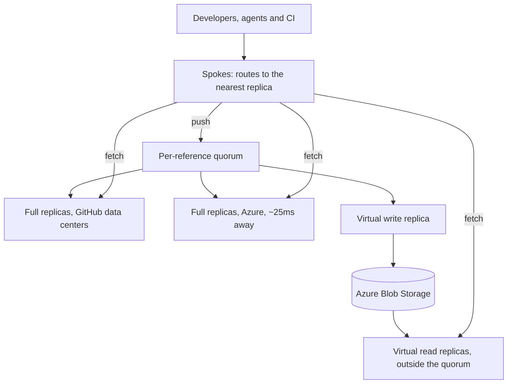

---
# Skeleton from Lead y4mofy4t (GitHub Engineering), picked 2026-10-27.
# Follow docs/editorial/case-study-writing-guide.md and replace every
# placeholder line. published and reviewed are the pick time, provisional: set them
# when you publish. verified: is the Author's alone (ADR-0007).
title: "Spokes: how GitHub reshapes its Git quorum for agent-scale load"
description: "How GitHub's Spokes narrows its write lock from a repository to one Git reference and makes object storage a voter, and what each write still pays."
kind: case-study
vertical: infrastructure-cloud
tags: ["git", "replication", "quorum", "object-storage", "github"]
published: "2026-10-27T17:47:16Z"
reviewed: "2026-10-27T17:47:16Z"
author: mira-vance
# Optional: an image HastCode may use, beside this file, replaces the
# generated title card. Never a Source's image.
# hero: system-name.png
# hero_alt: "What the image shows"
# Optional: related Explainer slugs and extra sources (title + url).
related: [metastable-failures, etcd]
draft: true
---

Over the past year, while its Git traffic grew exponentially, GitHub put a copy of [99.99999% of its Git repositories](https://github.blog/engineering/architecture-optimization/the-bridge-to-agent-scale-git-infrastructure/) in Azure as well as in its own data centers. The ones left behind are among the busiest on the platform, and what holds them back is [a round trip of about 25 milliseconds](https://github.blog/engineering/architecture-optimization/the-bridge-to-agent-scale-git-infrastructure/#h-no-repository-left-behind).

> Drafted with AI assistance, researched, verified and edited by the HastCode editorial team. We publish only as many pieces as the Author can verify this way.

## TL;DR

- Spokes is GitHub's Git storage system. It [keeps a full copy of each repository on the local disks of several fileservers, five by default](https://github.blog/engineering/architecture-optimization/building-git-infrastructure-for-agent-scale-development/#h-where-today-s-architecture-meets-new-demands), and commits every push through a quorum of those copies.
- Agents and CI multiplied the writes ([pushes grew 4.9x in a year](https://github.blog/engineering/architecture-optimization/building-git-infrastructure-for-agent-scale-development/)), and in Spokes [the slowest healthy replica sets both the latency and the throughput ceiling](https://github.blog/engineering/architecture-optimization/the-bridge-to-agent-scale-git-infrastructure/#h-no-repository-left-behind) of a repository. A replica 25ms away in Azure pushed that ceiling too low for the busiest ones.
- The bridge has three parts: the quorum [serializes writes per reference instead of per repository](https://github.blog/engineering/architecture-optimization/the-bridge-to-agent-scale-git-infrastructure/#h-no-repository-left-behind), a virtual write replica [makes Azure Blob Storage a member of the quorum](https://github.blog/engineering/architecture-optimization/the-bridge-to-agent-scale-git-infrastructure/#h-scaling-reads-on-their-own), and virtual read replicas [warm up from Blob Storage and serve reads outside it](https://github.blog/engineering/architecture-optimization/the-bridge-to-agent-scale-git-infrastructure/#h-scaling-reads-on-their-own).
- The price: [every write still pays the cross-region round trip](https://github.blog/engineering/architecture-optimization/the-bridge-to-agent-scale-git-infrastructure/#h-no-repository-left-behind), read replicas [catch up in the background](https://github.blog/engineering/architecture-optimization/the-bridge-to-agent-scale-git-infrastructure/#h-scaling-reads-on-their-own), and [the quorum still bounds write throughput](https://github.blog/engineering/architecture-optimization/the-bridge-to-agent-scale-git-infrastructure/#h-scaling-reads-on-their-own). The surprise: against virtual read replicas, GitHub's load-testing harness [hit its own limits first](https://github.blog/engineering/architecture-optimization/the-bridge-to-agent-scale-git-infrastructure/#h-scaling-reads-on-their-own).

## The path a push and a fetch take through Spokes

The diagram is ours, redrawn from the text of GitHub's posts; GitHub's own animations of replica migration and write concurrency are in [the original](https://github.blog/engineering/architecture-optimization/the-bridge-to-agent-scale-git-infrastructure/). A push goes to the quorum, now scoped to one reference; a fetch goes to a nearby full replica or a virtual read replica.

Steps 1 to 4 walk it top to bottom. GitHub calls the per-reference quorum a change it is making and the virtual replicas a first step; the post does not say how much of this carries production traffic today.

## Why agent traffic changes the arithmetic

GitHub frames the work around one shift: developers and agents working together in repositories that [receive millions of commits a day](https://github.blog/engineering/architecture-optimization/building-git-infrastructure-for-agent-scale-development/). Total Git activity on GitHub [rose from 218.2 billion events a month to 473.3 billion between September 2025 and August 2026](https://github.blog/engineering/architecture-optimization/building-git-infrastructure-for-agent-scale-development/). Pushes grew [from 0.69 billion to 3.35 billion a month](https://github.blog/engineering/architecture-optimization/building-git-infrastructure-for-agent-scale-development/).

The shape of that load matters as much as its size. An agent in a tight loop [commits or checkpoints after nearly every action](https://github.blog/engineering/architecture-optimization/building-git-infrastructure-for-agent-scale-development/), so its speed is bounded by how fast one push completes. Thousands of agents on their own branches in one repository produce a sustained write rate that, in GitHub's words, ["converges on a single point in our architecture."](https://github.blog/engineering/architecture-optimization/building-git-infrastructure-for-agent-scale-development/) And each push fans out: CI and code scanning [clone or fetch the same branch tip thousands of times per minute](https://github.blog/engineering/architecture-optimization/building-git-infrastructure-for-agent-scale-development/).

Spokes couples those two loads. Its copies on disk are the source of truth, so [adding read capacity means adding another durable replica](https://github.blog/engineering/architecture-optimization/building-git-infrastructure-for-agent-scale-development/#h-where-today-s-architecture-meets-new-demands), and because every replica takes part in every write, "adding replicas to absorb read load makes writes slower." For most repositories that trade works. At the top of the curve it is a ceiling.

## Why a 25ms round trip caps the busiest repositories

Spokes commits a push with [a three-phase commit protocol that uses a quorum](https://github.blog/engineering/architecture-optimization/building-git-infrastructure-for-agent-scale-development/#h-where-today-s-architecture-meets-new-demands), so that CI, the web UI and API clients all see one consistent repository. A quorum is the set of replicas whose agreement makes a write count. Spokes' quorum [needs only a majority to commit a write, but waits for every healthy replica to respond, up to a timeout](https://github.blog/engineering/architecture-optimization/the-bridge-to-agent-scale-git-infrastructure/#h-no-repository-left-behind), so a slow replica delays every write instead of falling behind. Each write also [holds a repository-wide lock until it commits](https://github.blog/engineering/architecture-optimization/the-bridge-to-agent-scale-git-infrastructure/#h-no-repository-left-behind). The slowest healthy replica therefore sets the latency of every write and, with one write in flight at a time, the throughput ceiling.

Distance turns that into arithmetic. A replica in the target Azure region is [about 1,000 miles from GitHub's data centers, around 25ms per round trip](https://github.blog/engineering/architecture-optimization/the-bridge-to-agent-scale-git-infrastructure/#h-no-repository-left-behind), and a write needs several round trips. In 2017 GitHub counted [four round trips to distant replicas](https://github.blog/engineering/infrastructure/stretching-spokes/#reducing-round-trips) for its three-phase commit plus distributed lock; the new post [says only "multiple"](https://github.blog/engineering/architecture-optimization/the-bridge-to-agent-scale-git-infrastructure/#h-no-repository-left-behind). Taking four as an illustration, that is about 100ms of network time per write, or about ten writes a second for a whole repository under one lock (our arithmetic, not a figure GitHub gives).

GitHub describes the effect as [a single, unordered request queue with one write in flight at a time](https://github.blog/engineering/architecture-optimization/the-bridge-to-agent-scale-git-infrastructure/#h-no-repository-left-behind): as the write rate grows, so does the queue, and each write waits longer than the one before. A repository already near its ceiling [would fall further behind with every push](https://github.blog/engineering/architecture-optimization/the-bridge-to-agent-scale-git-infrastructure/#h-no-repository-left-behind).

## Why GitHub moved the data first, then narrowed the lock

The first choice was about order. GitHub cites [rapidly growing traffic, a hard ceiling on the power capacity of its data centers and their region, and physical supply-chain constraints](https://github.blog/engineering/architecture-optimization/the-bridge-to-agent-scale-git-infrastructure/#h-how-we-got-here). The capacity left gave it ["enough time to migrate safely, but not enough to do it slowly."](https://github.blog/engineering/architecture-optimization/the-bridge-to-agent-scale-git-infrastructure/#h-how-we-got-here) It had prototyped new designs for Git on cloud infrastructure, but [judged that changing the storage architecture and the hosting platform at the same time, under that growth, carried too much risk](https://github.blog/engineering/architecture-optimization/the-bridge-to-agent-scale-git-infrastructure/#h-how-we-got-here). Git is [a Tier 0 service that nearly everything at GitHub depends on](https://github.blog/engineering/architecture-optimization/the-bridge-to-agent-scale-git-infrastructure/#h-how-we-got-here), so the order became: ["move the data first, then evolve the architecture once it arrived."](https://github.blog/engineering/architecture-optimization/the-bridge-to-agent-scale-git-infrastructure/#h-how-we-got-here)

That left the busiest repositories. Adding replicas was no answer, since in Spokes [more replicas make writes slower](https://github.blog/engineering/architecture-optimization/building-git-infrastructure-for-agent-scale-development/#h-where-today-s-architecture-meets-new-demands). Keeping the repository-wide lock across regions meant falling behind. In 2017 GitHub had named another route, [a more advanced consensus algorithm to cut round trips](https://github.blog/engineering/infrastructure/stretching-spokes/#reducing-round-trips); the bridge does not take it, and the new post [leaves the end state of the commit protocol to a later post](https://github.blog/engineering/architecture-optimization/the-bridge-to-agent-scale-git-infrastructure/#h-what-comes-next).

The deciding argument came from Git itself. A reference is a named pointer to a commit, such as a branch or a tag ([Git's own definition](https://git-scm.com/book/en/v2/Git-Internals-Git-References)). Git's consistency rule [applies to each reference individually](https://github.blog/engineering/architecture-optimization/the-bridge-to-agent-scale-git-infrastructure/#h-no-repository-left-behind): once the server accepts an update, no client should see an older value afterward. Updates to different references mostly do not depend on each other. Hence the principle: ["don't serialize what doesn't need to be."](https://github.blog/engineering/architecture-optimization/the-bridge-to-agent-scale-git-infrastructure/#h-no-repository-left-behind)

## Step 1: Spokes sends traffic to the nearest replica

Most repositories have [five replicas, to balance durability, availability and scale](https://github.blog/engineering/architecture-optimization/the-bridge-to-agent-scale-git-infrastructure/#h-how-we-got-here), and Spokes uses preferential routing to send each request to a replica in the same region and availability zone. During the migration, traffic follows the data. The [first copy of a repository landed in Azure's Central US region in August 2025](https://github.blog/engineering/architecture-optimization/the-bridge-to-agent-scale-git-infrastructure/#h-how-we-got-here). Today most repositories [have two of their five replicas in Azure, and Azure serves about half of Git traffic](https://github.blog/engineering/architecture-optimization/the-bridge-to-agent-scale-git-infrastructure/#h-how-we-got-here).

Routing reads to a nearby copy is not new: in 2017 Spokes already [sent reads to the closest replica that was in sync](https://github.blog/engineering/infrastructure/stretching-spokes/#geo-replication-for-github-com-and-github-enterprise).

## Step 2: the quorum locks a reference, not the repository

The change is one of scope: GitHub is [moving the quorum from the whole repository to individual references](https://github.blog/engineering/architecture-optimization/the-bridge-to-agent-scale-git-infrastructure/#h-no-repository-left-behind). With per-reference serialization, [only writes that contend on the same reference wait for each other](https://github.blog/engineering/architecture-optimization/the-bridge-to-agent-scale-git-infrastructure/#h-no-repository-left-behind). Most writes to a repository touch different references, for example agents and developers pushing to their own branches, so they stop queueing behind one another. Each write still pays the cross-region round trips, but writes to different references can be in flight at the same time.

GitHub says this raises a repository's write ceiling [roughly in proportion to how many references are being written at once](https://github.blog/engineering/architecture-optimization/the-bridge-to-agent-scale-git-infrastructure/#h-no-repository-left-behind).

The building block was already in Git. For Spokes, GitHub [implemented transactions for reference updates in open-source Git](https://github.blog/engineering/infrastructure/stretching-spokes/#git-reference-update-transactions), exposed through [`git update-ref --stdin`](https://git-scm.com/docs/git-update-ref). In GitHub's 2017 description, each replica [takes the local locks on the references involved, checks their old values, then commits or rolls back](https://github.blog/engineering/infrastructure/stretching-spokes/#git-reference-update-transactions) as the coordinator instructs. We infer that the new quorum coordinates on those same per-reference locks. The post does not say how a push that updates several references at once is ordered.

## Step 3: a virtual write replica puts object storage in the quorum

The next part separates storage from compute. Once repository data is [durably stored in Azure Blob Storage and updated with each incoming write](https://github.blog/engineering/architecture-optimization/the-bridge-to-agent-scale-git-infrastructure/#h-scaling-reads-on-their-own), reads can be decoupled from the write quorum. The first step is to make object storage a member of the quorum, through a special member GitHub calls a virtual replica.

Its compute is GitHub's first fully ephemeral node. It [streams incoming writes to object storage and serves no reads](https://github.blog/engineering/architecture-optimization/the-bridge-to-agent-scale-git-infrastructure/#h-scaling-reads-on-their-own). Because it votes, a write is not acknowledged until it is durable in object storage. That [adds a little latency to each write, but per-reference serialization keeps it from becoming a throughput bottleneck](https://github.blog/engineering/architecture-optimization/the-bridge-to-agent-scale-git-infrastructure/#h-scaling-reads-on-their-own), just as it does for the cross-region hop.

It also batches. The virtual write replica [coalesces transactions on disjoint references into a single set of network I/Os](https://github.blog/engineering/architecture-optimization/the-bridge-to-agent-scale-git-infrastructure/#h-scaling-reads-on-their-own), so a busy repository pays one round trip to object storage across many concurrent writes. [For now it also runs compaction](https://github.blog/engineering/architecture-optimization/the-bridge-to-agent-scale-git-infrastructure/#h-scaling-reads-on-their-own), and read replicas inherit the compacted state. GitHub's end-state plan moves maintenance to [separate workers that run directly against durable storage](https://github.blog/engineering/architecture-optimization/building-git-infrastructure-for-agent-scale-development/#h-minimize-coordination), so we infer that "for now" marks a stopgap.

## Step 4: virtual read replicas scale out from Blob Storage

Most repositories are heavily read-skewed, with [somewhere between 100 and 1,000 reads for every write](https://github.blog/engineering/architecture-optimization/the-bridge-to-agent-scale-git-infrastructure/#h-scaling-reads-on-their-own). Today reads and writes [hit the same replicas, so they compete for the same resources](https://github.blog/engineering/architecture-optimization/the-bridge-to-agent-scale-git-infrastructure/#h-scaling-reads-on-their-own) and cannot be scaled apart.

With the virtual write replica in place, GitHub can [scale out as many virtual read replicas as a repository needs, on demand](https://github.blog/engineering/architecture-optimization/the-bridge-to-agent-scale-git-infrastructure/#h-scaling-reads-on-their-own). Each one [warms its cache from Blob Storage and takes read traffic without joining the quorum](https://github.blog/engineering/architecture-optimization/the-bridge-to-agent-scale-git-infrastructure/#h-scaling-reads-on-their-own). Object storage is its source of truth, and it reconciles its local state against it in the background. Read capacity then grows [without adding work to every push](https://github.blog/engineering/architecture-optimization/building-git-infrastructure-for-agent-scale-development/#h-decouple-storage-from-compute), which breaks the coupling described above.

The idea of a replica outside the vote has a precedent at GitHub. Geo-replicas in GitHub Enterprise were [configured to be non-voting](https://github.blog/engineering/infrastructure/stretching-spokes/#geo-replication-for-github-com-and-github-enterprise), so pushes kept working when they were unreachable. We infer the same reasoning here, now backed by object storage instead of a full local copy.

## What it costs: every write still pays the round trip

Per-reference quorums raise throughput; they do not shorten a single write. GitHub says plainly that [each write still experiences the cross-region latency](https://github.blog/engineering/architecture-optimization/the-bridge-to-agent-scale-git-infrastructure/#h-no-repository-left-behind), and the virtual write replica adds a little more. An agent whose speed is [bounded by how fast a single push completes](https://github.blog/engineering/architecture-optimization/building-git-infrastructure-for-agent-scale-development/) gains concurrency with its neighbours, not a faster loop of its own. We infer that, for that agent, the bridge is about not getting slower rather than getting faster.

The gain also depends on writes spreading across references. GitHub notes that [trunk-based development, release trains and merge queues funnel work onto a single ref](https://github.blog/engineering/architecture-optimization/building-git-infrastructure-for-agent-scale-development/). Writes that contend on a shared reference [must still wait for each other](https://github.blog/engineering/architecture-optimization/the-bridge-to-agent-scale-git-infrastructure/#h-no-repository-left-behind). We infer that the default branch of a busy repository stays serialized at the pace of its slowest healthy replica, the case the bridge helps least.

The quorum also still waits for every healthy member up to a timeout, and the virtual write replica [is now one of them](https://github.blog/engineering/architecture-optimization/the-bridge-to-agent-scale-git-infrastructure/#h-scaling-reads-on-their-own). The post does not say what happens to writes when Blob Storage is slow or that node fails.

## What it costs: reads that can lag, and a quorum still in charge

Virtual read replicas [reconcile with object storage in the background](https://github.blog/engineering/architecture-optimization/the-bridge-to-agent-scale-git-infrastructure/#h-scaling-reads-on-their-own), which GitHub says suits some read workloads but not all. We infer the reason: a read replica can briefly hold an older value of a reference than the quorum has accepted, which a client fetching a branch it just pushed would notice. GitHub's fix, in a later step, is to [move reconciliation in-line](https://github.blog/engineering/architecture-optimization/the-bridge-to-agent-scale-git-infrastructure/#h-scaling-reads-on-their-own), fetching only the reference state and data that changed since the replica last caught up.

The other admitted limit is the quorum itself. Per-reference serialization raised write throughput, but [the quorum remains the bounding factor](https://github.blog/engineering/architecture-optimization/the-bridge-to-agent-scale-git-infrastructure/#h-scaling-reads-on-their-own) for going further. Every write still waits on replicas that [each hold a full copy of the repository](https://github.blog/engineering/architecture-optimization/the-bridge-to-agent-scale-git-infrastructure/#h-what-comes-next). GitHub is direct about where that leads: the commit protocol that took it to a billion repositories ["won't take it to the next billion and beyond."](https://github.blog/engineering/architecture-optimization/the-bridge-to-agent-scale-git-infrastructure/#h-what-comes-next)

## The evidence: internal tests and migration milestones

Two results are production facts: copies of [99.99999% of repositories now live in Azure](https://github.blog/engineering/architecture-optimization/the-bridge-to-agent-scale-git-infrastructure/), and Azure serves [about half of Git traffic](https://github.blog/engineering/architecture-optimization/the-bridge-to-agent-scale-git-infrastructure/#h-how-we-got-here), having absorbed GitHub's growth for most of the migration while its own data centers held steady.

The rest comes from internal testing. With realistic traffic, writes to different references [consistently saw 3 to 4 times higher throughput at lower latency](https://github.blog/engineering/architecture-optimization/the-bridge-to-agent-scale-git-infrastructure/#h-no-repository-left-behind). For reads, GitHub's distributed load-testing harness [routinely found ceilings in the current architecture; against virtual read replicas, it hit its own limits first](https://github.blog/engineering/architecture-optimization/the-bridge-to-agent-scale-git-infrastructure/#h-scaling-reads-on-their-own). The earlier post reports [up to 35 times higher write throughput in internal benchmarks](https://github.blog/engineering/architecture-optimization/building-git-infrastructure-for-agent-scale-development/#h-what-comes-next), but for the end-state architecture, not this bridge.

The posts publish no absolute numbers: no writes per second, no latency percentiles, no size of the test, and no count of the repositories still outside Azure. Nor do they say how far the per-reference quorum and virtual replicas have rolled out to production.

## What it makes possible

The immediate win is that [the last repositories can follow the rest into Azure](https://github.blog/engineering/architecture-optimization/the-bridge-to-agent-scale-git-infrastructure/#h-no-repository-left-behind), and [the old region can stop receiving requests](https://github.blog/engineering/architecture-optimization/the-bridge-to-agent-scale-git-infrastructure/#h-how-we-got-here). Each step, GitHub says, [gives repositories more headroom as it lands](https://github.blog/engineering/architecture-optimization/the-bridge-to-agent-scale-git-infrastructure/#h-what-comes-next), without waiting for the end state.

That end state is [due in a final post at GitHub Universe](https://github.blog/engineering/architecture-optimization/the-bridge-to-agent-scale-git-infrastructure/#h-what-comes-next). The direction is already visible. Git objects are [named by the hash of their contents](https://git-scm.com/book/en/v2/Git-Internals-Git-Objects), so, as GitHub puts it, they can be stored ["without anyone agreeing on them"](https://github.blog/engineering/architecture-optimization/the-bridge-to-agent-scale-git-infrastructure/#h-what-comes-next); what must be ordered is small. The hard parts GitHub names are [ordering that small part fast without moving the bottleneck, where durable reference state lives, and how compaction and garbage collection scale](https://github.blog/engineering/architecture-optimization/the-bridge-to-agent-scale-git-infrastructure/#h-what-comes-next). It [promises to explain why a small consensus group remains somewhere in the stack](https://github.blog/engineering/architecture-optimization/the-bridge-to-agent-scale-git-infrastructure/#h-what-comes-next).

What we take from the bridge is how much one question bought: what does our consistency rule actually apply to? For Git the answer was one reference, and narrowing the lock to that unit raised write throughput. Making the durable store a voter, not a replica on a disk, then turned read capacity into disposable compute. If you run a replicated store, look for a lock wider than your consistency rule. Just check first that your writes spread out: on one hot key, a narrower lock buys nothing.

## Sources

- [The bridge to agent-scale Git infrastructure](https://github.blog/engineering/architecture-optimization/the-bridge-to-agent-scale-git-infrastructure/), Eleanor White and Victoria Dye, GitHub Engineering, 21 October 2026
- [Building Git infrastructure for agent-scale development](https://github.blog/engineering/architecture-optimization/building-git-infrastructure-for-agent-scale-development/), Brian Celenza, GitHub Engineering, 6 October 2026
- [Stretching Spokes](https://github.blog/engineering/infrastructure/stretching-spokes/), Michael Haggerty, GitHub Engineering, 13 October 2017
- [git-update-ref documentation](https://git-scm.com/docs/git-update-ref), the Git project
- [Pro Git: Git References](https://git-scm.com/book/en/v2/Git-Internals-Git-References), the Git project
- [Pro Git: Git Objects](https://git-scm.com/book/en/v2/Git-Internals-Git-Objects), the Git project
