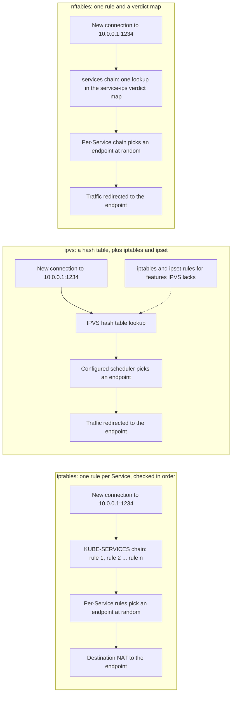

---
# Skeleton from Lead zwf3ad36 (Kubernetes blog), picked 2026-11-18.
# Drafted per docs/editorial/comparison-writing-guide.md; no author
# placeholder is left. published and reviewed are the pick time (make daily may move them to a Gap Day);
# make release keeps it (ADR-0012). verified: is the Author's alone (ADR-0007).
title: "kube-proxy iptables vs ipvs vs nftables: which backend to run"
description: "How the three kube-proxy backends look up Services and apply changes, why ipvs is being removed, and when nftables or iptables should replace it."
kind: comparison
vertical: infrastructure-cloud
tags: ["kubernetes", "kube-proxy", "nftables", "iptables", "ipvs"]
published: "2026-11-19T06:32:28Z"
verified: 2026-11-23
reviewed: "2026-11-23T10:10:31Z"
author: mira-vance
# Optional: an image HastCode may use, beside this file, replaces the
# generated title card. Never a Source's image.
# hero: option-a-vs-option-b.png
# hero_alt: "What the image shows"
# Optional: related Explainer slugs and extra sources (title + url).
related: [cilium]
---

Kubernetes SIG Network [plans to remove kube-proxy's `ipvs` backend in Kubernetes 1.40](https://kubernetes.io/blog/2026/11/16/ipvs-removal/), Dan Winship wrote on the Kubernetes blog on 16 November 2026. Unless you have replaced it, every node in a cluster runs kube-proxy, which [implements a virtual IP mechanism for Services](https://kubernetes.io/docs/reference/networking/virtual-ips/). Its backend (the documentation says proxy mode) is the kernel API it programs to do that. Developers added the `ipvs` backend in 2017 to fix performance problems in the `iptables` one. In very large clusters, kube-proxy would "[use 100% of one CPU all the time just to process iptables updates](https://kubernetes.io/blog/2026/11/16/ipvs-removal/#why-was-the-ipvs-backend-written)." Kubernetes [deprecated `ipvs` in 1.35](https://kubernetes.io/blog/2025/12/17/kubernetes-v1-35-release/#deprecation-of-ipvs-mode-in-kube-proxy) and recommends the `nftables` backend, generally available (GA) since 1.33, in its place. So which backend should write your Service rules: `iptables`, `ipvs` or `nftables`? We answer the same five questions for all three, from the Kubernetes blog, documentation and enhancement proposals (KEPs).

## TL;DR

- **`iptables`** writes one rule per Service IP into a chain the kernel checks in order, so a new connection costs more as Services are added. It is still the default.
- **`ipvs`** finds Services in a kernel hash table and changes entries one at a time, but it needs iptables and ipset for the rest of the Service API. It is deprecated.
- **`nftables`** matches every Service with one rule and a verdict map, and sends the kernel only what changed. It needs kernel 5.13 or later.
- They differ most in how a change reaches the kernel. `iptables` sends an update that grows with the cluster, `ipvs` one call per change, `nftables` one transaction the size of the change.
- Kubernetes recommends `nftables` to `ipvs` users on Kubernetes 1.36 or later. We infer that `iptables` is the fallback for older kernels, and that `ipvs` is now only a backend to migrate from.

## One new connection through three backends

All three backends do the same job. On each node, kube-proxy turns Services and their endpoints (the Pods behind them) into kernel rules. It updates the rules [when a Service or EndpointSlice changes](https://kubernetes.io/docs/reference/networking/virtual-ips/#minsyncperiod); an EndpointSlice is the object that lists a Service's endpoints. The kernel applies the rules to packets itself. When a client connects to a Service's virtual IP, the kernel [chooses an endpoint and redirects the packets to it](https://kubernetes.io/docs/reference/networking/virtual-ips/#packet-processing-iptables).

The diagram follows one new connection to the documentation's example Service, 10.0.0.1 on port 1234. With `iptables`, the packet walks the `KUBE-SERVICES` chain one rule at a time until a rule matches its address. With `ipvs`, the kernel finds the Service in a hash table, while iptables rules and ipset (kernel sets of addresses those rules can match) handle what IPVS cannot. With `nftables`, a single rule looks the address up in a verdict map. In all three, the last steps pick an endpoint and send the packet there. The documentation draws the IPVS path in [its own figure](https://kubernetes.io/docs/reference/networking/virtual-ips/#proxy-mode-ipvs).

## iptables: a chain of rules, one per Service

In this backend, kube-proxy [uses the iptables API of the kernel netfilter subsystem](https://kubernetes.io/docs/reference/networking/virtual-ips/#proxy-mode-iptables). It installs rules that redirect from each virtual IP to per-Service rules. Those link to a rule for each endpoint, which [redirects traffic with destination NAT](https://kubernetes.io/docs/reference/networking/virtual-ips/#packet-processing-iptables): it rewrites the packet's destination address.

The top level is the part that matters at scale. The `KUBE-SERVICES` chain holds [one rule to test each possible Service IP and port](https://kubernetes.io/blog/2025/02/28/nftables-kube-proxy/#why-nftables-part-1-data-plane-latency). The whole ruleset grows with the number of Services plus the number of endpoints.

The API was not built for this. In Dan Winship's words, it "[was designed for implementing simple firewalls](https://kubernetes.io/blog/2025/02/28/nftables-kube-proxy/#why-nftables-part-1-data-plane-latency)." To add a single rule, KEP-3866 says, the iptables binary must [acquire a lock and download the entire ruleset from the kernel](https://github.com/kubernetes/enhancements/blob/master/keps/sig-network/3866-nftables-proxy/README.md#the-iptables-kernel-subsystem-has-unfixable-performance-problems), then upload all of it again.

## ipvs: a kernel hash table with iptables beside it

In this backend, kube-proxy [uses the kernel IPVS and iptables APIs](https://kubernetes.io/docs/reference/networking/virtual-ips/#proxy-mode-ipvs) together to redirect traffic from Service IPs to endpoint IPs. IPVS is a kernel load-balancing subsystem. Like iptables, it hooks into netfilter, but it "uses a hash table as the underlying data structure", in the documentation's words.

Two details show how awkwardly it fits. The `kube-ipvs0` device [needs every Service IP address assigned to it](https://kubernetes.io/blog/2025/02/28/nftables-kube-proxy/#future-plans). And the IPVS APIs alone "[do not provide enough functionality to fully implement Kubernetes services](https://github.com/kubernetes/enhancements/blob/master/keps/sig-network/3866-nftables-proxy/README.md#the-ipvs-mode-of-kube-proxy-will-not-save-us)", says KEP-3866, so the backend also makes heavy use of iptables.

The people matter as much as the design. The backend's [original authors moved on](https://kubernetes.io/blog/2026/11/16/ipvs-removal/#why-is-the-ipvs-backend-now-being-deprecated) to work outside Kubernetes. KEP-5495 says SIG Network now [lacks maintainers familiar with the code](https://github.com/kubernetes/enhancements/blob/master/keps/sig-network/5495-deprecate-ipvs-mode-in-kube-proxy/README.md#motivation).

## nftables: one rule, a verdict map and a private table

In this backend, kube-proxy [uses the nftables API of the netfilter subsystem](https://kubernetes.io/docs/reference/networking/virtual-ips/#proxy-mode-nftables), which the documentation calls "the successor to the iptables API". Where iptables needs a rule per Service, the normal nftables ruleset has [a single rule that uses a verdict map](https://kubernetes.io/blog/2025/02/28/nftables-kube-proxy/#why-nftables-part-1-data-plane-latency) to dispatch. A verdict map is a table from a key to an action. Here the key is the destination IP, protocol and port. The action sends the packet to that Service's own chain.

Two more properties matter later. The backend keeps its rules in [its own table](https://github.com/kubernetes/enhancements/blob/master/keps/sig-network/3866-nftables-proxy/README.md#tables), which other nftables users are expected to ignore. And the nftables API accepts [several commands in a single atomic transaction](https://github.com/kubernetes/enhancements/blob/master/keps/sig-network/3866-nftables-proxy/README.md#communicating-with-the-kernel-nftables-subsystem), so a batch of changes lands together.

The backend arrived in Kubernetes 1.29 and [became GA in 1.33](https://kubernetes.io/blog/2026/11/16/ipvs-removal/).

## Lookup cost grows with the number of Services only in iptables

The data plane cost falls on the first packet of each new connection, the one the kernel matches against the Service rules.

**`iptables`** checks that packet against the Service rules in order, so the time is [O(n), linear, in the number of Services](https://kubernetes.io/blog/2025/02/28/nftables-kube-proxy/#why-nftables-part-1-data-plane-latency). A Service's place in the chain decides whether it gets the best case or the worst. Since 2017, kube-proxy has [removed redundant and irrelevant rules](https://kubernetes.io/blog/2026/11/16/ipvs-removal/#switching-to-iptables), but the lookup is still a chain.

**`ipvs`** [uses hash tables rather than linear lookup](https://kubernetes.io/blog/2026/11/16/ipvs-removal/#why-was-the-ipvs-backend-written), which solved the data plane problem.

**`nftables`** does one map lookup, so packet processing time is [more or less constant regardless of cluster size](https://kubernetes.io/blog/2025/02/28/nftables-kube-proxy/#why-nftables-part-1-data-plane-latency).

The Kubernetes blog's measurements, taken from [a KubeCon North America 2024 talk](https://kubernetes.io/blog/2025/02/28/nftables-kube-proxy/#learn-more), show the scale. The post reads p01 as roughly the best case, p50 as the average and p99 as roughly the worst. With 5,000 and 10,000 Services, the `nftables` p50 was about the same as the `iptables` p01. With 30,000 Services, the `nftables` p99 beat the `iptables` p01 "by a few microseconds". Against `ipvs`, `nftables` is "[very slightly](https://kubernetes.io/blog/2026/11/16/ipvs-removal/#switching-to-nftables)" better, and the Lead adds that "even the largest numbers in this graph are quite tiny". The documentation says the packet gain over `iptables` [only becomes noticeable in clusters with tens of thousands of services](https://kubernetes.io/docs/reference/networking/virtual-ips/#proxy-mode-nftables).

## Only nftables sends the kernel an update the size of the change

The control plane cost is the time kube-proxy takes to turn a changed Service or endpoint into kernel rules. It is not the smaller problem. The Lead says most `iptables` users met it [before their clusters grew large enough](https://kubernetes.io/blog/2026/11/16/ipvs-removal/#why-was-the-ipvs-backend-written) to notice the lookup cost.

**`iptables`** began by rewriting the entire ruleset on every change. Since Kubernetes v1.28 it [only makes updates where Services or EndpointSlices have changed](https://kubernetes.io/docs/reference/networking/virtual-ips/#minimize-iptables-restore). The limits of `iptables-restore` still force [an update that is O(n) in the number of Services](https://kubernetes.io/blog/2025/02/28/nftables-kube-proxy/#why-nftables-part-2-control-plane-latency), with a smaller constant than before. Batching hides part of the cost. The documentation's example deletes a Deployment of 100 Pods. With `minSyncPeriod: 0s`, kube-proxy makes [100 updates, one per endpoint](https://kubernetes.io/docs/reference/networking/virtual-ips/#minsyncperiod). With a larger value it might make 5 updates of 20 endpoints each. The default is `1s`, and a change may wait that long.

**`ipvs`** never rewrites everything, because the kernel IPVS API [has no way of doing batch updates](https://kubernetes.io/blog/2026/11/16/ipvs-removal/#why-was-the-ipvs-backend-written). That helps and hurts. The backend is [faster than `iptables` for a few small changes and potentially slower for many at once](https://kubernetes.io/blog/2026/11/16/ipvs-removal/#why-is-the-ipvs-backend-now-being-deprecated). Its ipset rules have the same gap.

**`nftables`** sends an update sized to [the Services and endpoints that changed since the last sync](https://kubernetes.io/blog/2025/02/28/nftables-kube-proxy/#why-nftables-part-2-control-plane-latency), whatever the total. Its private table also means no global lock contention with other components. Neither post measures this dimension. The 2025 one says so: "Unfortunately I don't have cool graphs for this part."

## Only ipvs leaves Service features unfinished

**`iptables`** is the reference. The Lead faults the first `ipvs` version for lacking "[100% compatibility with the `iptables` backend](https://kubernetes.io/blog/2026/11/16/ipvs-removal/#why-is-the-ipvs-backend-now-being-deprecated)". We infer that `iptables` behaviour is what the other two are measured against.

**`ipvs`** "[was never able to implement all of the edge cases of Kubernetes Service functionality correctly](https://kubernetes.io/blog/2026/11/16/ipvs-removal/)", the same post says. One example: Services that [need different endpoints for local and remote clients](https://kubernetes.io/blog/2025/02/28/nftables-kube-proxy/#future-plans) were difficult to build on IPVS. Various features beyond basic load balancing fall back to iptables rules, which brings back some of the `iptables` backend's scaling problems.

**`nftables`** is "[fully supported, feature-complete](https://kubernetes.io/blog/2026/11/16/ipvs-removal/#switching-to-nftables)", per the Lead. It is also [intentionally not 100% compatible](https://kubernetes.io/blog/2025/02/28/nftables-kube-proxy/#why-not-nftables) with `iptables`, because its authors used an opt-in backend to fix old defaults. The documentation [lists the differences](https://kubernetes.io/docs/reference/networking/virtual-ips/#migrating-from-iptables-mode-to-nftables):

- NodePort Services answer only on the node's primary addresses, unless you set `--nodeport-addresses`.
- kube-proxy adds no firewall rules to accept NodePort traffic.
- It installs no workaround for a bug in conntrack (the kernel's connection tracking) in kernels before 6.1, unless you pass `--conntrack-tcp-be-liberal`.
- NodePorts on `127.0.0.1` are an alpha feature in Kubernetes 1.37, off by default.

## IPVS schedulers cannot help while each node balances alone

**`iptables`** picks an endpoint [by session affinity or at random](https://kubernetes.io/docs/reference/networking/virtual-ips/#packet-processing-iptables).

**`ipvs`** offers [eleven schedulers](https://kubernetes.io/docs/reference/networking/virtual-ips/#proxy-mode-ipvs) through the `ipvs.scheduler` field, among them round robin (`rr`), least connection (`lc`) and Maglev hashing (`mh`). A scheduler is the algorithm that picks the endpoint. For some users this choice was the backend's other attraction.

A longer list reads like better balancing. The Lead explains why it is not. Every node runs its own kube-proxy, and the processes "[do not share their IPVS scheduler state](https://kubernetes.io/blog/2026/11/16/ipvs-removal/#what-about-ipvs-schedulers)". Each node picks endpoints without knowing what clients on other nodes are doing. We infer that a least-connection scheduler therefore counts only the connections that entered through its own node. Even schedulers designed for distributed use "generally don't work better than random selection" in kube-proxy. Maglev hashing, for example, is efficient only in a specific two-layer load-balancer design, and kube-proxy cannot act as either layer.

**`nftables`** [selects an endpoint at random by default](https://kubernetes.io/docs/reference/networking/virtual-ips/#proxy-mode-nftables), like `iptables`.

## ipvs has an end date, iptables stays, nftables is the planned default

**`iptables`** is [the default in Kubernetes 1.37](https://kubernetes.io/docs/reference/networking/virtual-ips/#proxy-modes), and the documentation says a future version will change the default to `nftables`. It advises setting `mode` explicitly, so an upgrade cannot change the backend unexpectedly. The long-term risk for `iptables` sits outside Kubernetes: Red Hat [plans to remove the iptables API entirely](https://kubernetes.io/blog/2026/11/16/ipvs-removal/#why-is-the-ipvs-backend-now-being-deprecated) from Red Hat Enterprise Linux (RHEL). Moving from `ipvs` to `iptables` also comes with advice to [reboot each node](https://kubernetes.io/blog/2026/11/16/ipvs-removal/#switching-to-iptables), not only restart kube-proxy.

**`ipvs`** has [warned at startup since 1.35](https://kubernetes.io/blog/2025/12/17/kubernetes-v1-35-release/#deprecation-of-ipvs-mode-in-kube-proxy). The Lead says removal is planned for 1.40. The documentation and [KEP-5495](https://github.com/kubernetes/enhancements/blob/master/keps/sig-network/5495-deprecate-ipvs-mode-in-kube-proxy/README.md#graduation-criteria) split that into two steps. In 1.40 the `KubeProxyIPVS` feature gate turns off by default, and you can turn it back on. In 1.43 the code is deleted. Because the backend depends on iptables, it also leaves RHEL when iptables does.

**`nftables`** [requires kernel 5.13 or later](https://kubernetes.io/docs/reference/networking/virtual-ips/#proxy-mode-nftables). Kubernetes recommends it to `ipvs` users on [Kubernetes 1.36 or later](https://kubernetes.io/blog/2026/11/16/ipvs-removal/#switching-to-nftables), because some performance and scaling fixes were not backported to earlier releases. KEP-5495 expects the kernel requirement to matter less. Every kernel too old for the backend "[will be out of LTS by the end of 2026](https://github.com/kubernetes/enhancements/blob/master/keps/sig-network/5495-deprecate-ipvs-mode-in-kube-proxy/README.md#proposal)"; LTS is long-term support. Switching from `ipvs` means changing `mode: ipvs` to `mode: nftables` and restarting kube-proxy.

## Trade-offs

Each cell summarises a section above, where its source is linked.

| Question | iptables | ipvs | nftables |
|---|---|---|---|
| Service lookup | One rule per Service, checked in order | Kernel hash table | One rule and a verdict map |
| First-packet latency | Grows with the number of Services | Very slightly behind nftables | Roughly constant |
| Update sent to the kernel | Changed rules since v1.28, still O(n) in Services | One change at a time; no batch API | Only what changed, in one transaction |
| Many changes at once | Batched by `minSyncPeriod` | Potentially slower than iptables | Not measured in the Sources |
| Service features | The behaviour the others are compared with | Incomplete; falls back to iptables and ipset | Complete; different NodePort and conntrack defaults |
| Endpoint choice | Session affinity or random | Eleven schedulers, each node on its own | Random by default |
| Status | Default in 1.37 | Deprecated in 1.35, off by default in 1.40, deleted in 1.43 | GA since 1.33; the planned default |
| Needs | The iptables API, which RHEL plans to remove | The IPVS and iptables APIs | Kernel 5.13 or later; Kubernetes 1.36 or later recommended |

## When to run nftables, iptables or ipvs

Everything in this section is our inference from the facts above, except where we name a Source.

**`nftables` wins when your nodes run kernel 5.13 or later and your cluster runs Kubernetes 1.36 or later.** That is the Lead's own recommendation for `ipvs` users. Expect the largest gain where Services number in the tens of thousands or endpoints change constantly. Before you switch, check the two metrics [the documentation names](https://kubernetes.io/docs/reference/networking/virtual-ips/#migrating-from-iptables-mode-to-nftables): `iptables_ct_state_invalid_dropped_packets_total` and `iptables_localhost_nodeports_accepted_packets_total`. Confirm that your pod network and NetworkPolicy implementation [support the backend](https://kubernetes.io/blog/2025/02/28/nftables-kube-proxy/#why-not-nftables).

**`iptables` wins when the kernel or the Kubernetes version is too old for `nftables`**, and in small clusters where neither cost shows. The Lead rates the 2026 backend "[still not as good as the `ipvs` backend](https://kubernetes.io/blog/2026/11/16/ipvs-removal/#switching-to-iptables)", yet far better than in 2017. Watch `sync_proxy_rules_duration_seconds`. The documentation suggests raising `minSyncPeriod` when its average runs [much larger than 1 second](https://kubernetes.io/docs/reference/networking/virtual-ips/#minsyncperiod). We would treat that as the signal to plan the move to `nftables`.

**`ipvs` wins nowhere new.** It keeps working, with a warning, until 1.40 turns it off by default. Use that time to test `nftables`. If you chose `ipvs` for a scheduler, the Lead's analysis suggests random selection costs you little.

The good news is that the replacement is not a compromise: the fast lookup, the small updates and the full Service API now come in one backend. Check your nodes' kernel version, your Kubernetes version and the `mode` in your kube-proxy configuration, and you know which paragraph above is yours.

## Sources

- Dan Winship, [Scheduling the removal of the kube-proxy IPVS backend](https://kubernetes.io/blog/2026/11/16/ipvs-removal/), Kubernetes blog, 16 November 2026.
- Dan Winship, [NFTables mode for kube-proxy](https://kubernetes.io/blog/2025/02/28/nftables-kube-proxy/), Kubernetes blog, 28 February 2025 (latency data from the KubeCon North America 2024 talk "From Observability to Performance").
- Kubernetes documentation, [Virtual IPs and Service Proxies](https://kubernetes.io/docs/reference/networking/virtual-ips/), v1.37: "Proxy modes", "`minSyncPeriod`", "Updating legacy `minSyncPeriod` configuration", "Migrating from `iptables` mode to `nftables`".
- [KEP-5495: Deprecate IPVS mode in kube-proxy](https://github.com/kubernetes/enhancements/blob/master/keps/sig-network/5495-deprecate-ipvs-mode-in-kube-proxy/README.md), Kubernetes enhancements: Motivation, Proposal, Graduation Criteria.
- [KEP-3866: Add an nftables-based kube-proxy backend](https://github.com/kubernetes/enhancements/blob/master/keps/sig-network/3866-nftables-proxy/README.md), Kubernetes enhancements. Sections cited: "The iptables kernel subsystem has unfixable performance problems", "The `ipvs` mode of kube-proxy will not save us", "Tables", "Communicating with the kernel nftables subsystem".
- Kubernetes v1.35 Release Team, [Kubernetes v1.35: Timbernetes (The World Tree Release)](https://kubernetes.io/blog/2025/12/17/kubernetes-v1-35-release/#deprecation-of-ipvs-mode-in-kube-proxy), Kubernetes blog, 17 December 2025: "Deprecation of ipvs mode in kube-proxy".
