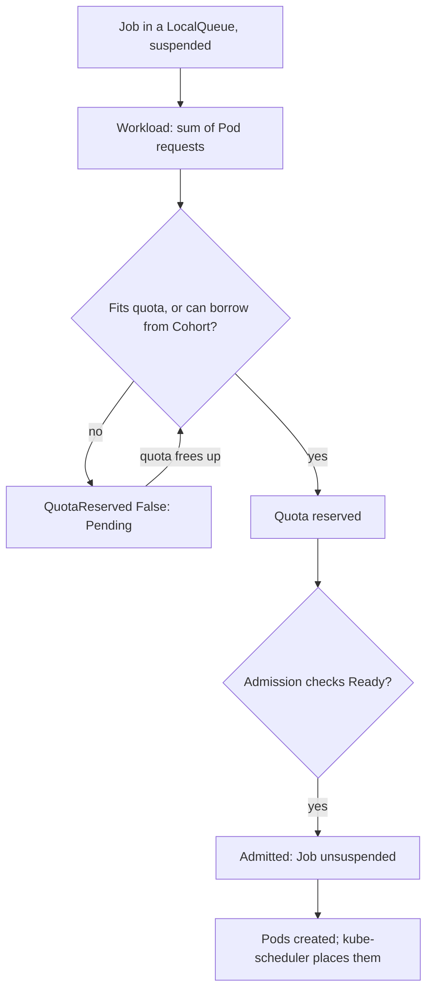

---
# Skeleton from Lead nhc3nfse (Kubernetes blog), picked 2026-10-27.
# published and reviewed are the pick time, provisional: set them
# when you publish. verified: is the Author's alone (ADR-0007).
title: "Kueue job admission: why a Kubernetes Job waits with no Pods"
description: "Kueue keeps a Kubernetes Job suspended until its whole request fits a queue's quota. How admission works, and how to read why a Job still waits."
kind: concept
vertical: infrastructure-cloud
tags: ["kubernetes", "kueue", "batch", "quota", "scheduling"]
published: "2026-10-28T12:54:21Z"
verified: 2026-10-28
reviewed: "2026-10-28T12:54:21Z"
author: mira-vance
# Optional: an image HastCode may use, beside this file, replaces the
# generated title card. Never a Source's image.
# hero: concept-name.png
# hero_alt: "What the image shows"
# Optional: related Explainer slugs and extra sources (title + url).
# related: [http-connection-reuse]
---

In a [walkthrough on the Kubernetes blog](https://kubernetes.io/blog/2026/10/14/tracing-kueue-admission-with-headlamp/), Utkarsh Raj, René Dudfield and Kevin Hannon submit a Job that runs [three Pods with one CPU each](https://kubernetes.io/blog/2026/10/14/tracing-kueue-admission-with-headlamp/#step-3-compare-the-workload-s-request-with-its-assignment): three CPUs and 600 MiB of memory in all. The queue it enters offers [two CPUs and two Pod slots](https://kubernetes.io/blog/2026/10/14/tracing-kueue-admission-with-headlamp/#step-5-inspect-clusterqueue-capacity-and-usage). Minutes pass. The Job is still suspended, with no application logs and possibly no Pod to inspect. Nothing has failed. Kueue, the controller in front of the Job, has compared the whole request with the queue's quota, found it does not fit, and [kept the Job suspended](https://kubernetes.io/blog/2026/10/14/tracing-kueue-admission-with-headlamp/#what-we-learned-without-leaving-headlamp) until quota frees up or the queue changes. The first question, the authors write, is not why the Pod is pending but ["Has Kueue admitted the Workload?"](https://kubernetes.io/blog/2026/10/14/tracing-kueue-admission-with-headlamp/)

> Drafted with AI assistance, researched, verified and edited by the HastCode editorial team. We publish only as many pieces as the Author can verify this way.

## TL;DR

- **Admission** in Kueue is the decision to [let a Workload start, meaning its Pods may be created](https://kueue.sigs.k8s.io/docs/concepts/#admission). Kueue decides [when a job waits, starts or is preempted](https://kueue.sigs.k8s.io/docs/overview/); kube-scheduler still decides which nodes the Pods run on.
- The mechanism: Kueue [suspends each Job](https://kueue.sigs.k8s.io/docs/tasks/run/jobs/#1-define-the-job) and represents it as a Workload whose request is [the sum of every Pod's requests](https://kueue.sigs.k8s.io/docs/concepts/workload/#resource-requests). When that total fits the quota of the ClusterQueue behind the Job's LocalQueue, Kueue [reserves the quota](https://kueue.sigs.k8s.io/docs/concepts/admission/), runs any admission checks, and lets the Job start.
- Why it exists: in plain Kubernetes the job controller [creates a Job's Pods instantly](https://kubernetes.io/blog/2022/10/04/introducing-kueue/#why-kueue), and ResourceQuota [rejects a request that exceeds it](https://kubernetes.io/docs/concepts/policy/resource-quotas/#how-kubernetes-resourcequotas-work) instead of queueing it.
- What to do: size quota for whole Workloads, lend idle quota through Cohorts with limits, and choose the queue order and preemption policy. The cost: a waiting Job has no Pod events to read, so you [read the Workload's conditions](https://kueue.sigs.k8s.io/docs/tasks/troubleshooting/troubleshooting_jobs/#is-my-job-admitted) instead, and preemption [terminates running Pods](https://kueue.sigs.k8s.io/docs/tasks/troubleshooting/troubleshooting_jobs/#is-my-job-suspended).

## Admission decides whether a Job starts, not where its Pods run

Kueue's documentation defines admission as ["the process of allowing a Workload to start (Pods to be created)"](https://kueue.sigs.k8s.io/docs/concepts/#admission). Kueue, its overview says, decides when a job should wait, when it [should be admitted to start, and when it should be preempted](https://kueue.sigs.k8s.io/docs/overview/), with preemption meaning its active Pods are deleted.

In our words: admission is a gate in front of the job controller. Until a Job passes it, Kubernetes creates no Pods for it, so there is nothing for the scheduler to place. The Lead frames the split as two questions. Kueue asks whether a Workload should start now, ["considering queue policy, quota, ResourceFlavors, admission checks, and other waiting Workloads"](https://kubernetes.io/blog/2026/10/14/tracing-kueue-admission-with-headlamp/#first-separate-admission-from-pod-scheduling). The scheduler asks, only after admission, which nodes can run the Pods.

The step at the heart of admission is **quota reservation**: Kueue [locks the resources a Workload needs](https://kueue.sigs.k8s.io/docs/concepts/#quota-reservation) in a ClusterQueue.

What does not count: a Pod stuck in `Pending` after its Workload was admitted. That Pod is waiting on node capacity, affinity, taints, volumes or an image pull, which the Lead assigns to the [scheduling branch of the investigation](https://kubernetes.io/blog/2026/10/14/tracing-kueue-admission-with-headlamp/#if-the-workload-is-admitted-switch-views), not to Kueue.

## Five objects carry the decision

Kueue adds a small set of APIs. Each is defined in its own docs:

- A **Workload** represents [the resource requirements of a job](https://kueue.sigs.k8s.io/docs/concepts/workload/) and is the unit of admission. Kueue creates one for each Job automatically and syncs its decisions back to the Job.
- A **LocalQueue** is a namespaced object that [points to one ClusterQueue](https://kueue.sigs.k8s.io/docs/concepts/local_queue/). Users submit jobs to a LocalQueue, never to a ClusterQueue directly.
- A **ClusterQueue** is a cluster-scoped object that [governs a pool of resources](https://kueue.sigs.k8s.io/docs/concepts/cluster_queue/) such as Pods, CPU, memory and accelerators, with quotas per flavor. Only batch administrators should create them.
- A **ResourceFlavor** represents [a variation of a resource](https://kueue.sigs.k8s.io/docs/concepts/resource_flavor/), such as spot versus on-demand machines or different GPU models, tied to nodes through labels, taints and tolerations.
- A **Cohort** is [a group of ClusterQueues that can borrow unused quota](https://kueue.sigs.k8s.io/docs/concepts/#cohort) from each other.

## The admission path, from suspended Job to running Pods

Walk it with the Lead's numbers. A Job names its LocalQueue with the [`kueue.x-k8s.io/queue-name` label](https://kueue.sigs.k8s.io/docs/tasks/run/jobs/#1-define-the-job); it need not be created suspended, because Kueue manages suspension through a webhook. Kueue creates a Workload and totals its request as [each Pod's requests multiplied by the Pod count](https://kueue.sigs.k8s.io/docs/concepts/workload/#resource-requests). The Lead's Job has [`parallelism: 3`](https://kubernetes.io/blog/2026/10/14/tracing-kueue-admission-with-headlamp/#step-3-compare-the-workload-s-request-with-its-assignment) and one CPU per Pod, so it asks for three Pods, three CPUs and 600 MiB.

The ClusterQueue then tries its flavors in order and assigns [the first with enough unused nominal quota](https://kueue.sigs.k8s.io/docs/concepts/cluster_queue/#flavors-and-resources) in the ClusterQueue or its Cohort. The Lead's queue has two CPUs and two Pod slots. Three does not fit two, so the Workload takes the "no" branch, and the Job stays suspended.

Had it fit, Kueue would reserve the quota, wait for [every admission check to report Ready](https://kueue.sigs.k8s.io/docs/concepts/admission/), and admit. In the 2022 post's example, admission is a [single update to the Job](https://kubernetes.io/blog/2022/10/04/introducing-kueue/#example-use-case): `.spec.suspend` becomes false, and the chosen flavor's labels are added to the Pod template's `nodeSelector`.

## Why is my Job still pending? The Workload's conditions say

Kueue's troubleshooting guide starts where the Lead does: [look at the Workload status](https://kueue.sigs.k8s.io/docs/tasks/troubleshooting/troubleshooting_jobs/#is-my-job-admitted), not the Pods. A Job's Workload is named in the form [`<api-name>-<job-name>-<hash>`](https://kueue.sigs.k8s.io/docs/tasks/troubleshooting/troubleshooting_jobs/#identifying-the-workload-for-your-job), and `kubectl describe workload` shows its conditions. Each pattern points somewhere different:

- **No conditions at all.** Under the `StrictFIFO` strategy, Kueue [only attempts to admit the head](https://kueue.sigs.k8s.io/docs/tasks/troubleshooting/troubleshooting_jobs/#unattempted-workload) of each ClusterQueue, so a Workload further back may not have been tried yet.
- **`QuotaReserved` is False with reason `Pending`.** Kueue tried and the quota was short. The docs show a message of the form ["insufficient quota for cpu in flavor default-flavor"](https://kueue.sigs.k8s.io/docs/tasks/troubleshooting/troubleshooting_jobs/#pending-workload), which is the Lead's case.
- **Reason `Inadmissible`.** The configuration is wrong, for example a [LocalQueue that does not exist](https://kueue.sigs.k8s.io/docs/tasks/troubleshooting/troubleshooting_jobs/#misconfigured-localqueues-or-clusterqueues), or a ClusterQueue that is inactive because a configured [flavor is missing](https://kueue.sigs.k8s.io/docs/tasks/troubleshooting/troubleshooting_queues/#why-no-workloads-are-admitted-in-the-clusterqueue).
- **`QuotaReserved` is True but not admitted.** Quota is held and an [admission check is still Pending](https://kueue.sigs.k8s.io/docs/tasks/troubleshooting/troubleshooting_jobs/#pending-admission-checks).
- **An `Evicted` condition with reason `Preempted`.** The Workload was admitted, then [evicted for a higher-priority Workload](https://kueue.sigs.k8s.io/docs/tasks/troubleshooting/troubleshooting_jobs/#is-my-job-preempted), and is queued again.
- **`Admitted` is True and Pods are `Pending`.** Kueue is done. The Lead says to [switch to the Job and Pod views](https://kubernetes.io/blog/2026/10/14/tracing-kueue-admission-with-headlamp/#if-the-workload-is-admitted-switch-views) and read scheduler events.

## Where admission shows up: Ray, Kubeflow, autoscaled GPUs and many clusters

Admission is not only for `batch/v1` Jobs. Kueue's overview lists [built-in integrations](https://kueue.sigs.k8s.io/docs/overview/#in-tree-integrations) for JobSet, Kubeflow training jobs, RayJob and RayCluster, plain Pods and Pod groups, and serving workloads such as Deployments and StatefulSets. Any other job API can take part by [creating a Workload for itself](https://kueue.sigs.k8s.io/docs/concepts/workload/#custom-workloads).

Quota is a logical count, and the [ProvisioningRequest admission check](https://kueue.sigs.k8s.io/docs/concepts/admission_check/provisioning_request/) adds a physical one through cluster-autoscaler. The docs walk a training job that needs 16 GPUs. The ClusterQueue has 32 GPUs of quota, so Kueue reserves 16, then creates a ProvisioningRequest. Cluster-autoscaler scales up four nodes with four GPUs each and reports `Provisioned=true`; Kueue marks the check Ready and admits the Workload, and the docs' outcome is that the job ["starts immediately with all 16 GPUs available"](https://kueue.sigs.k8s.io/docs/concepts/admission_check/provisioning_request/).

[MultiKueue](https://kueue.sigs.k8s.io/docs/concepts/multikueue/), beta since Kueue v0.9, applies the same gate across clusters. Once a Workload reserves quota in a manager cluster, a dispatcher creates copies in worker clusters. When one worker admits its copy, the manager [deletes the others](https://kueue.sigs.k8s.io/docs/concepts/multikueue/#job-flow) and runs the Job there.

## Why plain Kubernetes needed a queue in front of the job controller

The default behaviour is reasonable on a quiet cluster. Once a Job is created, explain Abdullah Gharaibeh and Aldo Culquicondor of Google in the 2022 post that introduced Kueue, ["the job-controller instantly creates the pods and kube-scheduler continuously attempts to assign the pods to nodes"](https://kubernetes.io/blog/2022/10/04/introducing-kueue/#why-kueue). At scale, the authors write, it ["can work the control plane to death"](https://kubernetes.io/blog/2022/10/04/introducing-kueue/#why-kueue), and there is no way to say which jobs get resources first, in what order, or how to share fairly.

The built-in tool for sharing, ResourceQuota, works at the wrong moment for this. It limits [aggregate consumption per namespace](https://kubernetes.io/docs/concepts/policy/resource-quotas/), and a create or update that would exceed it is [rejected with HTTP 403 Forbidden](https://kubernetes.io/docs/concepts/policy/resource-quotas/#how-kubernetes-resourcequotas-work).

The other way out, a separate batch scheduler, could [replace kube-scheduler or the job controller](https://kubernetes.io/blog/2022/10/04/introducing-kueue/#why-kueue), which the authors saw as an operational burden and a source of fragmented job APIs. So Kueue's design principle is to [avoid duplicating mature components](https://kueue.sigs.k8s.io/docs/overview/#why-use-kueue): cluster-autoscaler, kube-scheduler and kube-controller-manager keep autoscaling, Pod placement and job lifecycle. To make that possible, the team [added two knobs to the Job API](https://kubernetes.io/blog/2022/10/04/introducing-kueue/#overview): `suspend`, to say when a Job starts, and mutable scheduling directives, to say where its Pods may go.

## Practice one: size quota for the whole Workload, in every resource it requests

Kueue admits against the total, so plan in totals. A Job with three one-CPU Pods asks for three CPUs; the Lead warns that reading [only one Pod's template underestimates the Workload](https://kubernetes.io/blog/2026/10/14/tracing-kueue-admission-with-headlamp/#step-3-compare-the-workload-s-request-with-its-assignment).

Cover every resource the Pods request. If a ClusterQueue [has no quota defined for a requested resource](https://kueue.sigs.k8s.io/docs/tasks/troubleshooting/troubleshooting_jobs/#does-my-clusterqueue-have-the-resource-requests-that-the-job-requires), Kueue cannot admit the Job at all. To cap the number of Pods, give the ClusterQueue a quota on the [reserved `pods` resource](https://kueue.sigs.k8s.io/docs/concepts/cluster_queue/#flavors-and-resources), which Kueue computes from the Workload; we infer that is the "two Pod slots" in the Lead's queue.

Know how requests are counted. If a Pod sets only limits, Kueue [treats the limits as requests](https://kueue.sigs.k8s.io/docs/concepts/workload/#requests-values-adjustment); a LimitRange's defaults fill in missing values; and a Workload whose adjusted values fail LimitRange validation is [marked Inadmissible](https://kueue.sigs.k8s.io/docs/concepts/workload/#requests-values-validation).

The cost is that quota is only an accounting promise. Quota reservation confirms logical availability but [does not guarantee the physical resources exist](https://kueue.sigs.k8s.io/docs/concepts/admission_check/provisioning_request/). We infer the trade-off: quota set above what the nodes can hold admits Jobs whose Pods then wait in `Pending`, and quota set below it leaves nodes idle while Jobs queue.

## Practice two: lend idle quota through a Cohort, and cap the borrowing

A ClusterQueue's **nominal quota** is what it owns. In a Cohort, ClusterQueues can [borrow each other's unused nominal quota](https://kueue.sigs.k8s.io/docs/concepts/cluster_queue/#cohort). The docs' [example](https://kueue.sigs.k8s.io/docs/concepts/cluster_queue/#borrowing-example) pairs `team-a-cq`, with 9 CPUs, and `team-b-cq`, with 12. While team B has nothing admitted, team A can admit Workloads totalling 12 + 9 = 21 CPUs.

Two limits bound that. A [`borrowingLimit`](https://kueue.sigs.k8s.io/docs/concepts/cluster_queue/#borrowinglimit) of 1 on team A caps it at 9 + 1 = 10 CPUs. A [`lendingLimit`](https://kueue.sigs.k8s.io/docs/concepts/cluster_queue/#lendinglimit) of 1 on team B has the same effect from the lender's side. A Cohort can also hold [its own shared quota](https://kueue.sigs.k8s.io/docs/concepts/cohort/#configuring-quotas), and Cohorts can nest into a tree with [fair-sharing weights](https://kueue.sigs.k8s.io/docs/concepts/cohort/#hierarchical-cohorts).

Borrowing is not ownership. When team B has pending Workloads and team A has used its nominal quota, Kueue [admits team B's Workloads first](https://kueue.sigs.k8s.io/docs/concepts/cluster_queue/#borrowing-example). With `reclaimWithinCohort` enabled, a pending Workload can [preempt Workloads in other ClusterQueues](https://kueue.sigs.k8s.io/docs/concepts/cluster_queue/#preemption) that are using more than their nominal quota. The cost of borrowed capacity is that it can be taken back. One detail catches people out: to borrow a resource, a ClusterQueue [must define nominal quota for it, even if that is 0](https://kueue.sigs.k8s.io/docs/concepts/cohort/#configuring-quotas).

## Practice three: choose the queue order and who may preempt whom

Within a ClusterQueue, Workloads are ordered [by priority, then by creation time](https://kueue.sigs.k8s.io/docs/concepts/cluster_queue/#queueing-strategy). The strategy decides what happens when the head does not fit. Under `StrictFIFO`, older Workloads that cannot be admitted [block newer ones, even if those fit](https://kueue.sigs.k8s.io/docs/concepts/cluster_queue/#queueing-strategy). Under `BestEffortFIFO`, the default, they do not. Priority comes from the Job's Pod priority, or from a [WorkloadPriorityClass](https://kueue.sigs.k8s.io/docs/concepts/workload/#priority) that sets queueing priority without touching Pod priority.

Preemption is off unless you enable it. The ClusterQueue's [`withinClusterQueue`, `reclaimWithinCohort` and `borrowWithinCohort`](https://kueue.sigs.k8s.io/docs/concepts/cluster_queue/#preemption) policies all default to `Never`; `LowerPriority` lets a pending Workload evict lower-priority ones. Kueue uses [heuristics to preempt as few Workloads as possible](https://kueue.sigs.k8s.io/docs/concepts/preemption/).

The costs are concrete. `StrictFIFO` trades utilisation for predictable order. Preemption suspends the Job again, and Kubernetes [terminates and deletes its running Pods](https://kueue.sigs.k8s.io/docs/tasks/troubleshooting/troubleshooting_jobs/#is-my-job-suspended). Those Pods get a SIGTERM and their grace period, and they [do not count towards the Job's completions](https://kubernetes.io/docs/concepts/workloads/controllers/job/#suspending-a-job), so a preemptible Job needs to save its progress.

## What Kueue admission is not

**It is not Pod scheduling.** Kueue decides whether a Job's Pods may exist, and leaves pod-to-node scheduling to kube-scheduler. It influences placement by adding the flavor's labels in the Pod template's [`nodeSelector`](https://kueue.sigs.k8s.io/docs/concepts/resource_flavor/#resourceflavor-tolerations-for-automatic-scheduling) and adding the flavor's tolerations.

**It is not ResourceQuota.** A ResourceQuota is enforced by the API server at creation time and [rejects what exceeds it](https://kubernetes.io/docs/concepts/policy/resource-quotas/#how-kubernetes-resourcequotas-work). Kueue accepts the Job and makes it wait in a queue, with an order and a reason you can read.

**It is not gang scheduling of Pods.** Kueue reserves quota for the whole Workload. We infer from the docs that this is all-or-nothing on quota, not on nodes: an admitted Job can still have [some Pods Running and one Pending](https://kueue.sigs.k8s.io/docs/tasks/troubleshooting/troubleshooting_jobs/#are-the-pods-of-my-job-running). Kueue offers a separate, timeout-based [all-or-nothing mode with ready Pods](https://kueue.sigs.k8s.io/docs/concepts/workload/#all-or-nothing-semantics-for-job-resource-assignment) that evicts and requeues a Job that does not become ready. That mode deserves its own Explainer.

## What understanding admission makes possible

The first thing it gives you is a rule that splits every investigation in two. The Lead's version: [not admitted, look at Kueue; admitted but Pods `Pending`, look at the Job, Pods, nodes and scheduler](https://kubernetes.io/blog/2026/10/14/tracing-kueue-admission-with-headlamp/#if-the-workload-is-admitted-switch-views). A Job with no Pods stops being a mystery and becomes a condition message, a LocalQueue and a ClusterQueue to compare.

The second is a queue you can see into. Kueue's on-demand visibility API, available since v0.6.0, lists pending Workloads with their [position in the ClusterQueue and in the LocalQueue](https://kueue.sigs.k8s.io/docs/tasks/manage/monitor_pending_workloads/pending_workloads_on_demand/#local-queue-visibility-via-kubectl), which the docs say can help users estimate when their jobs will start.

You can reproduce the Lead's case on a test cluster. The plugin repository ships [sample Cohort, ClusterQueue, LocalQueue, ResourceFlavor and Job manifests](https://github.com/headlamp-k8s/plugins/tree/main/kueue/test-files/deploy). As the Lead [suggests](https://kubernetes.io/blog/2026/10/14/tracing-kueue-admission-with-headlamp/#optional-reproduce-the-pending-scenario), give a ClusterQueue two CPUs and two Pod slots, submit a three-Pod Job with one CPU per Pod, and read the Workload's `QuotaReserved` condition. Kueue keeps the Job suspended [until quota becomes available or the queue configuration changes](https://kubernetes.io/blog/2026/10/14/tracing-kueue-admission-with-headlamp/#what-we-learned-without-leaving-headlamp), so we infer that raising both quotas to three would let it start. On a shared cluster, a Job that waits with a clear reason, in a known place in line, is the system working as designed.

## Sources

- Utkarsh Raj, René Dudfield, Kevin Hannon, ["Why Is My Kubernetes Job Still Pending? Tracing Kueue Admission with Headlamp"](https://kubernetes.io/blog/2026/10/14/tracing-kueue-admission-with-headlamp/), Kubernetes blog, 14 October 2026 (a mirror of the [Headlamp blog original](https://headlamp.dev/blog/2026/10/12/tracing-kueue-admission-with-headlamp), 12 October 2026).
- Abdullah Gharaibeh, Aldo Culquicondor, ["Introducing Kueue"](https://kubernetes.io/blog/2022/10/04/introducing-kueue/), Kubernetes blog, 4 October 2022.
- Kueue, ["Overview"](https://kueue.sigs.k8s.io/docs/overview/).
- Kueue, ["Concepts"](https://kueue.sigs.k8s.io/docs/concepts/), including the glossary.
- Kueue, ["Admission"](https://kueue.sigs.k8s.io/docs/concepts/admission/).
- Kueue, ["Workload"](https://kueue.sigs.k8s.io/docs/concepts/workload/).
- Kueue, ["Local Queue"](https://kueue.sigs.k8s.io/docs/concepts/local_queue/).
- Kueue, ["Cluster Queue"](https://kueue.sigs.k8s.io/docs/concepts/cluster_queue/).
- Kueue, ["Resource Flavor"](https://kueue.sigs.k8s.io/docs/concepts/resource_flavor/).
- Kueue, ["Cohort"](https://kueue.sigs.k8s.io/docs/concepts/cohort/).
- Kueue, ["Admission Check"](https://kueue.sigs.k8s.io/docs/concepts/admission_check/) and ["ProvisioningRequest"](https://kueue.sigs.k8s.io/docs/concepts/admission_check/provisioning_request/).
- Kueue, ["MultiKueue"](https://kueue.sigs.k8s.io/docs/concepts/multikueue/).
- Kueue, ["Preemption"](https://kueue.sigs.k8s.io/docs/concepts/preemption/).
- Kueue, ["Run A Kubernetes Job"](https://kueue.sigs.k8s.io/docs/tasks/run/jobs/).
- Kueue, ["Troubleshooting Jobs"](https://kueue.sigs.k8s.io/docs/tasks/troubleshooting/troubleshooting_jobs/) and ["Troubleshooting Queues"](https://kueue.sigs.k8s.io/docs/tasks/troubleshooting/troubleshooting_queues/).
- Kueue, ["Pending Workloads on-demand"](https://kueue.sigs.k8s.io/docs/tasks/manage/monitor_pending_workloads/pending_workloads_on_demand/).
- Kubernetes, ["Jobs: Suspending a Job"](https://kubernetes.io/docs/concepts/workloads/controllers/job/#suspending-a-job) and ["Mutable Scheduling Directives"](https://kubernetes.io/docs/concepts/workloads/controllers/job/#mutable-scheduling-directives).
- Kubernetes, ["Resource Quotas"](https://kubernetes.io/docs/concepts/policy/resource-quotas/).
- Headlamp, [Kueue plugin](https://github.com/headlamp-k8s/plugins/tree/main/kueue) and [sample manifests](https://github.com/headlamp-k8s/plugins/tree/main/kueue/test-files/deploy), GitHub.
