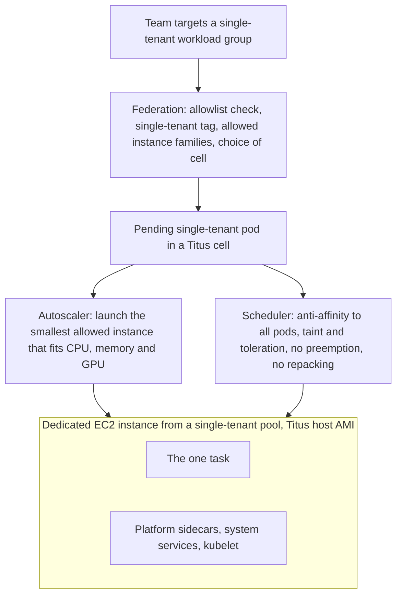

Netflix's container platform, Titus, [launches millions of containers a week across tens of thousands of EC2 instances](https://netflixtechblog.com/single-tenant-titus-vm-level-isolation-on-a-multi-tenant-container-platform-6d8b1909d163), and its default is to pack many teams' containers onto each host. In October 2026 Netflix described the opposite move: for an allowlisted set of jobs, Titus now [gives a single task its own virtual machine](https://netflixtechblog.com/single-tenant-titus-vm-level-isolation-on-a-multi-tenant-container-platform-6d8b1909d163), and the team that owns the job changes a label, not its deployment.

> Drafted with AI assistance, researched, verified and edited by the HastCode editorial team. We publish only as many pieces as the Author can verify this way.

## TL;DR

- Single-tenant Titus runs one task per EC2 instance, sized to fit that task. Netflix's Compute/Platform team still owns, patches and scales the host, and the application team keeps [the same Titus API and deployment path](https://netflixtechblog.com/single-tenant-titus-vm-level-isolation-on-a-multi-tenant-container-platform-6d8b1909d163).
- It exists because some interference is out of the kernel's reach: cgroups cap CPU time and memory, but [nothing partitions last-level cache, memory bandwidth or the network shaper's global lock](https://netflixtechblog.com/single-tenant-titus-vm-level-isolation-on-a-multi-tenant-container-platform-6d8b1909d163), and stateful streaming jobs paid for that in minutes of catch-up.
- Three parts make it work: federation decides who qualifies from an allowlist, the autoscaler launches the [smallest instance that fits](https://netflixtechblog.com/single-tenant-titus-vm-level-isolation-on-a-multi-tenant-container-platform-6d8b1909d163), and the Kubernetes scheduler keeps the node to one task with anti-affinity, a taint and no repacking.
- The price is slower starts and wasted headroom on small nodes, so Netflix [aims it at large, long-running, disruption-sensitive workloads](https://netflixtechblog.com/single-tenant-titus-vm-level-isolation-on-a-multi-tenant-container-platform-6d8b1909d163). The surprise: moving the noisiest jobs out [let the shared fleet pack denser](https://netflixtechblog.com/single-tenant-titus-vm-level-isolation-on-a-multi-tenant-container-platform-6d8b1909d163).

## The path a single-tenant task takes

The diagram is ours, redrawn from the text of Netflix's post; Netflix's own figures are in [the original](https://netflixtechblog.com/single-tenant-titus-vm-level-isolation-on-a-multi-tenant-container-platform-6d8b1909d163). A team opts in not with an API flag but by [targeting a single-tenant workload group](https://netflixtechblog.com/single-tenant-titus-vm-level-isolation-on-a-multi-tenant-container-platform-6d8b1909d163) that the platform team controls. From there, three components act in turn, top to bottom. The sections below walk them in order, then turn to what they cost.

Netflix describes each region as split into [independent cells, each limiting how large one control plane gets](https://netflixtechblog.com/single-tenant-titus-vm-level-isolation-on-a-multi-tenant-container-platform-6d8b1909d163). We infer that the autoscaler and scheduler in the diagram run per cell, since the post places the choice of cell in federation, before scheduling.

## Why sharing a kernel ran out of road

Titus already fences tenants with what Linux offers: [cgroups, namespaces, seccomp and AppArmor, the CPU scheduler, the iocost disk controller and per-container traffic shaping](https://netflixtechblog.com/single-tenant-titus-vm-level-isolation-on-a-multi-tenant-container-platform-6d8b1909d163), plus its own IAM role and security groups per container. Those limits divide what the kernel can divide. Much of a host is shared in hardware instead: cores share a last-level cache and a path to memory, and, as [Netflix puts it](https://netflixtechblog.com/single-tenant-titus-vm-level-isolation-on-a-multi-tenant-container-platform-6d8b1909d163), "There is no cgroup for memory bandwidth or cache residency." A neighbour can slow you down while both of you stay inside your quotas.

The worst case in Netflix's experience was the network. Per-container bandwidth shaping uses an HTB (hierarchical token bucket) queueing discipline that [serializes traffic behind a global lock](https://netflixtechblog.com/single-tenant-titus-vm-level-isolation-on-a-multi-tenant-container-platform-6d8b1909d163). A flood of small packets from one container contends on that lock, burns kernel CPU and starves its neighbours, which then see TCP retransmits. The fence against noisy neighbours becomes one.

The victims that mattered most were stateful streaming jobs. A stream processor knocked behind may [restore from a checkpoint and pause for many minutes](https://netflixtechblog.com/single-tenant-titus-vm-level-isolation-on-a-multi-tenant-container-platform-6d8b1909d163) to catch up, and its owners said they never saw this on a plain EC2 instance. Netflix has worked on this for years, through [predictive CPU isolation](https://netflixtechblog.com/predictive-cpu-isolation-of-containers-at-netflix-91f014d856c7), [noisy-neighbor detection with eBPF](https://netflixtechblog.com/noisy-neighbor-detection-with-ebpf-64b1f4b3bbdd) and [Mount Mayhem](https://netflixtechblog.com/mount-mayhem-at-netflix-scaling-containers-on-modern-cpus-f3b09b68beac); the new post credits each with [raising the floor for everyone](https://netflixtechblog.com/single-tenant-titus-vm-level-isolation-on-a-multi-tenant-container-platform-6d8b1909d163), without closing the gap.

## Why not microVMs, gVisor or plain EC2

Netflix [weighed four routes](https://netflixtechblog.com/single-tenant-titus-vm-level-isolation-on-a-multi-tenant-container-platform-6d8b1909d163). More shared-kernel tuning continues, and helps everyone, but narrows the gap without closing it, because the hardware stays shared.

MicroVMs such as [Firecracker](https://firecracker-microvm.github.io/) and [Kata Containers](https://katacontainers.io/) give each workload a lightweight VM; Firecracker [builds its microVMs on Linux KVM](https://firecracker-microvm.github.io/). Netflix listed three costs: the hardware virtualization they need was available only on bare-metal instances or through nested virtualization, which was not ready on its instance types at the time; no managed microVM service existed, so Netflix would run the hypervisor layer itself; and they add overhead on CPU- and I/O-bound work and do not support GPUs.

[gVisor](https://gvisor.dev/) avoids a hypervisor by [intercepting the sandboxed application's system calls](https://gvisor.dev/). Netflix judged that overhead too high on exactly the I/O-heavy jobs it wanted to protect.

Running containers directly on EC2 gives the VM, but hands instance choice, patching and scaling back to the application team, a move the post calls historically "a one-way door".

The deciding argument was the threat model. MicroVMs and gVisor are built to contain hostile tenants; Netflix's teams [needed resource and performance isolation, not protection from an attacker](https://netflixtechblog.com/single-tenant-titus-vm-level-isolation-on-a-multi-tenant-container-platform-6d8b1909d163). A dedicated EC2 VM gives that with no extra virtualization layer to operate.

## Step 1: federation decides who qualifies

Federation is the Titus layer that [decides where a job runs, which cell and which capacity, before it is scheduled onto a node](https://netflixtechblog.com/single-tenant-titus-vm-level-isolation-on-a-multi-tenant-container-platform-6d8b1909d163). For single tenancy it checks an allowlist the platform team maintains, then [tags an eligible task single-tenant and records the instance families it may run on](https://netflixtechblog.com/single-tenant-titus-vm-level-isolation-on-a-multi-tenant-container-platform-6d8b1909d163), so the workload sees consistent hardware.

The allowlist is deliberate. If a quieter host were a free checkbox, Netflix reasons, [most teams would tick it](https://netflixtechblog.com/single-tenant-titus-vm-level-isolation-on-a-multi-tenant-container-platform-6d8b1909d163) and the density that makes multi-tenancy efficient would erode. Keeping the decision with the platform team sends dedicated nodes to the jobs that need them and keeps the public API small while Netflix learns.

A second rule protects portability: Titus [does not silently resize a job to fill its node](https://netflixtechblog.com/single-tenant-titus-vm-level-isolation-on-a-multi-tenant-container-platform-6d8b1909d163). The job keeps the resources it requested; Netflix only recommends sizing it close to a node shape. Because the job runs the same in either mode, moving in or out is [a labeling change](https://netflixtechblog.com/single-tenant-titus-vm-level-isolation-on-a-multi-tenant-container-platform-6d8b1909d163).

The post does not say how the single-tenant tag is encoded. We infer that it travels with the task as Kubernetes metadata (labels, a toleration, the allowed instance families) that the autoscaler and scheduler read.

## Step 2: the autoscaler buys a right-sized node

There is no standing pool of every node shape. When a single-tenant task is pending, the autoscaler [compares its requested CPU, memory and GPU with its allowed instance families and launches the smallest instance that fits](https://netflixtechblog.com/single-tenant-titus-vm-level-isolation-on-a-multi-tenant-container-platform-6d8b1909d163), just in time. The tightest fit keeps the unused remainder small.

Nodes come from single-tenant node pools that [list the supported instance types and are pinned to a Titus container host AMI](https://netflixtechblog.com/single-tenant-titus-vm-level-isolation-on-a-multi-tenant-container-platform-6d8b1909d163) (Amazon Machine Image, the disk image an instance boots from). That pin is where the managed experience lives: the platform team declares the host image and configuration once, and every new node gets it. The pools are shared across single-tenant workloads, and can sit in separate clusters or inside multi-tenant ones.

Reclaiming is simple because nothing is repacked. Titus [reclaims only nodes whose workload scaled in or ended](https://netflixtechblog.com/single-tenant-titus-vm-level-isolation-on-a-multi-tenant-container-platform-6d8b1909d163), in two stages, so a pending task can reuse a vacated node before it is terminated. Patching is drift-based: a new host AMI can be applied in place to existing nodes without touching their containers, or set as the image for nodes created from then on, so [many upgrades need no disruption](https://netflixtechblog.com/single-tenant-titus-vm-level-isolation-on-a-multi-tenant-container-platform-6d8b1909d163).

## Step 3: the scheduler keeps it alone

Three standard Kubernetes tools do the fencing, [per Netflix](https://netflixtechblog.com/single-tenant-titus-vm-level-isolation-on-a-multi-tenant-container-platform-6d8b1909d163):

- **Pod anti-affinity.** [Inter-pod anti-affinity](https://kubernetes.io/docs/concepts/scheduling-eviction/assign-pod-node/#inter-pod-affinity-and-anti-affinity) constrains where a pod may run based on the labels of pods already there. Single-tenant pods are anti-affine to all other pods, so the scheduler places one per node.
- **A taint and a matching toleration.** A [taint lets a node repel pods](https://kubernetes.io/docs/concepts/scheduling-eviction/taint-and-toleration/), and only pods that tolerate it may land there. Only single-tenant workloads tolerate the taint on single-tenant nodes, so unrelated work stays off.
- **A priority class that exempts the task from preemption**, so it is never evicted to make room for another pod.

On top of those, Titus turns off defragmentation for these nodes: the repacking that, on the shared fleet, [periodically relocates workloads](https://netflixtechblog.com/single-tenant-titus-vm-level-isolation-on-a-multi-tenant-container-platform-6d8b1909d163) to free hosts. A single-tenant task keeps its host for its whole life, disturbed neither by neighbours nor by the platform's own bin-packing. For the streaming teams, that removed a second, self-inflicted source of disruption: their jobs are [no longer relocated by fleet repacking](https://netflixtechblog.com/single-tenant-titus-vm-level-isolation-on-a-multi-tenant-container-platform-6d8b1909d163).

## The first cost: cold starts

Launch latency is the trade-off Netflix says it [manages most carefully](https://netflixtechblog.com/single-tenant-titus-vm-level-isolation-on-a-multi-tenant-container-platform-6d8b1909d163). On the shared fleet, a new task usually lands on a running host that already caches the image layers, and starts in a few seconds. A single-tenant task waits for its own instance to boot (tens of seconds before the image pull even begins), then for the pull, then for the application's own warm-up.

The usual fix is a warm pool of booted, idle instances. It works on the shared fleet because a few large shapes cover almost every task. Single tenancy breaks that: a warm instance helps only a task of the same shape, and in Netflix's example a [warm r7i.2xlarge does nothing for a task that needs an m7a.8xlarge](https://netflixtechblog.com/single-tenant-titus-vm-level-isolation-on-a-multi-tenant-container-platform-6d8b1909d163). Best-fit sizing means many shapes, so many buckets and a low hit rate per dollar; a regional failover drains a thin pool at once.

Netflix keeps a little warm capacity for the most latency-sensitive starts and [narrows the menu to a curated set of sizes](https://netflixtechblog.com/single-tenant-titus-vm-level-isolation-on-a-multi-tenant-container-platform-6d8b1909d163), giving up some fit for a better hit rate. It names bigger wins in cutting the launch itself: lazy-pulling snapshotters such as [stargz](https://github.com/containerd/stargz-snapshotter) and [SOCI](https://github.com/awslabs/soci-snapshotter), checkpoint and restore with [CRIU](https://criu.org/), non-metal instances that boot faster, and switching off Kubernetes preemption logic that had [left freshly scaled nodes idle](https://netflixtechblog.com/single-tenant-titus-vm-level-isolation-on-a-multi-tenant-container-platform-6d8b1909d163).

## The second cost: overhead on small nodes

A single-tenant task gets [the machine minus the platform's overhead](https://netflixtechblog.com/single-tenant-titus-vm-level-isolation-on-a-multi-tenant-container-platform-6d8b1909d163): sidecars, system services and the kubelet take a roughly fixed slice of CPU and a few gigabytes of memory on every Titus host. A shared host spreads that slice across many tasks; a dedicated node charges all of it to one. Netflix says a small dedicated node can lose tens of percent of its resources this way, while on the largest shapes the loss rounds to a couple of percent.

To see why, take a hypothetical overhead of one vCPU (our number, not Netflix's): that is 25% of a 4-vCPU node and about 1% of a 96-vCPU one. Add the gap between what the task requested and the next instance size up, which on a dedicated node no neighbour can use, and the usable share is lowest on exactly the small nodes where isolation looks cheapest.

Netflix's guidance follows from that arithmetic: single tenancy pays off for [large, long-running, performance- and disruption-sensitive workloads](https://netflixtechblog.com/single-tenant-titus-vm-level-isolation-on-a-multi-tenant-container-platform-6d8b1909d163), sized near a node shape and run as fewer, larger replicas. It is the wrong call for small, bursty or highly elastic ones, which is the other reason for the allowlist.

## Why the shared fleet can get denser

You would expect dedicating whole machines to waste capacity. Netflix reports that [in aggregate it can move the other way](https://netflixtechblog.com/single-tenant-titus-vm-level-isolation-on-a-multi-tenant-container-platform-6d8b1909d163), for three reasons.

First, interference is lopsided: a few perpetrators, many victims. Pulling the handful of noisy jobs and the most sensitive victims onto their own nodes quiets every host they left.

Second, the old workaround was spreading. To protect sensitive jobs on shared hosts, Titus scattered them with anti-affinity, which [kept hosts partly empty](https://netflixtechblog.com/single-tenant-titus-vm-level-isolation-on-a-multi-tenant-container-platform-6d8b1909d163), and jobs with strict disruption budgets held nodes that could then not be compacted off-peak. Move those jobs out and the remaining fleet packs tighter.

Third, bin-packing theory did not match practice. AWS sells discrete sizes, so a large shared host rarely matches the sum of what lands on it, and those holes are big. Right-sizing one workload per instance [captured more of the available efficiency in Netflix's experience](https://netflixtechblog.com/single-tenant-titus-vm-level-isolation-on-a-multi-tenant-container-platform-6d8b1909d163) than packing's higher theoretical ceiling. The waste also gets an owner: it shows up as single-tenant node overhead per workload, not as fleet-wide fragmentation.

Maintenance gets easier too. Draining a full shared host means evacuating many tenants under their disruption budgets; draining a single-tenant host [moves one workload, automatically, when a new AMI ships](https://netflixtechblog.com/single-tenant-titus-vm-level-isolation-on-a-multi-tenant-container-platform-6d8b1909d163).

## How Netflix measures isolation

The post describes a [differential benchmark](https://netflixtechblog.com/single-tenant-titus-vm-level-isolation-on-a-multi-tenant-container-platform-6d8b1909d163). A representative reference container runs alone while its throughput and tail latency are recorded, then runs again beside a "havoc" container built to be a bad neighbour: a UDP flood through XDP against the network shaper, pointer-chasing and STREAM against cache and memory bandwidth, fsync storms against the disk, stress-ng against the scheduler, and GPU-burn against the accelerator.

A run counts only once the kernel's Pressure Stall Information shows real stalling. Its "some" line is [the share of time in which at least some tasks are stalled on a resource](https://docs.kernel.org/accounting/psi.html), which separates contention from mere busyness. Netflix repeats each scenario with fixed seeds and reports the median with a bootstrapped confidence interval, because noisy-neighbour results are heavy-tailed and an average hides the spikes.

The score blends throughput efficiency (operations per second kept under attack) with latency efficiency (undisturbed P99 divided by P99 under attack), weighted towards the tail for latency-sensitive services. A perfectly isolated system scores 100%, and [a single hard failure voids the run](https://netflixtechblog.com/single-tenant-titus-vm-level-isolation-on-a-multi-tenant-container-platform-6d8b1909d163).

One honest gap: the post describes the benchmark but publishes no scores comparing single-tenant and shared hosts. Its evidence for the outcome is the [adopting teams' reports of stable operation](https://netflixtechblog.com/single-tenant-titus-vm-level-isolation-on-a-multi-tenant-container-platform-6d8b1909d163).

## Who uses it, and what it makes possible

The first adopters were the workloads that prompted the work: managed [Apache Flink](https://flink.apache.org/) stream processing, streaming data connectors, and telemetry and logging pipelines, which were [both the most frequent sources of network contention and the most damaged by it](https://netflixtechblog.com/single-tenant-titus-vm-level-isolation-on-a-multi-tenant-container-platform-6d8b1909d163). Latency-sensitive serving paths and some GraphQL and edge services followed. Netflix calls it an ongoing rollout, and is watching control-plane and EC2 launch-rate metrics as the number of small nodes grows.

The shared fleet stays the default, and Netflix is still improving it: an eBPF rate limiter that timestamps packets instead of contending on HTB's lock, the approach Cilium's [Bandwidth Manager](https://docs.cilium.io/en/stable/network/kubernetes/bandwidth-manager/) calls EDT, plus [hardware cache, memory-bandwidth and GPU partitioning](https://netflixtechblog.com/single-tenant-titus-vm-level-isolation-on-a-multi-tenant-container-platform-6d8b1909d163) under evaluation.

What we find most useful is the shape of the decision. Isolation became [a reversible setting](https://netflixtechblog.com/single-tenant-titus-vm-level-isolation-on-a-multi-tenant-container-platform-6d8b1909d163) instead of a one-way move to EC2: a team can try a dedicated node for a quarter, measure, and step back. Netflix wants to go further, towards [a single Compute API that takes intent](https://netflixtechblog.com/single-tenant-titus-vm-level-isolation-on-a-multi-tenant-container-platform-6d8b1909d163) (how much isolation, how fast to launch, how long to run undisturbed) and leaves VM versus container to the platform. If you run a shared Kubernetes fleet, isolation can be a placement policy on hardware you already manage, spent only where the arithmetic says it pays.

## Sources

- [Single-tenant Titus: VM-level isolation on a multi-tenant container platform](https://netflixtechblog.com/single-tenant-titus-vm-level-isolation-on-a-multi-tenant-container-platform-6d8b1909d163), Samartha Chandrashekar and Nick Parker, Netflix TechBlog, 22 October 2026
- [Predictive CPU isolation of containers at Netflix](https://netflixtechblog.com/predictive-cpu-isolation-of-containers-at-netflix-91f014d856c7), Netflix TechBlog
- [Noisy Neighbor Detection with eBPF](https://netflixtechblog.com/noisy-neighbor-detection-with-ebpf-64b1f4b3bbdd), Netflix TechBlog
- [Mount Mayhem at Netflix: scaling containers on modern CPUs](https://netflixtechblog.com/mount-mayhem-at-netflix-scaling-containers-on-modern-cpus-f3b09b68beac), Netflix TechBlog
- [Firecracker](https://firecracker-microvm.github.io/)
- [Kata Containers](https://katacontainers.io/)
- [gVisor](https://gvisor.dev/)
- [Kubernetes: Assigning Pods to Nodes, inter-pod affinity and anti-affinity](https://kubernetes.io/docs/concepts/scheduling-eviction/assign-pod-node/#inter-pod-affinity-and-anti-affinity)
- [Kubernetes: Taints and Tolerations](https://kubernetes.io/docs/concepts/scheduling-eviction/taint-and-toleration/)
- [Linux kernel documentation: PSI, Pressure Stall Information](https://docs.kernel.org/accounting/psi.html)
- [Cilium: Bandwidth Manager](https://docs.cilium.io/en/stable/network/kubernetes/bandwidth-manager/)
- [containerd stargz-snapshotter](https://github.com/containerd/stargz-snapshotter)
- [AWS Labs SOCI snapshotter](https://github.com/awslabs/soci-snapshotter)
- [CRIU](https://criu.org/)
- [Apache Flink](https://flink.apache.org/)
