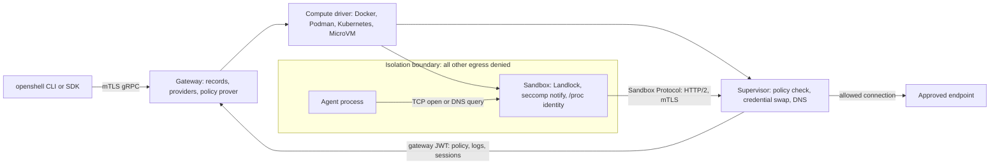

TODO(author): verify every claim against its source, then remove draft: true and this line.

An agent running in an OpenShell sandbox never holds a real API key: at startup [every credential is swapped for an opaque placeholder](https://docs.nvidia.com/openshell/latest/how-it-works/providers/overview), and the real value is substituted only on a request bound for an endpoint that both the network policy and the credential binding allow.

> Drafted with AI assistance, researched, verified and edited by the HastCode editorial team. We publish only as many pieces as the Author can verify this way.

## TL;DR

- OpenShell is NVIDIA's [runtime for fleets of autonomous AI agents](https://github.com/NVIDIA/OpenShell#readme): each agent runs in a sandbox, a YAML policy says what it may touch, and a gateway control plane manages sandboxes, credentials and policy.
- What sets it apart is where enforcement sits: [Landlock limits the filesystem, seccomp user notification intercepts every TCP open and DNS query](https://docs.nvidia.com/openshell/latest/about/architecture), and a supervisor on the trusted side of the boundary decides each request and injects credentials. The sandbox never decides policy.
- Policy changes are reviewed, not just applied: an [SMT-based prover](https://docs.nvidia.com/openshell/latest/how-it-works/policies/prover) checks proposed network rules for risky new reach, and [every proposal waits for a human by default](https://docs.nvidia.com/openshell/latest/how-it-works/policies/advisor).
- Adopt it if you run agents on Linux, Docker, Podman or Kubernetes and want credentials and egress policed outside the agent. Wait if you need a stable API: [0.0.x could not upgrade in place](https://docs.nvidia.com/openshell/latest/upgrade/0-1-0), and [0.1.x releases](https://github.com/NVIDIA/OpenShell/releases/tag/v0.1.5) still carry breaking changes.

## In 60 seconds

These two commands from the README's [Quickstart](https://github.com/NVIDIA/OpenShell#quickstart) install the CLI and a local gateway, then create a sandbox named `demo`. The README says you need Linux, macOS on Apple Silicon or Windows with WSL 2 (experimental), plus Docker, Podman or host virtualization; the default sandbox image is a minimal Ubuntu with no agent installed, and the README's next step, Run Your First Agent, runs OpenCode against a free OpenRouter model.

```shell
curl -LsSf https://raw.githubusercontent.com/NVIDIA/OpenShell/main/install.sh | sh
openshell sandbox create --name demo
```

## Architecture

Walk the diagram left to right. The [gateway](https://docs.nvidia.com/openshell/latest/how-it-works/gateways/overview) is the control plane: the CLI and SDKs reach it over mTLS gRPC, it keeps sandbox records and provider credentials, delivers policy and is [the only component that signs tokens](https://docs.nvidia.com/openshell/latest/about/architecture). The policy prover runs inside it.

To create a sandbox the gateway calls a [compute driver](https://docs.nvidia.com/openshell/latest/about/architecture), which provisions the workload, a supervisor and the fence between them, with each runtime's native tools: Docker and Podman turn the workload container's networking off, Kubernetes allows only the supervisor service through `NetworkPolicy`, and a MicroVM guest has no network device.

Inside the boundary the sandbox runs the agent as one non-root user with no Linux capabilities. [Landlock](https://docs.nvidia.com/openshell/latest/about/architecture) limits the filesystem, seccomp user notification intercepts every TCP open and DNS query, and the calling program is identified from `/proc`, not from a path the agent claims. The sandbox never decides policy.

Each held request crosses the [Sandbox Protocol](https://docs.nvidia.com/openshell/latest/about/architecture), one mutually authenticated HTTP/2 connection (a Unix socket under Docker and Podman, TCP on Kubernetes, vsock in a MicroVM), to the supervisor on the trusted side. The supervisor checks the [YAML policy](https://docs.nvidia.com/openshell/latest/how-it-works/policies/overview), default-deny and scoped per binary, host and port, swaps credential placeholders for real values, then opens the real connection. Enforcement runs through [the proxy, OPA, Landlock and seccomp](https://docs.nvidia.com/openshell/latest/how-it-works/gateways/overview).

It fails closed: [if the supervisor disconnects, the sandbox freezes the agent](https://docs.nvidia.com/openshell/latest/about/architecture). The gateway holds the records, the supervisor keeps its tokens in memory, and the sandbox holds only the gateway's public key.



## Use it if

- Your agents need real credentials for GitHub, PyPI or an inference API and you want them [never to appear in the agent's environment](https://docs.nvidia.com/openshell/latest/how-it-works/providers/overview): the sandbox gets placeholders, and the proxy substitutes the real value only at a bound endpoint.
- You run Linux, Docker Desktop on Apple Silicon, or a Kubernetes cluster whose CNI enforces `NetworkPolicy`: all three are [supported](https://docs.nvidia.com/openshell/latest/about/support-matrix), with Kubernetes deployed by [Helm chart](https://docs.nvidia.com/openshell/latest/kubernetes/setup) on top of the Agent Sandbox controller.
- You want a review step between an agent wanting access and getting it: the [policy advisor](https://docs.nvidia.com/openshell/latest/how-it-works/policies/advisor) lets a blocked agent propose a narrow rule, the prover scores it, and a human approves by default.
- Your agents need a GPU: [`--gpu`](https://docs.nvidia.com/openshell/latest/how-it-works/sandboxes/overview) selects NVIDIA CDI devices under Docker and Podman and sets the `nvidia.com/gpu` limit on Kubernetes.

## Don't use it if

- You need an API that holds still. [0.0.x installations could not upgrade in place](https://docs.nvidia.com/openshell/latest/upgrade/0-1-0), and [v0.1.5](https://github.com/NVIDIA/OpenShell/releases/tag/v0.1.5) renamed log files and changed Go SDK signatures. Pin the gateway and SDK to one release, or wrap a plain container runtime with your own egress proxy until the API settles.
- Your hosts run a Linux kernel older than 6.2: the boundary [requires Landlock ABI 3 and seccomp user notification](https://docs.nvidia.com/openshell/latest/about/support-matrix). Use gVisor, which brings its own application kernel, or a microVM.
- You want the prover to vouch for GraphQL or MCP traffic: it [reports those rules as unsupported](https://docs.nvidia.com/openshell/latest/how-it-works/policies/prover). The rules still enforce; review them by hand.
- You want a hosted sandbox with nothing to operate: OpenShell is a gateway, drivers and a cluster that you run. Use a managed service such as E2B.

## Alternatives

- [Agent Sandbox](https://github.com/kubernetes-sigs/agent-sandbox): the Kubernetes SIG controller that [OpenShell itself uses to provision sandbox pods](https://docs.nvidia.com/openshell/latest/kubernetes/setup); it gives you the pod lifecycle, not OpenShell's gateway, credential proxy or prover.
- [gVisor](https://gvisor.dev): a user-space application kernel that intercepts a container's system calls; isolation only, with no policy language or credential handling, and it runs on older host kernels.
- [Firecracker](https://firecracker-microvm.github.io): the microVM monitor behind AWS Lambda; a hardware-backed boundary, but you bring the policy and the proxy. OpenShell's own VM driver uses [libkrun](https://docs.nvidia.com/openshell/latest/about/support-matrix) instead.
- [Anthropic sandbox-runtime](https://github.com/anthropic-experimental/sandbox-runtime): a single-host wrapper that restricts one process's filesystem and network with OS primitives; no gateway, credential store or prover.
- [E2B](https://e2b.dev): hosted sandboxes for agent code with an SDK; the managed option when you would rather not run a gateway.

## FAQ

### Is OpenShell production ready?

OpenShell is at version 0.1 (the latest release is in Signals). NVIDIA's [README](https://github.com/NVIDIA/OpenShell#readme) calls 0.1.x "a stable release cadence", but [v0.1.5](https://github.com/NVIDIA/OpenShell/releases/tag/v0.1.5) still lists breaking changes and [0.0.x could not upgrade in place](https://docs.nvidia.com/openshell/latest/upgrade/0-1-0), so budget for upgrades that need reading.

### Does OpenShell run on macOS or Windows?

OpenShell supports [macOS on Apple Silicon with Docker Desktop](https://docs.nvidia.com/openshell/latest/about/support-matrix) and Linux on x86_64 and aarch64; Windows works through WSL 2 and is marked experimental. The workload's kernel must be Linux with Landlock and seccomp.

### Does OpenShell support Kubernetes?

Yes. OpenShell's gateway [installs by Helm chart](https://docs.nvidia.com/openshell/latest/kubernetes/setup) on Kubernetes 1.29 or later and creates sandbox pods through the Agent Sandbox controller, which you install first; the CNI must enforce `NetworkPolicy`, or workloads can bypass the supervisor.

### Does OpenShell support GPUs?

Yes. [`openshell sandbox create --gpu`](https://docs.nvidia.com/openshell/latest/how-it-works/sandboxes/overview) requests one GPU or a count: Docker and Podman select NVIDIA CDI devices, Kubernetes sets the `nvidia.com/gpu` limit, and the MicroVM driver accepts only one.

### Does OpenShell use formal verification?

Yes, for policy. OpenShell's [policy prover](https://docs.nvidia.com/openshell/latest/how-it-works/policies/prover) uses an SMT solver to check a candidate policy against a boundary you write, with a counterexample when it exceeds it, and risk-checks every rule an agent proposes; GraphQL and MCP rules are reported as unsupported.

### What are the alternatives to OpenShell?

The main alternatives to OpenShell are Kubernetes Agent Sandbox (pod lifecycle only), gVisor and Firecracker (isolation without a policy or credential layer), Anthropic's sandbox-runtime (single-host process sandboxing) and E2B (hosted sandboxes).

## Verdict

OpenShell is a serious, unusually well-documented answer to a question platform teams now face weekly: how to let an agent install packages, call APIs and use credentials without handing it the keys. The design holds together: a trusted supervisor outside the boundary, kernel enforcement inside it, credentials the agent never sees, and a prover and a human between an agent and any new access. We recommend it for teams already on Docker, Podman or a Kubernetes cluster with an enforcing CNI who are ready to run a gateway and read each release's breaking changes. We would hold off where the API must stay fixed for a year, or where hosts cannot run a 6.2 kernel; and note that the gateway's [anonymous telemetry is on by default](https://github.com/NVIDIA/OpenShell#telemetry), with an environment variable to turn it off. A 1.0 with a frozen policy schema and SDK, or prover coverage for MCP, would change that answer.

## Sources

- [OpenShell README](https://github.com/NVIDIA/OpenShell#readme)
- [OpenShell architecture documentation](https://docs.nvidia.com/openshell/latest/about/architecture)
- [OpenShell sandboxes overview](https://docs.nvidia.com/openshell/latest/how-it-works/sandboxes/overview)
- [OpenShell policies overview](https://docs.nvidia.com/openshell/latest/how-it-works/policies/overview)
- [OpenShell policy advisor](https://docs.nvidia.com/openshell/latest/how-it-works/policies/advisor)
- [OpenShell policy prover](https://docs.nvidia.com/openshell/latest/how-it-works/policies/prover)
- [OpenShell providers overview](https://docs.nvidia.com/openshell/latest/how-it-works/providers/overview)
- [OpenShell gateways overview](https://docs.nvidia.com/openshell/latest/how-it-works/gateways/overview)
- [OpenShell support matrix](https://docs.nvidia.com/openshell/latest/about/support-matrix)
- [OpenShell on Kubernetes: setup](https://docs.nvidia.com/openshell/latest/kubernetes/setup)
- [OpenShell 0.1.0 upgrade guide](https://docs.nvidia.com/openshell/latest/upgrade/0-1-0)
- [OpenShell v0.1.5 release page](https://github.com/NVIDIA/OpenShell/releases/tag/v0.1.5)
