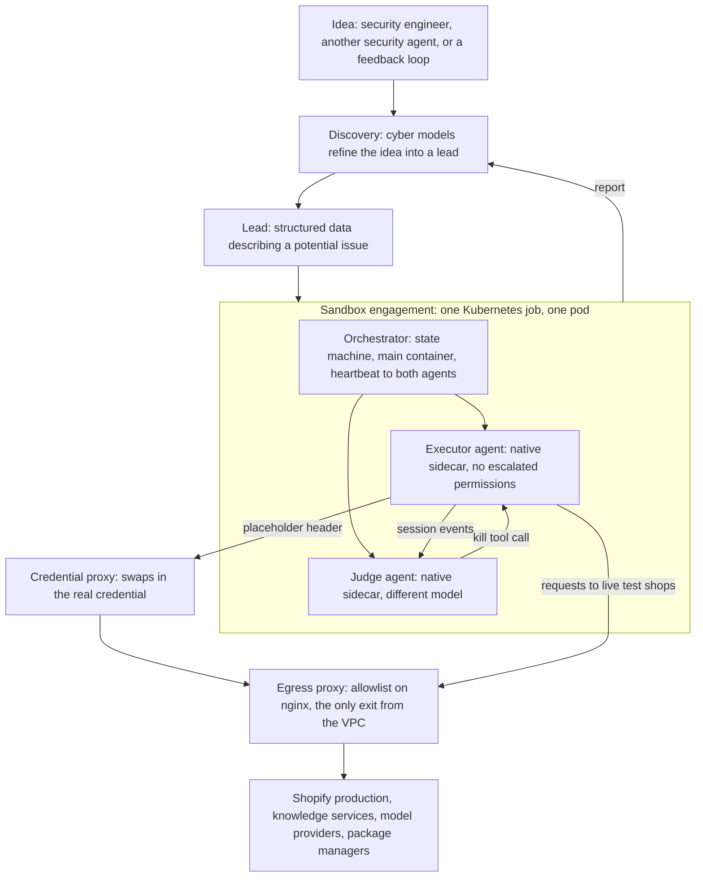

---
# Skeleton from Lead cmgchcqh (Shopify Engineering), picked 2026-11-16.
# Drafted per docs/editorial/case-study-writing-guide.md; the Author's check
# list is in the pull request. published and reviewed are the pick time (make daily may move them to a Gap Day);
# make release keeps it (ADR-0012). verified: is the Author's alone (ADR-0007).
title: "Cyber Chaos Monkey: how Shopify lets AI agents attack production"
description: "How Shopify's Cyber Chaos Monkey runs AI attack agents in production under a judge on another model, ending any run the judge can't vouch for."
kind: case-study
vertical: infrastructure-cloud
tags: ["security", "ai-agents", "kubernetes", "chaos-engineering", "shopify"]
published: "2026-11-16T09:41:23Z"
verified: 2026-11-16
reviewed: "2026-11-16T10:04:38Z"
author: mira-vance
# Optional: an image HastCode may use, beside this file, replaces the
# generated title card. Never a Source's image.
# hero: system-name.png
# hero_alt: "What the image shows"
related: [openshell, meta-thin-orchestrator, shopify-overexposed]
---

Shopify gives an AI agent [ephemeral live credentials](https://shopify.engineering/cyber-chaos-monkey) and a system with access to its source code, threat intelligence, past reports and infrastructure records, then points it at production and asks it to break in. The agent never runs alone: a second agent on a different model reads its every step and can kill it with a tool call.

## TL;DR

- The Cyber Chaos Monkey (CCM) is Shopify's [agentic vulnerability hunter that runs live against production infrastructure](https://shopify.engineering/cyber-chaos-monkey), using live test shops and organizations.
- Shopify built it because frontier models are [driving the cost of vulnerability discovery towards zero](https://shopify.engineering/cyber-chaos-monkey) across the industry, and a defender who knows its own systems can use the same models better than an outsider.
- A Discovery stage turns ideas into leads; each lead becomes a Sandbox engagement, a Kubernetes job whose orchestrator runs an executor agent beside a judge agent, with placeholder credentials for internal services swapped by a proxy and egress held to an nginx allowlist.
- The price is a run that fails closed (our term): [if the judge times out, crashes or fails to adjudicate, the run ends](https://shopify.engineering/cyber-chaos-monkey). The result Shopify reports: tens of thousands of engagements and no outage or incident.

## From an idea to a job that ends itself

The diagram is ours, redrawn from the text of Shopify's post; Shopify's own figures of the workflow, the sandbox network and the control loop are in [the original](https://shopify.engineering/cyber-chaos-monkey).

The path runs top to bottom. The Step sections below are our walk through it, not the post's own six steps. Step 1 is Discovery, which turns an idea into a lead. Step 2 is the Kubernetes job each lead becomes. Step 3 is what the executor can reach: credentials it never holds and a network with one exit. Step 4 is the judge. Step 5 is how the job fails closed, and Step 6 is the report that loops back. We infer the executor's Shopify requests pass through the egress proxy: the post says [only egress proxy pods can leave the VPC](https://shopify.engineering/cyber-chaos-monkey), and its sandbox-network figure shows the pod routing requests through the credential and egress proxies, but the text does not trace that path.

## Why Shopify wants its own attacker in production

Shopify reads the moment as a flood. Frontier models have brought [an explosion in vulnerability reports](https://shopify.engineering/cyber-chaos-monkey), and its own [bug bounty program](https://www.shopify.com/ca/bugbounty) has seen [almost a 300% increase in reports since 2024](https://shopify.engineering/cyber-chaos-monkey). Reviewing, validating and acting on that volume, the post says, [makes the program much harder to operate](https://shopify.engineering/cyber-chaos-monkey).

Its hypothesis is that the same models help both sides: in Shopify's words, they are ["a rising tide that lifts all boats."](https://shopify.engineering/cyber-chaos-monkey) What Shopify has and an attacker lacks is [a massive informational advantage](https://shopify.engineering/cyber-chaos-monkey) about its own software. So it set two goals: find impactful issues first, and make it prohibitively expensive for adversaries to find the ones it misses.

The awkward part is where. Shopify's answer is blunt: ["Attackers target our production systems, so our testing has to as well."](https://shopify.engineering/cyber-chaos-monkey) An agent that tests a copy of production tests the copy. The cost of that choice is the rest of this piece: Shopify had to build CCM so that [testing doesn't put availability or merchant data at risk](https://shopify.engineering/cyber-chaos-monkey).

The post is also explicit about the risk it is answering. It cites [recent incidents where AI agents in security testing reached systems they were never meant to touch](https://shopify.engineering/cyber-chaos-monkey), without naming them.

## What Shopify chose instead of waiting, or trusting one agent

The post has no comparison of options. We infer three alternatives its arguments rule out, and its design follows from each.

- **Waiting for outside reports.** The bug bounty already brings findings, but [at a volume that is hard to operate](https://shopify.engineering/cyber-chaos-monkey). CCM turns the same models inward, with [source code, threat intelligence, past reports, and infrastructure/deployment records](https://shopify.engineering/cyber-chaos-monkey) that we infer outside researchers do not have.
- **Testing somewhere safer.** Rejected in the one sentence above: attackers hit production. Shopify's earlier harness, described [in July 2026](https://shopify.engineering/building-an-agentic-harness-that-outlasts-the-model), proves findings with tests inside each application's own test suites. We infer CCM is the step past it, testing the deployed system rather than the code, though the CCM post links the two only as "earlier in 2026".
- **Trusting the agent's alignment.** Shopify says it does [not trust the execution agent to stay aligned](https://shopify.engineering/cyber-chaos-monkey) throughout a task. Rules alone are not enough, so a second agent checks the first.

The deciding argument is layering. Technical controls handle [leaked credentials and network breakout](https://shopify.engineering/cyber-chaos-monkey); alignment controls handle an agent that ignores its rules. We infer that neither layer is meant to be sufficient alone: the network fence does not know what an exploit means, and the judge does not hold the credentials.

## Step 1: Discovery turns ideas into leads

Shopify describes CCM as [a graph-engineered agentic bug-bounty researcher](https://shopify.engineering/cyber-chaos-monkey) and splits it into two components, Discovery and Sandbox. The post does not explain "graph-engineered".

Ideas arrive from [human security engineers, other security agents, or Discovery's own feedback loops](https://shopify.engineering/cyber-chaos-monkey). In Discovery, the latest cyber models refine an idea and identify the places in code or configuration it touches. The output is a lead: [structured data describing potential issues](https://shopify.engineering/cyber-chaos-monkey), sent to the Sandbox. The post gives no schema for a lead and names no models, beyond [the most capable cyber models available](https://shopify.engineering/cyber-chaos-monkey).

We infer that the split is a safety boundary as much as a division of labour. Discovery reads knowledge; it does not touch production. Everything that does is in Step 2, inside one job with a fixed lifetime.

## Step 2: each engagement is one Kubernetes job

[Every CCM engagement has a corresponding k8s job](https://shopify.engineering/cyber-chaos-monkey), and Shopify calls CCM a standard containerized workload. The job's pod runs a handful of containers. The main application container is a state-machine-based orchestrator; everything else, from maintenance tasks to the offensive agent itself, runs in sidecar containers.

Inside its container the agent works like a researcher. It can [install packages, build fuzzers, make live requests to Shopify and read production logs](https://shopify.engineering/cyber-chaos-monkey). The containers are Debian-based and come pre-loaded with development packages and security testing tools.

What it cannot do is as specific. The offensive agent runs [with no escalated permissions](https://shopify.engineering/cyber-chaos-monkey), and the only data seeded to it is a set of ephemeral Shopify credentials, such as a session cookie and CSRF token. It can read those credentials but not modify them.

A job is a good container for an attack. We infer that a Kubernetes job gives each engagement what a security team wants: a named unit with a start, an end and a pod that is gone afterwards, so a compromised toolchain or a half-finished exploit does not outlive the engagement that made it.

## Step 3: placeholder credentials and one way out

The ephemeral Shopify session is the only secret the agent holds. For everything else, it holds a stand-in. When the agent calls Shopify's knowledge services or a model provider, it [passes a placeholder header to a credential proxy](https://shopify.engineering/cyber-chaos-monkey), which replaces it with the real credential and sends the request on through an egress proxy. Which headers can be injected into which domains is strictly controlled, and the credentials rotate regularly.

We infer the point: a prompt-injected or misbehaving agent cannot print or exfiltrate a key it never had. The same pattern appears in NVIDIA's agent sandbox, which we cover in [our OpenShell explainer](/infrastructure-cloud/openshell/).

The network has one exit. In Shopify's words, ["Our egress proxy is effectively an allowlist on top of nginx,"](https://shopify.engineering/cyber-chaos-monkey) and egress proxy pods are the only ones that can leave the VPC. Four kinds of destination are allowed: Shopify production domains, knowledge services, model providers, and [a select set of package managers](https://shopify.engineering/cyber-chaos-monkey), such as Shopify's own package proxies.

We infer the allowlist does most of the work against network breakout: an agent that finds a way into some internal host still has no route to the open internet, and its package installs go through proxies Shopify runs.

## Step 4: a judge on a different model

Every agent gets [a strict set of Rules of Engagement (RoE)](https://shopify.engineering/cyber-chaos-monkey). They leave the agent free to try any exploit against its target, but set hard limits on what it may do once an exploit works, such as moving to other systems or retaining access.

Shopify enforces the rules with two-person integrity (TPI), [the idea that a second party must review the work of the acting party](https://shopify.engineering/cyber-chaos-monkey). Its twist is that the second party is another agent, differently prompted and aligned. The executor's session logs feed into a separately aligned agent, the judge, which uses [a different model](https://shopify.engineering/cyber-chaos-monkey). The judge reads every event: responses, thinking, tool calls and tool call results. If it sees risky behaviour incompatible with the RoE, it makes a tool call that ["instantly kills the offensive agent."](https://shopify.engineering/cyber-chaos-monkey)

Why a different model? We infer it is for the same reason two-person rules use two people: a weakness that leads one model astray, such as a prompt injection planted in a page it read, is less likely to fool a second model trained differently. The post does not say which models either agent uses.

## Step 5: the run fails closed

The judge is only useful if its silence counts as a no. Shopify designed the system to require [explicit positive control](https://shopify.engineering/cyber-chaos-monkey): if the judge times out, crashes, or fails to adjudicate the executor's messages, the run ends.

The mechanism is Kubernetes itself. The orchestrator is the pod's main container, and the executor and judge run as [native sidecar containers within the same pod](https://shopify.engineering/cyber-chaos-monkey). The orchestrator keeps a heartbeat with both. If either dies, the orchestrator exits, and the pod's restart policy stops it from restarting, so the job ends. Native sidecars are [init containers with `restartPolicy: Always`](https://kubernetes.io/docs/concepts/workloads/pods/sidecar-containers/#pod-sidecar-containers), stable since Kubernetes v1.33, and in a job they [do not stop it completing once the main container has finished](https://kubernetes.io/docs/concepts/workloads/pods/sidecar-containers/#jobs-with-sidecar-containers).

Keeping everything pod-local but isolated, Shopify says, [reduces the risk of network partitions](https://shopify.engineering/cyber-chaos-monkey) disrupting communication between the orchestrator, executor and judge, and an eviction terminates every container in the pod. We infer the property that matters: there is no state in which the executor keeps running and the judge does not.

## Step 6: findings loop back to Discovery

When testing ends, findings go into [a report sent back to Discovery and upwards](https://shopify.engineering/cyber-chaos-monkey). Discovery analyzes the results and runs feedback loops that may start further engagements.

That loop is where the "chaos monkey" name earns its keep. The name is Shopify's homage to [Netflix's Chaos Monkey](https://netflixtechblog.com/the-netflix-simian-army-16e57fbab116), which the post describes as [a tool Netflix introduced in 2011 to randomly shut down production instances](https://shopify.engineering/cyber-chaos-monkey). We infer the parallel: Chaos Monkey made failure routine so systems had to survive it, and CCM makes attack routine, engagement after engagement, so defences have to survive it.

The post does not say who triages a report, how findings are scored, or how fixes are made. "Upwards" is as far as it goes. Shopify's July harness had [fix-author agents that open a branch per finding](https://shopify.engineering/building-an-agentic-harness-that-outlasts-the-model); we do not know whether CCM's findings take that path.

## What it costs

Shopify admits few costs, so most of this section is ours, labelled as inference.

The first is the obvious one. CCM attacks production, with live credentials, on purpose. The controls limit what an agent can reach and what it may do after an exploit lands, but the exploit attempt itself is real traffic against live test shops and organizations. We infer the residual risk is a test that harms shared infrastructure before the judge reacts; the post reports none so far.

The second is a second model on every run. The judge reads the executor's full session, thinking included, so we infer each engagement pays for two models' worth of tokens, and the judge must keep up in real time or the run ends. The post gives no cost per engagement. For scale, the July harness reported [$50 to $300 for a full application scan](https://shopify.engineering/building-an-agentic-harness-that-outlasts-the-model), but that is a different system.

The third is lost work. Fail-closed means a judge that times out kills an executor that was doing nothing wrong. We infer Shopify accepts that trade, since a lost run costs a retry and a lost judge could cost an incident. The post gives no timeout values and no count of runs ended this way.

## The evidence, and what the post does not publish

Shopify's numbers are few and large. Its agents have [executed tens of thousands of offensive engagements](https://shopify.engineering/cyber-chaos-monkey) and identified and acted on dozens of impactful findings, without causing an outage or incident. The context number is the bug bounty's almost 300% growth in reports since 2024.

The gaps are wider. The post names no models. It publishes no false-positive rate, no severity breakdown of the findings, no cost per engagement and no count of judge kills or fail-closed endings. It does not say how many engagements breached their rules, which is the number that would show the judge working. It gives no timeout or heartbeat interval, no schema for a lead, and no explanation of "graph-engineered".

The July post shows what fuller numbers looked like for Shopify's code-scanning harness: [over 300 findings, valued at over $400,000 in equivalent bug bounty payouts](https://shopify.engineering/building-an-agentic-harness-that-outlasts-the-model). Those figures are not CCM's, and the CCM post does not offer its own.

What the post does show is a design, described in enough detail to copy, and a safety record over tens of thousands of runs.

## What a judged attacker makes possible

Shopify frames CCM as ["a bet on asymmetry"](https://shopify.engineering/cyber-chaos-monkey): the same class of models attackers use, plus what Shopify knows about itself. An attacker now has to [compete with agents that work around the clock](https://shopify.engineering/cyber-chaos-monkey).

The lesson travels beyond security testing. Any team running an agent with real access can take three parts of this design. Keep secrets out of the agent with a proxy that swaps placeholders for credentials at a domain it allows. Give the network one exit, an allowlist you run. And make the supervisor's silence a stop: put the agent and its checker in one pod, under one orchestrator that exits when either goes quiet. Meta's [thin orchestrator](/ai-ml-systems/meta-thin-orchestrator/) makes a similar bet on keeping the controlling code deterministic, and Shopify's [Overexposed](/infrastructure-cloud/shopify-overexposed/), which would rather report inconclusive than guess, shares what we read as CCM's preference for stopping over improvising.

The cost is real: a second model on every run, runs lost to a slow judge, and attack traffic in production. What could go right is a defender that finds its own holes faster than the flood of outside reports, with every attack it runs supervised, fenced and fail-closed by construction.

## Sources

- [Cyber Chaos Monkey: Staying ahead of security threats with AI agents](https://shopify.engineering/cyber-chaos-monkey), Dan Scofield, Shopify Engineering, 12 November 2026
- [Building an agentic harness that outlasts the model](https://shopify.engineering/building-an-agentic-harness-that-outlasts-the-model), Zack Deveau, Shopify Engineering, 29 July 2026
- [Shopify bug bounty program](https://www.shopify.com/ca/bugbounty), Shopify
- [The Netflix Simian Army](https://netflixtechblog.com/the-netflix-simian-army-16e57fbab116), Netflix TechBlog
- [Kubernetes: Sidecar Containers](https://kubernetes.io/docs/concepts/workloads/pods/sidecar-containers/)
