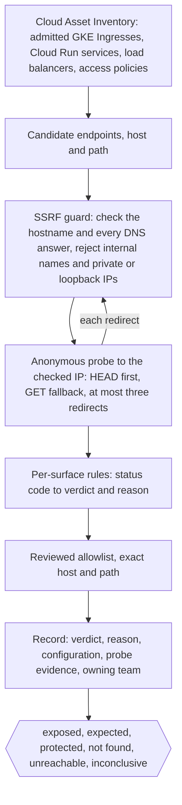

---
# Skeleton from Lead 55cceqfz (Shopify Engineering), picked 2026-10-30.
# Drafted per docs/editorial/case-study-writing-guide.md; the Author's check list
# is in the ticket. published and reviewed are the pick time, provisional: set them
# when you publish. verified: is the Author's alone (ADR-0007).
title: "Overexposed: how Shopify finds apps that answer without a login"
description: "Shopify's Overexposed finds open GKE and Cloud Run endpoints from the cloud's inventory, and would rather say inconclusive than guess."
kind: case-study
vertical: infrastructure-cloud
tags: ["security", "kubernetes", "cloud-run", "gcp", "shopify"]
published: "2026-10-30T10:03:54Z"
reviewed: "2026-10-30T10:03:54Z"
author: mira-vance
# Optional: an image HastCode may use, beside this file, replaces the
# generated title card. Never a Source's image.
# hero: system-name.png
# hero_alt: "What the image shows"
# Optional: related Explainer slugs and extra sources (title + url).
# related: [metastable-failures]
draft: true
---

Shopify's first scanner for apps that answer strangers without a login read the Kubernetes files in its infrastructure repository, and it [flagged protected apps, missed real ones and never saw some at all](https://shopify.engineering/overexposed). Its replacement, Overexposed, stops trusting the repository, asks Google Cloud what is actually deployed, and then knocks on each door as an anonymous outsider.

> Drafted with AI assistance, researched, verified and edited by the HastCode editorial team. We publish only as many pieces as the Author can verify this way.

## TL;DR

- Overexposed is a scheduled scanner that finds [internet-facing GKE Ingresses and Cloud Run services and checks whether each allows access without a login](https://shopify.engineering/overexposed), giving every endpoint a verdict and a reason.
- Shopify built it because a repository shows [what a team wanted, not what the cluster actually runs](https://shopify.engineering/overexposed): hand-set proxy settings, admission controllers and Ingresses from other repositories all broke the config-reading scanner.
- It takes candidates from [Cloud Asset Inventory](https://shopify.engineering/overexposed), passes each destination through an SSRF guard, sends one anonymous request, maps the response to one of six verdicts with per-surface status-code rules, applies a reviewed allowlist and records the evidence.
- The price is honesty about doubt: early runs left [about three in four results inconclusive](https://shopify.engineering/overexposed). The surprise is how Shopify [cut that by about 80% for Ingresses](https://shopify.engineering/overexposed): not by guessing, but by replaying every rule change against saved results.

## Overexposed's path from inventory to verdict

The diagram is ours, redrawn from the text of Shopify's post; Shopify's own flowcharts are in [the original](https://shopify.engineering/overexposed). The post describes [four steps per run](https://shopify.engineering/overexposed): ask the cloud what is running, probe like a stranger, interpret the result with policy, record a verdict and evidence. We split the probe step in two, because the guard that protects the scanner is its own piece of design.

Top to bottom: Step 1 is the inventory, Step 2 the guard, Step 3 the probe, Step 4 the status-code rules, Step 5 the allowlist and Step 6 the record. The redirect loop matters: every hop goes back through the guard before the scanner follows it.

## Why reading the repository missed real exposure

The question Shopify asked is simple to state: [which internet-facing apps allow anonymous access, and does that match policy?](https://shopify.engineering/overexposed) The first answer was to [read the Kubernetes files in the infrastructure repository](https://shopify.engineering/overexposed) and then send live requests. An [Ingress](https://kubernetes.io/docs/concepts/services-networking/ingress/) is the Kubernetes object that exposes HTTP and HTTPS routes from outside the cluster to services inside it, so its configuration looks like the natural place to read who is let in.

It [failed in three ways](https://shopify.engineering/overexposed):

- **False alarms.** Some teams set the proxy authentication settings directly. The scanner did not recognise them, so it flagged protected apps.
- **Misses.** An [admission controller](https://kubernetes.io/docs/reference/access-authn-authz/admission-controllers/), code that intercepts requests to the Kubernetes API server and may modify the resource, changes the settings when a cluster accepts an Ingress. It does not run in every cluster, so a correct setting could have no effect.
- **Blind spots.** Some Ingresses come from other repositories or platform tools, and the scanner never saw them.

Shopify's summary is a caption: ["The repository shows intent. The cluster shows what is enforced."](https://shopify.engineering/overexposed) Each failure has a different cost. False alarms train owners to ignore the scanner; misses and blind spots leave a real exposure unreported. We infer that the second kind is the one a security team cannot accept, which is why the fix had to change the source of truth, not the parser.

The post gives no counts for any of the three.

## The shortcuts Shopify chose not to take

The post names one alternative it tried, reading config, and argues against several shortcuts along the way.

- **Keep reading config.** We infer that teaching the parser about hand-set settings would fix the false alarms, but not the admission controller or the Ingresses defined elsewhere. Shopify instead went to the inventory of [Ingresses GKE accepted after all admission controllers ran](https://shopify.engineering/overexposed).
- **Trust the network setting.** On Cloud Run, "allow all traffic" looks like public. Shopify's point is that it is [not the same thing](https://shopify.engineering/overexposed): IAM decides who may call the service (Step 3).
- **Read one status code one way.** A 404 or a 403 is tempting to file as safe. Shopify keeps the meaning per surface and calls a response ["a clue, not always an answer"](https://shopify.engineering/overexposed) (Step 4).
- **Let the allowlist skip the probe.** Approved endpoints are [still probed on every run](https://shopify.engineering/overexposed) (Step 5).

The deciding argument runs through all four: ["uncertainty does not mean protected"](https://shopify.engineering/overexposed). Where evidence is incomplete or contradictory, the verdict is inconclusive and stays visible.

## Step 1: the cloud's inventory names the candidates

[Cloud Asset Inventory](https://shopify.engineering/overexposed) is Google Cloud's record of the resources in an organisation. For Overexposed it holds three things that matter: GKE Ingresses as admitted, after every admission controller has run; Cloud Run services; and load balancers. In Shopify's words, ["One search gets the resources, and a second search gets their access policies without needing cluster credentials."](https://shopify.engineering/overexposed)

The post's simplified snippet asks for two asset types, [`networking.k8s.io/Ingress` and `run.googleapis.com/Service`](https://shopify.engineering/overexposed), 500 results to a page. The snippet shows only the resource search; the access-policy search is described, not shown.

The first payoff came immediately. The inventory [turned up Cloud Run services in many projects that the first scanner never checked](https://shopify.engineering/overexposed). The post gives no count.

Two properties of this choice are worth naming. The scanner needs no cluster credentials, and the post's search snippet [takes a whole organisation, folder or project as its scope](https://shopify.engineering/overexposed). And it sees what the platform accepted, whichever repository or tool created it. Shopify's reference snapshot is careful about the limit: its inventory module ["reads no IAM and trusts no auth annotation"](https://gist.github.com/ss-shopify/37e1e3d51f0ee9b60b61b72a45a8656e), and inventory ["is not proof of public reachability"](https://gist.github.com/ss-shopify/37e1e3d51f0ee9b60b61b72a45a8656e). The inventory says what *can* be exposed; only a request from outside says what [is](https://shopify.engineering/overexposed).

## Step 2: the SSRF guard checks every destination

A scanner that sends requests to hostnames it reads from an inventory is an [SSRF (server-side request forgery)](https://shopify.engineering/overexposed) risk: a normal-looking hostname can resolve to a private address, and the scanner would then probe an internal system on someone's behalf.

The guard, as [Shopify describes it](https://shopify.engineering/overexposed), numbered by us:

1. Check the hostname and every IP address DNS returns.
2. Reject known internal names and disallowed addresses, such as private and loopback ones.
3. Connect directly to a checked IP without resolving the hostname again, while keeping the original hostname for the HTTP request and the HTTPS certificate check.
4. Repeat the destination checks before each redirected request.

Item 3 is the subtle one. If the scanner checked a name and then let its HTTP client resolve it again, a DNS answer could change between the check and the connection. We infer that pinning the checked IP is what closes that gap; the post does not name the attack. The reference snapshot is stricter in wording: [every DNS answer must be a global unicast address](https://gist.github.com/ss-shopify/37e1e3d51f0ee9b60b61b72a45a8656e).

Shopify does not oversell it. The checks are ["not enough on their own"](https://shopify.engineering/overexposed); the post adds that the scanner's network access should be restricted so it cannot reach internal services or cloud metadata endpoints.

## Step 3: one anonymous request, like a stranger

The probe [rules](https://shopify.engineering/overexposed) are short:

- Send HEAD first, and GET only if the server rejects HEAD. The snapshot falls back [on a 405 or 501](https://gist.github.com/ss-shopify/37e1e3d51f0ee9b60b61b72a45a8656e).
- Do not follow redirects automatically; follow at most three, checking each.
- A redirect to an identity provider means protected. A 401 with an authentication challenge means protected. A 200 with real content means exposed.
- If only `/admin` is protected, also try `/ADMIN` and other variants, because path rules can be case-sensitive.

Cloud Run needs extra care, because it has two separate controls. [Ingress settings](https://docs.cloud.google.com/run/docs/securing/ingress#settings) decide which networks can reach a service, from Internal to All; [IAM](https://shopify.engineering/overexposed) decides who can call it. A service is public only if [`allUsers` has the Cloud Run Invoker role, or the invoker check is off](https://docs.cloud.google.com/run/docs/authenticating/public). One that allows all traffic but limits the invoker role returns a 403 to strangers: ["not an exposure"](https://shopify.engineering/overexposed).

A load balancer complicates it again. The service behind it may allow anonymous calls while the load balancer or the application, for example with [Identity-Aware Proxy](https://shopify.engineering/overexposed), enforces login. So the scanner [reads the load balancer's URL map](https://shopify.engineering/overexposed) to find which service answers each path.

## Step 4: the same status code means different things per surface

Shopify keeps the rules in one table, `EXACT_OUTCOMES`, [so reviewers can see them together](https://shopify.engineering/overexposed). Our rendering of it, with the no-status, 5xx and anything-else rows taken from the snippet's [`classify_status` fallbacks](https://shopify.engineering/overexposed), which apply to both surfaces:

| Response | GKE Ingress | Cloud Run |
|---|---|---|
| 200 | exposed | not in the table |
| 401 | protected (auth challenge) | protected (auth challenge) |
| 403 | inconclusive (denied) | inconclusive (denied) |
| 404 | not found (missing) | inconclusive (missing) |
| no status | unreachable (transport error) | unreachable (transport error) |
| 5xx | inconclusive (server error) | inconclusive (server error) |
| anything else | inconclusive (other) | inconclusive (other) |

The 404 row is the lesson. Behind an Ingress, a 404 means the proxy answered and the path does not exist. On Cloud Run, Google's front end can return a 404 before the app runs, so it ["tells you nothing about authentication"](https://shopify.engineering/overexposed). The 403 row is the other: many apps send 403 for other reasons, so it is [not proof of protection](https://shopify.engineering/overexposed).

The six verdicts are [defined by evidence](https://shopify.engineering/overexposed): exposed (anonymous access worked, no allowlist match, needs review), expected (it worked and matched an approved entry), protected, not found, unreachable (no connection) and inconclusive (a response, but not enough to decide).

## Step 5: the allowlist adds context, not a skip

Some endpoints are meant to be public. Shopify keeps those exceptions [in code, so additions and changes go through review](https://shopify.engineering/overexposed), and matches them by exact host and path. The snapshot matches the [lower-cased host and the case-sensitive path](https://gist.github.com/ss-shopify/37e1e3d51f0ee9b60b61b72a45a8656e), after classification.

The allowlist never stops a probe. If anonymous access works and matches an entry, exposed becomes expected. If an allowlisted endpoint [starts requiring authentication or disappears](https://shopify.engineering/overexposed), the result is kept and the entry is marked for review as probably stale.

We infer the point of probing approved endpoints is that an exception rots quietly. A hypothetical public status page (our example, not Shopify's) that later gains login no longer needs its entry, and a stale entry is exactly what would hide the next service to take that host and path.

## Step 6: every verdict keeps its reason

Each result [records](https://shopify.engineering/overexposed) what was configured, what the probe saw, whether an allowlist entry applied, and the owning team when it is known. Response bodies and credentials are not stored: they may be sensitive and are not needed to explain the verdict.

That record is what makes the next step possible. Because every past result keeps its evidence, a new rule can be tested against history before it ships.

## What it costs

**Inconclusive is a lot of work at first.** In one July run, [about three in four results were inconclusive](https://shopify.engineering/overexposed). A scanner that refuses to guess hands people a long list of "we don't know". Shopify accepted that rather than call an unclear 403 safe.

**Coverage is two surfaces.** Overexposed [checks GKE Ingresses and Cloud Run services](https://shopify.engineering/overexposed). We infer that anything else that faces the internet needs its own inventory query and status-code rules before this design covers it.

**The guard is not the boundary.** The SSRF checks need [network restrictions behind them](https://shopify.engineering/overexposed); we infer that is infrastructure someone must own.

**Tests can lie.** AI coding agents [helped write Overexposed, and AI code review checked every pull request](https://shopify.engineering/overexposed). Shopify's warning: ["a test can pass but check the wrong thing"](https://shopify.engineering/overexposed); one test confirmed a SQL parameter existed, not that the query used it. So it applies mutation testing to guards: remove the fix, run the tests, and if they still pass, "the tests are wrong". Each verdict also has a canary target with a known expected result, checked periodically in the pipeline. We cover another answer to the same worry in [Catching JiTTests](/ai-ml-systems/meta-jittesting/), Meta's tests written to fail on a risky diff.

## The evidence: 80% fewer unknowns, and what the post leaves out

The one hard result is about doubt. Shopify grouped inconclusive results by reason, worked through the largest groups, and added clearer verdicts such as not found and unreachable [only where the evidence supported them](https://shopify.engineering/overexposed). Before shipping each rule change, the team replays it against saved results from earlier scans and compares every verdict. Within a few weeks, inconclusive Ingress results [dropped by about 80%](https://shopify.engineering/overexposed).

That replay is the quiet hero. It turns a rule change from an opinion into a diff of verdicts a reviewer can read.

The gaps are wide. The post gives no count of endpoints, projects or exposures found, no figure for Cloud Run's inconclusive rate, and no schedule beyond ["runs on a schedule"](https://shopify.engineering/overexposed). It does not say who is told about an exposed verdict, how owners are reached, or how fast exposures are fixed. The 80% is a share of Ingress results, not a count.

## What it makes possible

Shopify frames the result as a scanner that [explains each verdict](https://shopify.engineering/overexposed), so teams can confirm expected access, investigate uncertainty and change access controls. It also published a [reference snapshot](https://gist.github.com/ss-shopify/37e1e3d51f0ee9b60b61b72a45a8656e) as a starting point, which says it ["illustrates the core design, not a complete production scanner"](https://gist.github.com/ss-shopify/37e1e3d51f0ee9b60b61b72a45a8656e) and that live probing needs explicit authorisation.

The lesson reaches past security. Build the inventory from [what the cloud runs, not what a repository says](https://shopify.engineering/overexposed); observe from the outside; give every result a reason; and keep "unknown" as a real answer. In our view, any audit that reads configuration, whether for TLS, IAM or open ports, has the same gap between intent and enforcement, and the same fix.

The cost is a list of inconclusives that someone must work. What could go right is a scanner whose verdicts are trusted because it says when it does not know, and whose rules get sharper by replaying history rather than by guessing.

## Sources

- [Building Overexposed: understanding application exposure](https://shopify.engineering/overexposed), Simar Singh and Bernadette Aquino, Shopify Engineering, 19 October 2026
- [overexposed - understanding application exposure](https://gist.github.com/ss-shopify/37e1e3d51f0ee9b60b61b72a45a8656e), Shopify's reference snapshot linked from the post (no licence stated; described, not quoted as code)
- [Restrict network endpoint ingress for Cloud Run services and instances](https://docs.cloud.google.com/run/docs/securing/ingress), Google Cloud documentation
- [Allowing public (unauthenticated) access](https://docs.cloud.google.com/run/docs/authenticating/public), Google Cloud documentation
- [Ingress](https://kubernetes.io/docs/concepts/services-networking/ingress/), Kubernetes documentation
- [Admission Control in Kubernetes](https://kubernetes.io/docs/reference/access-authn-authz/admission-controllers/), Kubernetes documentation
