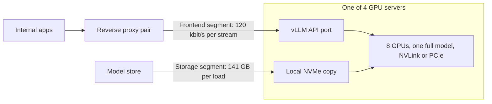

---
# Skeleton from Lead yhzlhblo (APNIC blog), picked 2026-11-26.
# published and reviewed are the pick time (make daily may move them to a Gap Day);
# make release keeps it (ADR-0012). verified: is the Author's alone (ADR-0007).
title: "Single-server inference: why a few GPU nodes need no RDMA fabric"
description: "When a whole model fits in one server, the network carries only token streams and model loads, so a proxy and QoS replace the RDMA fabric."
kind: concept
vertical: infrastructure-cloud
tags: ["inference", "gpu-clusters", "reverse-proxy", "qos", "vllm"]
published: "2026-11-25T07:37:22Z"
verified: 2026-11-26
reviewed: "2026-11-26T11:04:27Z"
author: mira-vance
# Optional: an image HastCode may use, beside this file, replaces the
# generated title card. Never a Source's image.
# hero: concept-name.png
# hero_alt: "What the image shows"
# Optional: related Explainer slugs and extra sources (title + url).
# related: [http-connection-reuse]
---

On 25 November 2026, Sabina Anja, Chief Technologist at Broadcom, [sized a network on the APNIC blog](https://blog.apnic.net/2026/11/25/the-model-inside-the-server-network-design-for-inference-on-a-few-gpu-nodes/) for a small inference cluster. The example is "4 servers × 8 GPUs", running Llama 3.3 70B with the vLLM inference server. A training cluster adds a second, dedicated network for traffic between GPUs in different servers, and [the 400G ports go with it](https://blog.apnic.net/2026/11/25/the-model-inside-the-server-network-design-for-inference-on-a-few-gpu-nodes/). Anja's arithmetic found little for it to carry here. One response stream is about 120 kbit/s. The largest transfer is a 141 GB model load per server. At 25 Gigabit Ethernet (GbE) line rate that is a 45-second transfer, made only at install and on a version change. ["The network problem is not how the GPUs talk to each other."](https://blog.apnic.net/2026/11/25/the-model-inside-the-server-network-design-for-inference-on-a-few-gpu-nodes/) This piece shows why that holds while a model fits in one server, the configuration that replaces the second network, and the point where the design stops working.

## TL;DR

- **Single-server inference** (our name for the pattern) means one server holding a complete copy of the model answers each request. vLLM's rule: a model too large for one GPU that ["fits on a single node with multiple GPUs"](https://docs.vllm.ai/en/latest/serving/parallelism_scaling/) is split inside that node.
- GPU-to-GPU traffic then stays inside the chassis. The network carries [token streams of about 120 kbit/s each and a 141 GB model load](https://blog.apnic.net/2026/11/25/the-model-inside-the-server-network-design-for-inference-on-a-few-gpu-nodes/): 19 minutes at 1 GbE, 45 seconds at 25 GbE.
- So the design needs no [**backend fabric**](https://blog.apnic.net/2026/11/25/the-model-inside-the-server-network-design-for-inference-on-a-few-gpu-nodes/), the separate network, ideally RDMA, that a training cluster has for GPU traffic between servers. It needs a reverse proxy pair, separate frontend and storage segments, and a scavenger quality-of-service (QoS) class for model transfers.
- The cost is configuration on every hop, and one hard limit. When [a model or a fine-tuning job spans servers](https://blog.apnic.net/2026/11/25/the-model-inside-the-server-network-design-for-inference-on-a-few-gpu-nodes/), GPUs in different servers exchange data, the traffic a backend fabric is built for.

## Single-server inference keeps GPU traffic inside the chassis

The Lead does not name the pattern, so we do: **single-server inference**. Its one condition, in Anja's words, is that ["the model fits in one server, so no GPU exchanges data with a GPU in another chassis"](https://blog.apnic.net/2026/11/25/the-model-inside-the-server-network-design-for-inference-on-a-few-gpu-nodes/). Each server holds a complete copy of the model and can answer a request alone.

"Fits in one server" does not mean "fits in one GPU". The Lead's model file is [about 141 GB](https://blog.apnic.net/2026/11/25/the-model-inside-the-server-network-design-for-inference-on-a-few-gpu-nodes/), too large for a single 48 GB or 80 GB GPU, so each server spreads it across its eight GPUs. vLLM's documentation states the rule: ["if the model is too large for a single GPU but fits on a single node with multiple GPUs, use tensor parallelism."](https://docs.vllm.ai/en/latest/serving/parallelism_scaling/) **Tensor parallelism** gives every GPU [a slice of every layer](https://blog.apnic.net/2026/11/25/the-model-inside-the-server-network-design-for-inference-on-a-few-gpu-nodes/), so the GPUs trade partial results at every layer, for every token.

That traffic is heavy, and it never reaches a network port. GPUs in one server [talk over NVLink or PCIe](https://blog.apnic.net/2026/11/25/the-model-inside-the-server-network-design-for-inference-on-a-few-gpu-nodes/): **NVLink** is a direct GPU-to-GPU link, and **PCIe** is the bus that connects cards inside a server. What crosses the network interface card (NIC) is ordinary: requests in, token streams out, and model files at install time.

Two cases do not count: a model that needs two servers to hold it, and fine-tuning that spans servers. Both put GPU data on the network, and we return to them below.

## What crosses the network: token streams and model loads

Walk it from the left, with [the Lead's numbers](https://blog.apnic.net/2026/11/25/the-model-inside-the-server-network-design-for-inference-on-a-few-gpu-nodes/) on each box. The Lead's own Figure 4 places the same pieces in a spine-and-leaf network.

**Apps, proxy, API port.** An application sends a prompt and the server responds over HTTPS, streaming a chatbot's answer. ["At about 300 bytes per message and 50 messages a second, one stream is 120 kbit/s"](https://blog.apnic.net/2026/11/25/the-model-inside-the-server-network-design-for-inference-on-a-few-gpu-nodes/). A thousand streams are 120 Mbit/s: under 0.5% of one 25 GbE link, by our arithmetic.

**The GPUs.** ["Bandwidth at this stage is not the problem; session count is."](https://blog.apnic.net/2026/11/25/the-model-inside-the-server-network-design-for-inference-on-a-few-gpu-nodes/) Every open stream holds between 1 and 10 GB of GPU memory for as long as it runs. The Lead does not name the GPU in its example. Eight of the 48 GB or 80 GB cards it mentions would hold 384 GB or 640 GB, by our arithmetic. Take away 141 GB of weights and 243 to 499 GB remain, in line with the Lead's "a few hundred GBs". That is room for about 24 streams at 10 GB each, or about 499 at 1 GB each. The Lead's own range for one server is "tens to a few hundred streams at once and no more".

**Model store to NVMe.** A model load is the only bulk transfer. 141 GB is 1,128 gigabits, so [at line rate](https://blog.apnic.net/2026/11/25/the-model-inside-the-server-network-design-for-inference-on-a-few-gpu-nodes/) it takes about 19 minutes at 1 GbE, 113 seconds at 10 GbE and 45 seconds at 25 GbE. Those figures assume "no protocol or storage overhead", so real loads run longer.

## Internal assistants are where the pattern fits

The Lead says this scale can fit where users are internal and the priority is latency or privacy, not training throughput. It gives [three examples](https://blog.apnic.net/2026/11/25/the-model-inside-the-server-network-design-for-inference-on-a-few-gpu-nodes/):

- **An internal knowledge assistant**: tens to a few hundred employees, long prompts, low concurrency, and a model of about 8B to 14B parameters.
- **Coding help for a private codebase**: a 7B to 14B model for line completion, and a 32B model for chat over a repository.
- **A staff chatbot** for IT, HR or the service desk: an 8B to 32B model if it answers from an internal knowledge base. A 70B model is only for messy, multi-step questions.

The 70B worked example is the large end of that range. We infer that the smaller models leave more GPU memory for streams, and that the network sees the same two kinds of traffic.

Inside the chassis, vLLM offers a second way to split a model. **Pipeline parallelism** ["splits the model along layers"](https://docs.vllm.ai/en/latest/serving/parallelism_scaling/), so data crosses GPUs [only at block handoffs](https://blog.apnic.net/2026/11/25/the-model-inside-the-server-network-design-for-inference-on-a-few-gpu-nodes/), which PCIe handles. vLLM's docs point to it when the GPUs ["do not have NVLINK interconnect (e.g. L40S)"](https://docs.vllm.ai/en/latest/serving/parallelism_scaling/). Either choice changes the traffic inside the server, not the traffic on the network.

## Why a fabric built too early carries little traffic

The **backend fabric** is a separate network for GPU-to-GPU traffic between servers. It has [its own NICs and gear](https://blog.apnic.net/2026/11/25/the-model-inside-the-server-network-design-for-inference-on-a-few-gpu-nodes/), ideally running Remote Direct Memory Access (RDMA) "so the adapters can read and write GPU memory directly". A training cluster has one. The Lead expects these small deployments to scale, so the question is whether to build the fabric now.

The Lead names two costs of building it too early. The first is money: switches and optics that carry little traffic. The second is operations. RDMA over Converged Ethernet (RoCEv2) brings queue management, Priority Flow Control (PFC) and Explicit Congestion Notification (ECN). PFC and ECN are the [lossless configuration RDMA requires](https://blog.apnic.net/2026/11/25/the-model-inside-the-server-network-design-for-inference-on-a-few-gpu-nodes/). Anja's verdict: ["For pure inference, though, you might not need it."](https://blog.apnic.net/2026/11/25/the-model-inside-the-server-network-design-for-inference-on-a-few-gpu-nodes/)

Skipping the fabric does not mean buying nothing. The Lead lists [three checks](https://blog.apnic.net/2026/11/25/the-model-inside-the-server-network-design-for-inference-on-a-few-gpu-nodes/) on the network you have:

- **Uplinks**: speed, current use, and the oversubscription ratio on the top-of-rack (ToR) switch. On a ToR switch with 10 GbE uplinks, one model transfer can fill an uplink for as long as it runs.
- **QoS support** at the access and uplink layers: Differentiated Services Code Point (DSCP) or Class of Service (CoS) support, and possibly a dedicated egress queue.
- **Port capacity**.

Server ports follow from the load times. The Lead calls [1 GbE too slow](https://blog.apnic.net/2026/11/25/the-model-inside-the-server-network-design-for-inference-on-a-few-gpu-nodes/), and 10 GbE or 25 GbE sufficient.

## Practice one: balance requests, not connections

Traffic on the frontend [does not look like web traffic](https://blog.apnic.net/2026/11/25/the-model-inside-the-server-network-design-for-inference-on-a-few-gpu-nodes/). A model is slow to start, pauses, then emits a few hundred bytes at a time, for minutes. The Lead adds: "Requests differ in cost by orders of magnitude, and many of them can share one long-lived HTTP/2 connection."

That last clause is the problem for two common balancers. Equal-Cost Multi-Path (ECMP) routing picks a path by [hashing the packet header fields that identify a flow](https://www.rfc-editor.org/rfc/rfc2991.html#section-4), so that ["packets for the same flow always use the same path"](https://www.rfc-editor.org/rfc/rfc2991.html#section-3). HTTP/2 puts many requests in one flow: ["A single HTTP/2 connection can contain multiple concurrently open streams"](https://www.rfc-editor.org/rfc/rfc9113.html#section-5), and its connections [are persistent](https://www.rfc-editor.org/rfc/rfc9113.html#section-9.1). We infer the result from those two facts: every request on a connection lands on the server its first packet reached. Anja says ECMP and a Layer 4 load balancer ["both place connections and see nothing of the requests inside them"](https://blog.apnic.net/2026/11/25/the-model-inside-the-server-network-design-for-inference-on-a-few-gpu-nodes/). Our [connection reuse explainer](/apis-networking/http-connection-reuse/) covers how HTTP/2 multiplexes streams.

So the Lead puts a **reverse proxy** pair in front of the servers, and balances per request. It recommends least connections in place of round robin, because one request ["can cost a hundred times the next"](https://blog.apnic.net/2026/11/25/the-model-inside-the-server-network-design-for-inference-on-a-few-gpu-nodes/). The nginx documentation gives the same reason: least-connected is fairer ["when some of the requests take longer to complete"](https://nginx.org/en/docs/http/load_balancing.html#nginx_load_balancing_with_least_connected).

The cost is a new tier to run. You must plan proxy sizing, firewall state tables and timeouts for the session count, not for bandwidth.

## Practice two: tune the proxy for long, quiet streams

Default proxy settings suit short responses. The Lead uses nginx as its example, and three of [its settings](https://blog.apnic.net/2026/11/25/the-model-inside-the-server-network-design-for-inference-on-a-few-gpu-nodes/) deal with long streams.

- **Buffering off.** nginx ships with [`proxy_buffering on`](https://nginx.org/en/docs/http/ngx_http_proxy_module.html#proxy_buffering), which saves the response into buffers, so, in the Lead's words, the user "receives text in clumps". With buffering off, nginx passes the response on "synchronously, immediately as it is received".
- **Longer idle timers.** [`proxy_read_timeout`](https://nginx.org/en/docs/http/ngx_http_proxy_module.html#proxy_read_timeout) defaults to 60 seconds between two reads from the server; after that nginx closes the connection. Stateful firewalls and NAT devices have idle timers too. The Lead's rule: "Set all of them to the longest silence you accept."
- **Affinity.** Per the Lead, each server keeps a cache of its conversations, and one that moves to another server has its work redone from the start. The Lead's fix is a consistent hash on a session identifier. In nginx, `hash` with `consistent` remaps [only a few keys](https://nginx.org/en/docs/http/ngx_http_upstream_module.html#hash) when a server joins or leaves the group.

We infer the cached work is vLLM's prefix cache, which lets a new query ["directly reuse the KV cache if it shares the same prefix"](https://docs.vllm.ai/en/latest/features/automatic_prefix_caching/) with an earlier one. Our [KV cache offloading explainer](/ai-ml-systems/kv-cache-offloading/) covers that cache.

The cost is a tension the Lead leaves open. Least connections moves load to the idlest server, and affinity pins a conversation to one server. We infer you must pick which rule wins for each route. We infer a second cost from the timers: a dead stream holds its proxy and firewall state for longer.

## Practice three: split the frontend and storage segments

The Lead gives each kind of traffic [its own segment](https://blog.apnic.net/2026/11/25/the-model-inside-the-server-network-design-for-inference-on-a-few-gpu-nodes/) on the existing fabric.

The **frontend segment** carries inference API traffic between the proxies and the servers: low bandwidth and delay-sensitive. The Lead's rule: ["The API port must be reachable only from the proxies"](https://blog.apnic.net/2026/11/25/the-model-inside-the-server-network-design-for-inference-on-a-few-gpu-nodes/). The segment therefore gets a dedicated VRF (a separate routing table), or a VLAN or VXLAN Network Identifier (VNI) inside an existing VRF. It keeps the fabric's existing maximum transmission unit (MTU), the largest packet a link carries.

The **storage segment** carries model files and container images from the model store: infrequent and bulk. The Lead isolates it the same way. It asks for jumbo frames (a larger MTU) end to end, with room for the VXLAN overhead in the underlay network.

The Lead dual-homes each server to its leaf pair with a two-member Link Aggregation Group (LAG) on 10 or 25 GbE links. One leaf can then fail, or take an upgrade, without affecting the cluster.

Separate segments do two jobs. They keep the API away from everything but the proxies. They also let a switch tell the two kinds of traffic apart: the Lead classifies "by segment or by Access Control List (ACL)". The second job matters because both segments share leaf uplinks and spine ports. Without QoS, the Lead says, responses wait behind the transfer in the default queue.

The cost is two more segments to carry through the fabric, and a jumbo MTU that must hold on every storage hop.

## Practice four: put model transfers in a scavenger class

A model transfer takes all the bandwidth on its path, and the queueing delay reaches users as stalled text. The Lead's answer is ["two traffic classes: One that protects the API traffic and one that deprioritizes model transfers"](https://blog.apnic.net/2026/11/25/the-model-inside-the-server-network-design-for-inference-on-a-few-gpu-nodes/). It calls this ordinary Differentiated Services (DiffServ), which [classifies and marks packets](https://www.rfc-editor.org/rfc/rfc2475.html) for a forwarding behaviour at each hop. The Lead's steps:

- **Mark at the ingress leaf.** Trust a host's own marking only if you control the host. On VXLAN, confirm the inner DSCP is copied to the outer header, or the spines treat every packet as default class.
- **Queue on the shared links.** The frontend class gets a guaranteed minimum, or strict priority with a rate cap. The scavenger class gets the lowest weight.
- **Rate-limit at the source.** "A shaper holds a Transmission Control Protocol (TCP) flow at a steady rate, while a policer makes it oscillate." Shape on the model store where a shaper is available, and keep a policer on the leaf as a backstop.

For the **scavenger class**, the Lead suggests one "such as CS1 or Lower-Effort Per-Hop Behavior (LE PHB)". RFC 8622 defines LE: its packets ["scavenge otherwise-unused resources only"](https://www.rfc-editor.org/rfc/rfc8622.html#section-1), and its recommended DSCP is [`000001`](https://www.rfc-editor.org/rfc/rfc8622.html#section-6). The RFC [replaces the older CS1 recommendation](https://www.rfc-editor.org/rfc/rfc8622.html#section-10), so prefer LE where your switches support it.

The RFC states the cost: under contention ["LE traffic can be starved completely"](https://www.rfc-editor.org/rfc/rfc8622.html#section-4). A model load may then take far longer than 45 seconds. PFC and ECN stay out, because this design carries no RDMA traffic.

## Practice five: keep model files off the network

The Lead limits how often a model file moves at all, in [three steps](https://blog.apnic.net/2026/11/25/the-model-inside-the-server-network-design-for-inference-on-a-few-gpu-nodes/):

1. Fetch the weights from the Internet once, into a store on your own network, and keep the container images there too.
2. Keep a copy on local NVMe in each server, so a process restart reads from disk.
3. Roll out a new model version one server at a time.

With local copies, model files cross the network only at first install and at a version change.

A loading server must not receive requests. ["A server is ready when the model is loaded, not when the port opens."](https://blog.apnic.net/2026/11/25/the-model-inside-the-server-network-design-for-inference-on-a-few-gpu-nodes/) The llm-d project's probe guide says vLLM's `/health` endpoint ["only indicates that the server process is running"](https://llm-d.ai/docs/operations/lifecycle/readiness-probes#problem-statement), while `/v1/models` ["is model-aware and indicates true readiness"](https://llm-d.ai/docs/operations/lifecycle/readiness-probes#v1models-endpoint-openai-compatible). Its recommended startup probe allows [up to 30 minutes](https://llm-d.ai/docs/operations/lifecycle/readiness-probes#recommended-probe-configuration) for a model to load.

The costs: with four servers, each load removes a quarter of serving capacity, by our arithmetic. In nginx the probe has a price: periodic health checks are [part of its commercial subscription](https://nginx.org/en/docs/http/ngx_http_upstream_module.html#example). Without them, nginx marks a server unavailable only after [attempts to reach it fail](https://nginx.org/en/docs/http/ngx_http_upstream_module.html#server).

## What single-server inference is not

It is not multi-node inference. vLLM's rule for the next size up: ["If a single node lacks sufficient GPUs to hold the model, deploy vLLM across multiple nodes."](https://docs.vllm.ai/en/latest/serving/parallelism_scaling/) GPUs then trade data across the network. The same page says efficient tensor parallelism then ["requires fast internode communication"](https://docs.vllm.ai/en/latest/serving/parallelism_scaling/), preferably through high-speed adapters such as InfiniBand. vLLM's security guide adds that all communications between nodes ["are insecure by default"](https://docs.vllm.ai/en/latest/usage/security/) and must sit on an isolated network. We infer that this isolated, fast network is the backend fabric the Lead set aside.

It is not multi-server fine-tuning. The Lead names that as the [second event](https://blog.apnic.net/2026/11/25/the-model-inside-the-server-network-design-for-inference-on-a-few-gpu-nodes/) that forces a bigger change.

It is not disaggregated prefilling either. That vLLM feature, [marked experimental](https://docs.vllm.ai/en/latest/features/disagg_prefill/), runs two instances and uses a connector "to transfer the prefill KV caches and results from prefill instance to decode instance". The Lead warns of an experimental vLLM mode that passes cached state between instances. That moves GPU data over the network even when the model fits on one server. We infer it means this feature. Our [disaggregated inference explainer](/ai-ml-systems/disaggregated-inference/) covers that design.

The boundary is one question: does any GPU need data from a GPU in another chassis? While the answer is no, the practices above hold.

## What understanding it makes possible

You can size an inference network from two numbers you can measure. Multiply message size by message rate for a stream. Divide the model file by the link speed for a load. Then count sessions, not bits, for the proxy and the firewall.

You can test the design before users do. Start a model transfer while a stream is open, and watch for stalled text: that checks the two traffic classes. Leave a stream silent past 60 seconds: that checks every idle timer. Probe `/v1/models` during a load: that checks the proxy waits for the model.

You can also defer a purchase with a clear trigger: a model outgrows one server, or fine-tuning spans more than one. The Lead expects these deployments to scale, but for some infrastructures that ["could still be 3 to 5 years away, if not longer"](https://blog.apnic.net/2026/11/25/the-model-inside-the-server-network-design-for-inference-on-a-few-gpu-nodes/).

The optimistic part: until then, four GPU servers join the network you already run. The team that runs it does the work, with protocols it already knows.

## Sources

- Sabina Anja, ["The model inside the server: Network design for inference on a few GPU nodes"](https://blog.apnic.net/2026/11/25/the-model-inside-the-server-network-design-for-inference-on-a-few-gpu-nodes/), APNIC blog, 25 November 2026.
- vLLM, ["Parallelism and Scaling"](https://docs.vllm.ai/en/latest/serving/parallelism_scaling/), documentation.
- vLLM, ["Security"](https://docs.vllm.ai/en/latest/usage/security/), documentation.
- vLLM, ["Disaggregated Prefilling (experimental)"](https://docs.vllm.ai/en/latest/features/disagg_prefill/), documentation.
- vLLM, ["Automatic Prefix Caching"](https://docs.vllm.ai/en/latest/features/automatic_prefix_caching/), documentation.
- llm-d, ["vLLM Model-Aware Readiness Probes"](https://llm-d.ai/docs/operations/lifecycle/readiness-probes), documentation.
- nginx, ["Module ngx_http_proxy_module"](https://nginx.org/en/docs/http/ngx_http_proxy_module.html), ["Module ngx_http_upstream_module"](https://nginx.org/en/docs/http/ngx_http_upstream_module.html) and ["Using nginx as HTTP load balancer"](https://nginx.org/en/docs/http/load_balancing.html), documentation.
- IETF, [RFC 2991, "Multipath Issues in Unicast and Multicast Next-Hop Selection"](https://www.rfc-editor.org/rfc/rfc2991.html), November 2000.
- IETF, [RFC 9113, "HTTP/2"](https://www.rfc-editor.org/rfc/rfc9113.html), June 2022.
- IETF, [RFC 2475, "An Architecture for Differentiated Services"](https://www.rfc-editor.org/rfc/rfc2475.html), December 1998.
- IETF, [RFC 8622, "A Lower-Effort Per-Hop Behavior (LE PHB) for Differentiated Services"](https://www.rfc-editor.org/rfc/rfc8622.html), June 2019.
