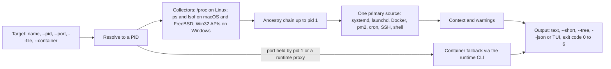

TODO(author): verify every claim against its source, then remove draft: true and this line.

A repository [created in December 2025](https://github.com/pranshuparmar/witr) is already in the official Debian and Ubuntu repositories: on Ubuntu 26.04 and Debian sid, [`sudo apt install witr`](https://github.com/pranshuparmar/witr#22-package-managers) works, beside Homebrew, winget, conda-forge, the AUR and FreeBSD ports.

> Drafted with AI assistance, researched, verified and edited by the HastCode editorial team. We publish only as many pieces as the Author can verify this way.

## TL;DR

- witr is a [single static binary for Linux, macOS, FreeBSD and Windows](https://github.com/pranshuparmar/witr#2-installation) that answers one question, ["why is this running?"](https://github.com/pranshuparmar/witr#1-purpose), for a process, port, container or file.
- The design choice: [everything is a process question](https://github.com/pranshuparmar/witr#5-core-concept). A port, service or container is mapped to a PID, witr walks the chain that created it (`systemd → pm2 → node`) and names exactly [one primary source](https://github.com/pranshuparmar/witr#73-standard-output-sections).
- Its [`--json` output is a documented contract](https://github.com/pranshuparmar/witr#74-json-output) and its [exit codes carry meaning](https://github.com/pranshuparmar/witr#72-exit-codes), so it fits scripts, CI and coding agents as well as a terminal.
- Adopt it today as an incident-time diagnostic on boxes you can `sudo` on. Look elsewhere for fleet-wide or historical answers: witr reads the live machine it runs on, and nothing in the README stores or forwards a result.

## In 60 seconds

The README's [Quick Install](https://github.com/pranshuparmar/witr#21-quick-install) is one command on Linux, macOS and FreeBSD: the script detects your OS and CPU, downloads the latest released binary and man page, and installs them under `/usr/local`. The README [recommends a package manager where you have one](https://github.com/pranshuparmar/witr#2-installation); `brew install witr`, `sudo apt install witr` and `winget install -e --id PranshuParmar.witr` are among the [sixteen listed](https://github.com/pranshuparmar/witr#22-package-managers).

```sh
curl -fsSL https://raw.githubusercontent.com/pranshuparmar/witr/main/install.sh | bash
```

Then ask about anything by name. This is the README's [first example](https://github.com/pranshuparmar/witr#61-name-based-query); its output shows the chain `systemd (pid 1) → pm2 (pid 5034) → node (pid 14233)`, the source (`pm2`), the working directory, the git branch and the sockets.

```sh
witr node
```

Run `witr` with no arguments and you get the [TUI](https://github.com/pranshuparmar/witr#3-interactive-mode-tui) instead. To try it without installing anything, the [browser playground](https://pranshuparmar.github.io/witr/) simulates a Linux web box; its [README](https://github.com/pranshuparmar/witr/blob/main/docs/README.md) says the JavaScript engine ports witr's output layer and CI checks it against golden output from the Go code.

## Architecture

witr is one Go binary with no server or agent: each run reads the machine it is on and prints an answer. Walk the diagram left to right.

**Target.** You name a process, or pass `--pid`, `--port`, `--file` or `--container`, [repeatable and mixable](https://github.com/pranshuparmar/witr#4-flags--options). The [core concept](https://github.com/pranshuparmar/witr#5-core-concept): every target resolves to a PID. A port held by pid 1 (socket activation) or a runtime forwarder (`docker-proxy`, `pasta`, RootlessKit) is explained by [the container that published it](https://github.com/pranshuparmar/witr#81-feature-compatibility-matrix); that Docker CLI fallback arrived in [v0.3.0](https://github.com/pranshuparmar/witr/releases/tag/v0.3.0).

**Collectors.** Linux reads [`/proc`](https://github.com/pranshuparmar/witr#8-platform-support); macOS shells out to `ps`, `lsof`, `sysctl` and `pgrep`; Windows calls Win32 APIs (ToolHelp32, PSAPI, Service Control Manager) [without PowerShell or WMI](https://github.com/pranshuparmar/witr#82-permissions-note); FreeBSD uses `procstat`, `ps` and `lsof`. Container lookups [need the runtime's CLI on PATH](https://github.com/pranshuparmar/witr#81-feature-compatibility-matrix).

**Ancestry.** The chain runs up to pid 1. When the starter has exited, witr [marks the break](https://github.com/pranshuparmar/witr#73-standard-output-sections) with `? (original parent exited)`, not the adopter, and since [v0.3.4](https://github.com/pranshuparmar/witr/releases/tag/v0.3.4) it stops at recycled parent PIDs.

**Source.** [One primary source](https://github.com/pranshuparmar/witr#73-standard-output-sections) is chosen: a systemd unit, launchd job, SSH session, Docker container, pm2, cron, an interactive shell or a Snap or Flatpak sandbox. If nothing explains the process, the source is `unknown`, never a guess.

**Context, warnings, output.** Working directory, git branch, container and sockets, then [warnings](https://github.com/pranshuparmar/witr#73-standard-output-sections) such as root, a public listener or `LD_PRELOAD`. Output is text, `--short`, `--tree`, [`--json`](https://github.com/pranshuparmar/witr#74-json-output) or the [TUI](https://github.com/pranshuparmar/witr#3-interactive-mode-tui), plus an [exit code](https://github.com/pranshuparmar/witr#72-exit-codes) from 0 to 6. We infer witr keeps no state: the README describes nothing written between runs.



## Use it if

- You correlate `ps`, `lsof`, `ss`, `systemctl` and `docker ps` by hand during incidents: witr's [stated purpose](https://github.com/pranshuparmar/witr#1-purpose) is to replace that correlation with one answer that is [understandable under stress](https://github.com/pranshuparmar/witr#9-success-criteria).
- You want to script it: the [JSON contract](https://github.com/pranshuparmar/witr#74-json-output) promises stable field names and types, with breaking changes only in a release whose notes call them out, and the [exit codes](https://github.com/pranshuparmar/witr#72-exit-codes) separate "not found", "permission denied" and "cause unknown".
- Your estate mixes runtimes: the [`--container` flag](https://github.com/pranshuparmar/witr#4-flags--options) searches Docker, Podman, nerdctl, Kubernetes via crictl, Incus, LXC, LXD and FreeBSD jails, and matches on compose project and service labels.
- Coding agents work on your machines: the README ships an [agent-instructions snippet and a Claude Code plugin](https://github.com/pranshuparmar/witr#75-using-witr-with-ai-coding-agents) so an agent runs `witr --port <PORT> --json` instead of chaining four tools.

## Don't use it if

- You need fleet-wide or historical answers. witr answers for the box it runs on, at the moment you run it, and nothing in the [README](https://github.com/pranshuparmar/witr#1-purpose) stores or forwards results. Use [osquery](https://osquery.io), or your metrics and log stack, for "what was running yesterday on 400 hosts".
- Windows is your main platform and you need the full picture. The [compatibility matrix](https://github.com/pranshuparmar/witr#81-feature-compatibility-matrix) marks file locks, tmux and screen detection, schedule detection and process actions unavailable on Windows, environment variables partial, and exit code 6 unused there. Keep [Process Explorer](https://learn.microsoft.com/en-us/sysinternals/downloads/process-explorer) beside it.
- You cannot get elevated privileges. [Without root](https://github.com/pranshuparmar/witr#82-permissions-note), a port held by another user's process names the user but not the process; on macOS, SIP hides some details even with sudo. The runtime's own tooling (`systemctl status`, `docker inspect`) may be what your permissions already allow.

## Alternatives

- [procps](https://gitlab.com/procps-ng/procps) (`ps`, `pstree` from [psmisc](https://gitlab.com/psmisc/psmisc)): the stock tools witr's README positions itself against; they show state and leave the correlation to you.
- [procs](https://github.com/dalance/procs): a `ps` replacement in Rust with a tree view and a Docker column; a better `ps`, not a causal chain with a named source.
- [htop](https://htop.dev): an interactive process viewer with a tree; built for watching load, not for explaining one process.
- [osquery](https://osquery.io): SQL over processes, listening ports and containers across a fleet, with a daemon and scheduled queries; heavier, and it covers the history and scale witr does not attempt.
- [Process Explorer](https://learn.microsoft.com/en-us/sysinternals/downloads/process-explorer): Microsoft's Windows process tree with handles and DLLs, which covers the ground witr marks partial or unavailable on Windows.

## FAQ

### Is witr production ready?

As a diagnostic, yes: witr ships as a [single static binary for Linux, macOS, FreeBSD and Windows](https://github.com/pranshuparmar/witr#2-installation), is in the [official Debian and Ubuntu repositories, Homebrew, winget and FreeBSD ports](https://github.com/pranshuparmar/witr#22-package-managers), and its [JSON output is a documented contract](https://github.com/pranshuparmar/witr#74-json-output). The version is still pre-1.0 (see the card).

### Does witr support Docker and Kubernetes containers?

Yes. witr's [`--container` flag](https://github.com/pranshuparmar/witr#4-flags--options) searches Docker, Podman, nerdctl, Kubernetes via crictl, Incus, LXC, LXD and FreeBSD jails, matching on name, image, command or compose labels; the runtime's CLI must be [on PATH](https://github.com/pranshuparmar/witr#81-feature-compatibility-matrix).

### Can I use witr in scripts and CI?

Yes. `witr <target> --json` prints a report with [stable field names and types](https://github.com/pranshuparmar/witr#74-json-output), and the [exit codes](https://github.com/pranshuparmar/witr#72-exit-codes) say what happened: 0 clean, 1 warnings, 2 not found, 3 permission denied, 4 bad input, 5 internal error, 6 cause unknown.

### What are the alternatives to witr?

The nearest alternatives to witr are procps (`ps`, `pstree`), procs, htop, osquery and, on Windows, Process Explorer. None produces witr's causal chain with one named source; witr, in turn, does not do fleet queries or history.

### How is witr licensed, and who maintains it?

witr is under the [Apache License 2.0](https://github.com/pranshuparmar/witr/blob/main/LICENSE). Pranshu Parmar ([`pranshuparmar`](https://github.com/pranshuparmar)) writes most of it (the share is in Signals); the [contributors graph](https://github.com/pranshuparmar/witr/graphs/contributors) lists an account named `claude` second, so we infer part of the work is AI-assisted.

## Verdict

witr does one thing a backend engineer needs at two in the morning and does it carefully: it turns "something is on port 5432" into "systemd started pm2, which started this", names the one source responsible, and admits when it cannot tell. We recommend it for anyone who runs Linux, macOS or FreeBSD hosts they can `sudo` on, and we would put it in a runbook and an agent's instructions on the strength of the JSON contract and the exit codes alone. It is not a monitor, keeps no history and knows nothing about the other 399 hosts, so it sits beside osquery or your metrics stack rather than replacing them; Windows users get the chain but not locks, schedules or process actions. A 1.0 release would remove our only hesitation, which is the pre-1.0 version number on a tool that already behaves like a finished one; a stored or shipped history would change what it is.

## Sources

- [witr README](https://github.com/pranshuparmar/witr#readme)
- [witr v0.3.4 release page](https://github.com/pranshuparmar/witr/releases/tag/v0.3.4)
- [witr v0.3.0 release page](https://github.com/pranshuparmar/witr/releases/tag/v0.3.0)
- [witr playground](https://pranshuparmar.github.io/witr/)
- [witr playground README (docs/README.md)](https://github.com/pranshuparmar/witr/blob/main/docs/README.md)
- [witr LICENSE](https://github.com/pranshuparmar/witr/blob/main/LICENSE)
