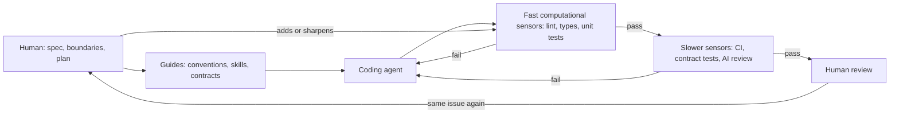

---
# Concept drafted from Lead ecc3xdg3 (Martin Fowler's site), picked 2026-10-29.
# Written to docs/editorial/concept-writing-guide.md; the Author's check list
# is in the pull request. published and reviewed are the pick time, provisional: set them
# when you publish. verified: is the Author's alone (ADR-0007).
title: "Harness engineering: steering coding agents with guides and sensors"
description: "A coding agent's harness is the guides and sensors that steer it and catch its mistakes before a human does. How it works and what it costs."
kind: concept
vertical: languages-runtimes
tags: ["coding-agents", "harness-engineering", "continuous-integration", "testing", "ai-agents"]
published: "2026-10-29T19:47:44Z"
verified: 2026-10-29
reviewed: "2026-10-29T19:47:44Z"
author: mira-vance
# Optional: an image HastCode may use, beside this file, replaces the
# generated title card. Never a Source's image.
# hero: concept-name.png
# hero_alt: "What the image shows"
related: [meta-thin-orchestrator, github-agent-scale-git, pgrust]
---

In a week Thoughtworks wrote up on 2 September 2026, it put [10 engineers in one room in its Barcelona office](https://martinfowler.com/articles/exploring-gen-ai/an-accidental-blackboard.html) and asked them to build an airline IROps system, the software a flight control centre uses to decide which flights to cancel and which planes to swap when something goes wrong. The rule was ["No code written by anyone. Everything built by agents."](https://martinfowler.com/rachels-ramblings/good-devs-wary.html#a-week-at-the-whiteboard) The write-up says they [built one in four days](https://martinfowler.com/articles/exploring-gen-ai/an-accidental-blackboard.html); Thoughtworks CTO Rachel Laycock, who links it, says they [got 80% done](https://martinfowler.com/rachels-ramblings/good-devs-wary.html#a-week-at-the-whiteboard). Asked afterwards, the team told her they spent [about two-thirds of their time at the whiteboard and one-third on the harness](https://martinfowler.com/rachels-ramblings/good-devs-wary.html#a-week-at-the-whiteboard): tests, contracts, architecture checks and a delivery pipeline. And [the application ran, but the build was frequently red](https://martinfowler.com/rachels-ramblings/good-devs-wary.html#the-application-ran-the-build-was-red). The agents committed so often that the [frequent commits were overloading the CI pipeline](https://martinfowler.com/articles/exploring-gen-ai/an-accidental-blackboard.html#the-repo-as-an-accidental-blackboard-for-agents). Writing the code was the easy part. The hard part was the machinery that tells you whether to trust it.

> Drafted with AI assistance, researched, verified and edited by the HastCode editorial team. We publish only as many pieces as the Author can verify this way.

## TL;DR

- A **harness** is [everything in an AI agent except the model itself](https://martinfowler.com/articles/harness-engineering.html). The **outer harness** a team builds around a coding agent is **guides**, which steer it before it acts, and **sensors**, which check its work and feed failures back so it can correct itself.
- It runs as a **steering loop**: [whenever an issue happens multiple times](https://martinfowler.com/articles/harness-engineering.html#TheSteeringLoop), a human improves a guide or a sensor so the agent stops repeating it.
- It pays off most where a model is unreliable: in one experiment a cost-optimised model passed all 178 acceptance tests in [3 of 10 runs without a harness and 10 of 10 with one](https://martinfowler.com/articles/are-harnesses-worth-the-cost.html#TestingACost-optimizedModel).
- The practices: run fast deterministic checks first, keep the expectations out of the agent's reach, and protect the CI signal. The cost is tokens and runtime (those harnessed runs used [about 3.9 times as many tokens](https://martinfowler.com/articles/are-harnesses-worth-the-cost.html#TestingACost-optimizedModel)) plus the human time to write and maintain the checks.

## What a harness is, and what it is for

Birgitta Böckeler, a Distinguished Engineer at Thoughtworks, laid the idea out in [Harness engineering for coding agent users](https://martinfowler.com/articles/harness-engineering.html). She starts from a shorthand: a harness is ["everything in an AI agent except the model itself - Agent = Model + Harness"](https://martinfowler.com/articles/harness-engineering.html). A coding agent ships with part of its harness built in, such as its system prompt and how it retrieves code. This piece is about the **outer harness**: what a team adds for its own codebase.

The outer harness has [two goals](https://martinfowler.com/articles/harness-engineering.html): raise the chance the agent gets a change right the first time, and give it a feedback loop that ["self-corrects as many issues as possible before they even reach human eyes"](https://martinfowler.com/articles/harness-engineering.html). [Two kinds of control](https://martinfowler.com/articles/harness-engineering.html#FeedforwardAndFeedback) serve them:

- **Guides** (feedforward) steer the agent before it acts: a file of coding conventions such as AGENTS.md, a skill, a bootstrap script.
- **Sensors** (feedback) observe what it did: tests, linters, type checkers, structural tests, an AI reviewer.

Neither works alone. Feedback only gives you an agent ["that keeps repeating the same mistakes"](https://martinfowler.com/articles/harness-engineering.html#FeedforwardAndFeedback); feedforward only, one that encodes rules ["but never finds out whether they worked"](https://martinfowler.com/articles/harness-engineering.html#FeedforwardAndFeedback). A check whose result never reaches the agent, such as a suite humans run after it has finished, is not a sensor in this sense; we infer that from her definition, which has sensors help the agent self-correct.

## The steering loop: two loops, one agent

Walk it from the left. A human writes the guides, and the agent makes a change. Böckeler sorts the sensors that check it by [how they run](https://martinfowler.com/articles/harness-engineering.html#ComputationalVsInferential). **Computational** sensors are deterministic tools such as tests, linters and type checkers; they run in milliseconds to seconds and their results are reliable. **Inferential** sensors, such as AI code review or an LLM acting as a judge, are slower, cost more and are less deterministic. The cheap ones go first, [as far left in the path to production as possible](https://martinfowler.com/articles/harness-engineering.html#TimingKeepQualityLeft), and every failure goes back to the agent: that is the inner loop.

The outer loop is the human's. ["The human's job in this is to steer the agent by iterating on the harness"](https://martinfowler.com/articles/harness-engineering.html#TheSteeringLoop): when a review finds the same problem twice, the fix is a new guide or sensor. In the Thoughtworks week, [most of the work at the keyboard](https://martinfowler.com/rachels-ramblings/good-devs-wary.html#a-week-at-the-whiteboard) was directing agents to put what the team had learned into the harness, so the next run got it right.

## A worked example: one service, two models, 178 checks

Naresh Jain, founder of Specmatic, [had coding agents build the same API service](https://martinfowler.com/articles/are-harnesses-worth-the-cost.html#TheApplicationBrief) with and without a harness: a backend-for-frontend that calls an Order API and publishes to Kafka, with exact rules for timeouts and errors. Its [guides](https://martinfowler.com/articles/are-harnesses-worth-the-cost.html#TheInnerLoopBehavioralHarness) were OpenAPI and AsyncAPI specifications, request-response examples and an API-development skill; its sensors checked contract conformance, response values and side effects such as Kafka publication. Afterwards, a [separate suite of 178 acceptance tests](https://martinfowler.com/articles/are-harnesses-worth-the-cost.html#ExperimentSetup) that the harness never saw judged every result. He [built the harness with Specmatic](https://martinfowler.com/articles/are-harnesses-worth-the-cost.html#KeepingGuidesAndSensorsInSync), his own contract-testing tool.

| 10-run averages | Accepted | Tokens | Time | Estimated cost |
|---|---|---|---|---|
| [GPT-6 Luna, no harness](https://martinfowler.com/articles/are-harnesses-worth-the-cost.html#TestingACost-optimizedModel) | 3 of 10 | 5,860,736 | 15 min 56 s | ~$0.086 |
| [GPT-6 Luna, harness](https://martinfowler.com/articles/are-harnesses-worth-the-cost.html#TestingACost-optimizedModel) | 10 of 10 | 22,933,648 | 35 min | ~$0.273 |
| [GPT-6 Sol, no harness](https://martinfowler.com/articles/are-harnesses-worth-the-cost.html) | 10 of 10 | 1,076,371 | 6 min 51 s | ~$0.406 |

The unharnessed Luna failures were close: each [still passed at least 144 of the 178 checks](https://martinfowler.com/articles/are-harnesses-worth-the-cost.html#WhereUnharnessedRunsSlippedUp), and they clustered at protocol boundaries, such as a timed-out creation that had to return 202 and instead returned 503, 400 or 429. Jain's reading is that the harness [served "as an external memory and attention aid"](https://martinfowler.com/articles/are-harnesses-worth-the-cost.html#TheHarnessAsExecutableAttention). His sample is small: [10 paired runs on one greenfield Java service](https://martinfowler.com/articles/are-harnesses-worth-the-cost.html#TheBoundariesOfThisExperiment).

## Where harnesses show up in real systems

**Stripe's minions.** Stripe's unattended agents produce [over a thousand merged pull requests a week](https://stripe.dev/blog/minions-stripes-one-shot-end-to-end-coding-agents) that contain no human-written code, though humans review them. Each run starts on a devbox that [spins up in 10 seconds](https://stripe.dev/blog/minions-stripes-one-shot-end-to-end-coding-agents), isolated from production and the internet. The orchestration, a fork of Block's goose agent, [interleaves agent loops with deterministic code](https://stripe.dev/blog/minions-stripes-one-shot-end-to-end-coding-agents) for git operations, linters and tests, so required steps always run. Almost all of its agent rules [apply only in the subdirectories they cover](https://stripe.dev/blog/minions-stripes-one-shot-end-to-end-coding-agents).

**Anthropic's long-running harness.** For an agent that works across many context windows, Anthropic has a first session write an `init.sh` script, a progress file and [a feature list of over 200 features for a claude.ai clone](https://www.anthropic.com/engineering/effective-harnesses-for-long-running-agents#feature-list), all marked failing. Each later session reads the progress file and git log, [runs a basic end-to-end test](https://www.anthropic.com/engineering/effective-harnesses-for-long-running-agents#getting-up-to-speed) before starting a feature, and works on one feature at a time. Giving the agent browser automation to test as a user would [dramatically improved performance](https://www.anthropic.com/engineering/effective-harnesses-for-long-running-agents#testing).

**Meta's thin orchestrator.** Meta wraps its specialist agents in a router whose steps are [deterministic except one, which runs inside an isolated subagent](https://engineering.fb.com/2026/10/19/ml-applications/thin-orchestrator-ai-agent-architecture/). We cover it in our [case study](/ai-ml-systems/meta-thin-orchestrator/); we infer it is the same move as Stripe's, keeping the checks out of the model's hands.

## Why agent-built code needs a harness

The first force is speed, the feature everyone adopts agents for. Google's DORA 2025 research found AI adoption now has a positive relationship with delivery throughput, but it ["does continue to have a negative relationship with software delivery stability"](https://cloud.google.com/blog/products/ai-machine-learning/announcing-the-2025-dora-report). DORA's explanation is the harness argument in other words: ["Without robust control systems, like strong automated testing, mature version control practices, and fast feedback loops, an increase in change volume leads to instability."](https://cloud.google.com/blog/products/ai-machine-learning/announcing-the-2025-dora-report) The volume is real: GitHub reports [pushes grew 4.9x year over year](https://github.blog/engineering/architecture-optimization/building-git-infrastructure-for-agent-scale-development/), which our [Spokes case study](/infrastructure-cloud/github-agent-scale-git/) follows into its Git storage.

The second is what agents lack. Human developers, Böckeler writes, [bring experience as an implicit harness](https://martinfowler.com/articles/harness-engineering.html#TheRoleOfTheHuman): conventions absorbed, the pain of complexity felt, their name on the commit. An agent has ["no social accountability, no aesthetic disgust at a 300-line function"](https://martinfowler.com/articles/harness-engineering.html#TheRoleOfTheHuman). A harness tries to make that experience explicit.

The third is that agents stop early. In Anthropic's runs, a later session would look around, see progress, and ["declare the job done"](https://www.anthropic.com/engineering/effective-harnesses-for-long-running-agents#the-long-running-agent-problem); another failure mode was [marking features complete without testing them end to end](https://www.anthropic.com/engineering/effective-harnesses-for-long-running-agents#testing). Only a sensor the agent cannot argue with closes that gap.

## Defence one: run the cheap, deterministic sensors first

Böckeler sorts sensors by [when they can afford to run](https://martinfowler.com/articles/harness-engineering.html#TimingKeepQualityLeft): linters, fast test suites and a basic review agent before a commit is even created; mutation testing and broader review after integration; dead-code detection and dependency scanners continuously, outside any one change. A sensor can also teach: a custom linter message that tells the agent how to fix the violation is, in her words, ["a positive kind of prompt injection"](https://martinfowler.com/articles/harness-engineering.html#FeedforwardAndFeedback).

Stripe does exactly this. Its first line of defence [selects and runs lints on each git push in under five seconds](https://stripe.dev/blog/minions-stripes-one-shot-end-to-end-coding-agents), because it wants to ["shift feedback left"](https://stripe.dev/blog/minions-stripes-one-shot-end-to-end-coding-agents): anything that would fail in CI should fail on the push. Only then does CI [pick tests from a suite of more than three million](https://stripe.dev/blog/minions-stripes-one-shot-end-to-end-coding-agents).

What it costs: a codebase has to offer these checks. A strongly typed language [gives you type-checking as a sensor](https://martinfowler.com/articles/harness-engineering.html#Harnessability) and clear module boundaries give you architecture rules; legacy code, where the harness is most needed, is [where it is hardest to build](https://martinfowler.com/articles/harness-engineering.html#AmbientAffordances). And computational sensors catch structure, not intent: [neither kind reliably catches](https://martinfowler.com/articles/harness-engineering.html#MaintainabilityHarness) misdiagnosed issues, overengineering or misunderstood instructions.

## Defence two: keep the expectations out of the agent's reach

Laycock asks the question every team meets: [what role should test-driven development play](https://martinfowler.com/rachels-ramblings/good-devs-wary.html#the-application-ran-the-build-was-red) when the agent wrote the tests alongside the code? Jain names the risk. If an agent interprets the requirements to write both the code and its tests, ["the same misreading or omission can appear in both"](https://martinfowler.com/articles/are-harnesses-worth-the-cost.html#KeepingGuidesAndSensorsInSync), and letting it change expected results when a test fails can hide a defect.

His answer was to give the expectations a source the agent does not control. The [contracts and examples were human-agreed expectations](https://martinfowler.com/articles/are-harnesses-worth-the-cost.html#KeepingGuidesAndSensorsInSync); a validation step checked the examples against the specifications before any test ran; and the agent was told to fix the implementation rather than weaken the expectations. Anthropic takes the same line with its feature list: agents may change only a pass/fail field, and are told ["It is unacceptable to remove or edit tests"](https://www.anthropic.com/engineering/effective-harnesses-for-long-running-agents#feature-list). It chose JSON because the model is [less likely to overwrite it than Markdown](https://www.anthropic.com/engineering/effective-harnesses-for-long-running-agents#feature-list).

What it costs: someone writes and maintains those contracts. Jain's cost figures [exclude that effort](https://martinfowler.com/articles/are-harnesses-worth-the-cost.html#TheEconomicsOfConsistentOutcomes). Böckeler calls checking functional behaviour ["the elephant in the room"](https://martinfowler.com/articles/harness-engineering.html#BehaviourHarness): faith in AI-generated test suites is, she writes, "not good enough yet".

## Defence three: protect the build signal

Continuous integration assumes a red build means something. ["Continuous Integration can only work if the mainline is kept in a healthy state"](https://martinfowler.com/articles/continuousIntegration.html#FixBrokenBuildsImmediately), Martin Fowler writes, quoting Kent Beck: "nobody has a higher priority task than fixing the build". Laycock's worry is the reverse case: [if the build is red so often that people stop paying attention](https://martinfowler.com/rachels-ramblings/good-devs-wary.html#the-application-ran-the-build-was-red), nobody spots the next real failure, and a green build stops reassuring too. Her candidate causes: too many agents in parallel, a system not modular enough, or changes arriving faster than the checks could finish.

We infer the mechanism: CI is a shared sensor with finite throughput. When agent changes arrive faster than it finishes, a red mainline no longer points at one change, so it stops being feedback. Thoughtworks [switched to pushing only when a coherent chunk of change was complete](https://martinfowler.com/articles/exploring-gen-ai/an-accidental-blackboard.html#the-repo-as-an-accidental-blackboard-for-agents). Stripe caps it: because CI costs tokens, compute and time, a minion gets [at most two rounds of CI](https://stripe.dev/blog/minions-stripes-one-shot-end-to-end-coding-agents), "often one, at most two, CI runs—and only after we’ve fixed everything we can locally".

What it costs: fewer, larger integrations. Thoughtworks found pushing less often [deprived the agents of the continuous flow of updates](https://martinfowler.com/articles/exploring-gen-ai/an-accidental-blackboard.html#the-repo-as-an-accidental-blackboard-for-agents) they had used to coordinate, and Laycock asks whether a pipeline can handle [Epics instead of Stories](https://martinfowler.com/rachels-ramblings/good-devs-wary.html#the-application-ran-the-build-was-red) at speed.

## What a harness is not

**Not the agent's built-in harness.** Anthropic calls its Claude Agent SDK ["a powerful, general-purpose agent harness"](https://www.anthropic.com/engineering/effective-harnesses-for-long-running-agents#the-long-running-agent-problem); that is the inner layer the vendor ships. Böckeler notes the word [means different things in different bounded contexts](https://martinfowler.com/articles/harness-engineering.html#MetaphorsOnlyGoSoFar). The outer harness is yours, built for one codebase.

**Not the same as context engineering.** Context engineering is how guides and sensors reach the agent; [engineering a user harness is "a specific form of context engineering"](https://martinfowler.com/articles/harness-engineering.html#HowDoesHarnessEngineeringRelateToContextEngineering). A good prompt is context; a system of controls that changes when the agent fails is a harness.

**Not proof the system works in production.** Laycock's whole piece turns on this: experienced developers know [built isn't the same as working in production](https://martinfowler.com/rachels-ramblings/good-devs-wary.html). Martin Fowler, she writes, argued that we won't know whether a heavily agent-built system works [until it has run in production for a while and survived a few rounds of change](https://martinfowler.com/rachels-ramblings/good-devs-wary.html#off-the-groomed-slopes). A green harness says the code meets the expectations someone encoded, nothing more.

How several agents coordinate through a shared space, which Thoughtworks [rediscovered as a blackboard system](https://martinfowler.com/articles/exploring-gen-ai/an-accidental-blackboard.html#the-repo-as-an-accidental-blackboard-for-agents), is a separate idea for its own Explainer.

## What understanding harnesses makes possible

You can now measure the harness instead of arguing about agents. Count the failures that recur, since each is a missing guide or sensor. Ask Böckeler's open question of your own setup: [if sensors never fire](https://martinfowler.com/articles/harness-engineering.html#AStartingPoint-AndOpenQuestions), is the code good or is detection weak? And copy Jain's method: the same brief, ten runs with and ten without the harness, judged by a suite the agent never sees. [pgrust](/databases-storage/pgrust/), a Postgres rewrite its author built mostly with agents, is a public example of a project that rests its case on verification.

The results can change which model you pick. Jain's [practical rule](https://martinfowler.com/articles/are-harnesses-worth-the-cost.html#WhatThisMeansInPractice) is to run the harness throughout development for a cost-optimised model, and for a frontier model to run the same checks once as a final gate. Anthropic's harness is available as a [quickstart](https://github.com/anthropics/claude-quickstarts/tree/main/autonomous-coding) to try. Böckeler expects service templates to grow into [harness templates](https://martinfowler.com/articles/harness-engineering.html#HarnessTemplates) for common service shapes.

The best case is not developers removed from the loop. It is their caution, the thing Laycock defends, written down as checks that run on every change. As Böckeler puts it, a good harness aims ["to direct it to where our input is most important"](https://martinfowler.com/articles/harness-engineering.html#TheRoleOfTheHuman).

## Sources

- Rachel Laycock, ["Why are good developers so wary of agentic development?"](https://martinfowler.com/rachels-ramblings/good-devs-wary.html), martinfowler.com, 29 October 2026.
- Birgitta Böckeler, ["Harness engineering for coding agent users"](https://martinfowler.com/articles/harness-engineering.html), martinfowler.com, 2 April 2026.
- Naresh Jain, ["Are Harnesses Worth the Cost?"](https://martinfowler.com/articles/are-harnesses-worth-the-cost.html), martinfowler.com, 13 October 2026.
- Giles Edwards-Alexander, ["An Accidental Blackboard"](https://martinfowler.com/articles/exploring-gen-ai/an-accidental-blackboard.html), martinfowler.com, 2 September 2026.
- Alistair Gray, ["Minions: Stripe's one-shot, end-to-end coding agents"](https://stripe.dev/blog/minions-stripes-one-shot-end-to-end-coding-agents), Stripe, 9 February 2026.
- Justin Young, ["Effective harnesses for long-running agents"](https://www.anthropic.com/engineering/effective-harnesses-for-long-running-agents), Anthropic, 26 November 2025 ([quickstart](https://github.com/anthropics/claude-quickstarts/tree/main/autonomous-coding)).
- Nathen Harvey, ["Announcing the 2025 DORA Report"](https://cloud.google.com/blog/products/ai-machine-learning/announcing-the-2025-dora-report), Google Cloud Blog, September 2025.
- Martin Fowler, ["Continuous Integration"](https://martinfowler.com/articles/continuousIntegration.html), martinfowler.com.
- Brian Celenza, ["Building Git infrastructure for agent-scale development"](https://github.blog/engineering/architecture-optimization/building-git-infrastructure-for-agent-scale-development/), The GitHub Blog, 6 October 2026.
- Meta, ["The Thin Orchestrator: How We Made Our AI Agents More Reliable by Giving the Router Less to Do"](https://engineering.fb.com/2026/10/19/ml-applications/thin-orchestrator-ai-agent-architecture/), Engineering at Meta, 19 October 2026.
