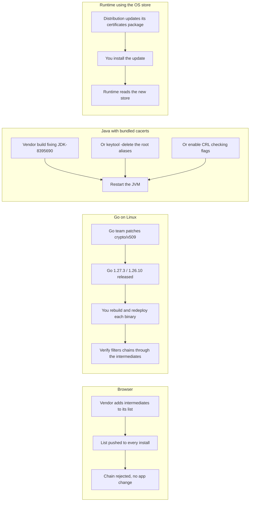

---
# Comparison drafted from Lead xpqwuoig (Go blog), picked 2026-10-30, per
# docs/editorial/comparison-writing-guide.md. published and reviewed are the
# pick time, provisional: set them when you publish. verified: is the
# Author's alone (ADR-0007).
title: "Bundled vs platform trust stores: who revokes a bad CA, how fast"
description: "How browsers, Go, Java and OS-store runtimes stopped trusting eMudhra's compromised intermediates, and who can revoke trust in each, how fast."
kind: comparison
vertical: languages-runtimes
tags: ["tls", "x509", "certificate-revocation", "go", "java"]
published: "2026-10-30T10:42:23Z"
reviewed: "2026-10-30T10:42:23Z"
author: mira-vance
# Optional: an image HastCode may use, beside this file, replaces the
# generated title card. Never a Source's image.
# hero: option-a-vs-option-b.png
# hero_alt: "What the image shows"
# Optional: related Explainer slugs and extra sources (title + url).
# related: [metastable-failures]
draft: true
---

On 17 October 2026, Mozilla added eight intermediate certificates issued under an eMudhra root [to OneCRL, "effectively blocking their usage in Firefox"](https://go.dev/blog/emudhra-incident). The keys behind them were "trivially weak," the Go team writes, allowing "recovery of the private keys in microseconds," so anyone holding them could sign a certificate for any domain. Firefox was protected that day. Go programs on Linux had to wait for [Go 1.27.3 and 1.26.10](https://go.dev/blog/emudhra-incident), shipped on 19 October as the project's first-ever URGENT security release, and then for every binary to be rebuilt. Java runtimes needed a vendor update or [four `keytool -delete` commands](https://openjdk.org/emudhra). The same compromise reached each client through a different door. So the question is: when a certificate authority (CA) fails, who can withdraw your client's trust in it, through what channel, and how fast? We answer it for browsers, Go, Java with its bundled `cacerts`, and runtimes that read the operating system's store.

> Drafted with AI assistance, researched, verified and edited by the HastCode editorial team. We publish only as many pieces as the Author can verify this way.

## TL;DR

- **Browsers** keep a revocation list their vendor pushes to every install (Mozilla's OneCRL, Chrome's CRLSets), so one vendor action protected every user without a code change.
- **Go** hands verification to the platform on Windows and macOS, but on Linux runs its own verifier with no revocation checking, so the block shipped as a Go release that only takes effect once you rebuild.
- **Java's bundled `cacerts`** is a keystore inside the runtime: you wait for a vendor build that fixes JDK-8395690, delete the affected root aliases yourself, or turn on CRL checking.
- **OS-store runtimes** trust whatever the distribution's certificate package says, so an OS update fixes them, unless a packaging bug (Debian's Java keystore) keeps the change from arriving.
- We infer: use the platform's store wherever someone else is paid to patch it fast; bundle only when you also own a fast way to ship the bundle, and never assume an OS root update blocks a bad intermediate.

## One compromised intermediate, four ways to stop trusting it

Every client here does the same job. It receives a chain of certificates from a server, builds a path to a root it trusts, and accepts or rejects it. What they differ in is where the list of trusted roots lives, where the list of *distrusted* certificates lives, and who can change either.

That second list is the crux. The eMudhra root was ["present in most trusted root programs,"](https://go.dev/blog/emudhra-incident) the Go team notes; the bad keys belonged to intermediates beneath it. A root store says which CAs to start from. We infer that it cannot, on its own, say "trust this root but not these eight certificates under it": that takes a revocation mechanism or a code change. The diagram follows the same compromised intermediate through each.

## Browsers: a list the vendor pushes

Firefox learned to distrust the eight intermediates through [OneCRL](https://wiki.mozilla.org/CA/Revocation_Checking_in_Firefox#OneCRL), Mozilla's list of revoked CA certificates. Mozilla describes the model plainly: "We gather CA certificate revocation information centrally, then push it out to clients." Besides CA-reported revocations, the list holds "exceptional revocations" that Mozilla adds by hand, typically after a security incident, which is what happened here.

Chrome has the equivalent. Chromium's documentation calls [CRLSets](https://www.chromium.org/Home/chromium-security/crlsets/) "the primary means by which Chrome quickly blocks certificates in emergency situations," covering intermediate and leaf certificates.

Cloudflare's Bas Westerbaan summed up the result: ["Browser maintainers were able to remediate the issue with a flip of a switch."](https://blog.cloudflare.com/emudhra-certificate-compromise/) He adds why: "They of course have just one application to update, instead of hundreds." The browser is both the trust store and its only consumer, and its vendor owns the delivery channel.

## Go: the platform's verifier, or its own

Go is two options in one, split by operating system. The Go team explains that ["on Windows and macOS we delegate these checks to the platform APIs,"](https://go.dev/blog/emudhra-incident) while "on Linux, which lacks platform APIs, we use our own verifier implementation." The [`crypto/x509` documentation](https://pkg.go.dev/crypto/x509#pkg-overview) says the same: on macOS and Windows, "certificate verification is handled by system APIs."

On Linux, Go reads the roots from the system's files ([`SSL_CERT_FILE` and `SSL_CERT_DIR` override the defaults](https://pkg.go.dev/crypto/x509#SystemCertPool)), but the decision is Go's own code, and that code does no revocation checking: [`Certificate.Verify`](https://pkg.go.dev/crypto/x509#Certificate.Verify) warns, "this function doesn't do any revocation checking." We infer that no list could be pushed to it. The Go team's reasoning: since Linux ["does not have a uniform built-in mechanism to handle revocation checking,"](https://go.dev/blog/emudhra-incident) it chose an URGENT release "which similarly removed trust."

The fix lives in the verifier. The [security announcement](https://groups.google.com/g/golang-announce/c/66pojueaQek) (CVE-2026-111943) says `Verify` "will now filter out chains which contain these intermediates." The fix ships inside each program, so the Go team's advice is to [rebuild TLS-using programs](https://go.dev/blog/emudhra-incident) with 1.27.3 or 1.26.10, which "will automatically reject" the compromised intermediates, and check with `go version -m` or `govulncheck -mode=binary`.

## Java: a keystore that ships with the runtime

A standalone OpenJDK runtime carries its own trust store, the `cacerts` keystore, at [`$JDK_HOME/lib/security/cacerts`](https://openjdk.org/emudhra) on JDK 11 and later (`jre/lib/security/cacerts` on JDK 8). The OpenJDK page on the incident tells you to "take one of the following actions immediately," in order of preference:

1. **Update the runtime** to a build whose release note says it fixes "issue JDK-8395690, CVE 2026-114820."
2. **Remove the relevant root certificates** with `keytool -delete -cacerts`, after backing up the keystore. The page lists four aliases: `emsignrootcag1 [jdk]`, `emsignrootcag2 [jdk]`, `emsigneccrootcag3 [jdk]` and `comodoaaaca [jdk]`. It does not say why the fourth, not named for eMudhra, is included. Then restart any running instances.
3. **Check for revoked certificates**: add `-Dcom.sun.net.ssl.checkRevocation=true` and `-Dcom.sun.security.enableCRLDP=true` for TLS, or use `jarsigner -verify -revcheck -strict` for signed JARs on JDK 17 and later.

The page also ships a [`CheckCerts.java`](https://cr.openjdk.org/~mr/CheckCerts.java) program, which "works on JDK 8 and later," to tell whether your runtime is at risk. Note the shape of option 2: the bundle lists roots, so the do-it-yourself fix removes roots. We infer that this distrusts everything chaining to those roots, not only the eight intermediates.

## OS-store runtimes: whatever the distribution ships

Many runtimes keep no store of their own and read the operating system's. OpenJDK's page covers its own case: a Java runtime installed from the OS "most likely uses the operating system's certificates," and on [Arch Linux, Fedora, Gentoo, Oracle Linux and Red Hat Enterprise Linux](https://openjdk.org/emudhra) "updating the operating system's certificates" is likely enough. FreeBSD and Homebrew users should update the packages "once updates are available."

Debian and its derivatives, including Ubuntu, "require a manual workaround": delete `/etc/ssl/certs/java/cacerts` and run `update-ca-certificates --fresh`. The reason is in [Debian bug 1069251](https://bugs.debian.org/cgi-bin/bugreport.cgi?bug=1069251), open since April 2024, originally titled "ca-certificates-java: keystore is not updated." The OS store and Java's copy of it had drifted apart; a comment of 22 October 2026 says the bug keeps Java's keystore from updating when `ca-certificates` removes the eMudhra intermediates.

Cloudflare's post names the general trap: an API client ["may delegate certificate verification to an HTTP library, a language runtime, the operating system, or a custom trust configuration,"](https://blog.cloudflare.com/emudhra-certificate-compromise/) and "Updating the SDK alone may not change the underlying policy." We infer the same holds for the OS: updating the certificates package only helps the clients that actually read it.

## How fast the block reached each client

**Browsers** moved first. Mozilla listed the intermediates in [OneCRL on 17 October](https://go.dev/blog/emudhra-incident), two days before the Go team heard of it.

**Go** shows how fast a bundled verifier can move when its maintainers drop everything. Per the [timeline](https://go.dev/blog/emudhra-incident), in PDT on 19 October: an outside researcher alerted the Security team at 11:45, Mozilla confirmed at 12:30, a patch tested against certificates signed with the recovered keys was ready at 14:00, the release began at 15:00, and it was announced at 19:13. That is under seven and a half hours from notice to release. The release process alone took ["just under four and a quarter hours,"](https://go.dev/blog/emudhra-incident) which the team calls too slow. Go's [security policy](https://go.dev/doc/security/policy) defines the track: URGENT issues "trigger an immediate dedicated security release, possibly with no pre-announcement," where PRIVATE fixes wait for the next scheduled minor release. But the release is not the block; your rebuild is.

**Java** depends on your vendor. OpenJDK's page names the fix and leaves dates to each distributor; it gives none.

**OS-store runtimes** depend on the distribution's package and your patch cycle; the OpenJDK page itself was still telling FreeBSD and Homebrew users to wait.

## Who has to act on your machines

**Browsers**: nobody on your side. The vendor [pushes the list to clients](https://wiki.mozilla.org/CA/Revocation_Checking_in_Firefox#OneCRL).

**Go**: you, once per binary. Cloudflare, which [learned of the compromise around 17:00 UTC on 19 October](https://blog.cloudflare.com/emudhra-certificate-compromise/), published its `cloudflared` update at 09:15 UTC the next day and asked users to upgrade to 2026.10.2 and redeploy container images. Its post adds: "Applications with bundled or custom trust stores received separate assessment and updates." We infer that every Go service you run is one such application until rebuilt, and on Windows and macOS it follows the platform instead.

**Java**: you, once per runtime: install the vendor build, or run four `keytool` deletes in every JDK and restart each JVM. Container images with a JDK baked in each need the change.

**OS-store runtimes**: you, once per machine or base image, through the package manager you already patch with, plus the Debian workaround where it applies. Cloudflare says it [updated "shared trust stores, base images, and other shared foundations"](https://blog.cloudflare.com/emudhra-certificate-compromise/), which is this model at company scale.

## What still gets through without a revocation check

**Browsers** have one built in: the pushed list. Mozilla's page describes [CRLite](https://wiki.mozilla.org/CA/Revocation_Checking_in_Firefox#CRLite), its mechanism for leaf certificates, as "delivered to the client using the same mechanism as OneCRL."

**Go on Linux** has none: `Verify` [does no revocation checking](https://pkg.go.dev/crypto/x509#Certificate.Verify), so the next compromised intermediate needs another release. The Go team [plans](https://go.dev/blog/emudhra-incident) to bring revocation support on Linux to parity, possibly using [upki](https://github.com/rustls/upki), which it describes as aiming to "provide reliable, privacy-preserving and efficient certificate revocation" ([issue 82402](https://go.dev/issue/82402)).

**Java** has CRL checking as an opt-in: [OpenJDK offers the two flags](https://openjdk.org/emudhra) as the fallback "if you have not already enabled revocation checking."

**OS-store runtimes** inherit whatever their TLS library does; as above, we infer a root store alone cannot express "this root, minus these intermediates." Cloudflare points at the same gap: tools like upki ["understand a trust store can't be a static list of root certificate authorities."](https://blog.cloudflare.com/emudhra-certificate-compromise/)

Whichever you run, Cloudflare's guidance holds: "It's important to not resolve these errors by disabling verification."

## Trade-offs

Each cell summarises a section above, where its source is linked.

| Question | Browsers | Go (Linux) | Java bundled `cacerts` | OS-store runtimes |
|---|---|---|---|---|
| Who can revoke | The browser vendor | The Go team, in the standard library | The JDK vendor, or you with `keytool` | The distribution |
| Channel | List pushed to every install | Go release, then your rebuild | Vendor build, or edit the keystore | Certificates package update |
| This incident | OneCRL on 17 October | Release 19:13 PDT, 19 October | JDK-8395690; no dates given | Package updates; Debian Java needs a workaround |
| Who acts on your side | Nobody | You, per binary | You, per runtime, plus a restart | You, per machine or image |
| Granularity | Individual intermediates | Chains through the intermediates | Vendor fix; DIY removes whole roots | The package's root list |
| Revocation fallback | Built in (OneCRL, CRLSets, CRLite) | None; upki proposed | CRL checking, opt-in | Depends on the TLS library |

## Bundled or platform trust store: when each wins

Everything in this section is our inference from the facts above, not a measurement.

**The browser model wins when one vendor owns both the store and the only client.** You cannot copy it for a fleet of services, but you can learn from it: a revocation channel that needs no rebuild is what made the browsers fastest.

**Go's own verifier wins on consistency and portability**: identical rules on every Linux, no dependence on how a distribution packages its store, and an upstream that shipped a fix in hours. Watch the second half of that timeline: you need a pipeline that can rebuild and redeploy every Go service within a day, and an inventory (`govulncheck -mode=binary`) that tells you which binaries are still old.

**Java's bundled `cacerts` wins when you want the trust decision pinned to the runtime you ship**, the same in every container. Watch the gap between vendors, keep the `keytool` procedure rehearsed, and decide in advance whether turning on CRL checking is worth its network dependency for your services.

**The platform store wins when someone else patches it fast and you already patch the OS.** One package update covers every runtime that reads it. Watch for copies that drift, as Debian's Java keystore did, and remember that a root store cannot carve out intermediates.

The pattern under all four: a trust store is only as good as the channel that updates it. Pick the store whose channel you already run every week.

## Sources

- Roland Shoemaker, [Our Response To The eMudhra Key Disclosure Incident](https://go.dev/blog/emudhra-incident), Go blog, 26 October 2026 ("eMudhra Incident", "Incident Timeline", "Lessons Learned and Future Improvements", "Upgrading and Verifying Your Deployments"). The Go blog is licensed CC BY 4.0.
- Go team, [[security] Go 1.27.3 and Go 1.26.10 are released](https://groups.google.com/g/golang-announce/c/66pojueaQek), golang-announce, 20 October 2026.
- Go, [Security Policy](https://go.dev/doc/security/policy): URGENT and PRIVATE tracks.
- Go standard library, [crypto/x509](https://pkg.go.dev/crypto/x509): package overview, `Certificate.Verify`, `SystemCertPool`.
- OpenJDK, [Compromised Certificates and OpenJDK Java Runtimes](https://openjdk.org/emudhra), last updated 24 October 2026: standalone and operating-system provided runtimes.
- Bas Westerbaan, [8 eMudhra certificates are compromised. Here's what you need to know](https://blog.cloudflare.com/emudhra-certificate-compromise/), Cloudflare blog, 20 October 2026 ("Our response", "Developer guidance", "Timeline", "Looking forward").
- Mozilla wiki, [CA/Revocation Checking in Firefox](https://wiki.mozilla.org/CA/Revocation_Checking_in_Firefox): OneCRL and CRLite.
- Chromium, [CRLSets](https://www.chromium.org/Home/chromium-security/crlsets/).
- Debian bug tracker, [#1069251: ca-certificates-java: keystore is not updated](https://bugs.debian.org/cgi-bin/bugreport.cgi?bug=1069251), reported 18 April 2024.
