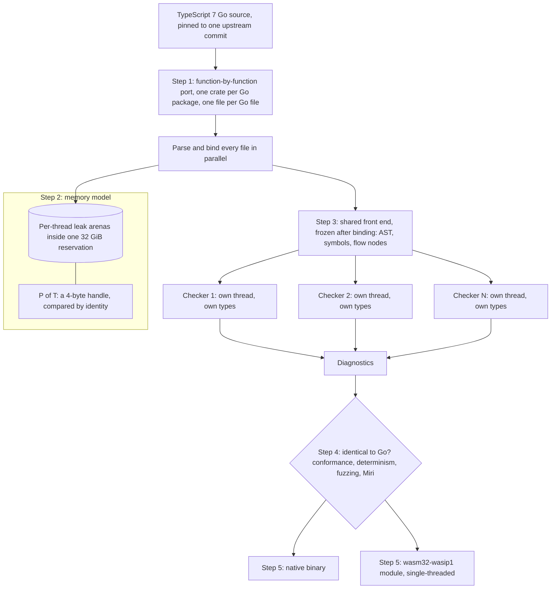

---
# Skeleton from Lead fru72d74 (Cloudflare blog), picked 2026-10-27.
# Follow docs/editorial/case-study-writing-guide.md; the author's check list
# is in the pull request. published and reviewed are the pick time, provisional: set them
# when you publish. verified: is the Author's alone (ADR-0007).
title: "tsrs: how a line-by-line Rust port of TypeScript cuts memory"
description: "tsrs ports TypeScript's Go checker to Rust function by function, trading unsafe arenas and ongoing parity work for far less memory and faster checks."
kind: case-study
vertical: languages-runtimes
tags: ["typescript", "rust", "compilers", "memory", "webassembly"]
published: "2026-10-27T17:47:16Z"
reviewed: "2026-10-27T17:47:16Z"
author: mira-vance
# Optional: an image HastCode may use, beside this file, replaces the
# generated title card. Never a Source's image.
# hero: system-name.png
# hero_alt: "What the image shows"
# Optional: related Explainer slugs and extra sources (title + url).
# related: [metastable-failures]
draft: true
---

On TypeScript 7, the compiler the TypeScript team ported to Go, one company's 37,000-file backend took [19 GiB of memory and 80 seconds](https://building.owner.com/tsrs) to type-check on one thread. In October 2026 Cloudflare and VoidZero announced [tsrs, a Rust port of that Go compiler](https://blog.cloudflare.com/typescript-rust-port/), which in early benchmarks is up to 8x faster and uses about 70% less memory, and its rule is to change nothing the checker decides.

> Drafted with AI assistance, researched, verified and edited by the HastCode editorial team. We publish only as many pieces as the Author can verify this way.

## TL;DR

- tsrs is [a drop-in replacement for the TypeScript 7 compiler and language server, written in Rust](https://github.com/oxc-project/tsrs/blob/4a406ed4ceb724fb43cb362d9149fbc430165973/README.md), ported from Go at Owner.com by Max Schwenk and now [incubated in the Oxc toolchain](https://blog.cloudflare.com/typescript-rust-port/) with Cloudflare and VoidZero.
- It exists because even the Go compiler's memory use [broke agent-heavy workflows on large codebases](https://building.owner.com/tsrs), and because Rust [compiles to WebAssembly without a garbage collector](https://blog.cloudflare.com/typescript-rust-port/) in tow.
- It works by porting every Go function as-is, putting long-lived compiler objects in per-thread arenas behind 32-bit handles, checking on several threads over one shared front end, and gating every change on TypeScript's own conformance suite.
- The price is unsafe memory code, every upstream TypeScript commit ported again, and an opt-in fast mode that can change diagnostics. The surprise: the first working build [used more memory than Go](https://github.com/oxc-project/tsrs/blob/4a406ed4ceb724fb43cb362d9149fbc430165973/docs/STATUS.md#2026-09-30-first-end-to-end-runs).

## A Go-shaped compiler with Rust-owned memory

The diagram is ours, redrawn from tsrs's [porting guide](https://github.com/oxc-project/tsrs/blob/4a406ed4ceb724fb43cb362d9149fbc430165973/docs/PORTING.md) and Max Schwenk's [post on building it](https://building.owner.com/tsrs); their own figures are in those originals. Read it top to bottom. The pinned Go source becomes Rust crates. At run time, files are parsed into arenas, shared read-only, and checked by several private checkers. Conformance gates hold the output to Go's, and one codebase ships as a native binary and a WebAssembly module. Steps 1 to 5 walk it in that order.

## Why TypeScript 7 still ran out of memory

Anders Hejlsberg announced the Go port as ["A 10x Faster TypeScript"](https://devblogs.microsoft.com/typescript/typescript-native-port/), and [Cloudflare's post grants](https://blog.cloudflare.com/typescript-rust-port/) that it was "far more memory efficient" than the JavaScript compiler before it. For Owner.com, that was not enough. Its backend monolith, Olympus, is [about 37,000 TypeScript files checked as one program](https://building.owner.com/tsrs). A single-threaded check took 19 GiB and 80 seconds; the type-aware linter beside it starts its own checker and doubles the memory, and with language and dev servers the total passes 50 GiB.

Coding agents made that a daily cost. Each agent [needs lint, type check and format in a tight loop](https://building.owner.com/tsrs), and even on a 36 GiB MacBook engineers could not run several agents at once without risking a locked machine.

Cloudflare's reason is different: where the compiler can run. Its post wants [complete development environments in more places](https://blog.cloudflare.com/typescript-rust-port/), including the browser, embedded devices and Workers, where the benefits of a small memory footprint "pay off quickly" when toolchains run in tight loops.

The gap was memory more than speed. We infer from Owner's account that a faster checker alone would not have let more agents share one machine; a smaller one would.

## Why Rust, when the TypeScript team chose Go

Owner [tried four mitigations first](https://building.owner.com/tsrs). Cloud sandboxes forced a choice between paying for p99 peaks and accepting out-of-memory crashes. Asking agents to take turns failed because agents "find ways around hooks". Splitting tsconfigs worked but "felt like a band-aid". Breaking the monolith into packages meant a re-architecture that was hard to land with thousands of commits a day.

The language question had been argued before. When the TypeScript team picked Go, Ryan Cavanaugh [explained](https://github.com/microsoft/typescript-go/discussions/411) that it needed "a structurally similar codebase" so changes could move between two compilers maintained side by side, and that languages demanding a rethink of memory management "might be a better fit for a ground-up rewrite". He added that batch compilations "can effectively forego garbage collection entirely".

We infer that tsrs takes both points literally. It is [a port, not a redesign](https://github.com/oxc-project/tsrs/blob/4a406ed4ceb724fb43cb362d9149fbc430165973/docs/PORTING.md), structured like Go so it can follow upstream. And it skips collection in the spirit of Cavanaugh's remark: batch allocations [usually live until process exit](https://github.com/oxc-project/tsrs/blob/4a406ed4ceb724fb43cb362d9149fbc430165973/docs/PORTING.md#memory-model-the-important-part).

Schwenk's own reasoning, [as he tells it](https://building.owner.com/tsrs), was that Go's memory was mostly "millions of small objects in a garbage-collected heap", and Rust would let him choose their size and lifetime. Cloudflare adds that Go to WebAssembly [must bundle its garbage collector](https://blog.cloudflare.com/typescript-rust-port/), and Rust need not.

## Step 1: the Go source is the specification

The port is ["mechanical and faithful"](https://github.com/oxc-project/tsrs/blob/4a406ed4ceb724fb43cb362d9149fbc430165973/docs/PORTING.md): the same algorithms, function decomposition, order of operations and diagnostics as the Go compiler at a commit pinned in `Cargo.toml`. The guide is blunt: "'improvements' are bugs". Each Go package maps to a Rust crate (`checker` to `tsrs_checker`, `parser` to `tsrs_parser`), each Go file to one Rust file with its functions in the same order, and each Go name to its snake_case twin, so `getTypeOfSymbol` becomes `get_type_of_symbol`.

That layout is what made an AI-driven port tractable. Schwenk says he [wrote zero code](https://building.owner.com/tsrs): Claude Opus 5.5 wrote signatures first with mocked bodies, so 20-plus subagents could fill crates in parallel worktrees, using the [15,197 conformance cases](https://building.owner.com/tsrs) the Go port left behind as the spec. The guide's [rules for agents](https://github.com/oxc-project/tsrs/blob/4a406ed4ceb724fb43cb362d9149fbc430165973/docs/PORTING.md#working-rules-for-agents) say: "Read the Go function, write the Rust function."

After one night, [78% of error baselines matched byte for byte](https://building.owner.com/tsrs), and most of the rest differed only because no type printer existed yet. With one, the match rate reached 99.97%. The [status log](https://github.com/oxc-project/tsrs/blob/4a406ed4ceb724fb43cb362d9149fbc430165973/docs/STATUS.md#2026-09-30-first-end-to-end-runs) records that first run, on 30 September 2026.

Scope stops at the compiler: `--init`, tracing and localised messages are [not ported](https://github.com/oxc-project/tsrs/blob/4a406ed4ceb724fb43cb362d9149fbc430165973/docs/PORTING.md#what-not-to-port).

## Step 2: arenas and 4-byte handles replace the garbage collector

A compiler's objects form a graph: AST nodes, symbols, types and flow nodes [live long, reference each other cyclically and are compared by identity](https://github.com/oxc-project/tsrs/blob/4a406ed4ceb724fb43cb362d9149fbc430165973/docs/PORTING.md#memory-model-the-important-part). Rust's ownership rules fight that shape. tsrs sidesteps the fight: those objects go into arenas, one per thread, and are reached through `P<T>`, a copyable handle with equality and hashing by identity, "like Go pointers". Apart from one documented exception, there are no lifetime parameters in the codebase; arena data is `'static`. A Go `*T` that can be nil becomes `Option<P<T>>`.

That is how the Rust stays shaped like Go. We infer it is also why the port could proceed file by file without redesigning ownership.

The handle is small. At first use, the process [reserves 32 GiB of address space](https://github.com/oxc-project/tsrs/blob/4a406ed4ceb724fb43cb362d9149fbc430165973/notes/mem-pointer-compression.md#the-32-gib-cap) in one block, and a `P<T>` is a 32-bit offset into it in 8-byte units, so `Option<P<T>>` is 4 bytes. Halving every pointer cut [peak memory by 14 to 15% for 6.5% more instructions](https://github.com/oxc-project/tsrs/blob/4a406ed4ceb724fb43cb362d9149fbc430165973/docs/RUST.md#techniques).

Other wins are laziness and early freeing. Lazy members build a generic type's properties only when asked: on Olympus, [tsc built 15.7 million member symbols and read 2.95 million](https://building.owner.com/tsrs). Test files that nothing imports are parsed into their own regions and [freed once checked](https://github.com/oxc-project/tsrs/blob/4a406ed4ceb724fb43cb362d9149fbc430165973/docs/RUST.md#techniques), worth 13 to 16% of peak memory on VS Code at low checker counts. Release builds [add mimalloc, PGO and, on Linux, BOLT](https://github.com/oxc-project/tsrs/blob/4a406ed4ceb724fb43cb362d9149fbc430165973/docs/RUST.md#techniques).

## Step 3: one shared front end, many private checkers

tsrs inherits Go's split. [Parsing and binding run per file, in parallel, and finish before checking](https://github.com/oxc-project/tsrs/blob/4a406ed4ceb724fb43cb362d9149fbc430165973/docs/PORTING.md#threading). Checking runs on N checkers, four by default, each on its own OS thread with a 512 MB stack.

Ownership follows the phases. The AST, binder symbols and flow nodes are shared and frozen after binding, and checkers only read them. Types, signatures and links are checker-owned: only the checker that made them touches them. Shared objects use special cells, `OwnedCell` and `FrozenCell`, because a standard `RefCell` writes a borrow flag even when read, so concurrent readers would race.

The cost of the split is duplication: [every checker builds its own copy](https://building.owner.com/tsrs) of each library type it needs. Schwenk's team tried sharing types across checkers and found no design that kept output identical without costing wall time.

So the work went into who checks what. The opt-in fast mode [groups nearby files on one checker](https://github.com/oxc-project/tsrs/blob/4a406ed4ceb724fb43cb362d9149fbc430165973/README.md#fast-mode) (and, from 16 checkers, files that use the same modules), starts heavy files first, and lets idle checkers take unstarted work. On Olympus at four checkers, grouping files by the modules they import [cut peak memory by 11% and wall time by 16%](https://building.owner.com/tsrs). [Stealing cut wall time](https://building.owner.com/tsrs) by 13.8% at four checkers and 17% at eight on a Linux workload.

## Step 4: every change must match Go's output

A fast checker that quietly stops reporting errors is the failure Schwenk's team [built most of the testing around](https://building.owner.com/tsrs). CI runs TypeScript's own suite against both compilers and compares errors, inferred types and which declaration each name resolves to, because "a checker that does nothing also reports zero errors."

The current evidence is broad. For the 0.20.0 beta, the [recorded validation](https://github.com/oxc-project/tsrs/blob/4a406ed4ceb724fb43cb362d9149fbc430165973/docs/COMPATIBILITY.md#conformance) matches all 13,700 error baselines, 12,998 `.types` and `.symbols` baselines each, and 13,626 JavaScript and declaration baselines. A separate run compares diagnostics against the pinned Go compiler on 1,000 popular TypeScript repositories.

Other gates target what a suite misses. A [determinism gate](https://building.owner.com/tsrs) requires single-threaded, default and randomised file assignments to produce identical output, and is itself tested with a fake compiler whose output depends on thread order. Shadow mode recomputes cached answers the slow way and compares them. Differential fuzzing compares Go and Rust parser output on mutated inputs; the [first 320,000 mutants](https://github.com/oxc-project/tsrs/blob/4a406ed4ceb724fb43cb362d9149fbc430165973/docs/RUST.md#techniques) showed no divergence. The unsafe arena code runs under Miri.

Between them, these caught a shortcut that [passed the entire suite while dropping errors](https://building.owner.com/tsrs). Schwenk is plain about the limit: "There's still no proof of parity."

## Step 5: one codebase, native and WebAssembly

The same crates build [`@tsrs/wasm`](https://github.com/oxc-project/tsrs/blob/4a406ed4ceb724fb43cb362d9149fbc430165973/README.md#extra-features), a module for the `wasm32-wasip1` target that Node and browsers [instantiate directly](https://github.com/oxc-project/tsrs/blob/4a406ed4ceb724fb43cb362d9149fbc430165973/notes/wasm-build.md#what-was-built-and-why). The design choices are small and telling. Files come through host imports, not WASI preopens, so one Rust path serves Node's file system, in-memory maps and browsers. It runs single-threaded. The host compiles the module once and makes a new instance per run, because tsrs keeps process-wide arenas and "linear memory never shrinks". Every layout assertion has a 32-bit twin. The 113 bundled `lib.*.d.ts` files ship uncompressed, 3.79 MB raw.

This is the part Cloudflare's post dwells on. It argues Rust's memory model allows [straightforward memory interactions between a WebAssembly guest and host](https://blog.cloudflare.com/typescript-rust-port/), and pairs tsrs with its recent [native Rust support in Workers](https://blog.cloudflare.com/rust-workers-emscripten-target/). The 0.20.0 release already fixed a [Workers failure above 128 MiB](https://github.com/oxc-project/tsrs/blob/4a406ed4ceb724fb43cb362d9149fbc430165973/docs/releases/0.20.0.md) that could silently hide input files. There is also a [browser playground](https://tsrs-playground.void.app).

## What it costs: parity is a job that never ends

A faithful port has to keep being faithful. The TypeScript team can spend years on a feature, and [Cloudflare warns](https://blog.cloudflare.com/typescript-rust-port/) that a port that drifts "will eventually fall apart and become incompatible". The 0.20.0 release alone [ported 112 upstream commits](https://github.com/oxc-project/tsrs/blob/4a406ed4ceb724fb43cb362d9149fbc430165973/docs/releases/0.20.0.md). Cloudflare plans to run the agent process it uses for [Vinext](https://blog.cloudflare.com/vinext-nextjs-on-vite), with daily upstream diffs and a nightly compatibility matrix, and admits differences remain, such as the order diagnostics print in.

Speed and exact output pull against each other. Since 0.20.0, the default follows [TypeScript's checker settings](https://github.com/oxc-project/tsrs/blob/4a406ed4ceb724fb43cb362d9149fbc430165973/README.md#fast-mode), and `--fast` adds the scheduling and lazy members. In known cases fast mode can make errors "appear, disappear, move or have different message text", and change the exit status.

The memory model has sharp edges. `P<T>` is thread-safe ["by decree, so the compiler does not police sharing"](https://github.com/oxc-project/tsrs/blob/4a406ed4ceb724fb43cb362d9149fbc430165973/docs/PORTING.md#threading); checked builds and ThreadSanitizer do that policing instead. About [a third of the unsafe code](https://github.com/oxc-project/tsrs/blob/4a406ed4ceb724fb43cb362d9149fbc430165973/docs/RUST.md#techniques) is in the handle and region code, and one memory bug [showed up in only one optimised build](https://building.owner.com/tsrs). The fixed reservation [needs a 47-bit user address space](https://github.com/oxc-project/tsrs/blob/4a406ed4ceb724fb43cb362d9149fbc430165973/notes/mem-pointer-compression.md).

There is a people cost too: pull requests [remain closed](https://github.com/oxc-project/tsrs/blob/4a406ed4ceb724fb43cb362d9149fbc430165973/README.md#contributing) for lack of review bandwidth.

## The evidence: large wins, measured by the builders

Cloudflare's headline is [up to 8x faster and about 70% less memory than TypeScript 7.0](https://blog.cloudflare.com/typescript-rust-port/) at the same number of checkers, in a configuration it says it checked with the TypeScript team. It also credits tsrs with some of the gains in TypeScript 7.1 beta, itself up to 2.5x faster than 7.0.

The repository's [results page](https://github.com/oxc-project/tsrs/blob/4a406ed4ceb724fb43cb362d9149fbc430165973/bench/RESULTS.md#default-settings), measured 27 October 2026 against 7.1 beta at default settings, shows tsrs 1.94x to 4.19x faster across 19 projects, 1.90x to 6.56x with `--fast`, and 1.85x to 2.60x less peak memory. It reports [identical diagnostics](https://github.com/oxc-project/tsrs/blob/4a406ed4ceb724fb43cb362d9149fbc430165973/bench/RESULTS.md#diagnostics) on every project. We infer the gap between these and Cloudflare's 8x is mostly the faster 7.1 baseline.

On Olympus, Owner [reports](https://building.owner.com/tsrs) tsgo 7.0.2 at four checkers taking 61.4 s and 36.0 GiB, against 8.75 s and 6.1 GiB for tsrs 0.14.0.

The memory wins were earned, not inherited. The first end-to-end run on a 38,000-file private monorepo [peaked at 20.5 GB against Go's 18.0 GB on one checker](https://github.com/oxc-project/tsrs/blob/4a406ed4ceb724fb43cb362d9149fbc430165973/docs/STATUS.md#2026-09-30-first-end-to-end-runs).

What is missing: the published results come from one Apple M3 Max, the Olympus numbers come from a private codebase nobody else can rerun, and none of the Sources cites an independent reproduction of either.

## What it makes possible

At Owner, type checking takes [seven seconds in CI and about twelve on a MacBook](https://building.owner.com/tsrs), and several agents can again run locally, each checking its own worktree. The same memory approach carries to linting: tsrslint, the type-aware lint backend ported onto tsrs, checked eight projects in 37.3 seconds against tsgolint's 169.4, and peaked at 11.5 GiB against 45.0. Cloudflare wants to [experiment with tsrs in type-aware lint rules for Oxlint](https://blog.cloudflare.com/typescript-rust-port/), and wants a full toolchain to run sandboxed on Workers or in a browser.

The lesson travels beyond TypeScript. A port can change languages without changing behaviour if the old code stays the specification and a test suite enforces it. Memory, not CPU, is often what stops parallel work, and a garbage-collected graph of small objects is where to look. And in a batch process, letting objects live until exit is a legitimate memory strategy, not a leak.

The cost is that every upstream commit has to be ported again. If that keeps working, TypeScript gets two compilers that agree on the language and compete on speed, and the TypeScript team still decides what the language is.

## Sources

- [Introducing tsrs: A port of TypeScript to Rust](https://blog.cloudflare.com/typescript-rust-port/), Boshen Chen, Dimitri Mitropoulos and Christoph Nakazawa, Cloudflare blog, 20 October 2026
- [tsrs](https://building.owner.com/tsrs), Max Schwenk, Owner.com engineering blog, 19 October 2026
- [tsrs README](https://github.com/oxc-project/tsrs/blob/4a406ed4ceb724fb43cb362d9149fbc430165973/README.md), oxc-project/tsrs at commit 4a406ed (Apache-2.0)
- [Porting guide: TypeScript 7 (Go) to Rust](https://github.com/oxc-project/tsrs/blob/4a406ed4ceb724fb43cb362d9149fbc430165973/docs/PORTING.md), oxc-project/tsrs
- [Rust practices](https://github.com/oxc-project/tsrs/blob/4a406ed4ceb724fb43cb362d9149fbc430165973/docs/RUST.md), oxc-project/tsrs
- [TypeScript compatibility](https://github.com/oxc-project/tsrs/blob/4a406ed4ceb724fb43cb362d9149fbc430165973/docs/COMPATIBILITY.md), oxc-project/tsrs
- [Release notes (status log)](https://github.com/oxc-project/tsrs/blob/4a406ed4ceb724fb43cb362d9149fbc430165973/docs/STATUS.md) and [0.20.0 beta release notes](https://github.com/oxc-project/tsrs/blob/4a406ed4ceb724fb43cb362d9149fbc430165973/docs/releases/0.20.0.md), oxc-project/tsrs
- [Benchmark results](https://github.com/oxc-project/tsrs/blob/4a406ed4ceb724fb43cb362d9149fbc430165973/bench/RESULTS.md), oxc-project/tsrs
- [mem-pointer-compression: 32-bit arena handles](https://github.com/oxc-project/tsrs/blob/4a406ed4ceb724fb43cb362d9149fbc430165973/notes/mem-pointer-compression.md), oxc-project/tsrs engineering notes
- [wasm-build: tsrs as a WebAssembly module](https://github.com/oxc-project/tsrs/blob/4a406ed4ceb724fb43cb362d9149fbc430165973/notes/wasm-build.md), oxc-project/tsrs engineering notes
- [Why Go?](https://github.com/microsoft/typescript-go/discussions/411), Ryan Cavanaugh, microsoft/typescript-go discussions, 5 March 2025
- [A 10x Faster TypeScript](https://devblogs.microsoft.com/typescript/typescript-native-port/), Anders Hejlsberg, TypeScript blog, 11 March 2025
- [Supporting native Rust in Workers with the new Emscripten target for wasm-bindgen](https://blog.cloudflare.com/rust-workers-emscripten-target/), Cloudflare blog, 28 September 2026
- [Next.js applications, powered by Vite: introducing Vinext 1.0](https://blog.cloudflare.com/vinext-nextjs-on-vite), Cloudflare blog, 28 September 2026
- [tsrs playground](https://tsrs-playground.void.app)
