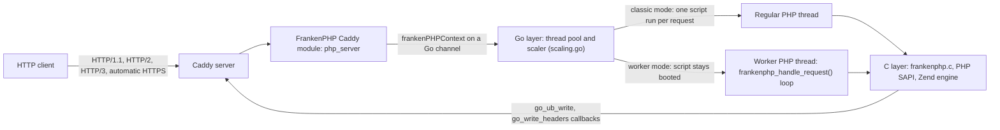

TODO(author): verify every claim against its source, then remove draft: true and this line.

FrankenPHP runs every request on a thread of one process: the PHP interpreter is [compiled into the Caddy binary through cgo](https://github.com/php/frankenphp/blob/main/docs/internals.md), so a single request that allocates past PHP's hard `memory_limit` [exits the process and takes every in-flight request with it](https://frankenphp.dev/docs/known-issues/), which is why the docs tell you to run it under a supervisor.

> Drafted with AI assistance, researched, verified and edited by the HastCode editorial team. We publish only as many pieces as the Author can verify this way.

## TL;DR

- FrankenPHP is an [application server for PHP built on the Caddy web server](https://github.com/php/frankenphp#readme): one binary serves HTTP/1.1, HTTP/2 and HTTP/3 with automatic HTTPS and [replaces Nginx or Apache plus PHP-FPM](https://frankenphp.dev/docs/migrate/).
- The design choice: the interpreter is embedded in Go [through cgo, and each PHP execution runs on a real POSIX thread](https://github.com/php/frankenphp/blob/main/docs/internals.md) of the same process, which is why it needs a thread-safe (ZTS) PHP build.
- [Worker mode](https://frankenphp.dev/docs/worker/) boots your application once and loops on `frankenphp_handle_request()`; Laravel, Symfony and Yii [enable it without application-code changes](https://thephp.foundation/blog/2025/05/15/frankenphp/).
- Since June 2025 the repository lives in the `php` GitHub organisation, [with the PHP Foundation contributing to its development](https://thephp.foundation/blog/2025/06/08/php-30/).
- Adopt it for Laravel or Symfony apps you deploy as containers or single binaries. Wait if you depend on [imap, newrelic or pcov](https://frankenphp.dev/docs/known-issues/), which are not thread-safe, or on legacy code you cannot audit for state that leaks between requests.

## In 60 seconds

The first command is the README's [install script](https://github.com/php/frankenphp#install-script) for Linux and macOS, which installs a static binary with PHP 8.5 and most popular extensions built in; the second, from the [Usage section](https://github.com/php/frankenphp#usage), serves the current directory. [Docker images](https://github.com/php/frankenphp#docker) are the other documented route.

```sh
curl https://frankenphp.dev/install.sh | sh

frankenphp php-server
```

## Architecture

Walk the diagram left to right. Caddy accepts the connection and handles TLS, HTTP/2 and HTTP/3 ([README](https://github.com/php/frankenphp#readme)). The FrankenPHP Caddy module, configured by the [`php_server` directive](https://frankenphp.dev/docs/config/), resolves the script path (classic mode) or picks the worker (worker mode), wraps the request in a `frankenPHPContext` and sends it down a Go channel to a PHP thread ([internals](https://github.com/php/frankenphp/blob/main/docs/internals.md)).

Those threads are the heart of the design. The interpreter is embedded through cgo, and each PHP execution runs on a real POSIX thread rather than a goroutine, because PHP's Zend Thread Safety model requires it: Go owns the pool, routing and auto-scaling, C owns the SAPI lifecycle and script loop, and a state machine in `internal/state/` keeps them in step ([internals](https://github.com/php/frankenphp/blob/main/docs/internals.md)). Hence PHP must be built with [`--enable-zts` and `--enable-embed`](https://frankenphp.dev/docs/compile/).

A regular thread runs one script per request: `beforeScriptExecution()` returns the filename, C executes it, and Go callbacks such as `go_ub_write` and `go_write_headers` carry output and headers back to Caddy. A worker thread keeps the script alive: `frankenphp_handle_request()` blocks in `waitForWorkerRequest()` until Go hands it a request, your handler runs, and `go_frankenphp_finish_worker_request()` cleans up ([internals](https://github.com/php/frankenphp/blob/main/docs/internals.md)).

State lives in each thread: Zend's allocator frees PHP memory at request shutdown, `$_SERVER` is rebuilt per request, and `$_ENV` is imported once per worker start. `num_threads` threads serve non-worker requests, worker threads are added on top, and `max_threads` caps the total; a request that waits over 5 ms while CPU is under 80% boots an extra thread, and idle extras retire after `max_idle_time` ([config](https://frankenphp.dev/docs/config/), [internals](https://github.com/php/frankenphp/blob/main/docs/internals.md)).



## Use it if

- You run Laravel, Symfony or Yii: all three [enable worker mode without application-code changes](https://thephp.foundation/blog/2025/05/15/frankenphp/). Symfony 7.4+ [supports it natively](https://frankenphp.dev/docs/symfony/), and Laravel drives it through Octane with [`php artisan octane:install --server=frankenphp`](https://frankenphp.dev/docs/laravel/).
- You want one container instead of two: the [migration guide](https://frankenphp.dev/docs/migrate/) maps `pm.max_children` to `num_threads`, your `php.ini` works as-is, and Nginx, PHP-FPM, FastCGI config and self-managed TLS certificates all go.
- You ship PHP as a single executable: [`EMBED=dist/app/ ./build-static.sh`](https://frankenphp.dev/docs/embed/) bundles your app, the interpreter and Caddy into one static binary.
- You write Go and want PHP behind a `net/http` handler: [`frankenphp.NewServer()` returns an `http.Handler`](https://frankenphp.dev/docs/library/).

## Don't use it if

- Your app needs [imap, newrelic or pcov](https://frankenphp.dev/docs/known-issues/): they are not thread-safe and are unsupported. Stay on PHP-FPM, where each worker is its own process.
- You need per-request process isolation. Every request runs in [one process](https://frankenphp.dev/docs/known-issues/), so a request past the hard memory limit stops the server; PHP-FPM loses one child instead.
- Your legacy code leaks memory or relies on globals being reset: [worker mode keeps statics, `ini_set()` and `$_ENV` across requests](https://frankenphp.dev/docs/worker/#state-persistence). Run [classic mode](https://frankenphp.dev/docs/classic/), which keeps the single binary, or set `MAX_REQUESTS` to recycle workers.

## Alternatives

- [PHP-FPM](https://www.php.net/manual/en/install.fpm.php): the FastCGI process manager that ships with PHP, behind Nginx or Apache; a process per worker, no worker mode, and [still fully supported alongside FrankenPHP](https://thephp.foundation/blog/2025/05/15/frankenphp/).
- [RoadRunner](https://github.com/roadrunner-server/roadrunner): also a Go server with a long-running PHP mode, but it supervises separate PHP worker processes instead of embedding the interpreter, so a standard non-ZTS PHP build works.
- [Swoole](https://github.com/swoole/swoole-src): a C extension that puts an event loop and coroutines inside PHP itself; a different programming model, with no web server in front.
- [NGINX Unit](https://github.com/nginx/unit): a polyglot application server that loads PHP as one language module among several, in the classic one-run-per-request model.

## FAQ

### Is FrankenPHP production ready?

Yes for mainstream frameworks: FrankenPHP is on a 1.x line with patch releases every few weeks (see Signals), and [Laravel, Symfony and Yii integrate it officially](https://thephp.foundation/blog/2025/05/15/frankenphp/). Run it under a supervisor: [exceeding PHP's hard memory limit exits the whole process](https://frankenphp.dev/docs/known-issues/).

### What is the difference between FrankenPHP worker mode and classic mode?

[Classic mode](https://frankenphp.dev/docs/classic/) runs a PHP file per request, like PHP-FPM. [Worker mode](https://frankenphp.dev/docs/worker/) boots the app once and loops on `frankenphp_handle_request()`, so statics, globals and `ini_set()` persist between requests.

### How does FrankenPHP compare to PHP-FPM?

FrankenPHP serves requests from threads of one Go process that also terminates HTTP; PHP-FPM forks processes behind a separate web server. The [migration guide](https://frankenphp.dev/docs/migrate/) maps `pm.max_children` to `num_threads` and `pm = dynamic` to `max_threads auto`.

### Which PHP extensions do not work with FrankenPHP?

FrankenPHP's [known issues](https://frankenphp.dev/docs/known-issues/) list imap, newrelic and pcov as unsupported (not thread-safe), and imagick as crash-prone in the Docker and Homebrew builds unless ImageMagick's OpenMP threading is disabled.

### What are the alternatives to FrankenPHP?

The main alternatives to FrankenPHP are PHP-FPM behind Nginx or Apache (a process per worker), RoadRunner (a Go server supervising PHP processes), Swoole (an event loop inside PHP) and NGINX Unit (a polyglot application server).

### How is FrankenPHP licensed and who maintains it?

FrankenPHP is [MIT licensed](https://github.com/php/frankenphp/blob/main/LICENSE); its optional Mercure library is [AGPL](https://frankenphp.dev/docs/compile/). Kévin Dunglas created it, Les-Tilleuls.coop sponsors it, and since 2025 it lives in the `php` GitHub organisation, [the PHP Foundation contributing and governance unchanged](https://thephp.foundation/blog/2025/05/15/frankenphp/).

## Verdict

FrankenPHP is careful systems engineering: a Go host that compiles the PHP interpreter in, fronts it with Caddy's HTTPS and HTTP/3, and keeps your application booted between requests. We recommend it for Laravel and Symfony teams shipping containers or single binaries, especially where two containers would become one. We would hold back where process isolation matters more than footprint, where an unsupported extension such as imap or newrelic is load-bearing, or where legacy code cannot be audited for state that leaks across worker requests; [PHP-FPM stays fully supported](https://thephp.foundation/blog/2025/05/15/frankenphp/) for exactly those cases. Thread-safe builds of the unsupported extensions, or per-request isolation inside the process, would widen that recommendation.

## Sources

- [FrankenPHP README](https://github.com/php/frankenphp#readme)
- [FrankenPHP internals: architecture overview](https://github.com/php/frankenphp/blob/main/docs/internals.md)
- [FrankenPHP docs: worker mode](https://frankenphp.dev/docs/worker/)
- [FrankenPHP docs: classic mode](https://frankenphp.dev/docs/classic/)
- [FrankenPHP docs: configuration](https://frankenphp.dev/docs/config/)
- [FrankenPHP docs: known issues](https://frankenphp.dev/docs/known-issues/)
- [FrankenPHP docs: migrating from Nginx and PHP-FPM](https://frankenphp.dev/docs/migrate/)
- [FrankenPHP docs: compile from sources](https://frankenphp.dev/docs/compile/)
- [FrankenPHP docs: standalone binaries](https://frankenphp.dev/docs/embed/)
- [FrankenPHP docs: use as a Go library](https://frankenphp.dev/docs/library/)
- [FrankenPHP docs: Laravel](https://frankenphp.dev/docs/laravel/)
- [FrankenPHP docs: Symfony](https://frankenphp.dev/docs/symfony/)
- [FrankenPHP LICENSE](https://github.com/php/frankenphp/blob/main/LICENSE)
- [The PHP Foundation: FrankenPHP Is Now Officially Supported by The PHP Foundation (15 May 2025)](https://thephp.foundation/blog/2025/05/15/frankenphp/)
- [The PHP Foundation: 30 years of PHP, FrankenPHP is now part of the PHP organisation (8 June 2025)](https://thephp.foundation/blog/2025/06/08/php-30/)
