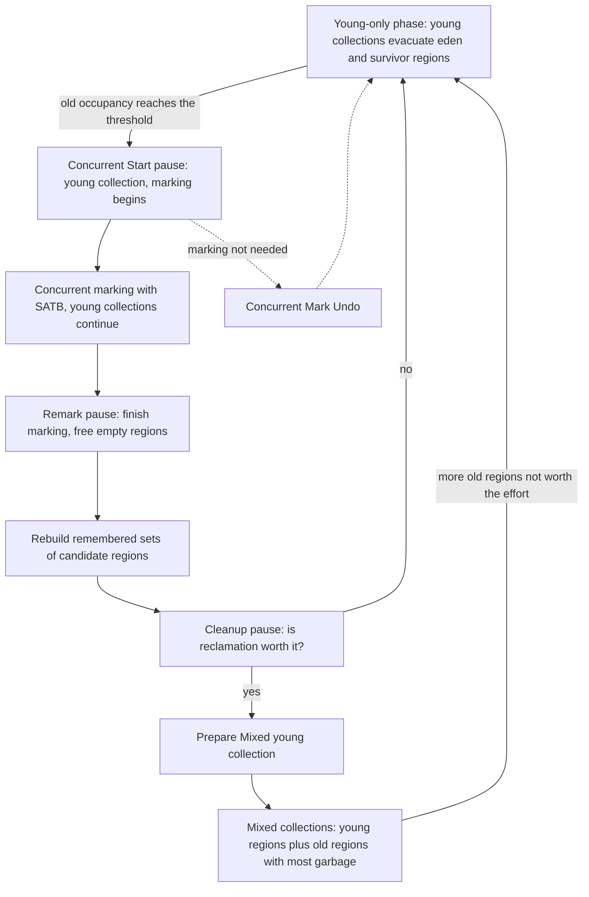

---
# Skeleton from Lead 46pdnjdh (Inside Java), picked 2026-11-16, drafted
# per docs/editorial/concept-writing-guide.md. published and reviewed are
# the pick time (make daily may move them to a Gap Day); make release keeps
# it (ADR-0012). verified: is the Author's alone (ADR-0007).
title: "G1 garbage collector: regions, mixed collections and a soft pause goal"
description: "G1, Java's default garbage collector, splits the heap into regions and reclaims those with the most garbage first, sized to a soft pause-time goal."
kind: concept
vertical: languages-runtimes
tags: ["g1", "garbage-collection", "jvm", "java", "latency"]
published: "2026-11-13T09:41:24Z"
verified: 2026-11-16
reviewed: "2026-11-16T10:04:38Z"
author: mira-vance
# Optional: an image HastCode may use, beside this file, replaces the
# generated title card. Never a Source's image.
# hero: concept-name.png
# hero_alt: "What the image shows"
# Optional: related Explainer slugs and extra sources (title + url).
# related: [http-connection-reuse]
---

In August 2025, two authors on the AWS Big Data Blog benchmarked Apache HBase on Amazon EMR with YCSB and watched the unusually long GC pauses a RegionServer reports through its `JvmPauseMonitor`. With G1 as the collector, they saw ["75 such pauses over a 7-hour period"](https://aws.amazon.com/blogs/big-data/improve-amazon-emr-hbase-availability-and-tail-latency-using-generational-zgc), in lines like "pause of approximately 3021ms". For HBase that is more than slow: ["If GC pauses exceed the configured ZooKeeper session timeout, they might lead to RegionServer failures."](https://aws.amazon.com/blogs/big-data/improve-amazon-emr-hbase-availability-and-tail-latency-using-generational-zgc) G1's default pause goal is [200 milliseconds](https://docs.oracle.com/en/java/javase/27/gctuning/garbage-first-g1-garbage-collector.html#GUID-082C967F-2DAC-4B59-8A81-0CEC6EEB9016). The post does not say whether that goal was changed, and either way the lesson holds: in G1 the pause time is a target the collector plans its work around, not a limit it enforces. How it plans, one region at a time, is what this piece explains.

## TL;DR

- **G1** (Garbage-First) is the HotSpot JVM collector that splits the heap into equal-sized regions and, in dev.java's words, ["will reclaim the regions with the most garbage first"](https://dev.java/learn/jvm/tool/garbage-collection/g1gc-overview/#g1-design-and-collection-cycle).
- Young-only pauses copy live objects out of new regions. When the old generation fills past a threshold, concurrent marking, bracketed by [Concurrent Start, Remark and Cleanup pauses](https://docs.oracle.com/en/java/javase/27/gctuning/garbage-first-g1-garbage-collector.html#GUID-F1BE86FA-3EDC-4D4F-BDB4-4B044AD83180), finds the old regions worth collecting, and **mixed collections** evacuate them alongside young ones.
- It is the default: on servers [since JDK 9, and as of JDK 27 in all environments](https://dev.java/learn/jvm/tool/garbage-collection/g1gc-overview/#introduction).
- What to do: set a heap size and, if needed, a pause goal with `-XX:MaxGCPauseMillis`, ["a soft goal that the JVM will try to achieve but cannot guarantee"](https://dev.java/learn/jvm/tool/garbage-collection/g1gc-overview/#using-g1). The cost: a higher goal can buy throughput with latency, a lower one the reverse.

## G1 collects regions, and picks the dirtiest first

Oracle's guide calls G1 ["generational, incremental, parallel, mostly concurrent, stop-the-world, and evacuating"](https://docs.oracle.com/en/java/javase/27/gctuning/garbage-first-g1-garbage-collector.html#GUID-E9CB81BC-92E5-489E-8A2E-760691A41CDF). In our words: **Generational**: new and long-lived objects are treated differently. **Incremental**: the heap is reclaimed a piece at a time. A **stop-the-world pause** halts the application's threads; **mostly concurrent** work runs beside them. **Evacuating**: live objects are copied into new memory areas, compacting them in the process.

The piece being collected is a **region**, ["the unit of memory allocation and memory reclamation"](https://docs.oracle.com/en/java/javase/27/gctuning/garbage-first-g1-garbage-collector.html#GUID-15921907-B297-43A4-8C48-DC88035BC7CF). Dead objects are never freed one by one: once the live ones are copied out, the region is ["considered empty and is eligible for reuse"](https://dev.java/learn/jvm/tool/garbage-collection/g1gc-overview/#g1-design-and-collection-cycle). So collecting a region costs the copying of what is alive in it, and pays back the garbage it held. Regions with the most garbage give the most space for the least copying: hence the name.

The aim is balance. dev.java names three design constraints, throughput, latency and memory footprint, and says G1 seeks ["a balance between latency and throughput, rather than heavily optimizing for either"](https://dev.java/learn/jvm/tool/garbage-collection/g1gc-overview/#a-brief-history-of-g1).

What does not count: a guarantee. G1 ["is not a real-time collector"](https://docs.oracle.com/en/java/javase/27/gctuning/garbage-first-g1-garbage-collector.html#GUID-E9CB81BC-92E5-489E-8A2E-760691A41CDF); it meets pause targets with high probability over time, "but not always with absolute certainty for a given pause."

## The heap as a grid of equal regions

G1 divides the heap into [regions of uniform size](https://dev.java/learn/jvm/tool/garbage-collection/g1gc-overview/#g1-design-and-collection-cycle), each with one role at a time. **Eden** holds new objects. **Survivor** holds objects copied out of a collection alive. **Old** holds objects that survived enough collections, and is ["checked less frequently"](https://dev.java/learn/jvm/tool/garbage-collection/g1gc-overview/#g1-design-and-collection-cycle). **Humongous** is one or more contiguous regions for a single object of [half a region or more](https://docs.oracle.com/en/java/javase/27/gctuning/garbage-first-g1-garbage-collector.html#GUID-D74F3CC7-CC9F-45B5-B03D-510AEEAC2DAC) (dev.java says larger than half), which [skips eden and survivor](https://dev.java/learn/jvm/tool/garbage-collection/g1gc-overview/#g1-design-and-collection-cycle).

Region size follows the maximum heap: by default G1 aims for [roughly 2048 regions, up to 32 MB each](https://docs.oracle.com/en/java/javase/27/gctuning/garbage-first-g1-garbage-collector.html#GUID-082C967F-2DAC-4B59-8A81-0CEC6EEB9016), and `-XX:G1HeapRegionSize` sets a power of 2 from 1 to 512 MB.

Put numbers on it with a heap of our choosing, `-Xmx8g`; the arithmetic is ours. 8 GB over about 2048 regions gives 4 MB regions, so an object of 2 MB or more is humongous. A 3 MB array takes a whole 4 MB region, and the leftover in a humongous object's last region is [lost for allocation until the entire object is reclaimed](https://docs.oracle.com/en/java/javase/27/gctuning/garbage-first-g1-garbage-collector.html#GUID-D74F3CC7-CC9F-45B5-B03D-510AEEAC2DAC): 1 MB idle for as long as the array lives. G1 also [typically does not move](https://docs.oracle.com/en/java/javase/27/gctuning/garbage-first-g1-garbage-collector.html#GUID-3A99AE6C-F80A-4565-A27C-B4AEDF5CDF71) humongous objects, only determining whether they are live.

## The cycle: young-only pauses, three marking pauses, then mixed collections

Walk it from the top. In the **Young-only phase** only young regions are collected. After each collection G1 sizes the young generation for the next stretch, so that in every [`GCPauseIntervalMillis` window pauses use at most the pause goal](https://docs.oracle.com/en/java/javase/27/gctuning/garbage-first-g1-garbage-collector.html#GUID-C268549C-7D95-499C-9B24-A6670B44E49C).

The trigger is old-generation occupancy reaching the **Initiating Heap Occupancy** threshold, [a percentage of the old generation size](https://docs.oracle.com/en/java/javase/27/gctuning/garbage-first-g1-garbage-collector.html#GUID-572C9203-AB27-46F1-9D33-42BA4F3C6BF3). It starts at [45%](https://docs.oracle.com/en/java/javase/27/gctuning/garbage-first-g1-garbage-collector.html#GUID-082C967F-2DAC-4B59-8A81-0CEC6EEB9016) and then adapts, watching how long marking takes and how much the old generation grows meanwhile.

Per Oracle's [cycle description](https://docs.oracle.com/en/java/javase/27/gctuning/garbage-first-g1-garbage-collector.html#GUID-F1BE86FA-3EDC-4D4F-BDB4-4B044AD83180), the **Concurrent Start** pause does a normal young collection and starts marking, unless G1 decides marking is unneeded and undoes it. **Remark** finalises marking, processes references, unloads classes and reclaims completely empty regions. **Cleanup** decides whether a Space-Reclamation phase follows; if so, one Prepare Mixed young collection ends the Young-only phase. If the application runs out of memory, the backstop is a stop-the-world Full GC.

## Mixed collections spend the pause where the garbage is

Each pause evacuates a **collection set**, ["the set of source regions from which space is reclaimed"](https://docs.oracle.com/en/java/javase/27/gctuning/garbage-first-g1-garbage-collector.html#GUID-3A64E6D5-A49D-4D6E-97E7-1BC21419ACF7): young regions, humongous regions and, during Space-Reclamation, old **candidate regions** from marking. Candidates are ranked by efficiency, preferring little live data and low connectivity to other regions. A region more than [85% live](https://docs.oracle.com/en/java/javase/27/gctuning/garbage-first-g1-garbage-collector.html#GUID-082C967F-2DAC-4B59-8A81-0CEC6EEB9016) is left out entirely.

How many per pause? Oracle's [sizing rule](https://docs.oracle.com/en/java/javase/27/gctuning/garbage-first-g1-garbage-collector.html#GUID-6D6B18B1-063B-48FF-99E3-5AF059C43CE8) has three parts: a minimum, the candidate count divided by `G1MixedGCCountTarget`; more regions "until 80% of the remaining time is predicted to be used"; and optional regions if time is still left.

Back on our 8 GB heap, suppose marking leaves 400 candidate regions (our number). `G1MixedGCCountTarget` defaults to 8, so each mixed pause takes at least 50 old regions, 200 MB, plus whatever more fits the 200 ms goal.

The phase ends when more old regions [wouldn't yield enough free space worth the effort](https://docs.oracle.com/en/java/javase/27/gctuning/garbage-first-g1-garbage-collector.html#GUID-F1BE86FA-3EDC-4D4F-BDB4-4B044AD83180). `G1HeapWastePercent` is the [unreclaimed space allowed](https://docs.oracle.com/en/java/javase/27/gctuning/garbage-first-g1-garbage-collector.html#GUID-082C967F-2DAC-4B59-8A81-0CEC6EEB9016), 5% of the heap by default, about 410 MB on a full 8 GB heap; Oracle applies it when choosing candidates. We infer it is what draws that line.

## Remembered sets: collecting a region without scanning the heap

Evacuation moves objects, so every reference to a moved object must be found and fixed. Scanning the whole heap for them each pause would defeat the point of collecting a few regions. The **remembered set** is the answer: ["the set of locations outside the collection set that contain references into the collection set"](https://docs.oracle.com/en/java/javase/27/gctuning/garbage-first-g1-garbage-collector.html#GUID-99526C47-2C71-408C-9DBE-4F38ED839FF0).

Its entries are compressed references to [**cards**](https://docs.oracle.com/en/java/javase/27/gctuning/garbage-first-g1-garbage-collector.html#GUID-99526C47-2C71-408C-9DBE-4F38ED839FF0), small logical slices of the heap, 512 bytes by default; a 4 MB region holds 8,192, by our arithmetic. At the start of a pause G1 merges the collection set's remembered sets into [a single unified remembered set](https://docs.oracle.com/en/java/javase/27/gctuning/garbage-first-g1-garbage-collector.html#GUID-58968F63-9EAF-487E-A884-CF0831EA6D31), dropping many duplicates; the remembered sets determine the heap roots for evacuation.

G1 builds them [mostly lazily](https://docs.oracle.com/en/java/javase/27/gctuning/garbage-first-g1-garbage-collector.html#GUID-99526C47-2C71-408C-9DBE-4F38ED839FF0). Young regions always have one, since they are collected every time; old candidates get theirs rebuilt between Remark and Cleanup, the step in the diagram.

Keeping them current costs work while the application runs. The tuning guide calls it **refinement** and schedules it concurrently so that at most [10% of the pause goal](https://docs.oracle.com/en/java/javase/27/gctuning/garbage-first-garbage-collector-tuning.html#GUID-379B3888-FE24-4C3F-9E38-26434EB04F89) goes on what is left in the pause; work beyond the refinement threads' capacity [spills into the pause](https://docs.oracle.com/en/java/javase/27/gctuning/garbage-first-garbage-collector-tuning.html#GUID-70E3F150-B68E-4787-BBF1-F91315AC9AB9).

## SATB: marking a heap the application keeps changing

Concurrent marking has a hard problem: the application rewrites references while marking threads trace them. G1 uses [**Snapshot-At-The-Beginning**](https://docs.oracle.com/en/java/javase/27/gctuning/garbage-first-g1-garbage-collector.html#GUID-AC383806-7FA7-4698-8B92-4FD092B9F368) (SATB), which takes "a virtual snapshot of the heap at the time of the Concurrent Start pause". Everything live at that moment counts as live until marking ends.

That is deliberate conservatism. An object that dies during marking is still treated as live for this cycle, with some exceptions, so G1 may retain memory other collectors would free. Oracle names the payoff: SATB ["provides better latency during the Remark pause"](https://docs.oracle.com/en/java/javase/27/gctuning/garbage-first-g1-garbage-collector.html#GUID-AC383806-7FA7-4698-8B92-4FD092B9F368), and what it kept too long is reclaimed by the next marking.

We infer why the trade suits G1. Remark is stop-the-world; whatever SATB settles up front is work Remark need not redo while the application waits. The price is paid in heap.

## Where G1 runs today

**Every HotSpot JVM, by default.** G1 arrived [experimental in JDK 6u14](https://dev.java/learn/jvm/tool/garbage-collection/g1gc-overview/#a-brief-history-of-g1), became standard in JDK 7u4 and the default in JDK 9. Until JDK 27 the JVM chose it only with [two or more cores and more than 1792 MB of memory](https://dev.java/learn/jvm/tool/garbage-collection/g1gc-overview/#using-g1), otherwise Serial; as of JDK 27, under [JEP 523](https://openjdk.org/jeps/523), it is the default everywhere.

**On small machines too.** It was built for [multiple processors and tens of GB of memory](https://dev.java/learn/jvm/tool/garbage-collection/g1gc-overview/#a-brief-history-of-g1). dev.java now describes it performing well with a single CPU and under 2 GB, after 12 G1 JEPs since JDK 8, and Oracle's selection guide says it ["typically performs as well as the Serial collector"](https://docs.oracle.com/en/java/javase/27/gctuning/available-collectors.html#GUID-414C9D95-297E-4EE3-B0D9-36F158A83393) in constrained environments.

**In latency-sensitive data stores.** The HBase post shows where the soft goal bites. Its authors write that ["G1 GC pauses are proportional to the pressure on the heap and the object allocation patterns"](https://aws.amazon.com/blogs/big-data/improve-amazon-emr-hbase-availability-and-tail-latency-using-generational-zgc), and recommend Generational ZGC for RegionServers to cut those pauses.

## Why collectors went regional

The force is heap size against pause time. Oracle positions G1 for [heaps of tens of GBs or larger](https://docs.oracle.com/en/java/javase/27/gctuning/garbage-first-g1-garbage-collector.html#GUID-0394E76A-1A8F-425E-A0D0-B48A3DC82B42), more than half live, with pause targets of no more than a few hundred milliseconds.

The older design did not scale that way. Oracle's [comparison](https://docs.oracle.com/en/java/javase/27/gctuning/garbage-first-g1-garbage-collector.html#GUID-98E80C82-24D8-41D4-BC39-B2583F04F1FF) says Parallel GC "can compact and reclaim space in the old generation only as a whole", while G1 spreads that work over many shorter collections, which "substantially shortens pause time at the potential expense of throughput". G1 was also [designed to replace CMS](https://dev.java/learn/jvm/tool/garbage-collection/g1gc-overview/#a-brief-history-of-g1), with more consistent pauses; CMS was removed in JDK 14.

We infer the shape of the argument. A collector that must finish the whole old generation in one pause has a pause that grows with the heap. One that can stop after any region can choose how much work fits the time it was given, and G1 does: it [builds a model of costs from previous pauses](https://docs.oracle.com/en/java/javase/27/gctuning/garbage-first-g1-garbage-collector.html#GUID-E9CB81BC-92E5-489E-8A2E-760691A41CDF) and sizes each pause's work to it. The price, the comparison adds, is that G1 "may exhibit higher overhead" than throughput collectors because of its concurrent work.

## Practice one: set a heap size and a pause goal, then stop

Oracle's [general recommendation](https://docs.oracle.com/en/java/javase/27/gctuning/garbage-first-garbage-collector-tuning.html#GUID-0BB3B742-A985-4D5E-A9C5-433A127FE0F6): use G1 with its defaults, "eventually giving it a different pause-time goal and setting a maximum Java heap size". Coming from another collector, start by [removing all options that affect garbage collection](https://docs.oracle.com/en/java/javase/27/gctuning/garbage-first-garbage-collector-tuning.html#GUID-E26056D1-02A5-4367-94EF-72C66D314AF7); many have no effect on G1 or make it worse.

Leave young-generation size alone. Options such as `-Xmn` and `-XX:NewRatio` take away the main means G1 has to meet its goal, and a fixed size "practically disables pause-time control", the same recommendation warns.

Then pick a direction. For throughput, raise `-XX:MaxGCPauseMillis`: G1 grows the young generation, which [directly determines the frequency of pauses](https://docs.oracle.com/en/java/javase/27/gctuning/garbage-first-garbage-collector-tuning.html#GUID-70E3F150-B68E-4787-BBF1-F91315AC9AB9). For latency, [modify the pause time target](https://docs.oracle.com/en/java/javase/27/gctuning/garbage-first-garbage-collector-tuning.html#GUID-0BB3B742-A985-4D5E-A9C5-433A127FE0F6): lower it.

The cost is the trade itself. dev.java is blunt: ["there are no settings for simply 'better' performance, but, at best, a tradeoff"](https://dev.java/learn/jvm/tool/garbage-collection/g1gc-overview/#using-g1). A lower goal means smaller, more frequent pauses; we infer it also means fewer old regions per mixed pause, so reclamation takes longer.

## Practice two: give the heap headroom over the live set

The **live set** is the memory your reachable objects occupy. dev.java's [general guidance](https://dev.java/learn/jvm/tool/garbage-collection/g1gc-overview/#using-g1) is a maximum heap 25% above the expected live set, adjusted to the application. A bigger heap, it says, trades "a larger memory footprint for reduced latency".

For steady early behaviour, set `-Xms` equal to `-Xmx` to avoid heap resizing, and add `-XX:+AlwaysPreTouch`; together, [dev.java says](https://dev.java/learn/jvm/tool/garbage-collection/g1gc-overview/#using-g1), they can reduce latency early in an application's life.

When G1 sizes the heap itself, `-XX:GCTimeRatio` steers it: the default of 24 targets [4% of the time spent in garbage collection](https://docs.oracle.com/en/java/javase/27/gctuning/garbage-first-garbage-collector-tuning.html#GUID-379B3888-FE24-4C3F-9E38-26434EB04F89). dev.java mentions [Automatic Heap Sizing](https://dev.java/learn/jvm/tool/garbage-collection/g1gc-overview/#using-g1) for G1 as an upcoming change.

The cost is memory you pay for and may not use.

## Practice three: read the logs before changing a flag

Each symptom has its own fix, and the logs say which one you have. Per-phase timings come from [`-Xlog:gc+phases=debug`](https://docs.oracle.com/en/java/javase/27/gctuning/garbage-first-g1-garbage-collector.html#GUID-58968F63-9EAF-487E-A884-CF0831EA6D31).

**A Full GC.** `Pause Full (G1 Compaction Pause)` in the log means [old-generation occupancy got too high](https://docs.oracle.com/en/java/javase/27/gctuning/garbage-first-garbage-collector-tuning.html#GUID-0DD93225-0BCF-4605-B365-E9833F5BD2FC), often because marking did not finish in time. The options: more marking threads with `-XX:ConcGCThreads`, an earlier start through a larger `-XX:G1ReservePercent`, or a fixed threshold with `-XX:-G1UseAdaptiveIHOP` and `-XX:G1IHOP`.

**Mixed collections too long.** Spread old regions over [more collections](https://docs.oracle.com/en/java/javase/27/gctuning/garbage-first-garbage-collector-tuning.html#GUID-D2B6ADCE-6766-4FF8-AA9D-B7F4F3D0F469) with `-XX:G1MixedGCCountTarget`, or skip costly regions with `-XX:G1MixedGCLiveThresholdPercent` and `-XX:G1HeapWastePercent`.

**Humongous fragmentation.** Raise `-XX:G1HeapRegionSize` so [fewer objects are humongous](https://docs.oracle.com/en/java/javase/27/gctuning/garbage-first-garbage-collector-tuning.html#GUID-2428DA90-B93D-48E6-B336-A849ADF1C552), or grow the heap.

**Throughput above all.** `-XX:-G1UseConcRefinement` moves all refinement into the pause, ["potentially significantly increasing latency"](https://docs.oracle.com/en/java/javase/27/gctuning/garbage-first-garbage-collector-tuning.html#GUID-70E3F150-B68E-4787-BBF1-F91315AC9AB9).
## What G1 is not

**Not ZGC.** Oracle says ZGC provides [max pause times under a millisecond, at the cost of some throughput](https://docs.oracle.com/en/java/javase/27/gctuning/available-collectors.html#GUID-9E4A6B11-BB94-424F-90EF-401287A1C333), independent of heap size, and points you there when response time is a high priority. G1 is the middle setting; ZGC is the switch the AWS post recommends for HBase. Our [ZGC adaptive heap sizing explainer](/languages-runtimes/zgc-adaptive-heap-sizing/) shows how ZGC trades memory for GC CPU.

**Not the throughput collector.** If peak performance comes first and pauses of a second or longer are acceptable, Oracle's [selection guide](https://docs.oracle.com/en/java/javase/27/gctuning/available-collectors.html#GUID-414C9D95-297E-4EE3-B0D9-36F158A83393) points to the parallel collector.

**Not every byte in the process.** G1 manages the Java heap; memory outside it, covered in our [off-heap memory explainer](/languages-runtimes/java-off-heap-memory/), is not its to collect.

## What understanding G1 makes possible

Once the cycle is clear, a GC log reads as a story. A long young pause is too much copying out of eden. A Full GC is marking that lost the race against allocation. A long mixed pause is old regions less empty than hoped. Each points at a different flag, and most point at none: the first step is a heap size and a goal.

You can measure what matters: the live set against the heap, pauses against the goal, how often a Concurrent Start leads to mixed collections at all. Oracle's [G1 chapter](https://docs.oracle.com/en/java/javase/27/gctuning/garbage-first-g1-garbage-collector.html) names the log phases.

The optimistic part: a collector built for tens of gigabytes and many cores is now the default on a single CPU, and the knob that matters most is one number you choose. Tell G1 how long a pause may be and how much memory it has, and it spends both where the garbage is.

## Sources

- Inside Java, ["Tutorial: The G1 Garbage Collector"](https://inside.java/2026/11/10/g1gc-tutorial/), November 2026 (links to the dev.java tutorial).
- dev.java, ["The G1 Garbage Collector"](https://dev.java/learn/jvm/tool/garbage-collection/g1gc-overview/), last updated 2 November 2026.
- Oracle, ["Garbage-First (G1) Garbage Collector"](https://docs.oracle.com/en/java/javase/27/gctuning/garbage-first-g1-garbage-collector.html), Java SE 27 GC Tuning Guide.
- Oracle, ["Garbage-First Garbage Collector Tuning"](https://docs.oracle.com/en/java/javase/27/gctuning/garbage-first-garbage-collector-tuning.html), Java SE 27 GC Tuning Guide.
- Oracle, ["Available Collectors"](https://docs.oracle.com/en/java/javase/27/gctuning/available-collectors.html), Java SE 27 GC Tuning Guide.
- OpenJDK, [JEP 523](https://openjdk.org/jeps/523), as cited by dev.java.
- Vishal Chaudhary, Ramesh Kandasamy, ["Improve Amazon EMR HBase availability and tail latency using generational ZGC"](https://aws.amazon.com/blogs/big-data/improve-amazon-emr-hbase-availability-and-tail-latency-using-generational-zgc), AWS Big Data Blog, 19 August 2025.
