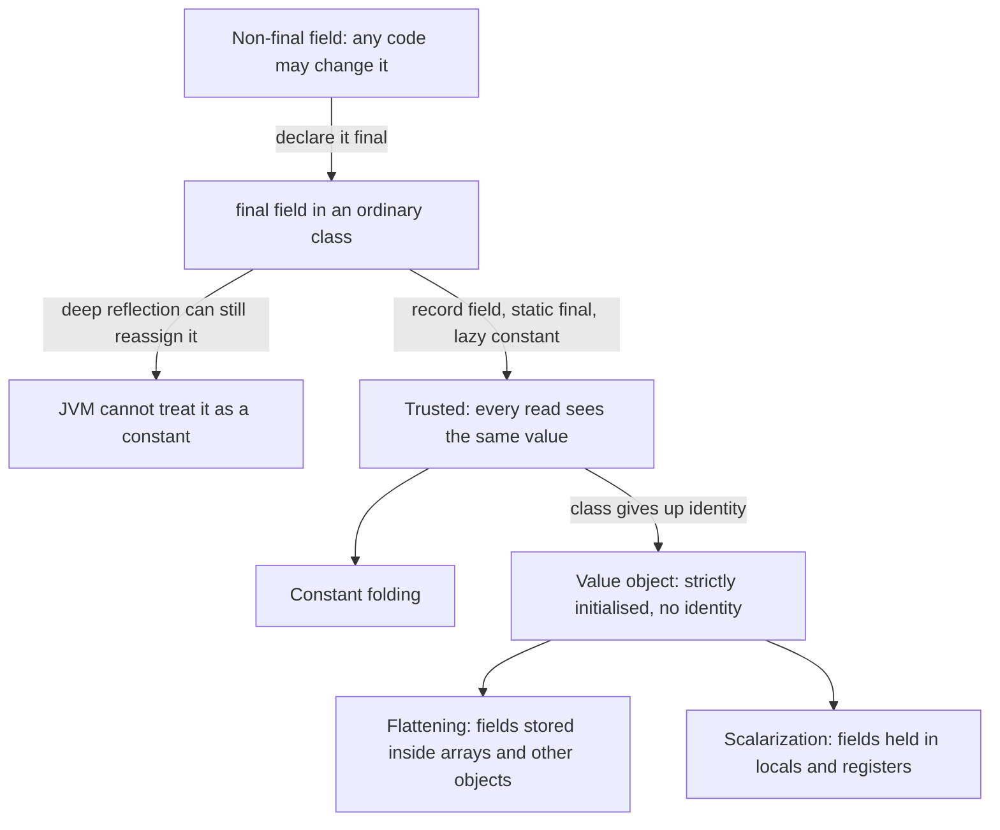

---
# Skeleton from Lead mntit4wy (Inside Java), picked 2026-10-29.
# published and reviewed are the pick time, provisional: set them
# when you publish. verified: is the Author's alone (ADR-0007).
title: "Immutable data in Java: state the JVM can trust never to change"
description: "Immutable data is state fixed at construction. How records, value objects and lazy constants let the JVM trust it, and what that trust buys."
kind: concept
vertical: languages-runtimes
tags: ["java", "immutability", "project-valhalla", "value-objects", "records"]
published: "2026-10-29T19:47:44Z"
verified: 2026-10-29
reviewed: "2026-10-29T19:47:44Z"
author: mira-vance
# Optional: an image HastCode may use, beside this file, replaces the
# generated title card. Never a Source's image.
# hero: concept-name.png
# hero_alt: "What the image shows"
# Optional: related Explainer slugs and extra sources (title + url).
related: [jvm-warmup-and-aot-compilation, java-off-heap-memory]
---

Make a `LocalDate` for 23 January 1996, add thirty years, take thirty away, and compare the two dates. JEP 401 runs exactly this in jshell: `d1.equals(d3)` is true, and `d1 == d3` is [false](https://openjdk.org/jeps/401#Motivation). They are two objects with two identities, for what the JEP calls ["effectively 48 bits of primitive data"](https://openjdk.org/jeps/401#Object-identity-is-expensive-at-run-time). An array of them is an array of pointers, each to its own block of heap memory. Now run the same lines in a JDK 28 jshell with preview features on, and `d1 == d3` is [true](https://openjdk.org/jeps/401#Programming-with-value-objects). JEP 401 is [targeted to JDK 28](https://openjdk.org/projects/jdk/28/) as a preview, and with previews enabled, [30 JDK classes](https://inside.java/2026/10/27/quality-heads-up/), from `Integer` to `LocalDate`, become value classes. Nicolai Parlog, announcing it to open-source projects, flags the "uncommon compatibility implication" that ["existing code will start using the new feature despite being unchanged"](https://inside.java/2026/10/27/quality-heads-up/). The date was always immutable. What changed is that the JVM is now allowed to believe it.

> Drafted with AI assistance, researched, verified and edited by the HastCode editorial team. We publish only as many pieces as the Author can verify this way.

## TL;DR

- **Immutable data** is state that is fixed when an object is constructed. Effective Java's advice to ["minimize mutability"](https://openjdk.org/jeps/547#Motivation) rests on it: an immutable object can be in only one state, so it can be shared freely across threads.
- The JVM optimises only immutability it can trust. A `final` field in an ordinary class [can still be reassigned by deep reflection](https://openjdk.org/jeps/500#Motivation), which blocks constant folding; record fields, lazy constants and value objects close that gap.
- Value objects go furthest: with no identity, the JVM may [flatten them into arrays and fields and scalarize them into locals](https://openjdk.org/jeps/401#Run-time-optimizations-for-value-objects), so an array of dates may perform much like an array of `int`.
- What to do: declare data as records or value classes, set every field before the object escapes, derive copies through the canonical constructor, and defer with lazy constants. The cost: preview flags, no locking on value objects, and constructor rules that break some existing code.

## Immutable data is state fixed at construction

JEP 547, by Per Minborg and Maurizio Cimadamore, starts from the standard advice: ["prefer immutability" or "minimize mutability"](https://openjdk.org/jeps/547#Motivation), Item 17 of Effective Java. Its reason is the one that matters for concurrency: an immutable object ["can be in only one state"](https://openjdk.org/jeps/547#Motivation). The platform's main tool for it has always been the `final` field.

JEP 401, owned by Dan Smith, the guest on the Inside Java [podcast episode](https://inside.java/2026/10/29/podcast-073/) behind this piece, sharpens that into two properties. Data is **immutable** when all its instance fields are final and the value it represents [will not change over time](https://openjdk.org/jeps/401#Declaring-value-classes). It is **interchangeable** when there is no need to tell apart two separately created instances that represent the same value. Dates, complex numbers and pixel colours [are both](https://openjdk.org/jeps/401#Motivation).

In our words: immutable data is a value wearing a class. Its constructor validates it once, and from then on every reader sees the same thing.

What does not count: a `final` reference to a mutable `ArrayList`. Records themselves are only ["(shallowly) immutable"](https://openjdk.org/jeps/468#Motivation): the record's fields cannot change, but what they point to can. And mutable objects need identity: two `Line` objects in a text editor may hold equal text today, but the editor relies on identity [to mutate the right one](https://openjdk.org/jeps/401#Immutable-data-does-not-need-identity).

## The ladder of trust between a field and the JIT

Start at the top. A lazily created logger in a **non-final field** is JEP 547's example: because the field is not final, the JVM ["cannot trust its content never to change"](https://openjdk.org/jeps/547#Embracing-mutability-for-more-flexible-initialization), so it cannot fold the value or drop the `null` check.

Declaring it **final** should fix that, and mostly does not. JEP 500's example sets a final field to 100 in a constructor, then uses `Field.setAccessible` and `Field.set` to make it [200, then 300](https://openjdk.org/jeps/500#Motivation). Its verdict: ["Final fields are, in reality, as mutable as non-final fields."](https://openjdk.org/jeps/500#Motivation)

Some finals are **trusted**. Deep reflection has been barred from mutating the fields of [hidden classes and records](https://openjdk.org/jeps/500#Motivation) since JDK 15 and 16, and static finals cannot be updated by reflection, so constant folding across static finals is ["not only possible but routine"](https://openjdk.org/jeps/547#Risks-and-assumptions). Constant folding evaluates a constant expression once rather than on every use, and JEP 500 calls it [often the first step](https://openjdk.org/jeps/500#Motivation) in a chain of optimisations.

The bottom rung, **value objects**, gets its own worked example.

## The bottom rung: a LocalDate with no address

JEP 401 puts numbers on it. Today, a `LocalDate[5]` is five pointers, each to a separate object, and every object needs [at least 64 bits for its header](https://openjdk.org/jeps/401#Reference-flattening) before any data. Objects created at different times or moved by the collector can sit far apart, so iterating may [load a different cache line](https://openjdk.org/jeps/401#Object-identity-is-expensive-at-run-time) for every element.

Once `LocalDate` has no identity, a JVM can **flatten** each element: store a null flag plus the year (an `int`) and month and day (two bytes) [in one 64-bit word](https://openjdk.org/jeps/401#Reference-flattening), inside the array itself. The JEP expects such an array to perform [similarly to an `int` array](https://openjdk.org/jeps/401#Programming-with-value-objects).

Now update an element with `dates[0] = dates[0].plusYears(30)`. In JIT-compiled code, the JEP sketches three steps. The flattened word is read into a **scalarized** reference, a null flag and three locals; `plusYears` takes and returns those scalars; the result is [flattened again on write](https://openjdk.org/jeps/401#Reference-scalarization). The code ["never touches a pointer to a heap-allocated LocalDate object"](https://openjdk.org/jeps/401#Reference-scalarization).

Immutability of the container matters too. A flattened reference must be read and written atomically, which limits mutable fields that store them to [no more than 64 bits](https://openjdk.org/jeps/401#Reference-flattening) on common hardware. A `LocalDateTime` is too big for a mutable field of an identity class, but it can be flattened into a field of a value class, because those fields [can never be observed to be mutated](https://openjdk.org/jeps/401#Reference-flattening).

## Where trusted immutable data already lives in the JDK

**`java.time` and the boxes.** Since JDK 8, `Optional` and the `java.time` classes have been specified as **value-based**, a contract that [anticipated today's value classes](https://inside.java/2026/10/27/quality-heads-up/); JDK 16 added the primitive wrappers. In the JDK 28 preview, all 30 of the listed classes are value classes, including `Number` and `Record` as [abstract value classes](https://openjdk.org/jeps/401#Value-classes-in-the-Java-Platform). `String` is not: it has [dependencies on object identity](https://openjdk.org/jeps/401#Programming-with-value-objects) in its API and implementation, so it stays an immutable identity class.

**Unmodifiable collections.** `List.of`, `Set.of` and `Map.of`, from JDK 9, create [compact, unmodifiable collections](https://openjdk.org/jeps/269#Goals). JEP 269 counts the old way: an unmodifiable two-element `HashSet` built with wrappers is [six objects](https://openjdk.org/jeps/269#Description). The factories reject nulls, partly for ["a more compact internal representation"](https://openjdk.org/jeps/269#Description), and once safely published the collections are safe for concurrent access. `Map.entry` even returns a new concrete type to ease [a possible later migration to a value type](https://openjdk.org/jeps/269#Description).

**JDK internals.** Low-level JDK code marks fields with the internal `@Stable` annotation, which asserts a non-final field [will not change after its first update](https://openjdk.org/jeps/547#Flexible-initialization-with-lazy-constants). Lazy constants are built on it, and one of JEP 547's goals is to give user code the constant folding [previously applicable only to JDK-internal code](https://openjdk.org/jeps/547#Goals).

## Why Java code drifts toward mutable state

The forces are mostly reasonable choices.

**`final` is too strict about timing.** Final fields must be set eagerly, during construction or class initialization, [in textual order](https://openjdk.org/jeps/547#Motivation). An application whose components each create a logger up front starts slowly, so developers move to mutable lazy fields, double-checked locking or `ConcurrentHashMap.computeIfAbsent`, none of which the JVM [can constant-fold](https://openjdk.org/jeps/547#Alternatives).

**Serialization needed to write finals.** Deserialization libraries mutate fields to initialize objects, a use case important enough that JDK 5 changed reflection [to allow mutating final fields](https://openjdk.org/jeps/500#Motivation). JEP 500 calls that ["a poor choice because it sacrificed integrity"](https://openjdk.org/jeps/500#Motivation). The same push for integrity is removing methods of `sun.misc.Unsafe` that [can also mutate final fields](https://openjdk.org/jeps/500#Motivation); [our off-heap memory Explainer](/languages-runtimes/java-off-heap-memory/) follows its memory-access methods out.

**Constructors leak.** Traditionally `super(...)` runs first, which exposes an object with [uninitialized subclass fields](https://openjdk.org/jeps/401#Safe-construction-of-value-objects) to any superclass constructor; such code can even observe a final field change.

**Copies are tedious.** Deriving a changed record means restating every component, ["a constant tax on productivity"](https://openjdk.org/jeps/468#Motivation).

**Identity is expensive.** Rather than pay for objects, developers sometimes model dates as plain `int` day counts, giving up [names, validation and convenience methods](https://openjdk.org/jeps/401#Object-identity-is-expensive-at-run-time).

## Practice one: declare data as a record, and as a value record when identity is noise

JEP 395 defines records as classes that act as ["transparent carriers for immutable data"](https://openjdk.org/jeps/395#Summary). A record's component fields are final, an [immutable by default policy](https://openjdk.org/jeps/395#Description), and it gets accessors, `equals`, `hashCode` and `toString` from its header. Its fields are already among the trusted ones reflection cannot reassign. For a list component, an unmodifiable `List.of` result [avoids defensive copies](https://openjdk.org/jeps/269#Description).

JEP 401 adds the `value` modifier. Records are final with final fields, so they [are often good candidates](https://openjdk.org/jeps/401#Declaring-value-classes); a class whose fields do not mirror its constructor, such as an amount of euros packed into one `long`, can still be a plain value class. For a final or abstract class with only final fields, adding `value` is [binary-compatible](https://openjdk.org/jeps/401#Migrating-to-value-classes).

The costs are real. You cannot synchronize on a value object, and `java.lang.ref` and `WeakHashMap` [throw `IdentityException`](https://openjdk.org/jeps/401#Value-classes-in-the-Java-Platform). Non-record value classes need `writeReplace` and `readResolve` [to serialize](https://openjdk.org/jeps/401#serialization). `==` compares fields recursively, so it can [take unbounded time](https://openjdk.org/jeps/401#Risks-and-Assumptions) and can indirectly expose private values. And it is a preview in JDK 28: compile with `--enable-preview` and run with it too.

## Practice two: set every field before the object escapes

JEP 513, final in JDK 25, lets a constructor run statements [before `super(...)`](https://openjdk.org/jeps/513#Summary). Those statements cannot use the object under construction, but they can initialize its fields, so the fields are set before a superclass constructor or anything it calls can see them.

Value classes make that phase the only one by default: the compiler inserts `super()` [at the end of the constructor, not the beginning](https://openjdk.org/jeps/401#Safe-construction-of-value-objects), so calling an instance method there is a compile error. Under it sits JEP 539, also in JDK 28: **strictly-initialized** fields must be written before they are read, so default `0` or `null` is never observed, and every read of a strict final field [observes the same value](https://openjdk.org/jeps/539#A-strict-approach-to-field-initialization). Deep reflection [cannot mutate them](https://openjdk.org/jeps/539#Strictly-initialized-final-fields-cannot-be-mutated-by-deep-reflection).

With previews on, JDK 28 applies the same rule to [all records](https://openjdk.org/jeps/401#Other-construction-enhancements), value or not. That is the cost: a record constructor that passes `this` to a helper stops compiling. The JEP argues most such code was a bug, since the fields were not yet set, and Parlog's heads-up lists the fixes: remove the statement, make it static-like, or [assign every field, then call `super()`](https://inside.java/2026/10/27/quality-heads-up/).

## Practice three: derive copies through the canonical constructor

Immutable state still evolves; you model change as a new value. Today that means **withers**, methods such as `withX` that return a copy. JEP 468 names two problems with them: boilerplate, and constraints that span components, such as two lists that must keep the same length, which make some withers [unsafe to write one field at a time](https://openjdk.org/jeps/468#Motivation).

JEP 468, by Gavin Bierman and Brian Goetz and still a candidate, proposes `oldLoc with { x = 0; }`. The block sees each component as a local variable, changes some of them, and then the compiler [calls the canonical constructor](https://openjdk.org/jeps/468#Description) with the result. Validation therefore runs on every copy: in the JEP's example, `r with { denom = 0; }` on a `Rational` [throws `IllegalArgumentException`](https://openjdk.org/jeps/468#Enforcing-constraints), just as `new Rational(3, 0)` would.

The costs: `with` is not in a JDK release, and it covers records only, not other classes. Until then, route every wither through the canonical constructor so the constraints hold. Each derived copy is a new object; for value objects, we infer the scalarization above can often keep those copies out of the heap.

## Practice four: defer the value instead of making the field mutable

When eager initialization is too slow, JEP 547's answer is a **lazy constant**: a `LazyConstant` created with a computing function, whose `get()` runs the function [at most once, even under concurrent calls](https://openjdk.org/jeps/547#Description), and is unmodifiable afterwards. The JEP calls this ["deferred immutability"](https://openjdk.org/jeps/547#Toward-deferred-immutability). `List.ofLazy`, `Map.ofLazy` and `Set.ofLazy` extend it to [collections](https://openjdk.org/jeps/547#Lazy-lists) whose elements are computed on demand.

The JVM can fold a lazy constant's content once it is set, but only when the field holding it is final, and ideally static final: instance finals remain [reflectively mutable for now](https://openjdk.org/jeps/547#Risks-and-assumptions), which limits the folding.

The costs: it is still a preview, now proposed for [a fourth round](https://openjdk.org/jeps/547#History) in JDK 28 with no changes, after the API was renamed from `StableValue` and trimmed. A computing function cannot return `null`. And every read goes through `get()`.

## What immutable data is not

**It is not the same as having no identity.** `String` is immutable and remains an [identity class](https://openjdk.org/jeps/401#Programming-with-value-objects). A value class is immutable data that has also given up identity. Existing classes do not become value classes automatically; their authors [must choose it](https://openjdk.org/jeps/401#Non-Goals).

**It is not a struct.** JEP 401 lists C-style structs as a non-goal, and notes C#'s value types support field mutation, which makes copy semantics [more complex to specify](https://openjdk.org/jeps/401#Alternatives). Java keeps [only primitives and references](https://openjdk.org/jeps/401#Goals).

**It is not `==` instead of `equals`.** Two value objects can be `equals` and not `==`, for example when float fields hold [different NaN bit patterns](https://openjdk.org/jeps/401#Comparing-value-objects). Keep using `equals`.

**It is not escape analysis.** JVMs already scalarize identity objects when they prove identity unused, but that is [somewhat unpredictable](https://openjdk.org/jeps/401#Alternatives) and does not help objects stored in fields and arrays. Value objects make it more predictable, even [across method boundaries](https://openjdk.org/jeps/401#Reference-scalarization).

**It is not unmodifiable-and-done.** `List.of` will not change, but if a `Set` element is mutated in a way that changes its hash, the behaviour [can become unspecified](https://openjdk.org/jeps/269#Description).

## What understanding immutable data makes possible

You can now read a data class and ask what the JVM is allowed to believe about it: whether the field is final, whether reflection can reassign it, whether anyone depends on its identity. Each "no" is an optimisation unlocked.

You can also measure it. Run your test suite with `--illegal-final-field-mutation=deny`, which JEP 500 recommends [to find code that mutates final fields](https://openjdk.org/jeps/500#Controlling-the-effect-of-final-field-restrictions). Build and test on JDK 28 with previews off and on, [as the Quality Outreach heads-up asks](https://inside.java/2026/10/27/quality-heads-up/), and report surprises to valhalla-dev. Where a hot path stores dates or boxed numbers, declare the field or array with the value class's own type: flattening typically [cannot apply to `Object` or a generic `T`](https://openjdk.org/jeps/401#When-can-flattening-and-scalarization-be-done%3F). Expect the fallback, a heap object per read, mostly [during warmup](https://openjdk.org/jeps/401#When-can-flattening-and-scalarization-be-done%3F); [our JVM warmup Explainer](/languages-runtimes/jvm-warmup-and-aot-compilation/) covers that phase.

JEP 401's stated aim is the best of both worlds: ["the abstraction of classes, with the simplicity and performance benefits of primitives"](https://openjdk.org/jeps/401#Programming-without-identity). Its future work, [enhanced primitive boxing and generics over primitive types](https://openjdk.org/jeps/401#Future-Work), builds on the same trust. Data that tells the truth about not changing is data the JVM can lay out like an `int`.

## Sources

- ["Episode 73 “Immutable Data Beyond Value Classes” \[AtA\]"](https://inside.java/2026/10/29/podcast-073/), Inside Java Podcast, Oracle, 29 October 2026.
- Nicolai Parlog, ["Quality Outreach Heads-up - JDK 28: Value Classes"](https://inside.java/2026/10/27/quality-heads-up/), Inside Java, Oracle, 27 October 2026.
- Dan Smith, ["JEP 401: Value Objects (Preview)"](https://openjdk.org/jeps/401), OpenJDK, JDK 28.
- Dan Smith, ["JEP 539: Strict Field Initialization in the JVM (Preview)"](https://openjdk.org/jeps/539), OpenJDK, JDK 28.
- ["JDK 28"](https://openjdk.org/projects/jdk/28/), OpenJDK project page.
- Gavin Bierman, ["JEP 395: Records"](https://openjdk.org/jeps/395), OpenJDK, JDK 16.
- Archie Cobbs and Gavin Bierman, ["JEP 513: Flexible Constructor Bodies"](https://openjdk.org/jeps/513), OpenJDK, JDK 25.
- Gavin Bierman and Brian Goetz, ["JEP 468: Derived Record Creation (Preview)"](https://openjdk.org/jeps/468), OpenJDK, candidate.
- Per Minborg and Maurizio Cimadamore, ["JEP 547: Lazy Constants (Fourth Preview)"](https://openjdk.org/jeps/547), OpenJDK, candidate.
- Ron Pressler and Alex Buckley, ["JEP 500: Prepare to Make Final Mean Final"](https://openjdk.org/jeps/500), OpenJDK, JDK 26.
- Stuart Marks, ["JEP 269: Convenience Factory Methods for Collections"](https://openjdk.org/jeps/269), OpenJDK, JDK 9.
