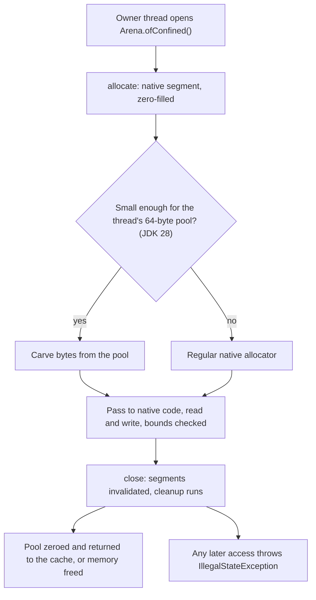

---
# Skeleton from Lead edumxmqt (Inside Java), picked 2026-10-27.
# published and reviewed are the pick time, provisional: set them
# when you publish. verified: is the Author's alone (ADR-0007).
title: "Off-heap memory in Java: data the garbage collector does not manage"
description: "Off-heap memory keeps Java data outside the garbage-collected heap. How FFM arenas and segments make it safe, and what that safety costs."
kind: concept
vertical: languages-runtimes
tags: ["java", "off-heap-memory", "ffm-api", "memory-management", "native-interop"]
published: "2026-10-28T12:54:21Z"
verified: 2026-10-28
reviewed: "2026-10-28T12:54:21Z"
author: mira-vance
# Optional: an image HastCode may use, beside this file, replaces the
# generated title card. Never a Source's image.
# hero: concept-name.png
# hero_alt: "What the image shows"
# Optional: related Explainer slugs and extra sources (title + url).
related: [structured-concurrency]
---

In one instrumented run of a test suite, more than 99.99% of the confined arenas that allocated native memory [used less than 64 bytes](https://inside.java/2026/10/23/confined-pools/). Confined arenas are often [scratch space around a native call](https://inside.java/2026/10/23/confined-pools/): room for the function to write an `int` or a pointer into, read once and thrown away. On an Apple M4, allocating 5 bytes that way [took 15.862 ns](https://inside.java/2026/10/23/confined-pools/). Per-Ake Minborg explains why: before JDK 28, even a tiny allocation "could involve the regular native allocator and the registration of an associated cleanup action", and that bookkeeping ["can cost more than actually accessing the allocated memory itself."](https://inside.java/2026/10/23/confined-pools/) JDK 28 serves those allocations from small per-thread pools, and the same benchmark [falls to 1.052 ns](https://inside.java/2026/10/23/confined-pools/), with no source change. The memory was never the expensive part. Giving it a safe lifetime was.

> Drafted with AI assistance, researched, verified and edited by the HastCode editorial team. We publish only as many pieces as the Author can verify this way.

## TL;DR

- **Off-heap memory** is memory outside the Java heap, ["not managed by the JVM"](https://openjdk.org/jeps/454#Summary): the garbage collector does not reclaim it, so the program [allocates and deallocates it itself](https://openjdk.org/jeps/454#Foreign-memory). Since JDK 22 the standard way to do that is the [Foreign Function & Memory (FFM) API](https://openjdk.org/jeps/454).
- The mechanism is a **memory segment** with [spatial and temporal bounds](https://openjdk.org/jeps/454#Memory-segments-and-arenas), and an **arena** that sets the lifetime: close a confined arena and its segments are invalidated and freed, and any later access throws.
- It matters to the libraries under much of the ecosystem: the JEP names [Tensorflow, Ignite, Lucene and Netty](https://openjdk.org/jeps/454#Foreign-memory), and 79 of the 87 methods of `sun.misc.Unsafe`, the old route, [are for accessing memory](https://openjdk.org/jeps/471#Motivation) and are being removed. In JDK 28, 5- and 20-byte confined allocations got [6.8x to 18.9x faster](https://inside.java/2026/10/23/confined-pools/) across the tested platforms.
- What to do: open a confined arena per unit of work, choose the arena kind by who needs the memory and for how long, and move off `Unsafe`. The cost: single-thread access, bounds checks on every access, and native calls that are [restricted methods](https://openjdk.org/jeps/454#Safety).

## Off-heap memory is memory the JVM does not manage

Objects created with `new` live in the JVM's heap, where they are [subject to garbage collection](https://openjdk.org/jeps/454#Foreign-memory). JEP 454, owned by Maurizio Cimadamore, defines foreign memory as ["memory not managed by the JVM"](https://openjdk.org/jeps/454#Summary). Some libraries, it says, cannot accept "the cost and unpredictability of garbage collection", so they [store data off-heap](https://openjdk.org/jeps/454#Foreign-memory), in memory they allocate and free themselves.

In our words: off-heap memory is a region of bytes with an address, no object header and no collector. Your code decides when it is born and when it dies.

The FFM API models it with three terms. A **memory segment** is ["an abstraction backed by a contiguous region of memory"](https://openjdk.org/jeps/454#Memory-segments-and-arenas). Its **spatial bounds** are the address range it covers; its **temporal bounds** are its lifetime, and together they guarantee ["no use of unallocated memory and no use-after-free"](https://openjdk.org/jeps/454#Memory-segments-and-arenas). An **arena** owns a set of segments and decides their lifetime: all segments from one arena are [deallocated at the same time](https://openjdk.org/jeps/454#Memory-segments-and-arenas), so they can safely point at each other.

What does not count: a segment can also wrap [a Java array or a heap byte buffer](https://openjdk.org/jeps/454#Memory-segments-and-arenas). That is the same API over on-heap memory. Off-heap means a **native segment**, allocated "as if via malloc", or a **mapped segment** over a file, "as if via mmap".

## One confined arena, from open to close



Walk it with the case the CSR for this change calls ["very common"](https://bugs.openjdk.org/browse/JDK-8390770): allocate an `int` for a system call's `errno`, make the call, read the value, discard the memory. The example below is ours and simplified: real code links the handle with [`Linker.Option.captureCallState`](https://download.java.net/java/early_access/jdk28/docs/api/java.base/java/lang/foreign/Linker.Option.html#captureCallState(java.lang.String...)), which saves `errno` into a segment passed to the call:

```java
int callAndReadErrno(MethodHandle call) throws Throwable {
    try (Arena arena = Arena.ofConfined()) {
        MemorySegment errno = arena.allocate(ValueLayout.JAVA_INT); // 4 bytes, zeroed
        int rc = (int) call.invokeExact(errno);                     // the call writes into errno
        return rc < 0 ? errno.get(ValueLayout.JAVA_INT, 0) : 0;
    }                                                               // close: errno is gone
}
```

`Arena.ofConfined()` gives the arena an [owner thread](https://download.java.net/java/early_access/jdk28/docs/api/java.base/java/lang/foreign/Arena.html#thread-confinement). Segments it allocates [are zero-initialized](https://download.java.net/java/early_access/jdk28/docs/api/java.base/java/lang/foreign/Arena.html#ofConfined()). Before JDK 28, the CSR counts [three native operations](https://bugs.openjdk.org/browse/JDK-8390770) here: allocation, the call, deallocation. In JDK 28 the 4 bytes come from a 64-byte pool, carved in order, as the Lead's figure does with a pointer at offset 0, a `long` at 8 and an `int` at 16 to 20. Leaving the block closes the arena: its segments [are invalidated atomically](https://openjdk.org/jeps/454#Memory-segments-and-arenas), and a later `get` [throws `IllegalStateException`](https://download.java.net/java/early_access/jdk28/docs/api/java.base/java/lang/foreign/Arena.html#class-description). On the M4, the pooled path [took 1.052 ns for 5 bytes](https://inside.java/2026/10/23/confined-pools/) against 15.862 ns without the pool.

## Lucene, Netty and the JDK itself live off the heap

**Lucene**'s `MMapDirectory` [reads index files through mmap](https://lucene.apache.org/core/10_0_0/core/org/apache/lucene/store/MMapDirectory.html). It uses the `MemorySegment` API, which [allows it to safely unmap](https://lucene.apache.org/core/10_0_0/core/org/apache/lucene/store/MMapDirectory.html) previously mapped files after their inputs are closed. On platforms such as Linux and macOS it also calls the native `madvise()`, which needs [`--enable-native-access`](https://lucene.apache.org/core/10_0_0/core/org/apache/lucene/store/MMapDirectory.html) to run without a warning.

**Netty** pools its buffers. Since Netty 4, objects such as `ByteBuf` carry [reference counts](https://netty.io/wiki/reference-counted-objects.html), so Netty can return them to a pool as soon as they are unused, because garbage collection does not provide ["efficient real-time guarantee of unreachability"](https://netty.io/wiki/reference-counted-objects.html). The price is leaks: a buffer collected before its count reaches zero [never goes back to the pool](https://netty.io/wiki/reference-counted-objects.html#wiki-h2-9).

**Hadoop and Cassandra**, JEP 471 notes, manage off-heap memory through `ByteBuffer` and call `sun.misc.Unsafe::invokeCleaner` [to deallocate it promptly](https://openjdk.org/jeps/471#Motivation), since a direct buffer is otherwise freed only [when it is garbage collected](https://openjdk.org/jeps/454#Foreign-memory).

**The JDK** now applies the idea to itself. JDK 28's pooled confined arena keeps [a bounded per-thread cache](https://bugs.openjdk.org/browse/JDK-8390770) of native memory: by default, once its arenas close, a platform or carrier thread retains at most 256 bytes of pools. Virtual threads [borrow a pool from their carrier](https://inside.java/2026/10/23/confined-pools/) rather than each keeping a cache.

## Why Java programs end up off the heap

Three forces push data out. The first is the collector itself: some libraries cannot accept its [cost and unpredictability](https://openjdk.org/jeps/454#Foreign-memory). The second is files: off-heap access lets data be serialized and deserialized by [mapping files directly into memory](https://openjdk.org/jeps/454#Foreign-memory). The third is native code, which needs bytes at an address. Byte buffers [long were the only supported way](https://openjdk.org/jeps/454#Memory-segments-and-byte-buffers) to pass off-heap data to it.

The tools Java had for this each failed in a different place. A direct `ByteBuffer` is limited to [two gigabytes](https://openjdk.org/jeps/454#Foreign-memory), and its memory is freed only when the buffer object is garbage collected, ["which developers cannot control"](https://openjdk.org/jeps/454#Foreign-memory). The `ByteBuffer` docs add that direct buffers ["typically have somewhat higher allocation and deallocation costs"](https://docs.oracle.com/en/java/javase/25/docs/api/java.base/java/nio/ByteBuffer.html#direct), and recommend them mainly for large, long-lived buffers.

`sun.misc.Unsafe`, introduced in 2002 [for use inside the JDK](https://openjdk.org/jeps/471#Motivation), went the other way: fast, regions up to 16 exabytes in theory, and `freeMemory` whenever you like. JEP 454 calls that model weak ["because it gives developers too much control"](https://openjdk.org/jeps/454#Foreign-memory): regions that point at each other must be freed in the right order, or dangling pointers cause use-after-free bugs. Nothing in a long or a raw address says when it stops being valid. The arena is the missing piece of information.

## Practice one: one confined arena per unit of work, closed by try-with-resources

Open a confined arena where the work starts, allocate everything that work needs from it, and let try-with-resources close it. The JEP's own examples use [exactly this shape](https://openjdk.org/jeps/454#Memory-segments-and-arenas), and an arena is a [`SegmentAllocator`](https://openjdk.org/jeps/454#Segment-allocators), a "one stop shop" for allocating integers, arrays and strings that are all released at the closing brace. A `ByteBuffer` API such as a channel still works: [`MemorySegment::asByteBuffer`](https://openjdk.org/jeps/454#Memory-segments-and-byte-buffers) gives you a buffer whose memory is freed when the arena closes, not when the collector runs.

In JDK 28 this pattern also became the fast one, for free: it is the one the pooling targets, and the Lead names bindings that [create a confined arena around each native call](https://inside.java/2026/10/23/confined-pools/) and jextract-style wrappers as the main beneficiaries.

The costs are the confinement rules. Only the owner thread can access the segments, and closing from another thread throws [`WrongThreadException`](https://download.java.net/java/early_access/jdk28/docs/api/java.base/java/lang/foreign/Arena.html#thread-confinement). `close()` is [not idempotent](https://download.java.net/java/early_access/jdk28/docs/api/java.base/java/lang/foreign/Arena.html#close()): closing twice throws, by design, because it may reveal a bug. And the speedup is narrow: pooling helps only allocations that fit the 64-byte pool, and sizes above it ran [at about parity](https://inside.java/2026/10/23/confined-pools/). The Lead warns that microbenchmark gains do not translate directly into whole-application gains.

## Practice two: choose the arena by who touches the memory and when it must go

The JDK offers [four arena kinds](https://download.java.net/java/early_access/jdk28/docs/api/java.base/java/lang/foreign/Arena.html#class-description), and the choice is a trade-off the JEP names directly: ["breadth of access against timeliness of deallocation"](https://openjdk.org/jeps/454#Memory-segments-and-arenas).

| Arena | Lifetime | Closed by | Threads |
|---|---|---|---|
| Global | Never freed | Cannot be closed | Any |
| Automatic | Until the collector finds it unreachable | Cannot be closed | Any |
| Confined | Until `close()` | The owner thread | The owner only |
| Shared | Until `close()` | Any thread | Any |

Use the **global** arena only for memory that lives as long as the process: its segments are [never deallocated](https://download.java.net/java/early_access/jdk28/docs/api/java.base/java/lang/foreign/Arena.html#class-description). An **automatic** arena behaves, we infer, much like a direct `ByteBuffer`'s memory: it is freed [at some unspecified time](https://download.java.net/java/early_access/jdk28/docs/api/java.base/java/lang/foreign/Arena.html#class-description) after it becomes unreachable. That is not enough for a mapped file, the JEP says, where [waiting for the collector](https://openjdk.org/jeps/454#Memory-segments-and-arenas) could hurt performance.

A **shared** arena is for memory several threads use at once, [such as in parallel processing](https://download.java.net/java/early_access/jdk28/docs/api/java.base/java/lang/foreign/Arena.html#thread-confinement). Its cost: closing it may not free memory immediately, because ["an expensive synchronization operation is needed"](https://openjdk.org/jeps/454#Memory-segments-and-arenas) to detect and cancel concurrent accesses. JDK 28's pools do not help it either; they [apply only to confined arenas](https://inside.java/2026/10/23/confined-pools/).

## Practice three: batch small allocations with a slicing allocator

JEP 454 is blunt: ["Memory allocation is often a bottleneck when clients use off-heap memory."](https://openjdk.org/jeps/454#Segment-allocators) Its answer is a **slicing allocator**: allocate one segment up front, then answer each request with a slice of it, so [many requests need no new memory](https://openjdk.org/jeps/454#Segment-allocators).

The `Arena` docs show a [custom slicing arena](https://download.java.net/java/early_access/jdk28/docs/api/java.base/java/lang/foreign/Arena.html#custom-arenas): a class that wraps a confined arena, hands out slices from one large segment, and closes the confined arena when it is closed. The docs call it "a vastly more efficient and scalable allocation strategy" that keeps the confined arena's timely deallocation. Use it when a loop or a request makes many small allocations that all die together.

We infer that JDK 28's pooled confined arena is the same idea built into the JDK: a fixed 64-byte region, [carved sequentially](https://inside.java/2026/10/23/confined-pools/), reset on close, except that the JDK picks the size and keeps the region for the next arena, while your slicing arena's slab is yours to size and is freed on close.

The costs: you size the slab in advance, and no slice can be freed early, because segments from one arena [share its temporal bounds](https://openjdk.org/jeps/454#Memory-segments-and-arenas) and the memory comes back only when the whole arena closes. A slicing arena is also still confined, with all of practice one's rules.

## Practice four: find your Unsafe dependencies before they stop working

The vast majority of Java developers never call `Unsafe` themselves, but [many applications depend on libraries](https://openjdk.org/jeps/471#Allowing-use-of-the-memory-access-methods-in-sun-misc-Unsafe) that do. Its memory-access methods were [deprecated for removal in JDK 23](https://openjdk.org/jeps/471#Summary) and print [a run-time warning](https://openjdk.org/jeps/498#Summary) on first use since JDK 24. JEP 471 plans to throw exceptions [in JDK 26 or later](https://openjdk.org/jeps/471#Description) and remove the methods in releases following JDK 26. The [replacements](https://openjdk.org/jeps/471#Motivation) are `VarHandle` for on-heap memory and `MemorySegment` for off-heap.

To see who calls them, run your test suite with `--sun-misc-unsafe-memory-access=debug`, which prints [a warning and a stack trace](https://openjdk.org/jeps/471#Allowing-use-of-the-memory-access-methods-in-sun-misc-Unsafe) on every use, or `=deny`, which throws `UnsupportedOperationException` instead. Then upgrade the libraries it names.

The cost of moving to FFM is the permission model. Calls into native code go through restricted methods such as `Linker::downcallHandle`, which by default [print a warning](https://openjdk.org/jeps/454#Safety) and need `--enable-native-access` to run quietly. Bounds are checked on every access, and the JEP counts on JIT compilers [hoisting those checks](https://openjdk.org/jeps/454#Risks-and-Assumptions) out of hot loops to stay competitive with `Unsafe` and `ByteBuffer`.

## What off-heap memory is not

**It is not a way around the safety rules.** A segment from an arena has bounds the runtime checks. Some of the API is ["inherently unsafe"](https://openjdk.org/jeps/454#Safety): a downcall handle with parameter types that do not match the native function can [crash the VM](https://openjdk.org/jeps/454#Safety), and `MemorySegment::reinterpret` makes segments whose bounds the runtime cannot verify. Those are the restricted methods.

**It is not JNI.** JNI calls native code through [native methods, a C header and a C implementation](https://openjdk.org/jeps/454#Foreign-functions). The FFM API calls it from [pure Java](https://openjdk.org/jeps/454#Goals), and does not change JNI at all, which is a [non-goal](https://openjdk.org/jeps/454#Non-goals).

**It is not free of the collector by default.** An automatic arena hands deallocation back to the garbage collector. Off-heap describes where the bytes are, not who decides when they go.

**It is not one `malloc` per allocation.** In JDK 28, closing a pooled arena can return its memory to a JDK cache instead of the native allocator, and the Lead warns tools [not to rely on a one-to-one correspondence](https://inside.java/2026/10/23/confined-pools/) between arena allocations and `malloc` or `free` calls. The segment's lifetime is unchanged; the native allocation's is not.

Mapped files deserve their own Explainer: a mapped segment is one kind of off-heap memory, with its own paging trade-offs.

## What understanding off-heap memory makes possible

You can now read a native binding and ask the right question of every allocation: which arena owns it, which thread may touch it, and when it goes. Get those three answers into the code and the use-after-free bugs JEP 454 set out to remove become exceptions you can catch: an access after close [fails with an exception](https://openjdk.org/jeps/454#Memory-segments-and-arenas) instead of risking what the JEP calls ["silent memory corruption"](https://openjdk.org/jeps/454#Foreign-memory), and the JEP's goal is to guarantee ["no use-after-free bugs, even when memory is allocated and deallocated across multiple threads"](https://openjdk.org/jeps/454#Goals).

You can also measure it. The Lead's numbers come from a JMH benchmark, and the Lead puts its configuration and raw results in [OpenJDK pull request #31365](https://github.com/openjdk/jdk/pull/31365). Run your own confined-arena hot path on JDK 27 and on a JDK 28 build, and see whether allocation was the part that cost you. Run your tests with `--sun-misc-unsafe-memory-access=debug` and see which libraries still reach for `Unsafe`.

The [JDK 28 `java.lang.foreign` documentation](https://download.java.net/java/early_access/jdk28/docs/api/java.base/java/lang/foreign/package-summary.html) is the place to start. The best sign for the API is the Lead itself: the pattern it recommends for safety, a confined arena around a native call, is now also the fast one, and existing code got the speedup with [no source code changes](https://inside.java/2026/10/23/confined-pools/).

## Sources

- Per-Ake Minborg, ["Allocating Off-Heap Memory: Typically 6-18x Faster in JDK 28"](https://inside.java/2026/10/23/confined-pools/), Inside Java, Oracle, 23 October 2026.
- [JDK-8385697: Add a Pooled Confined Arena](https://bugs.openjdk.org/browse/JDK-8385697), OpenJDK bug system.
- [CSR JDK-8390770: Add a Pooled Confined Arena](https://bugs.openjdk.org/browse/JDK-8390770), OpenJDK bug system.
- [OpenJDK pull request #31365](https://github.com/openjdk/jdk/pull/31365), GitHub.
- Maurizio Cimadamore, ["JEP 454: Foreign Function & Memory API"](https://openjdk.org/jeps/454), OpenJDK, JDK 22.
- ["JEP 471: Deprecate the Memory-Access Methods in sun.misc.Unsafe for Removal"](https://openjdk.org/jeps/471), OpenJDK, JDK 23.
- ["JEP 498: Warn upon Use of Memory-Access Methods in sun.misc.Unsafe"](https://openjdk.org/jeps/498), OpenJDK, JDK 24.
- ["Interface Arena"](https://download.java.net/java/early_access/jdk28/docs/api/java.base/java/lang/foreign/Arena.html), Java SE 28 and JDK 28 early-access API documentation (draft).
- ["Package java.lang.foreign"](https://download.java.net/java/early_access/jdk28/docs/api/java.base/java/lang/foreign/package-summary.html), Java SE 28 and JDK 28 early-access API documentation (draft).
- ["Class ByteBuffer: Direct vs. non-direct buffers"](https://docs.oracle.com/en/java/javase/25/docs/api/java.base/java/nio/ByteBuffer.html#direct), Java SE 25 API documentation.
- Apache Lucene, ["Class MMapDirectory"](https://lucene.apache.org/core/10_0_0/core/org/apache/lucene/store/MMapDirectory.html), Lucene 10.0.0 core API.
- Netty, ["Reference counted objects"](https://netty.io/wiki/reference-counted-objects.html), Netty wiki.
