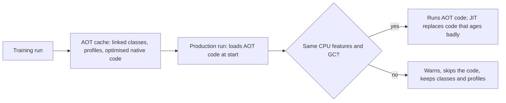

---
# Skeleton from Lead n6ufzk7i (Inside Java), picked 2026-10-27.
# published and reviewed are the pick time, provisional: set them
# when you publish. verified: is the Author's alone (ADR-0007).
title: "JVM warmup: why Java starts slow and how AOT caches shorten it"
description: "JVM warmup is the time HotSpot spends profiling and compiling before peak speed. Project Leyden's AOT cache moves that work into a training run."
kind: concept
vertical: languages-runtimes
tags: ["jvm", "jit", "aot-compilation", "project-leyden", "startup"]
published: "2026-10-27T17:47:17Z"
verified: 2026-10-28
reviewed: "2026-10-27T17:47:17Z"
author: mira-vance
# Optional: an image HastCode may use, beside this file, replaces the
# generated title card. Never a Source's image.
# hero: concept-name.png
# hero_alt: "What the image shows"
# Optional: related Explainer slugs and extra sources (title + url).
# related: [http-connection-reuse]
---

The case study in [JEP 545](https://openjdk.org/jeps/545#Case-study-in-faster-startup-and-warmup) runs Spring PetClinic on a 32GB machine and calls it warmed up once P99 response times stay under 20ms. The load generator does not send full traffic at once. It starts at 1,000 requests per second and climbs to 30,000 over ten seconds, to simulate a load balancer that assumes the application is not at peak performance ["until the JVM has JIT-compiled all hot paths to machine code"](https://openjdk.org/jeps/545#Case-study-in-faster-startup-and-warmup). Send 30,000 a second from the start, the JEP says, and P99 would be measured in seconds rather than milliseconds. On JDK 25 with a 2MB initial heap, the JVM gave its [first response at 5.86s](https://openjdk.org/jeps/545#Scenario-1:-JDK-25-with-a-small-initial-heap-and-no-pre-touching), and P99 spiked above 20ms for tens of seconds afterwards while ZGC grew the heap towards 20GB; it warmed up at about 80 seconds. Inside Java announced on 16 October 2026 that [JEP 545 is targeted to JDK 28](https://inside.java/2026/10/16/jep545-target-jdk28/). The same JEP's future work points at [ahead-of-time code compilation](https://openjdk.org/jeps/545#Future-Work), [JEP 544](https://openjdk.org/jeps/544), a second change for JDK 28 aimed at the other part of warmup: compiling the code.

> Drafted with AI assistance, researched, verified and edited by the HastCode editorial team. We publish only as many pieces as the Author can verify this way.

## TL;DR

- **Warmup** is the time a JVM needs to [reach peak performance](https://openjdk.org/jeps/545#Goals), as distinct from **startup**, the time to its first response. In HotSpot, warmup is when the JVM [profiles code and compiles the hottest methods](https://openjdk.org/jeps/544#Motivation) with its C1 and C2 just-in-time (JIT) compilers.
- The mechanism is a ladder: the slow bytecode interpreter counts events, C1 compiles hot methods with light optimisation and more profiling, and C2 compiles the hottest with full optimisation. When the workload shifts, HotSpot can [deoptimise and climb again](https://openjdk.org/jeps/544#Motivation).
- It shows up wherever new instances take traffic: requests sent to a new instance [take significantly longer](https://openjdk.org/jeps/516#Motivation) than requests to a warmed-up one, and on a two-core machine the JIT is [likely to compete with the application for CPU](https://openjdk.org/jeps/544#Performance).
- Project Leyden's answer is to [do the work in a training run](https://openjdk.org/jeps/544#Shifting-compilation-work-to-training-runs) and ship it in an AOT cache: classes (JDK 24), profiles (JDK 25), and in JDK 28 compiled code, which cut startup in JEP 544's benchmarks by [around 65% to 80%](https://openjdk.org/jeps/544#Performance).
- The cost: training must resemble production, the cache is tied to one JDK release and its code to [one CPU feature set and garbage collector](https://openjdk.org/jeps/544#Consistency-of-training-and-production-runs), and cached code can make it [significantly larger](https://openjdk.org/jeps/544#Controlling-the-generation-of-AOT-code-in-training).

## Startup and warmup are two different clocks

JEP 545, by Erik Österlund, defines both clocks in its goals. Startup is ["the time to an application's first response"](https://openjdk.org/jeps/545#Goals). Warmup is ["the time needed to reach peak performance"](https://openjdk.org/jeps/545#Goals). An application can win one and lose the other: in JEP 545's case study, a large, pre-touched heap made [startup worse but warmup better](https://openjdk.org/jeps/545#Scenario-2:-JDK-25-with-a-large-pre-touched-initial-heap).

JEP 544, owned by John Rose, describes the run in [three phases](https://openjdk.org/jeps/544#Motivation): the JVM starts up, warms up, then reaches peak performance. During startup it loads, links and initialises classes on demand. During warmup that ramps down, and profiling and compilation with the optimising C2 compiler take over.

Two compilation terms recur. **Just-in-time (JIT)** compilation turns bytecode into native code while the program runs, for the methods that profiling shows are hot. **Ahead-of-time (AOT)** compilation does it before the run; a static compiler, in JEP 544's words, [converts entire applications to native code "prior to run time"](https://openjdk.org/jeps/544#What-about-static-compilation?). **Peak performance** is the state in which every hot method is fully optimised and [the compilers go idle](https://openjdk.org/jeps/544#Motivation).

What does not count: a slow first response caused only by scanning JARs and loading classes is a startup cost, not warmup, though JEP 483 lays the foundation for [improving both](https://openjdk.org/jeps/483#Goals). And warmup is not one-time: a change in workload can [start another warmup phase](https://openjdk.org/jeps/544#Motivation).

## The ladder from interpreter to C2


Walk it from the left, with [JEP 544's account](https://openjdk.org/jeps/544#Motivation). HotSpot first runs application and JDK code in the bytecode interpreter, counting method invocations and loop iterations. It uses those counts to pick frequently invoked methods, the hot spots, and compiles them with the C1 compiler, which produces native code that is "only modestly optimized" and still collects profile data, now including the types of objects it sees. When the profile is statistically useful, C2 recompiles the hottest methods into highly optimised code with no instrumentation. Every step costs CPU and memory the application could have used.

JEP 515 puts numbers on a small case. Its `HelloStreamWarmup` program loads [almost 900 JDK classes](https://openjdk.org/jeps/515#Description) and compiles about 30 hot methods at the highest optimisation level. It runs in 90 milliseconds with an AOT cache that holds no profiles, and in 73 milliseconds once profiles from a training run are cached: 19% faster, because the JIT ran earlier and with more accuracy.

The loop at the right matters too. If an application starts receiving a third type of request, HotSpot can [deoptimise and then reoptimise](https://openjdk.org/jeps/544#Motivation) for all three. That is how it keeps peak performance as the workload changes.

## Where warmup shows up in real systems

**Scaling out.** JEP 516 notes that Java applications are often scaled by starting new JVM instances, and that requests sent to a new instance ["take significantly longer than requests sent to a warmed-up instance"](https://openjdk.org/jeps/516#Motivation). It treats that as a source of tail latency, separate from garbage collection pauses.

**Small containers.** JEP 544 ran its startup benchmarks on a [two-core Linux/x64 system](https://openjdk.org/jeps/544#Performance) on purpose, to emulate a microservice in which the JIT compiler is likely to compete with the application for CPU time. With fewer cores, compilation and serving share the same budget.

**Load balancer ramps.** The PetClinic test in JEP 545 [ramps traffic over ten seconds](https://openjdk.org/jeps/545#Case-study-in-faster-startup-and-warmup) because a cold JVM cannot take full load. We infer that a ramp like this in production means each new instance carries less than its share until it is warm.

**The heap, not only the compiler.** In JEP 545's first scenario the 80-second warmup came from ZGC [committing memory and taking page faults](https://openjdk.org/jeps/545#Scenario-1:-JDK-25-with-a-small-initial-heap-and-no-pre-touching) as the heap grew from 2MB towards 20GB. Warmup is whatever stands between first response and steady P99, and the compiler is one part of it.

**Framework startup.** Spring PetClinic 3.2.0 loads and links [about 21,000 classes](https://openjdk.org/jeps/483#Description) at startup and took 4.486 seconds to start on JDK 23.

## Why the JVM compiles late on purpose

HotSpot waits because waiting buys three things, and JEP 544 lists them in its case for [dynamic over static compilation](https://openjdk.org/jeps/544#What-about-static-compilation?).

The first is agility. A JIT can deoptimise and reoptimise when the hot spots move, while a statically compiled application "can be optimized for only one set of hot spots". The second is portability. Code generated at run time fits the processor, its feature set, the operating system and the JDK version in use, so a redeployed application reaches peak performance without being rebuilt. The third is compatibility with dynamic class loading, linkage, dispatch and reflection. Static compilers for Java, JEP 544 says, have resorted to ["closed-world assumptions"](https://openjdk.org/jeps/544#What-about-static-compilation?) and to making developers name in advance the classes eligible for reflection.

JEP 515 explains why the JIT cannot just guess. In the absence of `final` or `sealed`, any class can be subclassed at any time, and new classes can load in response to input, so ["to truly know what an application does, we must run it"](https://openjdk.org/jeps/515#Motivation). HotSpot has collected profiles [since JDK 1.2](https://openjdk.org/jeps/515#Motivation).

The bill comes at every start. JEP 483 puts it plainly: ["All this dynamism comes at a price, however, which must be paid every time an application starts."](https://openjdk.org/jeps/483#Motivation) Yet applications tend to [start the same way each time](https://openjdk.org/jeps/483#Motivation), and that repetition is what Project Leyden uses.

## Defence one: cache classes and profiles from a training run

[Project Leyden](https://openjdk.org/projects/leyden/) aims to improve startup time, time to peak performance and footprint. Its thesis, in JEP 544, is to do work [ahead of time rather than just in time](https://openjdk.org/jeps/544#Shifting-compilation-work-to-training-runs): run the application once as a **training run**, store the results in an **AOT cache**, and load them in every production run.

The first two steps are already shipped. [JEP 483](https://openjdk.org/jeps/483#Description), in JDK 24, caches classes in their loaded and linked form; PetClinic started in 2.604 seconds instead of 4.486, 42% faster, with a 130MB cache. [JEP 515](https://openjdk.org/jeps/515#Description), in JDK 25, adds method profiles so C2 can run immediately. [JEP 514](https://openjdk.org/jeps/514#Description), also JDK 25, folds training and cache creation into one step:

```sh
java -XX:AOTCacheOutput=app.aot -cp app.jar com.example.App
java -XX:AOTCache=app.aot -cp app.jar com.example.App
```

The costs are real. JEP 483 requires all runs to use [the same JDK release, architecture and operating system](https://openjdk.org/jeps/483#Consistency-of-training-and-subsequent-runs) and consistent class paths, and classes from user-defined class loaders are [not cached](https://openjdk.org/jeps/483#Non-Goals). The one-step workflow needs [double the heap](https://openjdk.org/jeps/514#Manually-orchestrating-training-and-cache-creation) you specify. The training run itself is work: JEP 483 recommends a synthetic run that [exercises typical production code paths](https://openjdk.org/jeps/483#How-to-train-your-JVM), with mocked databases and short smoke tests rather than a large test suite. Cached profiles do not stop HotSpot [profiling in production](https://openjdk.org/jeps/515#Description).

## Defence two: cache the compiled code itself



JEP 544, integrated for JDK 28, stores optimised native code from the training run in the same cache. It uses [the same commands](https://openjdk.org/jeps/544#Description); the cache simply holds more. AOT code and JIT code come from the same C1 and C2 compilers and are fully interoperable, and if AOT code is unavailable or later deoptimised, execution falls back to the interpreter and JIT.

On five framework benchmarks on two cores, the cache alone cut startup by [around 50% to 70%, and with AOT code by around 65% to 80%](https://openjdk.org/jeps/544#Performance). In a `javac` benchmark that compiles 50 source files twenty times, the first iteration was about 30% faster with the cache and about 75% faster with AOT code, which was close to steady state by the fourth iteration.

The costs: AOT code runs only on CPUs [with the same features](https://openjdk.org/jeps/544#Consistency-of-training-and-production-runs) (code built for AVX-512 will not run without it) and with the same garbage collector, because it contains GC-specific barriers. It can differ from JIT code: C2 cannot treat a `static final` field whose value varies between runs [as a compile-time constant](https://openjdk.org/jeps/544#Differences-between-AOT-code-and-JIT-code), so it emits a load instead. And cached code can make the cache [significantly larger](https://openjdk.org/jeps/544#Controlling-the-generation-of-AOT-code-in-training).

## Defence three: stop the heap from undoing the gains

JEP 545 attacks the memory side of warmup with ZGC. It commits [just 2MB for the initial heap](https://openjdk.org/jeps/545#Faster-startup-with-a-small-initial-heap) by default, expands the heap [aggressively and concurrently](https://openjdk.org/jeps/545#Improved-warmup-with-aggressive-heap-expansion) on worker threads capped at 25% of CPU threads, pre-touches new memory [when it expands](https://openjdk.org/jeps/545#Faster-warmup-with-concurrent-pre-touching) rather than at startup, and on Linux 6.1 and later upgrades the heap to [large pages](https://openjdk.org/jeps/545#Faster-memory-access-via-large-pages), typically 2MB.

In the PetClinic study, running with `-XX:+UseZGC -XX:+ZAdaptiveHeapSizing` started in [5.84s, 38% faster than the large pre-touched heap](https://openjdk.org/jeps/545#Scenario-3:-JDK-NN), and warmed up within the ten-second ramp, against about 80 seconds before. Without concurrent pre-touching, warmup took 34s; without large pages, 18s.

JEP 545 connects this to compilation directly: keeping P99 low leaves [more CPU for the JIT](https://openjdk.org/jeps/545#Scenario-3:-JDK-NN), and AOT code from JEP 544 will free CPU for ZGC in turn, per its [future work](https://openjdk.org/jeps/545#Future-Work). Before [JEP 516](https://openjdk.org/jeps/516#Motivation) in JDK 26, ZGC users could not enable ahead-of-time class loading and linking at all.

The cost: applications tuned for the old default of 1/64 of physical memory, 2GB on a 128GB machine, [may warm up more slowly](https://openjdk.org/jeps/545#Risks-and-Assumptions) and need re-tuning.

## What AOT caching is not

**It is not static compilation.** JEP 544 rules out [an AOT-only mode](https://openjdk.org/jeps/544#Non-Goals): AOT and JIT code coexist in one run, and HotSpot can still deoptimise. Initial experiments towards near-total reliance on AOT code, its future work says, suggest that minimising interpreter use produces [overly large cache files](https://openjdk.org/jeps/544#Future-Work), and minimising JIT compilation often lowered peak performance. Applications keep, in JEP 544's words, ["the agility, portability, and compatibility of dynamic compilation"](https://openjdk.org/jeps/544#Shifting-compilation-work-to-training-runs).

**It is not the JDK 9 `jaotc` tool.** [JEP 295](https://openjdk.org/jeps/295) added experimental AOT compilation in JDK 9, compiling classes into a native library before launch. [JEP 410](https://openjdk.org/jeps/410#Motivation) removed it in JDK 17, noting it had "seen little use", and pointed developers who want Graal-based AOT compilation to [GraalVM](https://openjdk.org/jeps/410#Alternatives). We infer the difference that matters: Leyden's code comes from HotSpot's own C1 and C2, guided by a profile of a real run, inside the same cache as the classes.

**It is not class-data sharing alone.** CDS, [first shipped in a JDK 5 update in 2004](https://openjdk.org/jeps/483#History), caches parsed class metadata. The AOT cache builds on it by also loading and linking classes, then adding profiles and code.

**It is not cross-compilation.** JEP 544 [does not support it](https://openjdk.org/jeps/544#Non-Goals): build the cache on the same CPU architecture and features you deploy to.

## What understanding warmup makes possible

The first gain is a measurement. Time to first response and time to steady P99 are different numbers, and JEP 545's [case study](https://openjdk.org/jeps/545#Case-study-in-faster-startup-and-warmup) shows how to take the second: ramp load, watch P99, and note when it stays under your target. JEP 544 adds a picture: the area between two iteration-time curves is the [total warmup-time improvement](https://openjdk.org/jeps/544#Performance).

The second is observability. `-XX:+PrintCompilation` now reports [both AOT code loading and JIT compilation](https://openjdk.org/jeps/544#Observing-AOT-cache-usage-in-production), and `-XX:AOTMode=required` makes HotSpot exit with an error if the cache violates a constraint, so a mismatched CPU or collector fails loudly instead of falling back to the JIT with only a warning.

You can try the first steps today: JDK 25 ships [one-step cache creation](https://openjdk.org/jeps/514#Description) with classes and profiles. The [JDK 28 early-access builds](https://jdk.java.net/28/) are where AOT code will appear; the page notes a recently targeted JEP may land in a later build. Train on your smoke tests, start one instance with the cache and one without, and compare both clocks. What could go right is a new instance that serves its first ramp at close to the speed of the ones already running, with the JIT still there to follow the workload when it changes.

## Sources

- Inside Java, ["JEP targeted to JDK 28: 545: Faster Startup and Warmup with ZGC"](https://inside.java/2026/10/16/jep545-target-jdk28/), Oracle, 16 October 2026.
- Erik Österlund, ["JEP 545: Faster Startup and Warmup with ZGC"](https://openjdk.org/jeps/545), OpenJDK, JDK 28.
- John Rose, ["JEP 544: Ahead-of-Time Code Compilation"](https://openjdk.org/jeps/544), OpenJDK, JDK 28.
- Ioi Lam, Dan Heidinga, John Rose, ["JEP 483: Ahead-of-Time Class Loading & Linking"](https://openjdk.org/jeps/483), OpenJDK, JDK 24.
- John Rose, ["JEP 514: Ahead-of-Time Command-Line Ergonomics"](https://openjdk.org/jeps/514), OpenJDK, JDK 25.
- Igor Veresov, John Rose, ["JEP 515: Ahead-of-Time Method Profiling"](https://openjdk.org/jeps/515), OpenJDK, JDK 25.
- Erik Österlund, ["JEP 516: Ahead-of-Time Object Caching with Any GC"](https://openjdk.org/jeps/516), OpenJDK, JDK 26.
- Vladimir Kozlov, ["JEP 295: Ahead-of-Time Compilation"](https://openjdk.org/jeps/295), OpenJDK, JDK 9.
- Vladimir Kozlov, ["JEP 410: Remove the Experimental AOT and JIT Compiler"](https://openjdk.org/jeps/410), OpenJDK, JDK 17.
- OpenJDK, ["Project Leyden"](https://openjdk.org/projects/leyden/).
- OpenJDK, ["JDK 28 Early-Access Builds"](https://jdk.java.net/28/).
