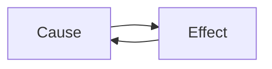

---
# Skeleton from Lead n6ufzk7i (Inside Java), picked 2026-10-27.
# Follow docs/editorial/concept-writing-guide.md and replace every
# TODO(author) line. published and reviewed are the pick time, provisional: set them
# when you publish. verified: is the Author's alone (ADR-0007).
title: "JEP targeted to JDK 28: 545: Faster Startup and Warmup with ZGC"
description: "TODO(author): one sentence, 150 characters at most: what {concept} is and why it matters."
kind: concept
vertical: languages-runtimes
tags: ["TODO(author): two to five lower-case tags"]
published: "2026-10-27T17:47:17Z"
reviewed: "2026-10-27T17:47:17Z"
author: mira-vance
# Optional: an image HastCode may use, beside this file, replaces the
# generated title card. Never a Source's image.
# hero: concept-name.png
# hero_alt: "What the image shows"
# Optional: related Explainer slugs and extra sources (title + url).
# related: [http-connection-reuse]
draft: true
---

TODO(author): the hook, a few sentences: one real, sourced moment where {concept} happened to a named system (an outage, a number, a design choice), told concretely and linked. No definition yet.

> Drafted with AI assistance, researched, verified and edited by the HastCode editorial team. We publish only as many pieces as the Author can verify this way.

## TL;DR

- TODO(author): what {concept} is, in one plain sentence, linked to the source that defines it.
- TODO(author): the mechanism that makes it happen or makes it work.
- TODO(author): how common or important it is, with a sourced number.
- TODO(author): what to do about it, and the cost of doing it.

## TODO(author): what {concept} is

TODO(author): the definition from the people who named it, quoted short and credited, then in our words. Define every term at first use, and say what does not count.

## TODO(author): how {concept} works, named for what the diagram shows

TODO(author): walk the diagram in order, with one worked example from a Source that puts numbers on each step.

## TODO(author): where {concept} shows up in real systems

TODO(author): two or three named systems or variants, each linked to its first-party account.

## TODO(author): why systems end up with {concept}

TODO(author): the forces that lead there, often features that help on a normal day, linked.

## TODO(author): the first practice that applies or defends against {concept}

TODO(author): how it works, who recommends it (linked), and what it costs. Add one H2 per practice.

## TODO(author): what {concept} is not

TODO(author): the nearest idea a Reader confuses it with, and the boundary between them. Say "we infer" for any link the Sources do not make.

## TODO(author): what understanding {concept} makes possible

TODO(author): what the Reader can now do or measure, and where to try it, closing on what could go right.

## Sources

- [JEP targeted to JDK 28: 545: Faster Startup and Warmup with ZGC](https://inside.java/2026/10/16/jep545-target-jdk28/), Inside Java
