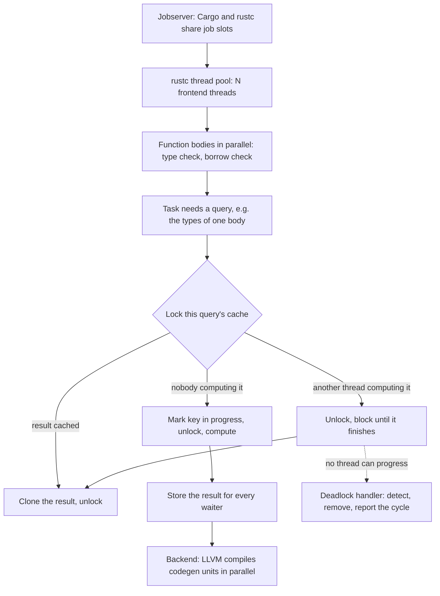

---
# Skeleton from Lead l4p7nqgs (Rust blog), picked 2026-11-23, written to
# docs/editorial/concept-writing-guide.md. published and reviewed are the pick time (make daily may move them to a Gap Day);
# make release keeps it (ADR-0012). verified: is the Author's alone (ADR-0007).
title: "Parallel compiler frontend: how rustc checks code on many threads"
description: "A parallel frontend type-checks function bodies on many threads over a shared query cache; in rustc it cuts single-crate check time by 22–44%."
kind: concept
vertical: languages-runtimes
tags: ["rust", "compilers", "parallelism", "rayon", "build-performance"]
published: "2026-11-21T18:54:05Z"
verified: 2026-11-24
reviewed: "2026-11-24T16:32:07Z"
author: mira-vance
# Optional: an image HastCode may use, beside this file, replaces the
# generated title card. Never a Source's image.
# hero: concept-name.png
# hero_alt: "What the image shows"
# Optional: related Explainer slugs and extra sources (title + url).
# related: [http-connection-reuse]
---

Since [`nightly-2026-11-14`](https://blog.rust-lang.org/2026/11/16/enabling-parallel-frontend-on-nightly/#context), the nightly Rust compiler has checked code on [two threads](https://blog.rust-lang.org/2026/11/16/enabling-parallel-frontend-on-nightly/#tuning-the-thread-count) by default. The part that changed is the frontend, which the Rust Compiler Team says [includes type checking and borrow checking](https://blog.rust-lang.org/2026/11/16/enabling-parallel-frontend-on-nightly/#context) and had run on a single thread. Across the real-world benchmarks in the team's suite, two threads cut the wall time of a from-scratch `check` build by [21.95% on average](https://blog.rust-lang.org/2026/11/16/enabling-parallel-frontend-on-nightly/#benefits), and eight threads by 44.23%. For a `cargo check` of the `nalgebra`, `cargo` or `diesel` crates, eight threads made compilation ["almost three times faster"](https://blog.rust-lang.org/2026/11/16/enabling-parallel-frontend-on-nightly/#benefits). The code is [not new](https://blog.rust-lang.org/2026/11/16/enabling-parallel-frontend-on-nightly/#context). The team shipped it as a [nightly opt-in in November 2023](https://blog.rust-lang.org/2023/11/09/parallel-rustc/), aiming for stable in 2024, and [missed that goal](https://blog.rust-lang.org/2026/11/16/enabling-parallel-frontend-on-nightly/#context). This piece shows how rustc lets many threads share one cache of results, and what the extra threads cost you.

## TL;DR

- A **parallel compiler frontend** runs the analysis half of a compiler on several threads inside one process. In rustc, that half [includes type checking and borrow checking](https://blog.rust-lang.org/2026/11/16/enabling-parallel-frontend-on-nightly/#context).
- rustc runs type and borrow checking over a crate's function bodies in parallel on [a fork of Rayon](https://rustc-dev-guide.rust-lang.org/parallel-rustc.html#parallel-iterator). Threads share each query's [locked cache](https://rustc-dev-guide.rust-lang.org/parallel-rustc.html#query-system). A key one thread is computing is marked "in progress", so a second thread waits instead of recomputing. A [deadlock-handler thread](https://rustc-dev-guide.rust-lang.org/parallel-rustc.html#query-system) breaks any waiting cycle.
- Nightly defaults to [2 threads](https://blog.rust-lang.org/2026/11/16/enabling-parallel-frontend-on-nightly/#tuning-the-thread-count). In the team's benchmarks, 2 to 8 threads cut single-crate `check` time by [22% to 44%](https://blog.rust-lang.org/2026/11/16/enabling-parallel-frontend-on-nightly/#benefits), with little gain expected [above about 8](https://blog.rust-lang.org/2026/11/16/enabling-parallel-frontend-on-nightly/#tuning-the-thread-count).
- The costs: [more memory](https://blog.rust-lang.org/2026/11/16/enabling-parallel-frontend-on-nightly/#tuning-the-thread-count), [diagnostics whose order can change](https://blog.rust-lang.org/2026/11/16/enabling-parallel-frontend-on-nightly/#limitations-and-known-issues), and [smaller gains](https://blog.rust-lang.org/2026/11/16/enabling-parallel-frontend-on-nightly/#benefits) when LLVM or other crates already keep every core busy. `--jobs-frontend=N` sets the count; `--jobs-frontend=1` [opts out](https://blog.rust-lang.org/2026/11/16/enabling-parallel-frontend-on-nightly/#how-do-i-opt-out).

## The frontend is the half of rustc that ran on one thread

A compiler's **frontend** works out what the code means and whether it is valid. Its **backend** turns that into machine code. The Rust team's 2023 post lists the frontend's jobs as including ["parsing, type checking, and borrow checking"](https://blog.rust-lang.org/2023/11/09/parallel-rustc/#existing-intraprocess-parallelism-the-back-end). That post spells it front-end; we use the 2026 post's spelling, frontend.

The backend was already parallel. It splits a crate into **codegen units**, pieces of code that [LLVM processes in parallel](https://blog.rust-lang.org/2023/11/09/parallel-rustc/#existing-intraprocess-parallelism-the-back-end). The `-C codegen-units=n` option [controls the number of concurrent tasks](https://rustc-dev-guide.rust-lang.org/parallel-rustc.html#parallel-compilation).

A **parallel compiler frontend** runs the analysis itself on several threads, inside one compiler process working on one crate.

Two kinds of parallelism do not count. Parallel codegen belongs to the backend. Cargo's parallelism is between processes: building ripgrep on 28 virtual cores, the 2023 post's timeline shows [60 processes, most of them rustc and a few build scripts](https://blog.rust-lang.org/2023/11/09/parallel-rustc/#existing-interprocess-parallelism). Those processes compile [several crates in parallel](https://blog.rust-lang.org/2023/11/09/parallel-rustc/#existing-interprocess-parallelism), and that parallelism shrinks ["as crate dependencies increase"](https://blog.rust-lang.org/2023/11/09/parallel-rustc/#existing-interprocess-parallelism).

## Queries make the frontend safe to split

rustc's frontend is built from **queries**: ["function-like queries compute information about the input source"](https://rustc-dev-guide.rust-lang.org/query.html#queries-demand-driven-compilation). A query takes a key, such as one function, and returns a result, such as its types. The function that computes it is the query's [**provider**](https://rustc-dev-guide.rust-lang.org/query.html#providers).

Query execution is memoized. The first call computes the result; ["the next time, the result is returned from a hashtable"](https://rustc-dev-guide.rust-lang.org/query.html#queries-demand-driven-compilation). That cache is the state every thread shares.

Two rules make sharing it workable, says the [parallel chapter](https://rustc-dev-guide.rust-lang.org/parallel-rustc.html#query-system) of the rustc-dev-guide (the dev guide). A provider reaches data only ["via the query context"](https://rustc-dev-guide.rust-lang.org/parallel-rustc.html#query-system), which can synchronise access. Results ["are required to be immutable"](https://rustc-dev-guide.rust-lang.org/parallel-rustc.html#query-system), so threads can read them at once.

The compiler then splits the work by body. As of August 2022, the dev guide's table lists type checking and borrow checking as running through [`Map::par_body_owners`](https://rustc-dev-guide.rust-lang.org/parallel-rustc.html#parallel-iterator). The guide says it runs a callback on [all HIR owners in the crate](https://rustc-dev-guide.rust-lang.org/parallel-rustc.html#parallel-iterator). We infer from its name that it covers each owner of a body of code, such as a function. The tasks run on [a custom fork of Rayon](https://rustc-dev-guide.rust-lang.org/parallel-rustc.html#parallel-iterator), a crate that provides parallel iterators. The 2023 post calls this [fine-grained parallelism](https://blog.rust-lang.org/2023/11/09/parallel-rustc/#new-intraprocess-parallelism-the-front-end), added by changing ["a relatively small number of key points in the code"](https://blog.rust-lang.org/2023/11/09/parallel-rustc/#new-intraprocess-parallelism-the-front-end).

## Lock, mark in progress, wait: one query on many threads



The dev guide warns that, as of November 2024, its parallel chapter holds ["quite a bit of outdated information"](https://rustc-dev-guide.rust-lang.org/parallel-rustc.html#parallel-compilation). The query steps below are the ones it describes.

Walk it from the top. Cargo and rustc share a **jobserver**, ["essentially a semaphore that controls the number of jobs running concurrently"](https://doc.rust-lang.org/cargo/reference/build-scripts.html#jobserver). The 2023 post says the compiler [uses it to limit the number of threads it creates](https://blog.rust-lang.org/2023/11/09/parallel-rustc/#putting-it-all-together). Inside that limit, the pool works through the bodies in parallel.

A task needs a query result. rustc [locks the cache table](https://rustc-dev-guide.rust-lang.org/parallel-rustc.html#query-system) for that query, and one of three things happens:

- **Cached.** The thread clones the result and releases the lock.
- **Nobody computing it.** The thread marks the key "in progress", releases the lock and computes it.
- **In progress elsewhere.** The thread releases the lock and blocks until the other thread [has computed the result](https://rustc-dev-guide.rust-lang.org/parallel-rustc.html#query-system).

When the computing thread finishes, it stores the result, and every thread waiting on that key can use it. Waiting is the design. No key is computed twice, and no thread holds the lock while it computes. Waiting brings one risk: a cycle, where threads wait on each other's queries. When workers stop making progress, an extra thread, the **deadlock handler**, steps in to ["detect, remove and report the cycle error"](https://rustc-dev-guide.rust-lang.org/parallel-rustc.html#query-system). The backend then compiles codegen units as before.

## Compiling Cargo: 10.2 seconds of frontend became 5.9

The 2023 post timed rustc with a profiler during ["a release build of the final crate in Cargo"](https://blog.rust-lang.org/2023/11/09/parallel-rustc/#existing-intraprocess-parallelism-the-back-end). Serially, the frontend took [10.2 seconds and the backend 6.2](https://blog.rust-lang.org/2023/11/09/parallel-rustc/#existing-intraprocess-parallelism-the-back-end), with LLVM threads busy for 5.9 of those.

With eight frontend threads, the frontend took [5.9 seconds](https://blog.rust-lang.org/2023/11/09/parallel-rustc/#new-intraprocess-parallelism-the-front-end). The backend fell to 5.3 seconds too. The post notes that the eight frontend threads [generate LLVM IR for eight codegen units at once](https://blog.rust-lang.org/2023/11/09/parallel-rustc/#new-intraprocess-parallelism-the-front-end); LLVM IR is the input LLVM compiles. We add the two phases ourselves: 16.4 seconds became 11.2, about 32% less. The post gives no total.

The 2026 post measures the same idea across a suite. This is the [mean wall-time change](https://blog.rust-lang.org/2026/11/16/enabling-parallel-frontend-on-nightly/#benefits) for its real-world benchmarks, each building a single crate from scratch, against a sequential frontend:

| Frontend threads | check | clippy | debug | opt |
|---|---|---|---|---|
| 2 | −21.95% | −20.74% | −14.2% | −12.51% |
| 4 | −37.99% | −36.01% | −29.14% | −23.67% |
| 8 | −44.23% | −41.76% | −36.1% | −27.88% |

Check builds gain most. We infer why: `cargo check` stops before code generation, so the frontend is a larger share of its time.

## Where parallel frontends show up

**rustc** is the long-running case. The 2023 post credits the project's start to [@Zoxc and its 2023 revival to @SparrowLii](https://blog.rust-lang.org/2023/11/09/parallel-rustc/#acknowledgments). In 2025, Vadim Petrochenkov and other contributors [started a coordinated effort](https://blog.rust-lang.org/2026/11/16/enabling-parallel-frontend-on-nightly/#context) to finish it. It is now on by default only on nightly; stable keeps the [sequential frontend](https://blog.rust-lang.org/2026/11/16/enabling-parallel-frontend-on-nightly/#how-do-i-opt-out).

**tsrs**, the Rust port of TypeScript's compiler covered in [our tsrs Explainer](/languages-runtimes/cloudflare-tsrs/), splits the work another way. [Parsing and binding run per file, in parallel](https://github.com/oxc-project/tsrs/blob/4a406ed4ceb724fb43cb362d9149fbc430165973/docs/PORTING.md#threading), and finish before checking. Checking runs on N checkers, [four by default](https://github.com/oxc-project/tsrs/blob/4a406ed4ceb724fb43cb362d9149fbc430165973/docs/PORTING.md#threading), each on its own OS thread. The parsed code is [shared and frozen](https://github.com/oxc-project/tsrs/blob/4a406ed4ceb724fb43cb362d9149fbc430165973/docs/PORTING.md#threading); the types each checker builds are its own.

We infer the trade between the two. The rustc design shares one cache of results, so threads lock it and sometimes wait on each other. The tsrs design shares mostly frozen data, so checkers wait on each other far less, but each one builds its own types. Neither Source compares them.

## Why compilers end up parallelising the frontend

The first force is idle cores at the end of a build. Cargo's process parallelism [shrinks as crate dependencies increase](https://blog.rust-lang.org/2023/11/09/parallel-rustc/#existing-interprocess-parallelism). We infer that the last crates in a graph compile with few others beside them, so one thread does the frontend while other cores wait.

The second is that the codebase was ready. The compiler had been moving from passes to a ["demand-driven" system](https://rustc-dev-guide.rust-lang.org/query.html#queries-demand-driven-compilation) of queries, a shift under way in July 2021. Memoized, immutable results were built for that design. The dev guide says those same properties make it ["actually feasible to evaluate multiple queries in parallel"](https://rustc-dev-guide.rust-lang.org/parallel-rustc.html#query-system).

A feature that helps on a normal day, one shared cache of immutable answers, is what lets the work spread across threads. We infer it is also where threads contend. The dev guide's data-structures section, which it marks as quite outdated, warned of lock contention degrading performance [as threads increase beyond 4](https://rustc-dev-guide.rust-lang.org/parallel-rustc.html#data-structures).

## Practice one: start at two threads, measure up to eight

The nightly default of [two threads](https://blog.rust-lang.org/2026/11/16/enabling-parallel-frontend-on-nightly/#tuning-the-thread-count) is, in the team's words, ["a conservative choice"](https://blog.rust-lang.org/2026/11/16/enabling-parallel-frontend-on-nightly/#tuning-the-thread-count): enough to surface bugs without raising memory use much. You raise it with the `--jobs-frontend` flag, through `RUSTFLAGS` or in `.cargo/config.toml`:

```toml
[build]
rustflags = ["-Zunstable-options", "--jobs-frontend=8"]
```

Eight is the ceiling worth testing. The team expects performance to ["not scale very well above ~8 threads"](https://blog.rust-lang.org/2026/11/16/enabling-parallel-frontend-on-nightly/#tuning-the-thread-count). In 2023 it recommended eight because it was the configuration [tested the most](https://blog.rust-lang.org/2023/11/09/parallel-rustc/#performance-effects); that post's flag was `-Z threads=8`.

The cost is memory. Higher thread counts [raise the compiler's memory use](https://blog.rust-lang.org/2026/11/16/enabling-parallel-frontend-on-nightly/#tuning-the-thread-count), and in extreme cases it can run out. The 2023 post measured increases of [up to 35%](https://blog.rust-lang.org/2023/11/09/parallel-rustc/#performance-effects) in multi-threaded mode. Watch peak memory on your largest crate, and on CI machines with little RAM per core, before you raise the count.

## Practice two: measure the whole build, not one crate

Frontend threads compete with everything else in the build. Cargo's `--jobs` flag sets the build's concurrency and [defaults to the number of logical CPUs](https://doc.rust-lang.org/cargo/reference/build-scripts.html#jobserver). In the 2023 design, heavy process-level parallelism means rustc's thread-level parallelism ["will be limited appropriately"](https://blog.rust-lang.org/2023/11/09/parallel-rustc/#putting-it-all-together).

So whole builds win less. The team timed `cargo check` of the [`cargo` crate's full crate graph on an 8-core machine](https://blog.rust-lang.org/2026/11/16/enabling-parallel-frontend-on-nightly/#benefits). One frontend thread took 36.7 s, 2 took 35.1 s, 4 took 31.9 s and 8 took 30.8 s. The team puts that at about 15%. The reason it gives: your cores [may already be busy](https://blog.rust-lang.org/2026/11/16/enabling-parallel-frontend-on-nightly/#benefits) with LLVM or by Cargo compiling several crates at once.

Measure the build you run most. With eight threads, the team saw end-to-end `cargo check` run [about twice as fast for several crates](https://blog.rust-lang.org/2026/11/16/enabling-parallel-frontend-on-nightly/#benefits). For incremental rebuilds, it saw a mean improvement of [3–5%](https://blog.rust-lang.org/2026/11/16/enabling-parallel-frontend-on-nightly/#benefits), and warns its benchmarks for that case are weak.

## Practice three: do not depend on diagnostic order

Diagnostics, the errors and warnings rustc prints, can change order between runs. The team warns that ["the produced order of diagnostics might not be deterministic"](https://blog.rust-lang.org/2026/11/16/enabling-parallel-frontend-on-nightly/#limitations-and-known-issues). We infer that a test which compares compiler output as text, line by line, can fail between two runs of the same code. Sort the diagnostics before comparing, or pin that job to one thread.

Thread scheduling is one of the sources of nondeterminism that our Explainer on [deterministic simulation testing](/distributed-systems/deterministic-simulation-testing/) walks through. The output binary is held to a stricter rule. It [may not be reproducible either](https://blog.rust-lang.org/2026/11/16/enabling-parallel-frontend-on-nightly/#limitations-and-known-issues), and the team treats that as a bug. It asks for crashes and non-reproducible binaries on [issue #113349](https://github.com/rust-lang/rust/issues/113349).

The opt-out is one flag: `-Zunstable-options --jobs-frontend=1` [disables the parallel frontend on nightly](https://blog.rust-lang.org/2026/11/16/enabling-parallel-frontend-on-nightly/#how-do-i-opt-out). The cost of opting out is the speed.

## A parallel frontend is not parallel codegen or a parallel build

Two ideas sit close to this one. **Parallel codegen** compiles codegen units in LLVM; it was [already on by default](https://rustc-dev-guide.rust-lang.org/parallel-rustc.html#parallel-compilation) and is tuned with `-C codegen-units`. **A parallel build** is Cargo running [many rustc processes](https://blog.rust-lang.org/2023/11/09/parallel-rustc/#existing-interprocess-parallelism) that compile several crates in parallel.

The boundary is the unit of work. Parallel codegen splits machine-code generation; a parallel build splits the crate graph. A parallel frontend splits analysis within one crate, down to the function body.

Nor is the frontend fully parallel yet. As of November 2024, the dev guide listed [lexical parsing, HIR lowering and macro expansion](https://rustc-dev-guide.rust-lang.org/parallel-rustc.html#parallel-compilation) as still serial. HIR lowering turns the abstract syntax tree (AST) into the [High-Level Intermediate Representation](https://blog.rust-lang.org/2026/11/16/enabling-parallel-frontend-on-nightly/#what-s-next) (HIR). The team names [parallel macro expansion and name resolution](https://blog.rust-lang.org/2026/11/16/enabling-parallel-frontend-on-nightly/#what-s-next) as work in progress, and an open pull request parallelises [AST-to-HIR lowering](https://github.com/rust-lang/rust/pull/163495). Once it is confident there are no major issues, it wants to [stabilise the parallel frontend](https://blog.rust-lang.org/2026/11/16/enabling-parallel-frontend-on-nightly/#what-s-next).

## What understanding a parallel frontend makes possible

You can now read a slow build in three layers and measure each. Cargo's [`--timings` report](https://doc.rust-lang.org/cargo/reference/timings.html), which drew the 2023 post's ripgrep timeline, shows whether cores sit idle across the crate graph. Timing `cargo check` at `--jobs-frontend=1`, 2, 4 and 8 shows what threads inside one crate buy you. Peak memory at each step shows the price. If the tail of your build is one large crate on one thread, the frontend threads are aimed at your problem.

You can also predict where the gains come from. We infer the profile that gains most: a long frontend, many independent function bodies and spare cores. A build already busy with LLVM and many crates does not.

The optimistic part: a compiler built around one shared cache found a way to let every core read it. On nightly, two threads already check your code, and four timings tell you whether eight would pay.

## Sources

- Jakub Beránek, on behalf of the Compiler Team, ["Enabling the parallel frontend on nightly"](https://blog.rust-lang.org/2026/11/16/enabling-parallel-frontend-on-nightly/), Rust blog, 16 November 2026.
- Nicholas Nethercote, on behalf of the Parallel Rustc Working Group, ["Faster compilation with the parallel front-end in nightly"](https://blog.rust-lang.org/2023/11/09/parallel-rustc/), Rust blog, 9 November 2023.
- Rust compiler team, ["Parallel compilation"](https://rustc-dev-guide.rust-lang.org/parallel-rustc.html), rustc-dev-guide.
- Rust compiler team, ["Queries: demand-driven compilation"](https://rustc-dev-guide.rust-lang.org/query.html), rustc-dev-guide.
- The Cargo Book, ["Build scripts: Jobserver"](https://doc.rust-lang.org/cargo/reference/build-scripts.html#jobserver).
- The Cargo Book, ["Reporting build timings"](https://doc.rust-lang.org/cargo/reference/timings.html).
- rust-lang/rust, [issue #113349](https://github.com/rust-lang/rust/issues/113349) and [pull request #163495](https://github.com/rust-lang/rust/pull/163495).
- oxc-project/tsrs, ["PORTING.md: Threading"](https://github.com/oxc-project/tsrs/blob/4a406ed4ceb724fb43cb362d9149fbc430165973/docs/PORTING.md#threading).
