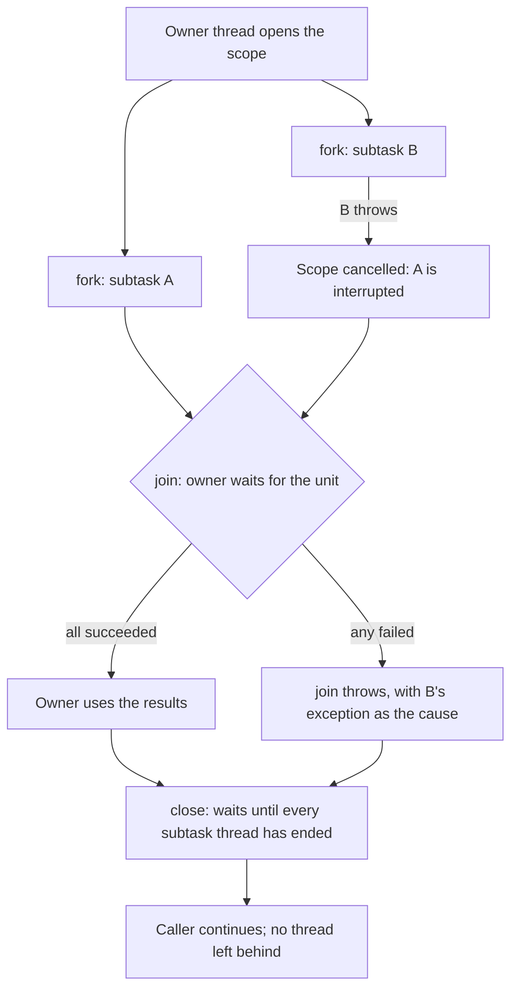

---
# Skeleton from Lead 5ldu3gbw (Inside Java), picked 2026-10-26.
# published and reviewed are the pick time, provisional: set them
# when you publish. verified: is the Author's alone (ADR-0007).
title: "Structured concurrency: why child tasks never outlive their parent"
description: "Structured concurrency ties concurrent tasks to the block that starts them, so none outlives its parent and errors and cancellation follow the tree."
kind: concept
vertical: languages-runtimes
tags: ["concurrency", "java", "virtual-threads", "cancellation", "error-handling"]
published: "2026-10-26T18:49:55Z"
reviewed: "2026-10-26T18:49:55Z"
author: mira-vance
# Optional: an image HastCode may use, beside this file, replaces the
# generated title card. Never a Source's image.
# hero: concept-name.png
# hero_alt: "What the image shows"
# Optional: related Explainer slugs and extra sources (title + url).
# related: [http-connection-reuse]
draft: true
---

In JDK 19, OpenJDK shipped a class called `StructuredTaskScope` as an [incubating API](https://openjdk.org/jeps/428). It was [re-incubated in JDK 20](https://openjdk.org/jeps/437), became a [preview API in JDK 21](https://openjdk.org/jeps/453), and was [previewed again in every release through JDK 27](https://openjdk.org/jeps/543#History). Along the way `fork` [stopped returning a `Future`](https://openjdk.org/jeps/453), the public constructors gave way to [static factory methods](https://openjdk.org/jeps/505), and `join()` gained a [type parameter for the exception it throws](https://openjdk.org/jeps/533). On 21 October 2026, Inside Java announced that [JEP 543 is targeted to JDK 28](https://inside.java/2026/10/21/jep543-target-jdk28/), and the JEP proposes to [finalize the API "without further change"](https://openjdk.org/jeps/543#History). Nine releases reshaped the API's surface. What every one of those JEPs kept, almost word for word, was its opening promise: treat related tasks running in different threads as [a single unit of work](https://openjdk.org/jeps/543#Summary).

> Drafted with AI assistance, researched, verified and edited by the HastCode editorial team. We publish only as many pieces as the Author can verify this way.

## TL;DR

- **Structured concurrency** confines concurrent subtasks to the block of code that started them, so they [all return to the same place](https://openjdk.org/jeps/543#Structured-concurrency) and none outlives its parent. Martin Sústrik [coined the term](https://openjdk.org/jeps/543#Structured-concurrency); Nathaniel J. Smith [popularised it](https://vorpus.org/blog/notes-on-structured-concurrency-or-go-statement-considered-harmful/) with Trio's nurseries.
- The mechanism is a scope: fork children inside it, [join them as a unit](https://openjdk.org/jeps/543#Using-StructuredTaskScope), and the block cannot exit until every child thread has ended. By default one child's failure [cancels its siblings](https://openjdk.org/jeps/543#Description), and cancelling the parent cancels the children.
- It is now part of the mainstream: [Kotlin](https://kotlinlang.org/docs/coroutines-basics.html#coroutine-scope-and-structured-concurrency), [Swift](https://github.com/swiftlang/swift-evolution/blob/main/proposals/0304-structured-concurrency.md) and [Python 3.11](https://docs.python.org/3/library/asyncio-task.html#task-groups) build it in, and [JEP 543](https://openjdk.org/jeps/543) makes `StructuredTaskScope` a final API in JDK 28.
- What to do: replace fire-and-forget submissions with a scope, choose a failure policy, and make subtasks respond to interruption. The cost: the rules are [enforced at run time](https://openjdk.org/jeps/543#Structured-use-is-enforced), and a subtask that ignores interrupts can [delay closing the scope indefinitely](https://openjdk.org/jeps/543#Cancellation).

## A concurrent task returns to the block that started it

TODO(author): verify every claim against its source, then set verified: and remove draft: true and this line.

JEP 543, by Alan Bateman, Viktor Klang and Ron Pressler, states the principle in one sentence: ["If a task splits into concurrent subtasks then they all return to the same place, namely the task's code block."](https://openjdk.org/jeps/543#Structured-concurrency)

It borrows from structured programming. In single-threaded code, a method you call [cannot outlive the method that called it](https://openjdk.org/jeps/543#Task-structure-should-reflect-code-structure), and it returns or throws only to its caller. The call stack records that hierarchy, so errors know where to go. Structured concurrency asks the same of threads: the lifetimes of concurrent operations [nest the way the code does](https://openjdk.org/jeps/543#Structured-concurrency), so the runtime can build a tree of tasks that is the concurrent counterpart of the call stack.

Three terms recur. A **scope** (Trio calls it a **nursery**) is the block that owns the children. To **fork** is to start a child task in that scope. To **join** is to wait for the children as a unit.

What does not count: starting threads and joining them by hand, however carefully. Smith's essay argues that merely having an unrestricted way to spawn a task [makes everything harder to use](https://vorpus.org/blog/notes-on-structured-concurrency-or-go-statement-considered-harmful/#go-statements-not-even-once), because any function you call might leave one running. The structure has to be the way children start, so that a task with [unbounded lifetime](https://vorpus.org/blog/notes-on-structured-concurrency-or-go-statement-considered-harmful/#there-is-an-escape) is the visible exception, not the default.

## Fork, join, close: how a scope handles a failure



Here is that diagram in Java 28. The example is ours, written against the API in [JEP 543](https://openjdk.org/jeps/543#Using-StructuredTaskScope):

```java
Quote quote(String sku) throws ExecutionException, InterruptedException {
    try (var scope = StructuredTaskScope.open()) {
        Subtask<Price> price = scope.fork(() -> priceService.lookup(sku));
        Subtask<Stock> stock = scope.fork(() -> stockService.lookup(sku));
        scope.join();                        // waits for both, or the first failure
        return new Quote(price.get(), stock.get());
    }                                        // close: no subtask thread outlives this
}
```

The owner opens the scope in a try-with-resources block. Each `fork` [starts a thread, by default a virtual thread](https://openjdk.org/jeps/543#Using-StructuredTaskScope), and returns a `Subtask` handle. The zero-argument `open()` uses the default policy: [fail if any subtask fails](https://openjdk.org/jeps/543#Using-StructuredTaskScope).

Put illustrative numbers on it (ours, not a Source's). The price lookup takes 2 seconds; the stock lookup fails after 100 ms. The failure [cancels the scope, which interrupts the price lookup](https://openjdk.org/jeps/543#Description), and `join()` throws an `ExecutionException` [with the stock lookup's exception as the cause](https://openjdk.org/jeps/543#Exception-handling). Leaving the block calls `close()`, which [waits for every subtask thread to finish](https://download.java.net/java/early_access/jdk28/docs/api/java.base/java/util/concurrent/StructuredTaskScope.html#class-description), so the caller sees the failure at about 100 ms plus however long the price lookup takes to stop. If the caller's thread is interrupted instead, [both subtasks are cancelled](https://openjdk.org/jeps/543#Description) when it leaves the scope.

## Trio, Python and Kotlin build scopes into their async models

Smith [built the idea into Trio](https://vorpus.org/blog/notes-on-structured-concurrency-or-go-statement-considered-harmful/#nurseries-a-structured-replacement-for-go-statements), a Python async library. Its [docs](https://trio.readthedocs.io/en/stable/reference-core.html#nurseries-and-spawning) put it plainly: "you can't start a child task unless you're prepared to be a responsible parent", which means opening a nursery. If any child finishes with an unhandled exception, the nursery [immediately cancels all the tasks inside it](https://trio.readthedocs.io/en/stable/reference-core.html#nurseries-and-spawning), waits for them, and re-raises the errors in the parent, grouped into an `ExceptionGroup`.

Python's standard library has its own version. [`asyncio.TaskGroup`](https://docs.python.org/3/library/asyncio-task.html#asyncio.TaskGroup), added in Python 3.11, awaits all its tasks when the `async with` block exits. The first time a task fails with an exception other than `CancelledError`, [the remaining tasks are cancelled](https://docs.python.org/3/library/asyncio-task.html#asyncio.TaskGroup) and the failures are combined into an `ExceptionGroup`. The docs call `TaskGroup.create_task()` an alternative to `asyncio.create_task()` with ["strong safety guarantees"](https://docs.python.org/3/library/asyncio-task.html#asyncio.create_task).

Kotlin's coroutines rely on the principle by default. Coroutines [form a tree of parent and child tasks](https://kotlinlang.org/docs/coroutines-basics.html#coroutine-scope-and-structured-concurrency): a parent waits for its children, and a failed or cancelled parent cancels them recursively. New coroutines can be launched only in a `CoroutineScope`. Inside [`coroutineScope()`](https://kotlinlang.org/api/kotlinx.coroutines/kotlinx-coroutines-core/kotlinx.coroutines/coroutine-scope.html), if the block or any child fails, the scope fails and cancels all the other children.

## Swift and Go draw the boundary in different places

Swift's [SE-0304](https://github.com/swiftlang/swift-evolution/blob/main/proposals/0304-structured-concurrency.md#child-tasks), implemented in Swift 5.5, makes child tasks bounded: a function that creates one must wait for it to end before returning. A [task group](https://github.com/swiftlang/swift-evolution/blob/main/proposals/0304-structured-concurrency.md#task-groups-and-child-tasks) scopes the children; if the scope exits by throwing, unfinished children are cancelled first. A child's error reaches the parent when the parent [awaits that child](https://github.com/swiftlang/swift-evolution/blob/main/proposals/0304-structured-concurrency.md#cancellation), for example with `next()`. Swift keeps an exit: [unstructured and detached tasks](https://github.com/swiftlang/swift-evolution/blob/main/proposals/0304-structured-concurrency.md#unstructured-tasks) whose lifetime is not bound to their creator, for fire-and-forget work and calls from synchronous code.

Go's [`errgroup`](https://pkg.go.dev/golang.org/x/sync/errgroup) package, which Smith's essay [later noted as "highly relevant"](https://vorpus.org/blog/notes-on-structured-concurrency-or-go-statement-considered-harmful/#footnotes), offers error propagation and cancellation for goroutines working on one task. With [`WithContext`](https://pkg.go.dev/golang.org/x/sync/errgroup#WithContext), the first function to return an error cancels a shared `Context`, and [`Wait` returns that error](https://pkg.go.dev/golang.org/x/sync/errgroup#Group.Go). A zero `Group` [does not cancel on error](https://pkg.go.dev/golang.org/x/sync/errgroup#Group). We infer that errgroup gives you the shape without the guarantee: the `go` statement still exists, nothing forces a call to `Wait`, and a goroutine stops only if it checks its `Context`. The structure is a convention you keep, not one the language keeps for you.

## Why programs end up without structure

The first concurrency primitives were the easy ones. Smith's essay compares the `go` statement, thread spawning, callbacks and futures to `goto`: [the obvious primitive](https://vorpus.org/blog/notes-on-structured-concurrency-or-go-statement-considered-harmful/#go-statements-not-even-once), matching how schedulers work and powerful enough to build anything, but able to send control anywhere. When any call might leave a task running, functions are [no longer black boxes](https://vorpus.org/blog/notes-on-structured-concurrency-or-go-statement-considered-harmful/#go-statement-considered-harmful), cleanup blocks can close a file a background task still uses, and an error in a background task has no caller to go to.

Java's `ExecutorService`, the JEP says, [allows unrestricted patterns of concurrency](https://openjdk.org/jeps/543#Unstructured-concurrency-with-ExecutorService): one thread creates it, another submits work, and any code holding a `Future` can wait on it. That freedom is useful, and it is why the executor cannot know which tasks belong together. JEP 543 walks through [three ways it goes wrong](https://openjdk.org/jeps/543#Unstructured-concurrency-with-ExecutorService) in a two-subtask request handler:

- One subtask fails; the handler throws, and the other subtask keeps running in its thread.
- The handler's thread is interrupted; the interruption does not reach either subtask, and both leak.
- The slow subtask is joined first while the fast one fails; the handler waits for the slow one instead of cancelling it.

The task-subtask relationships, the JEP says, ["exist only in our minds"](https://openjdk.org/jeps/543#Unstructured-concurrency-with-ExecutorService). Fixing each case by hand with `try`/`finally` and `cancel` calls is possible but tricky, and hides the code's intent.

## Practice one: open a scope, fork, join once, let close clean up

Use a scope wherever a task fans out and needs every answer, or the first good one, before it continues. The JEP's [workflow](https://openjdk.org/jeps/543#Using-StructuredTaskScope) has five steps: open a scope with a static `open` method, `fork` subtasks, `join` them as a unit, process the outcome, and close the scope, usually through try-with-resources.

Read results only after `join()`. `Subtask::get` [throws if called before joining](https://openjdk.org/jeps/543#Using-StructuredTaskScope). This is why `fork` no longer returns a `Future`: the JEP explains that structured results should be read once, after the join, and a blocking `Future.get()` [invited the wrong use](https://openjdk.org/jeps/543#Have-the-fork-methods-return-a-Future).

Nest freely. A subtask can [open its own scope](https://openjdk.org/jeps/543#Using-StructuredTaskScope), so scopes nest into a tree. Subtasks also [inherit `ScopedValue` bindings](https://openjdk.org/jeps/543#Scoped-values) from the scope's owner.

The cost is that the rules are enforced at run time, not by the compiler. Only the [owner thread may fork, join or close](https://download.java.net/java/early_access/jdk28/docs/api/java.base/java/util/concurrent/StructuredTaskScope.html#class-description); `fork` cannot be called after `join`; and closing without joining throws. A scope used outside try-with-resources, or closed out of order, [may throw `StructureViolationException`](https://openjdk.org/jeps/543#Structured-use-is-enforced). `StructuredTaskScope` is deliberately [not an `ExecutorService`](https://openjdk.org/jeps/543#Structured-use-is-enforced). The JEP calls migrating straightforward; we infer it is still a change at each call site, since a scope cannot be passed where an executor is expected.

## Practice two: choose the failure policy, not just the code

"Fail if any child fails" is the default, not the only policy. In Java, a [`Joiner`](https://openjdk.org/jeps/543#Joiners) passed to `open` decides when the scope is done and what `join()` returns:

- `allSuccessfulOrThrow()` returns a list of results, or throws if any subtask fails.
- `anySuccessfulOrThrow()` returns the result of the first subtask to succeed and cancels the rest; the JEP suggests it for [redundant services](https://openjdk.org/jeps/543#Joiners), where any one answer will do.
- `allUntil(predicate)` returns a list of all the subtasks once they have all completed, or as soon as a completed one matches the predicate, cancelling the scope.
- A [custom `Joiner`](https://openjdk.org/jeps/543#Custom-Joiners) implements `onFork`, `onComplete`, `result` and `timeout`, for example to collect only successes.

Kotlin offers the same choice with a different name: [`supervisorScope`](https://kotlinlang.org/api/kotlinx.coroutines/kotlinx-coroutines-core/kotlinx.coroutines/coroutine-scope.html) lets children fail independently. Smith's essay describes nursery-like types that [restart failed children](https://vorpus.org/blog/notes-on-structured-concurrency-or-go-statement-considered-harmful/#you-can-define-new-types-that-quack-like-a-nursery), in the spirit of Erlang supervisors, which the JEP also names as [an influence](https://openjdk.org/jeps/543#Structured-concurrency).

The costs: a `Joiner` [must not be reused](https://openjdk.org/jeps/543#Joiners) across scopes, and a custom one's `onComplete` can run on several threads at once, so it [must be thread-safe](https://openjdk.org/jeps/543#Custom-Joiners). Java's default reports one failure as the cause; [Python](https://docs.python.org/3/library/asyncio-task.html#asyncio.TaskGroup) and [Trio](https://trio.readthedocs.io/en/stable/reference-core.html#nurseries-and-spawning) group every failure into an `ExceptionGroup`, which handlers must unpack.

## Practice three: make every subtask cancellable, and give the scope a deadline

The guarantee that no child outlives its parent is only as fast as the slowest child to stop. In Java, cancelling a subtask means [interrupting its thread](https://openjdk.org/jeps/543#Description), and the JEP is explicit that it does [not replace interruption](https://openjdk.org/jeps/543#Non-Goals) with a new mechanism. Subtasks [must finish as soon as possible when interrupted](https://openjdk.org/jeps/543#Cancellation); one blocked in a method that ignores interrupts may delay `close()` indefinitely, because close always waits.

Other runtimes have the same rule in their own words. Swift's cancellation is [cooperative](https://github.com/swiftlang/swift-evolution/blob/main/proposals/0304-structured-concurrency.md#cancellation): it has no effect unless something checks for it, and functions doing long synchronous work can check the task's cancelled status themselves. Trio raises `Cancelled` at the next [checkpoint](https://vorpus.org/blog/notes-on-structured-concurrency-or-go-statement-considered-harmful/#no-really-nurseries-always-wait-for-the-tasks-inside-to-exit), and the nursery waits for cleanup to finish.

A tree lets a deadline [cover a whole subtree](https://openjdk.org/jeps/543#Structured-concurrency). In Java, `open` takes a configuration function where [`withTimeout`](https://openjdk.org/jeps/543#Configuration) sets one; when it expires, the scope is cancelled and `join()` throws with a `CancelledByTimeoutException` as the cause. SE-0304 makes the case for deadlines in general: an absolute deadline installed on a task [propagates to its child tasks](https://github.com/swiftlang/swift-evolution/blob/main/proposals/0304-structured-concurrency.md#structured-concurrency-1) without being passed through every API.

The cost is an audit: every blocking call inside a subtask needs to respond to interruption, or the scope's guarantee arrives late.

## What structured concurrency is not

**It is not virtual threads.** Virtual threads make it [cost-effective to dedicate a thread](https://openjdk.org/jeps/543#Motivation) to every I/O operation. Structured concurrency coordinates those threads; the JEP calls the two [a great match](https://openjdk.org/jeps/543#Structured-concurrency), but either works without the other: a scope can [use any thread factory](https://openjdk.org/jeps/543#Configuration).

**It is not parallel streams or fork/join.** `ForkJoinPool` already imposes structure, but the JEP notes it is designed for [compute-intensive tasks rather than I/O](https://openjdk.org/jeps/543#Task-structure-should-reflect-code-structure).

**It is not asynchronous composition.** `CompletableFuture` is built for the asynchronous paradigm, while `StructuredTaskScope` [encourages blocking code](https://openjdk.org/jeps/543#Have-the-fork-methods-return-a-Future) that waits once, in one place.

**It does not replace `ExecutorService`.** That is an explicit [non-goal](https://openjdk.org/jeps/543#Non-Goals). The team prototyped a structured `ExecutorService` and dropped it because most existing uses are unstructured, and passing a restricted one to existing code would [throw exceptions in most situations](https://openjdk.org/jeps/543#Enhance-the-ExecutorService-interface).

**It is not a way to share data between threads.** Channels are [out of scope](https://openjdk.org/jeps/543#Non-Goals). Scoped values, which subtasks inherit, deserve their own Explainer.

## What it makes possible: functions that are really done when they return

The first gain is local reasoning. With a scope, Smith writes, ["when a function does return, you know it's really done"](https://vorpus.org/blog/notes-on-structured-concurrency-or-go-statement-considered-harmful/#nurseries-preserve-the-function-abstraction). You can read a method and know it leaves no thread behind, and that its errors arrive where `try`/`catch` can see them.

The second is observability. In the JSON thread dump JEP 543 describes, each scope lists [the threads forked in it, with a reference to its parent](https://openjdk.org/jeps/543#Observability). Run `jcmd <pid> Thread.dump_to_file -format=json <file>` and the owner, typically blocked in `join`, appears with its subtasks' threads and their stack traces beneath it, so you can see what each one is doing. The JEP calls this tree the concurrent counterpart of the call stack.

The third is policy on whole subtrees: a [timeout on one scope](https://openjdk.org/jeps/543#Configuration) cancels its unfinished subtasks, and cancellation [propagates through the tree](https://openjdk.org/jeps/543#Cancellation) without tokens passed by hand.

You can try it now. Python 3.11 and later ship [`asyncio.TaskGroup`](https://docs.python.org/3/library/asyncio-task.html#task-groups), Kotlin's [`coroutineScope`](https://kotlinlang.org/api/kotlinx.coroutines/kotlinx-coroutines-core/kotlinx.coroutines/coroutine-scope.html) is there today, and the [JDK 28 early-access API docs](https://download.java.net/java/early_access/jdk28/docs/api/java.base/java/util/concurrent/StructuredTaskScope.html) list `StructuredTaskScope` as part of `java.util.concurrent` since 28. Rewrite one fan-out handler with a scope, kill one of its dependencies, and watch the siblings stop and the error arrive in the right place. Nine releases went into making that the ordinary way to write it in Java.

## Sources

- Inside Java, ["JEP targeted to JDK 28: 543: Structured Concurrency"](https://inside.java/2026/10/21/jep543-target-jdk28/), Oracle, 21 October 2026.
- Alan Bateman, Viktor Klang, Ron Pressler, ["JEP 543: Structured Concurrency"](https://openjdk.org/jeps/543), OpenJDK.
- ["JEP 428: Structured Concurrency (Incubator)"](https://openjdk.org/jeps/428), OpenJDK, JDK 19.
- ["JEP 437: Structured Concurrency (Second Incubator)"](https://openjdk.org/jeps/437), OpenJDK, JDK 20.
- ["JEP 453: Structured Concurrency (Preview)"](https://openjdk.org/jeps/453), OpenJDK, JDK 21.
- ["JEP 505: Structured Concurrency (Fifth Preview)"](https://openjdk.org/jeps/505), OpenJDK, JDK 25.
- ["JEP 533: Structured Concurrency (Seventh Preview)"](https://openjdk.org/jeps/533), OpenJDK, JDK 27.
- ["Interface StructuredTaskScope"](https://download.java.net/java/early_access/jdk28/docs/api/java.base/java/util/concurrent/StructuredTaskScope.html), Java SE 28 and JDK 28 early-access API documentation (draft).
- Nathaniel J. Smith, ["Notes on structured concurrency, or: Go statement considered harmful"](https://vorpus.org/blog/notes-on-structured-concurrency-or-go-statement-considered-harmful/), 25 April 2018.
- Trio, ["Trio's core functionality: Nurseries and spawning"](https://trio.readthedocs.io/en/stable/reference-core.html#nurseries-and-spawning).
- Python, ["Coroutines and tasks: Task groups"](https://docs.python.org/3/library/asyncio-task.html#task-groups).
- Kotlin, ["Coroutines basics: Coroutine scope and structured concurrency"](https://kotlinlang.org/docs/coroutines-basics.html#coroutine-scope-and-structured-concurrency).
- Kotlin, [`coroutineScope` API reference](https://kotlinlang.org/api/kotlinx.coroutines/kotlinx-coroutines-core/kotlinx.coroutines/coroutine-scope.html), kotlinx.coroutines.
- John McCall, Joe Groff, Doug Gregor, Konrad Malawski, ["SE-0304: Structured concurrency"](https://github.com/swiftlang/swift-evolution/blob/main/proposals/0304-structured-concurrency.md), Swift Evolution.
- Go, [package `errgroup`](https://pkg.go.dev/golang.org/x/sync/errgroup), golang.org/x/sync.
