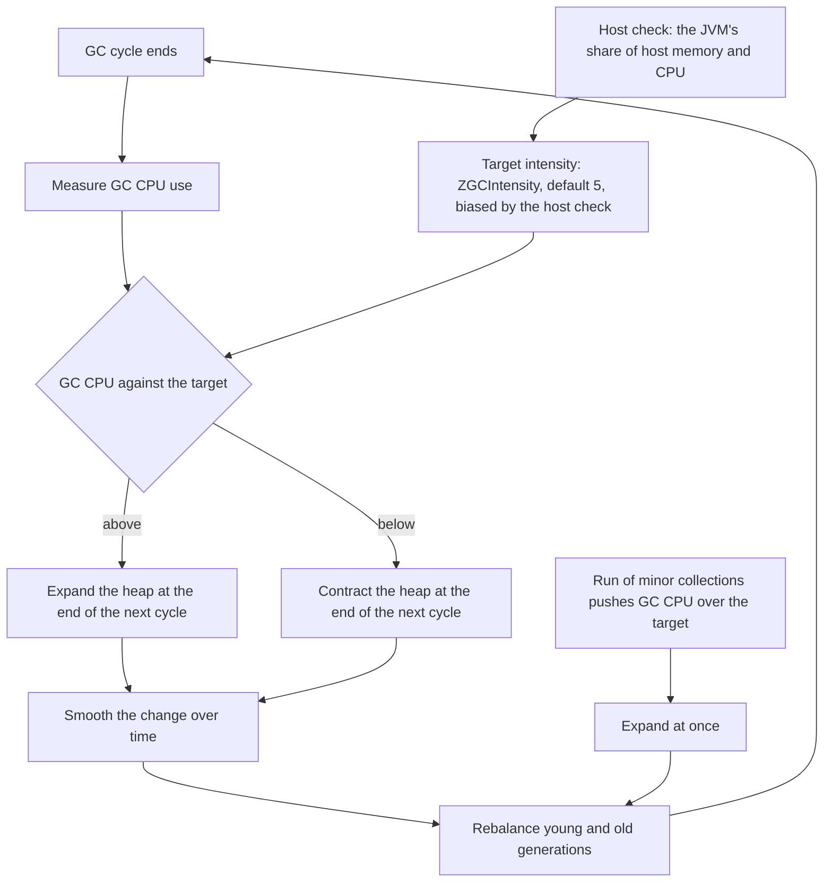

---
# Drafted from Lead jfcptahu (Inside Java), picked 2026-10-30, per
# docs/editorial/concept-writing-guide.md. published and reviewed are the pick time, provisional: set them
# when you publish. verified: is the Author's alone (ADR-0007).
title: "Adaptive heap sizing: how ZGC trades memory for GC CPU on its own"
description: "Adaptive heap sizing lets ZGC resize the heap toward a GC CPU target, so you stop guessing -Xmx and JVMs on one host share its memory."
kind: concept
vertical: languages-runtimes
tags: ["zgc", "garbage-collection", "jvm", "heap-sizing", "java"]
published: "2026-10-30T10:42:23Z"
verified: 2026-10-30
reviewed: "2026-10-30T10:42:23Z"
author: mira-vance
# Optional: an image HastCode may use, beside this file, replaces the
# generated title card. Never a Source's image.
# hero: concept-name.png
# hero_alt: "What the image shows"
# Optional: related Explainer slugs and extra sources (title + url).
# related: [http-connection-reuse]
---

The [case study in JEP 546](https://openjdk.org/jeps/546#Case-study-in-adaptive-heap-sizing) puts four JVMs, one after another, into a single container with 16GB of memory. A SPECjbb2015 instance ran alone for the first 12 minutes at 5,000 requests per second. Then an H2 in-memory database benchmark started beside it and grew its heap in a sudden burst, and the SPECjbb2015 JVM shrank its own heap at once to make room. When the database exited at the 24-minute mark, SPECjbb2015 grew back into the memory it freed. From minute 30, two more SPECjbb2015 instances joined, each at 5,000 requests per second, and [within two minutes the three had split the memory roughly evenly](https://openjdk.org/jeps/546#Case-study-in-adaptive-heap-sizing). The JEP tracks the container's physical memory, and each JVM's, across 42 minutes, and each heap kept changing as the neighbours did.

> Drafted with AI assistance, researched, verified and edited by the HastCode editorial team. We publish only as many pieces as the Author can verify this way.

## TL;DR

- **Adaptive heap sizing** lets the Z Garbage Collector (ZGC) [adjust the heap's size](https://openjdk.org/jeps/546#Summary) to the resources available, the application's needs and the applications competing with it. It is [JEP 546](https://openjdk.org/jeps/546), integrated in JDK 28 and opt-in with `-XX:+ZAdaptiveHeapSizing`.
- The mechanism is a feedback loop. ZGC compares its GC CPU use with a target intensity, [expands or contracts the heap at the end of the next cycle](https://openjdk.org/jeps/546#A-good-steward-of-CPU-and-memory), smooths the change, and rebalances the young and old generations.
- It replaces a guess most teams get wrong: the default maximum heap was [25% of physical memory](https://openjdk.org/jeps/546#Configuring-the-maximum-heap-size-is-difficult), 32GB on a 128GB host, and the experiments to pick a better `-Xmx` are rarely done.
- What to do: turn it on, stop setting `-Xmx`, and tune with one number, `ZGCIntensity` ([default 5](https://openjdk.org/jeps/546#Tuning-resource-usage)). The cost: the default ceiling becomes [100% of physical memory minus a small reserve](https://openjdk.org/jeps/546#Risks-and-Assumptions), and on a crowded host your JVM pays for its neighbours in GC CPU.

## Adaptive heap sizing makes the heap size an output

The **heap** is the memory the JVM hands out for Java objects. A garbage collector reclaims the ones no longer reachable, and JEP 546 opens on what that job is: ["The Java Virtual Machine presents the illusion of an infinite heap."](https://openjdk.org/jeps/546#Motivation) Until now you sized that illusion with a hard maximum, `-Xmx`, and optionally a soft one, `-XX:SoftMaxHeapSize`.

JEP 546, owned by Erik Österlund, turns that around. Its first goal is to ["adaptively adjust the size of the heap in response to changes in the workload and the host system"](https://openjdk.org/jeps/546#Goals); its second is to ["provide the same throughput and latency as a well-tuned, manually configured heap"](https://openjdk.org/jeps/546#Goals). The heap size stops being an input you guess and becomes an output ZGC computes.

What it computes from is **GC CPU**, the processor time the collector spends. ZGC is a tracing collector: it follows references to find live objects and copies them out of sparse regions, so its cost per cycle [scales with live data, not heap size](https://openjdk.org/jeps/546#Motivation). A bigger heap fills more slowly, so cycles come less often. The JEP's summary of the trade: ["GC CPU usage tends to vary inversely with heap size."](https://openjdk.org/jeps/546#Adaptive-heap-sizing) Memory and CPU are two currencies for the same work, and adaptive sizing chooses the exchange rate.

What does not count: merely handing idle memory back to the operating system. ZGC already does that; [JEP 377](https://openjdk.org/jeps/377) lists "Uncommitting unused memory" among its features. Adaptive sizing decides how big the heap should be.

## The loop: measure GC CPU, compare with the target, resize



Start at the top. ZGC compares its GC CPU use with a **target intensity**, an abstract measure of GC CPU set by `ZGCIntensity`, [a positive integer that defaults to 5](https://openjdk.org/jeps/546#Tuning-resource-usage).

If GC CPU is above the target, ZGC [expands the heap at the end of the next GC cycle](https://openjdk.org/jeps/546#A-good-steward-of-CPU-and-memory): fewer collections, less CPU, better throughput. If it is below, ZGC contracts the heap at the end of the next cycle, giving memory back and spending more CPU. Changes are ["smoothed out over time in order to avoid disruptive swings"](https://openjdk.org/jeps/546#A-good-steward-of-CPU-and-memory); the JEP credits a paper, [Heap Size Adjustment with CPU Control](https://www.semanticscholar.org/paper/Heap-Size-Adjustment-with-CPU-Control-Tavakolisomeh-Shimchenko/71ea127e53bcfb85de6bc47708d325297680b04c), for that design.

ZGC is generational: new objects go to the young generation, collected often by **minor collections**, and survivors are promoted to the old generation, collected less often by **major collections**. So besides the total, ZGC [rebalances the sizes of the young and old generations](https://openjdk.org/jeps/546#A-good-steward-of-CPU-and-memory) to hit the target. The side path is a fast reaction: if a run of minor collections pushes GC CPU over the target, ZGC expands the heap immediately rather than waiting for the next cycle's end.

The host check on the left biases the target itself. We come to it in the third practice.

## Four JVMs in 16GB, walked through the loop

The JEP's case study puts phases on the diagram, though not CPU figures; the mapping from phase to box below is our reading.

**Minutes 0 to 12.** One SPECjbb2015 JVM at 5,000 requests per second. ZGC ["finds a reasonable heap size that yields good performance"](https://openjdk.org/jeps/546#Case-study-in-adaptive-heap-sizing), and the heap grows slowly because GC CPU use is not excessive. In the diagram, small trips round the "above" branch.

**Minutes 12 to 24.** The H2 database JVM grows its heap in a burst, and the SPECjbb2015 JVM [contracts its heap immediately](https://openjdk.org/jeps/546#Case-study-in-adaptive-heap-sizing). It keeps serving 5,000 requests per second without saturating the CPU, but its GC CPU rises, which hurts latency and throughput. We infer this is the host check at work: the target was biased upward, and the loop took the "below" branch even as GC CPU climbed.

**Minute 24.** The database exits. ZGC [expands the heap quickly](https://openjdk.org/jeps/546#Case-study-in-adaptive-heap-sizing) to cut its CPU use, and latency and throughput improve: the "above" branch, now with room to grow.

**Minutes 30 to 32.** Two more SPECjbb2015 JVMs start at 5,000 requests per second each. Within two minutes the three share the memory roughly evenly, so each performs well.

## Why picking a heap size was so hard

The forces that made adaptive sizing worth building are the ones that made a sensible default feel safe.

**The default was a fraction.** HotSpot's maximum heap is [25% of physical memory](https://openjdk.org/jeps/546#Configuring-the-maximum-heap-size-is-difficult) by default: 32GB on a 128GB machine. A fine starting point, but no one value suits every application.

**Tuning it is an experiment nobody repeats.** The JEP describes measuring memory, throughput and latency at several `-Xmx` values against a representative workload. Such experiments are hard to get right, so they are rarely done, and their results must be [redone after every application or JVM update](https://openjdk.org/jeps/546#Configuring-the-maximum-heap-size-is-difficult) and do not carry across hardware.

**Both mistakes hurt.** ["If the maximum heap size is too small, ZGC will use more CPU time"](https://openjdk.org/jeps/546#Configuring-the-maximum-heap-size-is-difficult), and the application may run out of memory. Too large, and the operating system can run short, swap pages to disk or, at worst, [kill processes](https://openjdk.org/jeps/546#Configuring-the-JVM-to-be-a-good-neighbor-is-difficult).

**The soft limit moved the guess.** JDK 13 [introduced `-XX:SoftMaxHeapSize`](https://malloc.se/blog/zgc-softmaxheapsize), in Per Liden's words a "soft limit on how large the Java heap can grow", which ZGC exceeds only to avoid an allocation stall or an `OutOfMemoryError`. His example, repeated in the JEP, is `-Xmx5G -XX:SoftMaxHeapSize=2G` for an application that needs 2GB normally and 5GB in spikes. But choosing the soft maximum is [no easier](https://openjdk.org/jeps/546#Configuring-the-JVM-to-be-a-good-neighbor-is-difficult), with the same failure modes.

## Where the idea came from

Adaptive sizing reuses earlier ZGC parts, each described by the project itself.

**Soft maximum plus uncommit.** Liden's 2020 post shows the pattern the new policy automates: after a spike, ZGC shrinks the heap back toward the soft limit and uncommits idle memory to the operating system, after [`-XX:ZUncommitDelay`, 300 seconds by default](https://malloc.se/blog/zgc-softmaxheapsize). JEP 546 says adaptive sizing reacts to the host ["as though a soft maximum heap size had been set"](https://openjdk.org/jeps/546#Description).

**A CPU budget instead of a size.** In 2023 Marina Shimchenko, then a PhD student at Uppsala University, described research from Oracle, Uppsala and KTH on [automated heap sizing for ZGC](https://inside.java/2023/06/20/optimizing-memory-utilization-zgc/). The user sets a GC CPU target relative to the application's own CPU use; at the end of each cycle, ZGC adjusts the soft maximum to meet it. The team tested targets of 5%, 10%, 15% and 20%: higher targets used less memory but could use more energy, and execution time was generally unaffected. We infer this is the ancestor of `ZGCIntensity`, which JEP 546 deliberately does not tie to a percentage.

**Fast startup and warmup.** [JEP 545](https://openjdk.org/jeps/545), also in JDK 28, cuts ZGC's default initial heap from 1/64 of physical memory to 2MB and adds aggressive expansion during warmup; JEP 546 says ZGC expands the heap aggressively while the application [warms up](https://openjdk.org/jeps/546#A-good-steward-of-CPU-and-memory). Our [JVM warmup explainer](/languages-runtimes/jvm-warmup-and-aot-compilation/) covers that side, including JEP 545's run with `-XX:+ZAdaptiveHeapSizing`.

## Practice one: turn it on and stop setting -Xmx

The switch is two flags:

```text
java -XX:+UseZGC -XX:+ZAdaptiveHeapSizing ...
```

With the startup and warmup work of JEP 545, the JEP says this makes it ["neither necessary nor desirable"](https://openjdk.org/jeps/546#Description) to set `-Xmx` or `-XX:SoftMaxHeapSize`. That is the recommendation: let the loop pick the size, and keep the options for the cases that genuinely need a fence. They still work; keeping existing sizing and tuning options working is one of the JEP's [three goals](https://openjdk.org/jeps/546#Goals).

**What it costs.** The ceiling moves. With the policy on, the default maximum heap is 100% of physical memory minus a small reserve, instead of 25%. The JEP's own risk section says ["ZGC will use more memory than it did in past releases"](https://openjdk.org/jeps/546#Risks-and-Assumptions), possibly leaving other processes short. Its answer is that several JVMs at the old 25% default carried the same risk. We infer that a host running non-JVM processes beside one JVM is where the change in ceiling is most likely to show, so watch memory there before you drop an explicit `-Xmx`.

## Practice two: tune with one number, not a heap size

Most applications [need no tuning](https://openjdk.org/jeps/546#Tuning-resource-usage); the default intensity is meant to work well. When you do want a different balance, you set one integer:

- **Lower intensity** means fewer collections, less CPU and a larger heap.
- **Higher intensity** means more frequent collections, more CPU and a smaller heap.

The JEP's example, `-XX:ZGCIntensity=4`, uses slightly less CPU and slightly more memory than the default 5. We infer a memory-starved, CPU-rich deployment would turn it up; a latency-sensitive service with RAM to spare would turn it down.

The number is not a percentage, on purpose. ["The relationship between intensity and actual GC CPU usage is intentionally unspecified"](https://openjdk.org/jeps/546#Tuning-resource-usage), so the team can change the mapping in future releases and keep it meaningful across hardware.

**What it costs.** You lose a dial you can reason about in units. An `-Xmx` is gigabytes; an intensity of 6 means "a bit more CPU, a bit less memory", and its exact effect may differ between JDK releases. We infer you should treat a chosen intensity like any other tuning result: tied to the JDK you measured it on, and worth re-checking on upgrade.

## Practice three: let JVMs on one host share memory

The host check in the diagram is what makes the JVM a **good neighbour**. ZGC [monitors the fractions of the host's memory and CPU time](https://openjdk.org/jeps/546#A-good-neighbor) the JVM process uses, alongside its own behaviour:

- A JVM using **much memory but little CPU** contracts its heap, spending CPU it has to spare.
- A JVM using **little memory but much CPU** expands its heap, saving CPU at the cost of memory it can afford.

This rule comes first. ["ZGC prioritizes being a good neighbor over achieving its target intensity"](https://openjdk.org/jeps/546#A-good-neighbor), biasing the default or configured intensity up or down. The result, per the JEP, is that multiple ZGC JVMs on one host use memory and CPU in line with their own target intensities: the even three-way split in the case study.

**What it costs.** Your JVM pays for its neighbours. In the case study the SPECjbb2015 JVM gave up memory to the database, and its GC CPU rose enough to [hurt latency and throughput](https://openjdk.org/jeps/546#Case-study-in-adaptive-heap-sizing) until the database left. The JEP does not say how ZGC reads host memory inside a container with its own limit; we leave that for the Author's check list and your own test.

## What adaptive heap sizing is not

**It is not a memory residency target.** Some other runtimes balance memory against GC CPU by targeting [memory residency](https://openjdk.org/jeps/546#Alternatives), the ratio of live data to heap size. The JEP rejects that for ZGC: a fixed residency can give widely varying GC CPU, and live data is hard to measure in a generational collector. GC CPU is measured directly, and it is what users watch.

**It is not a soft maximum you forgot to set.** `SoftMaxHeapSize` is one fixed number. Adaptive sizing moves the effective limit every cycle and reacts to the host.

**It is not a cure for a large live set.** GC CPU per cycle tracks live data, so we infer a heap cannot usefully contract below what the application keeps alive; a leak still ends in an `OutOfMemoryError`.

**It is not a defence against every GC spiral.** Marc Brooker [traces a loop](https://brooker.co.za/blog/2024/08/14/gc-metastable.html) where memory pressure slows collection, more requests pile up and pressure rises further; we cover that in [metastable failures](/distributed-systems/metastable-failures/). We infer that expanding the heap when GC CPU climbs pushes against that loop, but JEP 546 makes no such claim, and the good-neighbour rule can contract a heap while GC CPU rises.

## What this makes possible

The question you ask changes. Instead of "how big should this heap be?", which had no stable answer across releases, hardware and traffic, you ask "how much CPU will I spend on collection?", and ZGC holds that line as the workload moves.

You can try it on JDK 28: take a service you have tuned by hand, run it with `-XX:+UseZGC -XX:+ZAdaptiveHeapSizing` and no `-Xmx`, and compare memory, throughput and tail latency. The JEP's bar is that it should [match a well-tuned, manually configured heap](https://openjdk.org/jeps/546#Goals). Then try `ZGCIntensity` one step either side of 5 and watch the trade move.

The bigger prize is the shared host. Today, packing several JVMs onto one machine means splitting its memory by hand and hoping the splits stay right. The JEP's case study shows three JVMs [dividing memory evenly within two minutes](https://openjdk.org/jeps/546#Case-study-in-adaptive-heap-sizing) and the first giving memory back when a hungry neighbour arrived. A JVM that takes what it needs, returns what it doesn't, and negotiates with the processes beside it is a JVM you can pack more densely.

## Sources

- Inside Java, ["JEP targeted to JDK 28: 546: Adaptive Heap Sizing for ZGC"](https://inside.java/2026/10/19/jep546-target-jdk28/), Oracle, 19 October 2026.
- Erik Österlund, ["JEP 546: Adaptive Heap Sizing for ZGC"](https://openjdk.org/jeps/546), OpenJDK, JDK 28.
- Erik Österlund, ["JEP 545: Faster Startup and Warmup with ZGC"](https://openjdk.org/jeps/545), OpenJDK, JDK 28.
- ["JEP 377: ZGC: A Scalable Low-Latency Garbage Collector (Production)"](https://openjdk.org/jeps/377), OpenJDK, JDK 15.
- Per Liden, ["ZGC | Using -XX:SoftMaxHeapSize"](https://malloc.se/blog/zgc-softmaxheapsize), malloc.se, 2 July 2020.
- Marina Shimchenko, ["Optimizing Memory Utilization with Automated Heap Sizing in ZGC"](https://inside.java/2023/06/20/optimizing-memory-utilization-zgc/), Inside Java, 20 June 2023.
- Tavakolisomeh et al., ["Heap Size Adjustment with CPU Control"](https://www.semanticscholar.org/paper/Heap-Size-Adjustment-with-CPU-Control-Tavakolisomeh-Shimchenko/71ea127e53bcfb85de6bc47708d325297680b04c), as cited by JEP 546.
- Marc Brooker, ["Garbage Collection and Metastability"](https://brooker.co.za/blog/2024/08/14/gc-metastable.html), brooker.co.za, August 2024.
