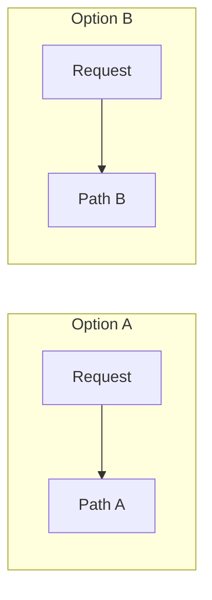

---
# Comparison template, drawn from http-connection-reuse. `make lead` writes
# it as a skeleton at content/explainers/<vertical>/<slug>.md; to start by
# hand, copy it there. Follow docs/editorial/comparison-writing-guide.md.
# Replace every TODO(author) line: a production build fails while one is
# left. `verified:` is added by the Author alone, after checking every
# claim against its Source (ADR-0007); an agent never writes it.
title: "TODO(author): {option A} vs {option B}: what the choice turns on, in the words a Reader searches"
description: "TODO(author): one sentence, 150 characters at most: the options, the question they answer differently, and who should pick which."
kind: comparison
vertical: "TODO(author): the one Vertical slug it fits, e.g. apis-networking"
tags: ["TODO(author): two to five lower-case tags"]
published: "TODO(author): RFC 3339 with offset, e.g. 2026-10-23T09:00:00Z"
reviewed: "TODO(author): the same as published"
author: mira-vance
# Optional: an image HastCode may use, beside this file, replaces the
# generated title card. Never a Source's image.
# hero: option-a-vs-option-b.png
# hero_alt: "What the image shows"
# Optional: related Explainer slugs and extra sources (title + url).
# related: [metastable-failures]
draft: true
---

TODO(author): the hook, a few sentences: one sourced fact (a measurement, a release, a design change) that makes the choice between {option A} and {option B} matter, linked to the Lead. End on the question this piece answers for every option.

> Drafted with AI assistance, researched, verified and edited by the HastCode editorial team. We publish only as many pieces as the Author can verify this way.

## TL;DR

- TODO(author): {option A} in one plain sentence: how it does the thing being compared.
- TODO(author): {option B} in one plain sentence, the same way.
- TODO(author): the dimension where they differ most.
- TODO(author): which to pick when, labelled "we infer" unless a Source says it.

## TODO(author): the options side by side, named for what the diagram shows

TODO(author): what the options have in common, then one paragraph walking the diagram: the same request or workload through each option.

## TODO(author): {option A}: how it works

TODO(author): how {option A} works, from its specification or documentation, linked claim by claim.

## TODO(author): {option B}: how it works

TODO(author): how {option B} works, the same way. Add one H2 per option.

## TODO(author): the first dimension, answered for every option

TODO(author): one question (a failure mode, a limit, a cost) answered for each option in turn, in the same order every time. Add one H2 per dimension; each becomes a row of the table.

## Trade-offs

Each cell summarises a section above, where its source is linked.

| Question | {option A} | {option B} |
|---|---|---|
| TODO(author): the first dimension | TODO(author): short answer | TODO(author): short answer |
| TODO(author): the next dimension | TODO(author): short answer | TODO(author): short answer |

## TODO(author): when each one wins

TODO(author): one paragraph per option: the situation where it is the right choice and what to watch. Say plainly that this section is our inference unless a Source states it.

## Sources

- TODO(author): the Lead first, as [{title}](https://example.com/the-lead), its authors, publisher and date; then every specification, document and page cited, one per line.
