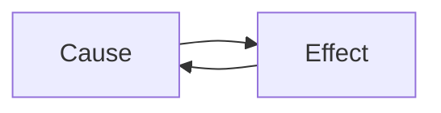

---
# Concept template, drawn from metastable-failures. `make lead` writes it
# as a skeleton at content/explainers/<vertical>/<slug>.md; to start by
# hand, copy it there. Follow docs/editorial/concept-writing-guide.md.
# Replace every TODO(author) line: a production build fails while one is
# left. `verified:` is added by the Author alone, after checking every
# claim against its Source (ADR-0007); an agent never writes it.
title: "TODO(author): {concept}: the one-line answer, in the words a Reader searches"
description: "TODO(author): one sentence, 150 characters at most: what {concept} is and why it matters."
kind: concept
vertical: "TODO(author): the one Vertical slug it fits, e.g. distributed-systems"
tags: ["TODO(author): two to five lower-case tags"]
published: "TODO(author): RFC 3339 with offset, e.g. 2026-10-23T09:00:00Z"
reviewed: "TODO(author): the same as published"
author: mira-vance
# Optional: an image HastCode may use, beside this file, replaces the
# generated title card. Never a Source's image.
# hero: concept-name.png
# hero_alt: "What the image shows"
# Optional: related Explainer slugs and extra sources (title + url).
# related: [http-connection-reuse]
draft: true
---

TODO(author): the hook, a few sentences: one real, sourced moment where {concept} happened to a named system (an outage, a number, a design choice), told concretely and linked. No definition yet.

> Drafted with AI assistance, researched, verified and edited by the HastCode editorial team. We publish only as many pieces as the Author can verify this way.

## TL;DR

- TODO(author): what {concept} is, in one plain sentence, linked to the source that defines it.
- TODO(author): the mechanism that makes it happen or makes it work.
- TODO(author): how common or important it is, with a sourced number.
- TODO(author): what to do about it, and the cost of doing it.

## TODO(author): what {concept} is

TODO(author): the definition from the people who named it, quoted short and credited, then in our words. Define every term at first use, and say what does not count.

## TODO(author): how {concept} works, named for what the diagram shows

TODO(author): walk the diagram in order, with one worked example from a Source that puts numbers on each step.

## TODO(author): where {concept} shows up in real systems

TODO(author): two or three named systems or variants, each linked to its first-party account.

## TODO(author): why systems end up with {concept}

TODO(author): the forces that lead there, often features that help on a normal day, linked.

## TODO(author): the first practice that applies or defends against {concept}

TODO(author): how it works, who recommends it (linked), and what it costs. Add one H2 per practice.

## TODO(author): what {concept} is not

TODO(author): the nearest idea a Reader confuses it with, and the boundary between them. Say "we infer" for any link the Sources do not make.

## TODO(author): what understanding {concept} makes possible

TODO(author): what the Reader can now do or measure, and where to try it, closing on what could go right.

## Sources

- TODO(author): the Lead first, as [{title}](https://example.com/the-lead), its authors, publisher and date; then every other page cited, one per line.
