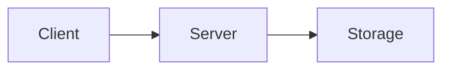

---
# Repo Profile template. Copy it to content/explainers/<vertical>/<slug>.md,
# fetch the Fact Pack beside it (make fetch REPO=owner/name MD=<that file>)
# and follow docs/editorial/repo-profile-writing-guide.md. Replace every
# TODO(author) line: a production build fails while one is left.
title: "TODO(author): {repo}: what it is, in the words a Reader searches"
description: "TODO(author): one sentence, 150 characters at most: what it is and the trade-off that matters."
kind: repo-profile
vertical: "TODO(author): the one Vertical slug it fits, e.g. distributed-systems"
repo: "TODO(author): owner/name, exactly as on GitHub"
who_for: "TODO(author): who should adopt it, in one line"
tags: ["TODO(author): two to four lower-case tags"]
published: "TODO(author): RFC 3339 with offset, e.g. 2026-10-23T09:00:00Z"
reviewed: "TODO(author): the same as published"
author: mira-vance
# Optional: a sourced hero beside this file replaces the generated card.
# hero: owner-name.png
# hero_alt: "What the image shows"
# Optional: related Explainer slugs and extra sources (title + url).
# related: [raft-leader-election]
draft: true
---

TODO(author): the hook, one sentence: a sourced fact about the repository (a number, a design choice, a release) that makes a backend engineer look twice.

> Drafted with AI assistance, researched, verified and edited by the HastCode editorial team. We publish only as many pieces as the Author can verify this way.

## TL;DR

- TODO(author): what {repo} is, in one plain sentence.
- TODO(author): the design choice that sets it apart, as the README or the code shows it.
- TODO(author): the answer: who should adopt it today, and who should wait.

## In 60 seconds

TODO(author): one sentence on what the commands do, linking the README section they come from.

```sh
TODO(author): the README's install or quickstart commands, copied verbatim
```

## Architecture

TODO(author): how {repo} is built, walking the diagram in order: the components, how data moves, where state lives. Link the code or the docs for each claim.



## Use it if

- TODO(author): a situation where it is the right choice, grounded in a fact from the Fact Pack, the README or a release page.
- TODO(author): a second situation, grounded the same way.

## Don't use it if

- TODO(author): a situation where it is the wrong choice, and what to use instead.
- TODO(author): a second situation, grounded the same way.

## Alternatives

- TODO(author): the first alternative and how it differs, in one line.
- TODO(author): the second alternative and how it differs, in one line.
- TODO(author): the third alternative and how it differs, in one line.

## FAQ

### TODO(author): Is {repo} production ready?

TODO(author): a self-contained answer in one to three sentences that names {repo} and stands on its own.

### TODO(author): Does {repo} support {feature}?

TODO(author): a self-contained answer in one to three sentences that names {repo} and stands on its own.

### TODO(author): How does {repo} compare to {alternative}?

TODO(author): a self-contained answer in one to three sentences that names {repo} and stands on its own.

### TODO(author): How is {repo} licensed?

TODO(author): a self-contained answer in one to three sentences that names {repo} and stands on its own.

### TODO(author): Who maintains {repo}?

TODO(author): a self-contained answer in one to three sentences that names {repo} and stands on its own.

## Verdict

TODO(author): one paragraph: the recommendation, who it is for, and what would change it.

## Sources

- TODO(author): the README and every release page or doc you cited, e.g. [{repo} README](https://github.com/{repo}#readme)
